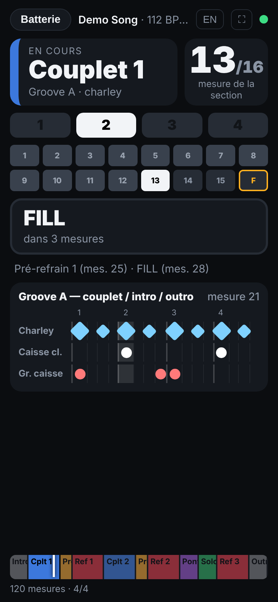
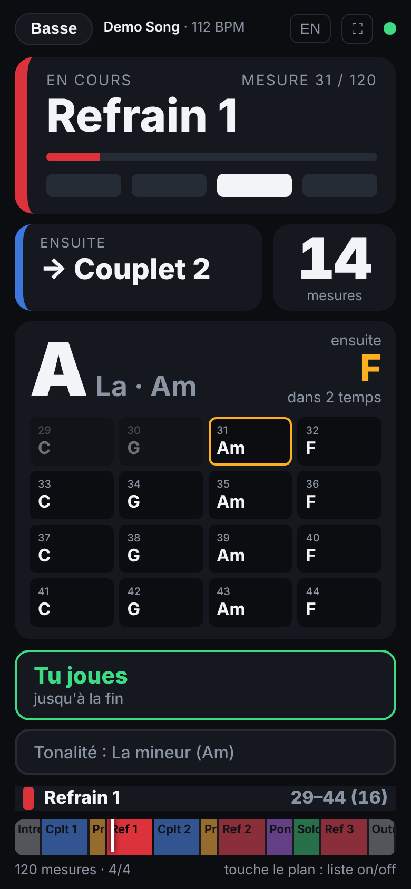
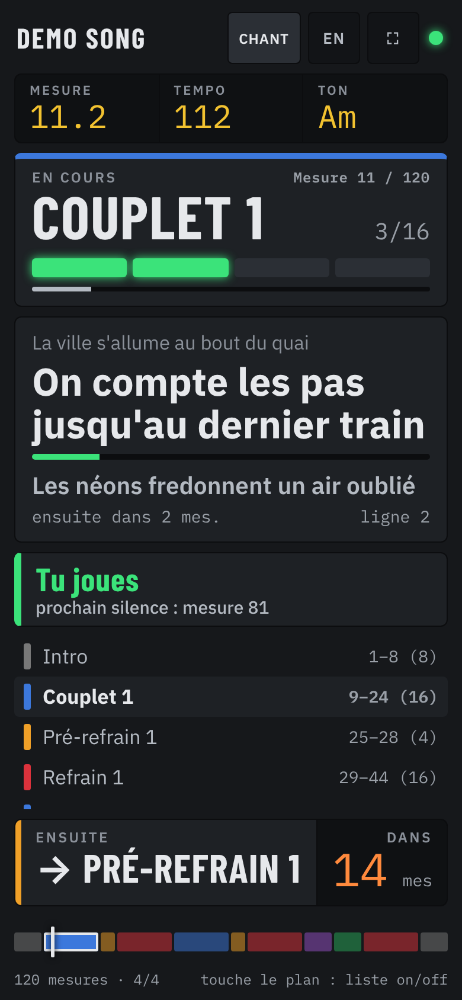
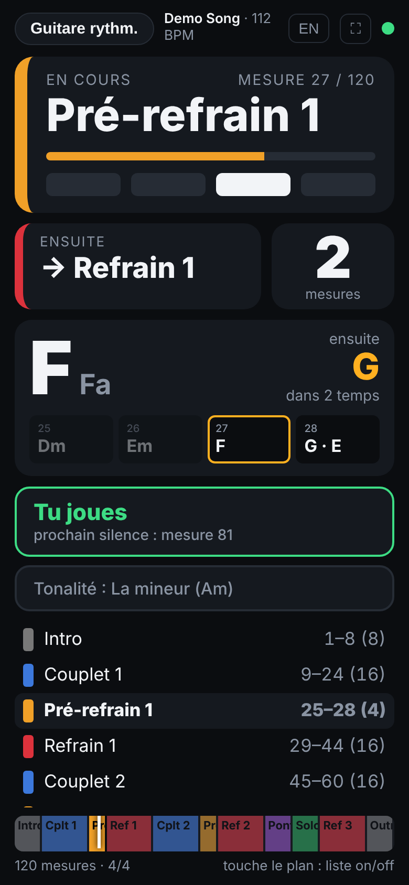
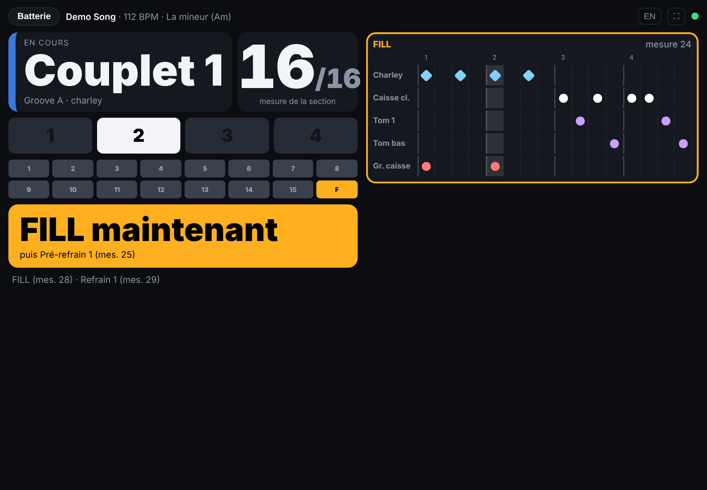
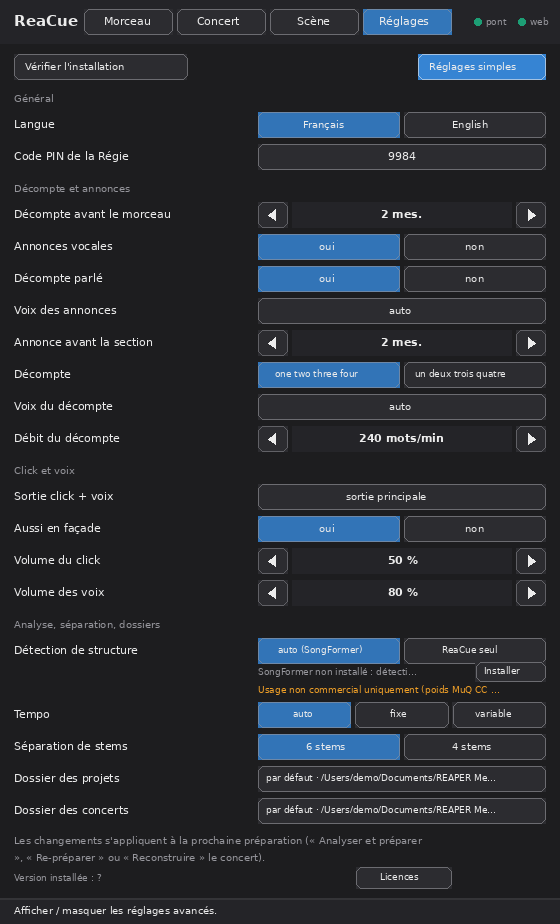

# ReaCue

**Des morceaux prêts pour le live dans REAPER, en un clic — et un prompteur sur le téléphone de chaque musicien.**

*[English version: README.md](README.md)*

ReaCue s'adresse aux groupes qui jouent en live avec REAPER. À partir des stems d'un morceau (ou d'un seul
MP3, qu'il sait séparer lui-même en stems, en local), il détecte le tempo, la grille des mesures et la structure, puis construit tout dans le projet REAPER :
carte de tempo, régions nommées et colorées, click avec count-in, annonces vocales (« Refrain »…) et décompte
« one two three four » avant chaque section. Il publie aussi un **prompteur web** que chaque musicien ouvre
sur son téléphone, servi par l'interface web intégrée de REAPER : structure, accords (basse / guitares),
paroles calées (chant) et une vue batteur dédiée avec les grooves et les fills transcrits.

Tout tourne en local : aucun service en ligne et pas d'internet une fois installé (la séparation de stems et
l'analyse de structure, facultatives, utilisent des modèles d'IA qui tournent eux aussi sur ton ordinateur).
Un mode facultatif permet de piloter ReaCue en langage naturel avec Claude (serveur MCP).

> **Nouveau sur ReaCue ? Suis le tutoriel pas à pas : [docs/TUTORIEL_fr.md](docs/TUTORIEL_fr.md)**
> (anglais : [docs/TUTORIAL_en.md](docs/TUTORIAL_en.md)).

> **Licences et avertissements :** voir [Licences, responsabilités et avertissements](#licences-responsabilités-et-avertissements)
> et [THIRD_PARTY_NOTICES.md](THIRD_PARTY_NOTICES.md) — l'analyse de structure facultative est réservée à un
> **usage non commercial**.

> **État : 1.0.0.** Développé et utilisé sur macOS (Intel). La prise en charge de Windows et des Mac Apple Silicon
> **n'a pas encore été testée sur une vraie machine** — vos retours sont les bienvenus.

| Batterie | Basse | Chant | Guitare |
|---|---|---|---|
|  |  |  |  |



*(Captures d'un morceau fictif « Demo Song » : structure, accords, paroles et batterie sont inventés.)*

## Sommaire

- [Fonctionnalités](#fonctionnalités)
- [Principe](#principe)
- [Prérequis](#prérequis)
- [Installation](#installation)
- [Activer l'interface web de REAPER (prompteur)](#activer-linterface-web-de-reaper-prompteur)
- [Séparation de stems (facultatif)](#séparation-de-stems-facultatif)
- [Analyse de structure (SongFormer, par défaut)](#analyse-de-structure-songformer-par-défaut)
- [La fenêtre ReaCue](#la-fenêtre-reacue)
- [Utilisation](#utilisation)
- [Mode concert](#mode-concert)
- [Paroles](#paroles)
- [Réglages](#réglages)
- [Facultatif : piloter ReaCue avec Claude (MCP)](#facultatif--piloter-reacue-avec-claude-mcp)
- [Limites connues](#limites-connues)
- [Dépannage / FAQ](#dépannage--faq)
- [Désinstallation](#désinstallation)
- [Pour les développeurs](#pour-les-développeurs)
- [Licences, responsabilités et avertissements](#licences-responsabilités-et-avertissements)
- [Crédits et licence](#crédits-et-licence)

## Fonctionnalités

Dans REAPER, à partir de l'audio déjà présent dans le projet — le tout depuis **une seule fenêtre, « ReaCue »**,
en quatre onglets (Morceau, Concert, Scène, Réglages) :

- **Carte de tempo** calée sur le morceau : tempo fixe quand l'enregistrement est quantisé, ou un marqueur
  de tempo par mesure quand il a été joué sans click (le click suit alors le groupe). L'audio est déplacé
  pour que la mesure 1 tombe pile sur une barre de mesure.
- **Une région par section**, nommée et colorée (Intro, Couplet 1, Pré-refrain, Refrain, Pont, Solo,
  Break, Outro, Main Riff…), en français ou en anglais.
- **Piste CLICK** (source click native de REAPER) avec **count-in** de 2 mesures, envoyable sur une sortie
  physique dédiée pour les in-ears.
- **Piste VOIX** : annonce vocale (« Refrain ») sur l'avant-dernière mesure de chaque section et « one two
  three four » sur la dernière, routée comme le click. Utilise les voix du système (macOS `say`, Windows SAPI).
- **Piste CUES** et marqueurs « → Refrain », lisibles d'un coup d'œil.
- **Séparation de stems** (facultatif) : transforme un seul MP3/WAV en 6 stems (voix, batterie, basse,
  guitare, piano, autres) avec [Demucs](https://github.com/facebookresearch/demucs), sur ton ordinateur, sans
  abonnement ni envoi en ligne — puis ReaCue prépare le morceau à partir des stems.
- **Mode concert** : plusieurs morceaux préparés enchaînés dans un seul projet, arrêt automatique à la fin
  de chaque morceau, un onglet **Scène** pour piloter le concert, un **QR code** pour les
  musiciens et une télécommande **Régie** sur téléphone (code PIN) ; un bouton **Vérifier** (contrôle
  avant concert, avec corrections en un clic) et un mode **Répétition** : boucler une section ou une plage
  avec une mesure de décompte avant chaque reprise, vitesse 100 à 70 %.
- **Instruments** : couper / mettre en solo chaque stem du concert (Chant, Batterie, Basse…), *Tout
  entendre*, et un profil **« Joué en live »** enregistré avec le concert (le groupe joue batterie et basse
  pour de vrai → ces stems sont coupés sur tous les morceaux, avec des exceptions par morceau). Depuis la
  fenêtre, le téléphone Régie ou Claude.

Sur les téléphones et tablettes des musiciens (prompteur web) :

- section en cours, mesure et temps, mesures restantes, section suivante, décompte sur la dernière mesure ;
- **Basse / guitares** : accord en cours et suivant avec décompte, grille de la section, tonalité ;
- **Chant** : paroles défilantes calées sur le morceau, ligne suivante et décompte avant chaque entrée ;
- **Batterie** : groove de la section, grille 16 pas de la mesure en cours, fills, crashs, arrêts et reprises ;
- entrées et silences de chaque instrument détectés sur les stems (« STOP à la prochaine mesure »,
  « Entrée dans 2 mesures ») ;
- français / anglais ; suit le curseur de lecture de REAPER (sur scène, seul REAPER doit tourner) ;
- en mode concert : morceau x/N et morceau suivant ; rôle **Régie** pour piloter le concert depuis un téléphone.

## Principe

```
 Action REAPER « ReaCue - Préparer le morceau »          Claude (facultatif, MCP)
                 │                                         │
                 ▼                                         ▼
        Programme ReaCue (Python) : analyse audio, tempo, sections, accords, paroles, batterie
                 │  dépose des données (jamais de code) dans <ressources REAPER>/ReaCueMCP/
                 ▼
        ReaCue_Bridge.lua (tourne en fond dans REAPER) ──> API REAPER
                 │
                 └──> reaper_www_root/prompteur.html + reacue_song.json ──> téléphones (Wi-Fi)
```

## Prérequis

- **REAPER 7** ou plus récent (la 6.x marche probablement, non testée).
- **macOS 12+** (Intel ou Apple Silicon) ou **Windows 10/11** (bêta).
- Environ 1,5 Go d'espace disque (environnement Python et bibliothèques), plus 1,5 Go environ pour la
  séparation de stems facultative.
- **Internet seulement pendant l'installation** (téléchargement de Python et des bibliothèques). Rien n'est
  envoyé ensuite ; aucune parole n'est jamais téléchargée.
- Pour le prompteur : téléphones et ordinateur sur le même réseau Wi-Fi.

## Installation

1. Télécharge le projet (bouton vert **Code** → *Download ZIP*) et dézippe-le **là où il restera**, par
   exemple `Documents/ReaCue`. Ne déplace plus le dossier ensuite (ou relance l'installation si tu le fais).
2. Lance REAPER une fois (pour que son dossier de réglages existe), puis **quitte REAPER** : l'installateur
   peut alors enregistrer les actions tout seul.
3. Lance l'installateur :
   - **macOS** : double-clic sur **`Install ReaCue.command`**. Si macOS refuse de l'ouvrir (« développeur
     non identifié »), clic droit → *Ouvrir* → *Ouvrir*. Autre possibilité dans le Terminal :
     `bash "Install ReaCue.command"`.
   - **Windows** : double-clic sur **`Install ReaCue.bat`**. Si SmartScreen affiche un avertissement :
     *Informations complémentaires* → *Exécuter quand même*.
4. Réponds aux questions : langue (`fr` / `en`), déclaration de ReaCue dans Claude Desktop (facultatif,
   réponds *non* si tu n'utilises pas Claude) et installation de la **séparation de stems** (facultatif,
   environ 1 Go à télécharger, 5 à 15 minutes ; voir [Séparation de stems](#séparation-de-stems-facultatif)).
   Dernière question : l'**analyse de structure SongFormer**, proposée par défaut (*Entrée* = oui) ; il faut
   ensuite taper **`J'accepte`** pour accepter les licences des modèles (usage non commercial). Les modèles
   déjà présents sur l'ordinateur sont réutilisés ([détails](#analyse-de-structure-songformer-par-défaut)).
5. Lance REAPER. Le pont démarre tout seul et les actions sont disponibles dans *Actions → Show action list*
   (au premier lancement, la fenêtre ReaCue ouvre un assistant qui vérifie l'installation) :
   - **ReaCue** — la fenêtre principale (onglets Morceau, Concert, Scène, Réglages) : **ajoute celle-ci à
     une barre d'outils** (clic droit sur une barre → *Customize toolbar* → *Add*), elle suffit au quotidien ;
   - **ReaCue - Concert** — la même fenêtre, ouverte sur l'onglet Scène ;
   - **ReaCue - Préparer le morceau**, **ReaCue - Republier le prompteur**, **ReaCue - Séparer les stems**
     (aussi en boutons dans l'onglet Morceau), **ReaCue - Morceau suivant** / **Morceau précédent** (pour une
     pédale ou un raccourci).

L'installateur peut être relancé à tout moment (changer de langue, réparer une installation) : tes réglages
et tes morceaux préparés sont conservés.

Ce qu'il fait : installe [uv](https://docs.astral.sh/uv/) (gestionnaire Python d'Astral) si besoin, crée un
environnement Python 3.12 privé dans le dossier `.venv` (paquets précompilés uniquement, aucun compilateur
nécessaire), copie les scripts REAPER dans `<ressources REAPER>/Scripts/ReaCue/`, ajoute le pont à
`Scripts/__startup.lua`, enregistre les actions dans `reaper-kb.ini` (seulement si REAPER est fermé) et
écrit `<ressources REAPER>/ReaCueMCP/reacue_settings.json`. Rien d'autre n'est modifié sur le système.

Si REAPER était ouvert pendant l'installation, charge les actions une fois à la main : *Actions → Show action
list → New action → Load ReaScript…* → choisis `ReaCue.lua` (et, si tu les veux en actions séparées,
`ReaCue_Preparer.lua`, `ReaCue_Republier_prompteur.lua`, `ReaCue_Separer_stems.lua`) dans `<ressources REAPER>/Scripts/ReaCue/`. (*Options → Show REAPER resource path* ouvre ce dossier.)

## Activer l'interface web de REAPER (prompteur)

À faire une fois, à la main (REAPER n'offre pas de moyen sûr de le faire par script) :

1. REAPER → *Options → Preferences* (macOS : *REAPER → Settings*) → **Control/OSC/web** → **Add**.
2. Control surface mode : **Web browser interface**. Port : **8080** (ou un autre port libre). Le reste ne change pas.
3. OK, OK.

Sur chaque téléphone ou tablette, ouvre : **`http://<IP de l'ordinateur>:8080/prompteur.html`**, puis
choisis ton rôle.

Trouver l'adresse IP de l'ordinateur :

- **macOS** : *Réglages Système → Wi-Fi → Détails…* à côté du réseau → *Adresse IP* (ex. `10.0.1.23`).
- **Windows** : *Paramètres → Réseau et Internet → Wi-Fi → propriétés du réseau → Adresse IPv4*, ou
  `ipconfig` dans une invite de commandes.
- L'installateur affiche aussi l'adresse probable à la fin.

Conseils :

- **Réserve l'adresse IP** de l'ordinateur dans la box ou le routeur (réservation DHCP, parfois appelée
  « bail statique ») : l'adresse ne change plus et les favoris des téléphones restent valables. En concert,
  un petit routeur de voyage dédié est idéal.
- Ajoute la page à l'écran d'accueil (iOS : *Partager → Sur l'écran d'accueil* ; Android : *⋮ → Ajouter à
  l'écran d'accueil*) pour un affichage plein écran comme une application. Le bouton ⛶ passe aussi en plein écran.
- Le bouton **FR/EN** change la langue du prompteur sur ce téléphone (mémorisé).
- Le point vert indique que la liaison avec REAPER est active.

## Séparation de stems (facultatif)

ReaCue donne ses meilleurs résultats avec des stems (un fichier par instrument). Si tu n'as que le MP3 d'un
morceau, ReaCue peut le séparer pour toi avec [Demucs](https://github.com/facebookresearch/demucs)
(recherche Meta AI, licence MIT), entièrement sur ton ordinateur : rien n'est envoyé en ligne, aucun abonnement.

**Installation** (une fois) : réponds *oui* à la question de l'installateur sur la séparation de stems, ou
plus tard double-clic sur **`Install ReaCue Stems.command`** (macOS) / **`Install ReaCue Stems.bat`**
(Windows). Cela crée un environnement Python séparé `.venv-demucs` dans le dossier de ReaCue (PyTorch +
Demucs, environ 1 Go), télécharge les deux modèles et mesure la vitesse de ton ordinateur. L'environnement
de ReaCue lui-même n'est pas touché.

**Utilisation** :

1. Glisse le MP3 (ou le WAV) dans un projet REAPER vide et clique dessus pour le sélectionner.
2. Lance **ReaCue - Séparer les stems**. Une fenêtre montre l'avancement (tu peux la fermer).
3. À la fin, six pistes apparaissent (Chant, Batterie, Basse, Guitare, Piano, Autres), calées exactement
   comme l'item d'origine, qui est retiré du projet (un seul *Annuler* le remet ; le fichier reste sur le disque).
4. Lance **ReaCue - Préparer le morceau** comme d'habitude.

Détails :

- Durée : environ **5 à 8 minutes pour un morceau de 4 minutes** sur un Mac Intel récent (4 cœurs), plus
  rapide sur Apple Silicon. C'est le processeur qui travaille (aucune carte graphique nécessaire).
- Les stems sont écrits à côté du fichier d'origine, dans `<nom du morceau>-stems/htdemucs_6s/`, et gardent
  le nom du fichier d'origine (tonalité et tempo dans le nom restent lus par ReaCue). Relancer l'action sur le
  même fichier les importe immédiatement, sans refaire la séparation.
- `stems_model` dans les réglages : `"htdemucs_6s"` (6 stems, par défaut) ou `"htdemucs"` (4 stems : voix,
  batterie, basse, autres — guitare et claviers restent ensemble dans « autres »).
- Qualité : voix, batterie et basse sont très bonnes ; guitare et surtout piano sont moins propres qu'avec
  les services commerciaux (un peu de repisse). Guitare lead et rythmique ne sont pas séparées : la détection
  des solos, qui s'appuie sur un stem de guitare lead, n'est donc pas disponible.
- Mac Intel : PyTorch n'est plus publié pour les Mac Intel après la version 2.2.2 ; l'installateur choisit
  automatiquement les bonnes versions.

## Analyse de structure (SongFormer, par défaut)

ReaCue trouve tout seul les sections d'un morceau (couplet, refrain, pont…). Pour des frontières et des
noms plus justes, il peut utiliser [SongFormer](https://github.com/ASLP-lab/SongFormer), un modèle d'IA
d'analyse de structure musicale, entièrement sur ton ordinateur (rien n'est envoyé en ligne). **ReaCue
garde sa grille** (tempo, mesures, count-in) : SongFormer dit seulement où sont les sections et ce qu'elles
sont ; chaque frontière est ensuite calée sur la mesure la plus proche de la grille de ReaCue.

**Installation** (une fois) : l'installateur la propose **par défaut** (étape 6/6, *Entrée* = oui) ;
ou plus tard double-clic sur **`Install ReaCue Structure.command`** (macOS) / **`Install ReaCue
Structure.bat`** (Windows). Avant tout téléchargement, l'installateur affiche les licences des modèles et
n'installe que si tu tapes exactement **`J'accepte`** (`I accept` en anglais) ; sinon rien n'est installé.
Pour une installation sans question : `REACUE_STRUCTURE_ACCEPT=yes`. L'accord est mémorisé dans
`structure/.licenses_accepted` (pas redemandé aux mises à jour). Cela crée un environnement Python séparé `.venv-structure` dans le dossier de
ReaCue, télécharge SongFormer et ses deux dépendances (MuQ, MusicFM) à des versions figées dans
`structure/`, télécharge les modèles une fois pour toutes (dans `structure/hf` et le dossier de
SongFormer), fait un court essai et affiche `STRUCTURE_OK` avec la vitesse de ton ordinateur. Environ
**3 Go** à télécharger, 10 à 40 minutes. L'environnement de ReaCue lui-même n'est pas touché.

**Modèles déjà téléchargés** : avant de télécharger, l'installateur cherche les modèles déjà présents sur
l'ordinateur — une autre copie de SongFormer (par exemple `~/Documents/ReaCue-labo/SongFormer/src/SongFormer/ckpts`,
fichiers vérifiés avec le `md5sum.txt` de SongFormer) et le cache Hugging Face par défaut
(`~/.cache/huggingface/hub` sur macOS / Linux, `%USERPROFILE%\.cache\huggingface\hub` sur Windows :
MuQ et wav2vec2-conformer). Ils sont **copiés** (ou liés, sans place en plus sur le même disque) vers
`structure/` ; les originaux ne sont jamais modifiés ni supprimés. Seul ce qui manque est téléchargé.
Autres dossiers à fouiller : `REACUE_REUSE_DIRS` (séparés par `:` ou `;`).

**Utilisation** : rien à faire. *Analyser et préparer*, *Tout faire* et *Réanalyser depuis zéro* (fenêtre,
actions, Claude) utilisent SongFormer automatiquement dès qu'il est installé ; l'onglet affiche **« Analyse de structure (SongFormer)… N s »** pendant
ce temps et le résultat indique « Sections détectées par SongFormer ». Le résultat est mémorisé par morceau
(`.reacue/<morceau>_structure.json` à côté de l'audio) : préparer à nouveau le morceau est immédiat, tant
que le fichier audio ne change pas.

Comment les sections sont construites :

| Étape | Règle |
|---|---|
| Entrée | le mix, ou la somme des stems (calés comme pour l'analyse) |
| Frontières | calées sur la mesure la plus proche ; une carrure de 4 mesures depuis la frontière précédente l'emporte si elle est à ≤ 1 mesure |
| Petits morceaux | segments de moins de 2 mesures fusionnés avec un voisin ; deux parties consécutives de même type fusionnées si l'une fait moins de 8 mesures et le tout ≤ 16 (8 + 8 = deux couplets) |
| Silence | ignoré au début et à la fin |
| Noms | Intro, Couplet N, Pré-refrain N, Refrain N, Pont, Instrumental, Outro (français ou anglais ; couplets, pré-refrains et refrains numérotés) ; une partie *instrumentale* devient **Solo** quand la guitare (stem lead s'il existe) est nettement plus forte que d'habitude et la voix faible ; même type = même lettre |
| Priorité | les régions modifiées à la main dans REAPER, et `set_sections` de Claude, passent toujours avant toute analyse |
| À vérifier | dans la fenêtre, une section est en **orange** si sa longueur n'est pas 4, 8 ou 16 mesures, ou si SongFormer avait placé sa frontière à ¾ de mesure ou plus de la mesure retenue (« déplacée par le calage ») ou entre deux mesures |
| Repli | SongFormer non installé, réglage « ReaCue seul » → détection de ReaCue ; erreur ou délai dépassé (30 min) → « Analyse SongFormer impossible : … → structure ReaCue utilisée » |

Exemple réel (une chanson française à 105,12 BPM, Mac 16 Go) : frontières de SongFormer calées exactement
aux mesures 9 / 17 / 25 / 33 / 41 / 49 / 57 / 73 → Intro, Couplet 1, Couplet 2, Instrumental, Couplet 3,
Pont, Refrain 1, Instrumental (Solo avec les stems), Outro. Première fois : environ 40 min de
téléchargement et chargement des modèles, puis environ 7 min d'analyse (fenêtre 420 s).

Réglage **Détection de structure** dans l'onglet **Réglages** : *auto (SongFormer)* (par défaut :
SongFormer s'il est installé) ou *ReaCue seul* ; la ligne en dessous indique si SongFormer est installé.
Clé `structure_engine` (`"auto"` / `"reacue"`).

Mémoire et durée :

- Le modèle regarde le morceau par fenêtres de **420 s** (son réglage d'entraînement) si l'ordinateur a
  **15 Go de RAM ou plus**, sinon **120 s** (un peu moins précis, environ 4 Go de mémoire). En 420 s il lui
  faut **6 Go ou plus** de mémoire libre. 8 Go de RAM au total est le minimum conseillé.
- Sur le processeur (aucune carte graphique nécessaire) : **plusieurs minutes par morceau** sur un Mac
  Intel (l'installateur affiche une estimation) ; plus rapide sur Apple Silicon ou avec une carte NVIDIA.
  Seule la première préparation d'un morceau coûte ce temps (ensuite le cache sert).

**Licences — usage non commercial uniquement.** Le code de SongFormer est sous CC BY 4.0, mais il
s'appuie sur le modèle **MuQ** dont les **poids sont sous licence CC BY-NC 4.0 (non commerciale)** :
l'analyse est donc réservée à un usage personnel / non commercial. Voir [Crédits et
licence](#crédits-et-licence). Le dépôt ne contient aucun poids de modèle : l'installateur les télécharge
chez leurs auteurs.

## La fenêtre ReaCue

Action **ReaCue** (mets-la dans une barre d'outils). Une fenêtre, quatre onglets ; elle s'ouvre toute seule
sur le bon (projet concert → **Scène**, projet d'un morceau → **Morceau**, sinon le dernier utilisé).
Clic droit : ancrer / détacher — ancrée en bas, elle devient une barre de transport compacte. Tant qu'elle
est ouverte, quel que soit l'onglet, elle assure aussi l'arrêt automatique du concert, la boucle de
répétition, la télécommande Régie et le profil « joué en live ».

En bas, une **ligne d'aide** explique l'élément survolé. Une erreur affiche sa **cause**, **que faire** et
un bouton qui le fait (*Démarrer le pont*, *Corriger* pour un fichier hors ligne, *Installer*,
*Enregistrer*, *Ouvrir le journal*…). Au **premier lancement**, un assistant vérifie l'installation
(pont, interface web et port, adresse IP, programme, stems, structure, dossier des projets) avec un bouton
pour chaque point manquant ; on le retrouve dans *Réglages → Vérifier l'installation*.

| Morceau | Tout faire |
|---|---|
|  |  |
| **Structure (édition)** | **Concert — préparation en lot** |
|  |  |
| **Scène** | **Réglages** |
|  |  |
| **Assistant** | **Réglages avancés** |
|  |  |

*(Morceaux de démonstration inventés.)*

- **Morceau** — le projet ouvert.
  - Un **grand bouton** donne l'étape suivante : **Séparer les stems** (un seul MP3/WAV) → **Analyser et
    préparer** → **Prêt ✓** (clic : onglet Scène) ; après une modification de la structure : **Appliquer
    les modifications**. À côté, **Tout faire** enchaîne séparer les stems (si besoin), analyser et préparer,
    mettre à jour les téléphones et enregistrer le projet : une liste montre chaque étape (déjà fait, en
    cours avec sa durée, réussie, en échec), *Arrêter* s'arrête après l'étape en cours, *Reprendre* repart de
    l'étape en échec. *Tout faire* est proposé juste après **+ Nouveau morceau**.
  - Boutons secondaires : *Re-préparer* (garde ta structure), *Réanalyser depuis zéro* (après
    confirmation), *Mettre à jour les téléphones* (paroles, accords, batterie, structure).
  - **Pastilles d'état** : Stems · Structure (*SongFormer*, *ReaCue* ou *manuelle*) · Tempo · Accords ·
    Batterie · Paroles (N lignes) · Prompteur publié · Enregistré. Un clic fait l'action utile (séparer,
    installer SongFormer, mettre à jour les téléphones, ouvrir le dossier des paroles, QR code, enregistrer).
  - **Structure** : une **bande colorée** (une case par section, largeur proportionnelle aux mesures,
    couleurs de ReaCue, **orange = à vérifier**, survol = détail) puis la liste (première mesure, longueur).
    Clic sur une case ou un nom = la choisir et l'écouter. Pour la section choisie : *Renommer*, ◀ ▶
    (début ± 1 mesure), *Fusionner →* (avec la suivante), *Couper en deux*, *Supprimer* ; *+ Section au
    curseur* ; **Annuler / Rétablir** (historique) ; puis **Appliquer**.
  - *Ouvrir le dossier*, **Ajouter à un concert**. Après une réussite lancée depuis la fenêtre, le projet du
    morceau est enregistré automatiquement.
- **Concert** — les projets de morceaux du dossier des projets (✓ préparé, orange = à préparer), **+** en
  ajoute un à la setlist ; réordonner (▲ ▼), retirer (✕), *Renommer* ; **Construire** (ou *Reconstruire*) le
  concert, l'*Ouvrir* dans un nouvel onglet, *Joué en live…* ; les concerts existants (*Modifier*, *Ouvrir*).
  **Préparer tous les morceaux non préparés** (ou *Préparer la sélection* avec les cases cochées) : en
  arrière-plan, un morceau après l'autre (ouvert dans un onglet, *Tout faire*, enregistré, onglet refermé),
  avec la progression ; *Arrêter* s'arrête après le morceau en cours.
- **Scène** — pilotage du concert : morceau x/N, transport, sections, **instruments**, morceau suivant,
  *Vérifier* (avec *Corriger*, aussi pour le pont et l'interface web), *Répétition*, *Setlist*, *PIN*, *QR*.
  Avec un morceau seul ouvert (sans concert) : transport simple (Début, Lecture, Stop), sections,
  instruments et boucle de répétition.
- **Réglages** — vue **simple** (langue, décompte, annonces, voix, sorties click + voix, détection de
  structure, licences) et **Réglages avancés** (PIN, annonce avant la section, langue, voix et débit du
  décompte, volumes, tempo, modèle de séparation, dossiers). *Vérifier l'installation* rouvre l'assistant.
  S'applique à la prochaine préparation.

## Utilisation

1. **Importe le morceau** : dans la fenêtre ReaCue, **+ Nouveau morceau** (onglet Morceau, ou sous la liste
   de l'onglet Concert) → un fichier (MP3, WAV…) ou un dossier de stems → titre. ReaCue copie les fichiers dans
   `<dossier des projets>/<Titre>/`, ouvre un nouvel onglet avec un fichier par piste et enregistre
   `<Titre>/<Titre>.RPP` (un morceau existant n'est jamais écrasé). À la main, ça marche aussi : un stem par
   piste, tous calés au même départ (glisser-déposer). Un seul MP3/WAV marche avec moins de détails — mieux
   vaut le séparer d'abord avec **Séparer les stems** (voir plus haut ; *Tout faire* le fait tout seul).
   - Le rôle de chaque stem est lu dans le **nom du fichier** : `drum`/`batterie`/`kick`/`perc`,
     `bass`/`basse`, `guitar`/`guitare`/`gtr` (`lead`/`solo` = guitare solo), `vocal`/`voice`/`vox`/`chant`/`voix` ;
     tout le reste compte comme claviers/autre.
   - Facultatif : la tonalité et le tempo dans le nom des fichiers (ex. `Demo Song-A minor-112bpm-drums.wav`)
     aident les accords et le choix entre tempo double et moitié.
2. Dans l'onglet **Morceau** de la fenêtre ReaCue, clique **Tout faire** (ou le grand bouton, étape par
   étape : *Séparer les stems* puis *Analyser et préparer* ; action **ReaCue - Préparer le morceau**).
   L'avancement s'affiche dans l'onglet (de 20 s à quelques minutes ; plus la première fois avec
   SongFormer) ; à la fin : tempo, structure (mesures et longueurs), ce qui a été publié (*Résumé*).
3. Vérifie la structure (bande colorée : les cases orange d'abord) et écoute. Pour la corriger : outils de
   la section choisie (renommer, déplacer d'une mesure, fusionner, couper, supprimer, ajouter, *Annuler*),
   puis **Appliquer** — ou **modifie les régions à la main dans REAPER**, puis *Appliquer* / *Re-préparer* :
   voir [Corriger la structure](#corriger-la-structure). *Re-préparer* sur le même projet **garde la
   structure validée** (ou reprend tes régions modifiées) et reconstruit tout (click, annonces, prompteur),
   en appliquant le fichier de réglages s'il a été modifié entre-temps.
4. Après avoir ajouté ou modifié un fichier de paroles, clique **Mettre à jour les téléphones** (action
   **ReaCue - Republier le prompteur**) (rien n'est modifié dans le projet REAPER).

Plusieurs morceaux à préparer ? Onglet **Concert** → **Préparer tous les morceaux non préparés**.

Chaque préparation **remplace** les régions, marqueurs, la carte de tempo et les pistes CLICK / CUES / VOIX
du projet (un seul *Annuler* revient en arrière). Prévois un projet par morceau.

### Corriger la structure

Deux méthodes, qu'on peut mélanger :

- **À la main dans REAPER, puis *Appliquer* (ou *Re-préparer*).** Double-clique sur une région dans la barre des régions (en haut
  de la fenêtre) pour changer son nom ou son début ; ajoutes-en une avec une sélection de temps et *Markers →
  Insert region from time selection* (Maj+R) ; supprimes-en une avec clic droit → *Remove region* ; ou fais
  simplement glisser ses bords, puis lance
  **ReaCue - Préparer le morceau**. Quand le morceau est déjà préparé (mêmes items audio), ReaCue lit les
  régions du projet et, si elles diffèrent de la structure enregistrée, **les adopte comme nouvelle
  structure** ; la fenêtre de fin indique alors « Structure reprise de tes régions REAPER ». Règles :
  - seul le **début** de chaque région compte : une section dure jusqu'au début de la région suivante ;
  - le début est placé sur la barre de mesure la plus proche (à moins d'un quart de mesure, sans rien dire ;
    au-delà, arrondi avec un avertissement) ;
  - les noms sont repris tels quels (français ou anglais) ; le type de section — couleur, annonce, rôle dans
    le prompteur — est déduit du nom (« Refrain 2 », « Chorus », « Solo »…) ;
  - une région avant la mesure 1, après la fin du morceau ou sur la même mesure qu'une autre est ignorée
    avec un avertissement ; si aucune région ne commence à la mesure 1, les premières mesures sont
    rattachées à la première région ;
  - régions, couleurs, marqueurs « → », CUES, VOIX, CLICK et prompteur sont ensuite reconstruits.
  Si aucune région n'a changé, rien ne change (structure conservée). Dans un autre projet (consolidé, autre
  morceau), les régions ne sont jamais lues et rien n'est modifié.
- **Avec Claude** (mode facultatif, plus bas) : « le refrain 1 commence mesure 37 », « renomme la section 6
  en Solo ».

*Mettre à jour les téléphones* ne reprend **pas** les régions modifiées (le prompteur doit rester d'accord avec
les annonces et le click déjà dans REAPER) : un avertissement demande de cliquer *Appliquer*.

## Mode concert

Enchaîne plusieurs morceaux **déjà préparés** (chacun dans son projet) dans un seul projet REAPER, et pilote
tout le concert depuis une fenêtre ou depuis un téléphone.

1. **Construire le concert** — dans l'onglet **Concert** de la fenêtre ReaCue : **+** sur chaque morceau,
   mets-les dans l'ordre, *Renommer*, **Construire** (le concert s'ouvre dans un nouvel onglet quand il est
   prêt). Ou avec Claude : *« concert “Samedi” : Demo Song, Second Demo, Third Demo »*
   (outil `build_concert`), ou en ligne de commande :
   `python -m reacue_mcp.cli concert --name "Samedi" --songs "Demo Song" "Second Demo"`
   (macOS/Linux, depuis le dossier de ReaCue avec `.venv/bin/python` ; Windows : `.venv\Scripts\python reacue_cli.py concert …`).
   Les morceaux sont cherchés par nom de projet dans le dossier des projets (réglage `projects_dir`, défaut
   `<Documents>/REAPER Media`) ou donnés par leur chemin `.RPP`. Rien n'est réanalysé : chaque morceau garde
   ses stems, sa carte de tempo (fixe ou un tempo par mesure), sa structure validée, ses annonces et son click.
2. **L'ouvrir** — onglet **Concert** (*Ouvrir*), ou action **ReaCue - Concert** (onglet Scène) : sans concert ouvert, elle liste les concerts
   (dossier : réglage `concert_dir`, défaut `<dossier des projets>/Concerts`) ; un clic l'ouvre dans un
   **nouvel onglet** (ton projet en cours reste ouvert).
3. **Jouer** — un seul projet : une piste par instrument commune à tous les morceaux (Chant, Batterie,
   Basse, Guitares…, une couleur par morceau), CLICK / VOIX / CUES en bas, régions « Morceau · Refrain 1 »,
   une ligne de règle « Morceaux » avec les marqueurs « 1 · Demo Song ». La lecture **s'arrête toute seule
   à la fin de chaque morceau** et le curseur attend sur le décompte du suivant : Espace quand le groupe est prêt.

Fichiers écrits côte à côte : `<nom>.RPP` (le concert), `<nom>.setlist.json` (l'ordre, réutilisable),
`<nom>.concert.lua` (temps des morceaux, lus par la fenêtre), `<nom>.prompteur.json` (prompteur de tout le
concert). Corrige un morceau **dans son propre projet**, puis *Reconstruire le concert* (bouton Setlist) :
les modifications faites directement dans le projet concert sont écrasées.

**L'onglet Scène** (fenêtre ancrable : clic droit) affiche « 2 / 6 · Morceau », tempo, tonalité,
section, « mesure x / N », une pastille Lecture / Pause / Arrêt, la progression et le temps restant du
morceau, le temps du concert et le morceau suivant ; de gros boutons **Précédent / Début / Lecture-Pause /
Stop / Suivant** (pendant la lecture, Stop, Précédent et Suivant demandent un **double appui** en 2 s, pour
éviter les accidents) ; les **sections** du morceau en pastilles de couleur (clic = y aller, la lecture
continue) ; les boutons **Setlist**, **PIN** et **QR**. Ancrée en bas, elle tient sur une ligne (état +
transport + QR). Actions en plus *ReaCue - Morceau suivant* / *Morceau précédent* pour une pédale ou un
raccourci. L'arrêt automatique et la télécommande ne marchent que si la fenêtre ReaCue est ouverte (n'importe quel
onglet, même ancrée).

**Instruments (couper / solo / joué en live)** — sous les sections, un bouton par piste d'instrument du
concert (Chant, Batterie, Basse, Guitares, Guitare solo, Claviers, Autres, Mix ; pas CLICK / VOIX / CUES) :
un clic la coupe / la remet (pendant la lecture hors répétition : **double appui**), un **appui long** =
solo (encore = retour), **Tout entendre** remet tout (encore = retour au profil). Ces choix à la main durent
jusqu'au morceau suivant. **Joué en live…** ouvre le profil du concert : coche ce que le groupe joue pour de
vrai (ex. Batterie et Basse) — ces stems sont coupés automatiquement sur chaque morceau — et règle des
**exceptions par morceau** (clic sur une case : stem / live / profil ; ex. on garde le stem de basse sur le
morceau où le bassiste passe aux claviers).


Le profil est enregistré dans `<nom>.setlist.json` (`live`, `live_exceptions`), gardé quand on reconstruit
le concert, et appliqué au début de chaque morceau. La mesure de décompte de la répétition n'écrase pas tes
choix. La vue *Vérifier* indique les stems coupés. Le prompteur affiche à chaque musicien « ton stem est
coupé / joué », et le téléphone Régie a les mêmes boutons (PIN). Avec Claude : `build_concert(…,
live=["drums", "bass"], live_exceptions={"Second Demo": {"bass": "stem"}})`, ou changer le profil d'un
concert existant sans le reconstruire : `set_live_profile("Samedi", live=[…], exceptions={…})` (aussi
`set_sections([{"concert_live": {…}}])`).

**QR code pour les musiciens** — le bouton QR affiche en grand l'adresse du prompteur
`http://<IP de cet ordinateur>:<port>/prompteur.html` : l'IP est calculée au moment du clic (macOS
`ipconfig`, Windows `ipconfig`, Linux `hostname -I`) et le port lu dans les réglages de l'interface web de
REAPER (`reaper.ini`). Les musiciens le scannent avec l'appareil photo du téléphone (même Wi-Fi).
Encodeur QR : [luaqrcode](https://github.com/speedata/luaqrcode) (licence BSD).

**Régie (télécommande sur téléphone)** — dans le prompteur, choisis le rôle **Régie** : Lecture/Pause, Stop,
Précédent / Suivant, Début du morceau, setlist et sections cliquables, instruments (toucher = couper, appui
long = solo, *Tout entendre*), avec un ✓ quand REAPER a exécuté la
commande. Le **code PIN à 4 chiffres** affiché dans l'onglet Scène est demandé une fois (généré au
premier lancement, modifiable avec le bouton PIN, mémorisé sur le téléphone). Les commandes passent par
l'interface web de REAPER (`/_/SET/EXTSTATE/ReaCue/remote/…`) et sont vérifiées par la fenêtre ReaCue (PIN,
protection contre le rejeu). ⚠️ Le PIN évite les fausses manipulations, **pas les attaques** : toute personne
sur le même réseau peut joindre directement l'interface web de REAPER (`/_/…`). En concert, utilise un Wi-Fi
réservé au groupe.

**Vérifier (contrôle avant concert)** — le bouton **Vérifier** de l'onglet Scène liste, avec une pastille
verte / orange / rouge : fichiers audio lisibles (pas d'« OFFLINE »), fichiers des annonces présents,
morceaux préparés (structure et tempo), concert à jour (aucun projet de morceau modifié depuis la
construction — empreinte enregistrée à la construction), pont ReaCue, interface web de REAPER, adresse
réseau, carte son active, sorties du click et des annonces (sorties matérielles existantes, piste non
coupée), prompteur publié, téléphones Régie vus. Un bouton **Corriger** apparaît quand c'est possible :
remettre les médias en ligne, reconstruire le concert, republier le prompteur. Disponible aussi sans concert
ouvert (partie système seulement).

**Mode répétition** — le bouton **Répétition** (fenêtre ou téléphone Régie) coupe l'arrêt automatique.
Touche une section pour la **faire boucler** ; touche une 2e section du même morceau pour boucler toute la
plage (ex. Couplet 2 → Refrain 2). Avant le début de la boucle et **avant chaque reprise, une mesure de
décompte** est jouée avec le click et les annonces seuls (les autres pistes sont coupées pendant cette
mesure), au tempo de cet endroit du morceau. **Vitesse** 100 / 90 / 80 / 70 % (hauteur préservée ; click,
annonces et prompteur suivent). *Boucle off* arrête la boucle ; *Quitter* (ou sortir de la répétition depuis
le téléphone) remet tout comme avant : vitesse 100 %, arrêt automatique, répétition et sélection de temps de
REAPER.

Pas à pas : [tutoriel, chapitre concert](docs/TUTORIEL_fr.md#16-mode-concert--plusieurs-morceaux-dans-un-projet).

## Paroles

ReaCue **ne télécharge jamais de paroles** : tu fournis ton propre fichier texte, à côté des stems (même dossier) :

- nom commençant par `paroles`, `parole` ou `lyrics`, extension `.txt` (UTF-8) ou `.rtf` ;
- une ligne = une phrase chantée ; une ligne vide sépare les blocs (couplet, refrain…) ;
- les lignes-étiquettes comme `[Refrain]` ou `Couplet 2 :` sont ignorées ; `(x2)` ou `bis` en fin de ligne la répète ;
- un refrain écrit une seule fois est retrouvé automatiquement quand il est rechanté (stem voix nécessaire).

Les lignes sont calées automatiquement sur le stem voix. Pour corriger une ligne, ajoute un **fichier
d'ancres** à côté des paroles : `paroles_calage.json` (ou `lyrics_timing.json`). Il ne contient aucun texte,
seulement des numéros de ligne et des positions sur la grille :

```json
{
  "_commentaire": "les clés commençant par _ sont ignorées",
  "1": "9:1.5",
  "2": "11:1.5-12:4",
  "5#2": "47:2.75",
  "8": null
}
```

- clé `"12"` = ligne 12 (à partir de 1, lignes non vides, étiquettes exclues), 1re fois qu'elle est chantée ;
  `"12#2"` = 2e fois qu'elle est chantée (refrain répété) ;
- valeur `"45"` = mesure 45, temps 1 ; `"45:2.75"` = mesure 45, temps 2,75 (temps à partir de 1, décimales
  permises) ; `"45:2.75-49:1.5"` = début et fin ; `{"debut": "45:2.75", "fin": "49:1.5"}` idem ;
  `null` = ligne jamais affichée.
- Si **chaque** ligne a son ancre (ou `null`), le calage automatique n'est pas utilisé du tout.

Clique ensuite *Mettre à jour les téléphones* (onglet Morceau).

## Réglages

Le plus simple : l'onglet **Réglages** de la fenêtre ReaCue (écrit tout de suite, les autres clés du fichier
sont gardées). Fichier : `<ressources REAPER>/ReaCueMCP/reacue_settings.json` (créé par l'installateur ;
modifiable aussi avec n'importe quel éditeur de texte ; une clé absente prend sa valeur par défaut). Pris en compte à la prochaine
préparation (*Analyser et préparer*, *Re-préparer*, *Tout faire*), y compris pour un morceau déjà préparé (sa structure validée est gardée). Le réglage `language`
nomme les sections des morceaux nouvellement analysés ; les noms de sections que tu as validés restent tels quels.

| Clé | Défaut | Rôle |
|---|---|---|
| `language` | `"fr"` | `"fr"` ou `"en"` : noms des régions, annonces, prompteur, messages |
| `count_in_bars` | `2` | mesures de click avant la mesure 1 |
| `cue_lead_bars` | `2` | annonce N mesures avant la section (2 = avant-dernière mesure) |
| `voice_cues` | `true` | annonce vocale des sections |
| `voice_count_in` / `voice_count_each` | `true` | « one two three four » sur le count-in / avant chaque section |
| `count_lang` | `"en"` | langue du décompte (`"en"` ou `"fr"`) |
| `announce_voice` / `count_voice` | `null` | nom d'une voix du système (macOS : `Thomas`, `Samantha`… Windows : `Microsoft Hortense Desktop`, `Microsoft Zira Desktop`…) ; `null` = automatique |
| `count_rate` | `240` | débit du décompte (mots par minute) |
| `voice_volume` / `click_volume` | `0.8` / `0.5` | volume des pistes |
| `click_to_master` | `true` | `false` = click et voix seulement sur `click_hw_output` (in-ears) |
| `click_hw_output` | `null` | sortie physique (0 = sorties 1/2, 2 = 3/4…) |
| `tempo_mode` | `"auto"` | `auto`, `constant` (un seul tempo) ou `beatmap` (un tempo par mesure) |
| `stems_model` | `"htdemucs_6s"` | modèle de séparation de stems : `"htdemucs_6s"` (6 stems) ou `"htdemucs"` (4 stems) |
| `structure_engine` | `"auto"` | sections : `"auto"` (SongFormer s'il est installé) ou `"reacue"` (détection de ReaCue seule) |
| `projects_dir` | `null` | mode concert : dossier où chercher les projets des morceaux par leur nom ; `null` = `<Documents>/REAPER Media` |
| `concert_dir` | `null` | mode concert : dossier des concerts ; `null` = `<dossier des projets>/Concerts` |

Voix : sous Windows, on ajoute des voix (par exemple françaises) dans *Paramètres → Heure et langue →
Voix*. Seules les voix visibles par SAPI (voix « Desktop ») sont utilisées. Sans aucune voix, tout fonctionne
sauf les annonces (un avertissement s'affiche).

## Facultatif : piloter ReaCue avec Claude (MCP)

Si tu utilises [Claude Desktop](https://claude.ai/download), réponds *oui* pendant l'installation (ou relance
l'installateur). Le serveur `reacue` est ajouté à la configuration de Claude Desktop (sauvegarde gardée sous
`claude_desktop_config.json.bak-reacue`). Redémarre Claude Desktop puis demande par exemple :

- « Prépare le morceau dans REAPER. »
- « Le refrain commence mesure 29, pas 25. » → `set_sections`
- « Renomme la section 6 en Solo guitare. » → `rename_section`
- « 1 mesure de count-in, click seulement sur les sorties 3/4. » → `update_options`
- « C'est à 94 BPM, pas 188. » → `prepare_song` avec `bpm_hint`
- « J'ai déplacé les régions dans REAPER, reprends-les. » → `prepare_song` (régions reprises, sans réanalyse)

| Outil | Rôle |
|---|---|
| `reaper_status` | REAPER et le pont répondent ? |
| `prepare_song` | Préparation complète (peut importer un fichier) |
| `analyze_audio` | Analyse seule, sans toucher au projet |
| `set_sections` / `rename_section` | Corriger la structure ; tout est reconstruit (noms en français ou en anglais). `set_sections` **l'emporte** sur les régions modifiées à la main ; `rename_section` les reprend d'abord (numéros = régions actuelles) |
| `set_grid` | Imposer une grille à tempo fixe quand la détection se trompe |
| `update_options` | Count-in, mode de tempo, click, annonces, voix… sans réanalyser |
| `get_project_state`, `goto_section`, `transport` | État du projet, navigation, lecture/arrêt |
| `build_concert` | Construire un concert avec des morceaux préparés (facultatif : profil « joué en live » `live`, `live_exceptions`) |
| `set_live_profile` | Changer le profil « joué en live » d'un concert existant, sans le reconstruire |

Les deux modes partagent la même mémoire du dernier morceau préparé : on peut préparer avec le bouton et
affiner avec Claude, ou l'inverse.

Les régions modifiées à la main dans REAPER sont reprises par `prepare_song` (morceau déjà préparé ;
`reanalyse=true`, `bpm_hint` ou `beats_per_bar` forcent une analyse complète), `update_options` et
`rename_section`. Sur un morceau déjà préparé dont les régions n'ont pas été modifiées, `prepare_song` refait
une analyse (le bouton *Re-préparer*, lui, garde la structure). `set_sections` et `set_grid` imposent la structure donnée et remplacent ces régions. Les
outils de Claude sont chargés au début d'une conversation : après une mise à jour de ReaCue, ouvre une
nouvelle conversation.

## Limites connues

- **La détection de structure n'est pas parfaite** : elle dépend des morceaux. Les limites de sections sont
  en général justes à une mesure près ; les noms (couplet ou refrain, pré-refrain collé au refrain…) sont à
  vérifier. Les longueurs qui ne font pas 4, 8 ou 16 mesures méritent un coup d'œil.
- **Un MP3 seul est moins précis que des stems** : pas d'entrées/silences par instrument, pas de transcription
  de batterie, noms de sections et accords moins fiables. Utilise d'abord *Séparer les stems*.
- **Séparation de stems** : les stems guitare et piano gardent un peu de repisse ; la séparation prend
  plusieurs minutes par morceau sur le processeur (une seule fois par morceau : le résultat est gardé).
- **Batterie** : grosse caisse, caisse claire et charley sont fiables ; toms et ride sont approximatifs. Les
  fills sont les mesures qui s'écartent du groove de la section.
- **Accords** : accords parfaits, septièmes, sus et power chords ; les voicings jazz complexes sont simplifiés.
- Régions modifiées à la main : seuls leurs débuts et leurs noms sont lus (pas leurs fins) ; une réanalyse
  complète d'un morceau déjà préparé n'est possible qu'avec Claude (`reanalyse`) ou en ligne de commande
  (`reacue_cli.py prepare --reanalyse`).
- Mesures en x/4 uniquement (4/4 et 3/4 détectés).
- **Windows : bêta, pas encore testé sur une vraie machine.** À vérifier en particulier : le lancement en
  arrière-plan depuis REAPER, les voix SAPI et les chemins avec accents. Merci de signaler les problèmes.
- Linux : pas d'installateur (le code tourne ; les annonces demandent `espeak-ng`).
- **Mode concert** : l'arrêt automatique, la télécommande et le profil des instruments demandent la fenêtre *ReaCue* ouverte ;
  Précédent / Suivant / Début arrêtent la lecture et placent le curseur (relance avec Lecture) ;
  *Reconstruire* écrase les modifications faites directement dans le projet concert. Le PIN de la Régie
  n'est pas une barrière de sécurité.
- **Boucle de répétition** : pilotée par la fenêtre ReaCue (pas par la boucle de REAPER), donc une reprise
  saute avec la latence habituelle d'un déplacement dans REAPER (quelques millisecondes) ; les pistes des
  instruments sont coupées pendant la mesure de décompte par la fenêtre (si REAPER est quitté pendant cette
  mesure, enlève le mute à la main). Les vitesses sous 100 % utilisent la vitesse de lecture de REAPER avec
  préservation de la hauteur (qualité selon le mode d'étirement du projet).
- **Vérifier** : « concert à jour » compare chaque projet de morceau à l'empreinte prise à la construction du
  concert — enregistrer un projet de morceau sans changement musical peut quand même le marquer comme
  modifié ; les médias hors ligne sont repérés par le fichier et sa fréquence d'échantillonnage (REAPER ne
  donne pas directement l'état OFFLINE).

## Dépannage / FAQ

**« Le pont ReaCue ne tourne pas dans REAPER. »** Le pont démarre avec REAPER via `Scripts/__startup.lua`.
Redémarre REAPER. Si ça ne suffit pas, lance l'action `ReaCue_Bridge.lua` à la main (*Actions → Load
ReaScript*) et vérifie que `__startup.lua` contient la ligne ReaCue (relancer l'installateur la rétablit).
Une fenêtre modale ouverte dans REAPER bloque aussi le pont.

**« Programme ReaCue introuvable. »** Le dossier a été déplacé ou supprimé : relance l'installateur depuis
son nouvel emplacement.

**Le prompteur affiche « REAPER ne répond pas ».** Vérifie que le téléphone est sur le même Wi-Fi que
l'ordinateur, que l'interface web est activée (voir plus haut) et que l'adresse et le port sont les bons. Un
pare-feu peut bloquer le port 8080 : autorise REAPER (Windows : *Autoriser une application via le pare-feu
Windows Defender*).

**L'adresse IP a changé et les téléphones ont perdu la page.** Réserve l'adresse IP de l'ordinateur dans la
box (réservation DHCP), voir plus haut.

**L'écran du téléphone se met en veille.** Touche ⛶ (plein écran) : la page demande alors au téléphone de
rester allumé (Screen Wake Lock, versions récentes de Chrome/Safari). Sinon, désactive le verrouillage
automatique pendant le concert (iOS : *Réglages → Luminosité et affichage → Verrouillage automatique* ;
Android : *Affichage → Mise en veille de l'écran*).

**Pas d'annonces vocales.** macOS : vérifie que les voix sont présentes dans *Réglages Système →
Accessibilité → Contenu énoncé*. Windows : installe une voix pour ta langue (*Paramètres → Heure et langue →
Voix*). L'avertissement de la fenêtre finale indique quelle voix manquait.

**Tempo faux (double ou moitié).** Indique le tempo dans le nom des stems (ex. `-94bpm`), ou passe par
Claude (`bpm_hint`).

**L'item audio affiche « OFFLINE » dans REAPER (macOS).** REAPER n'arrive pas à lire le fichier. Ça arrive
notamment avec les fichiers laissés dans *Téléchargements* : macOS peut refuser à REAPER l'accès à ce dossier.
Déplace ou copie le fichier dans le dossier du projet (par exemple `Documents/REAPER Media/<morceau>/`), puis
dans REAPER clic droit sur l'item → *Item properties…* → *Choose new file*, ou glisse simplement le fichier à
nouveau. Autre solution : autorise REAPER dans *Réglages Système → Confidentialité et sécurité → Fichiers et
dossiers* puis redémarre REAPER. *Séparer les stems* a aussi besoin de pouvoir lire le fichier.

**« La séparation de stems n'est pas installée. »** Double-clic sur `Install ReaCue Stems.command` / `.bat`
dans le dossier de ReaCue (internet nécessaire une fois).

**La séparation est lente / l'avancement reste à 0 %.** Le premier pour cent peut prendre une minute
(chargement du modèle). Compte 1,5 à 2 fois la durée du morceau sur un Mac Intel. Ferme les autres
applications gourmandes. Le journal est `<nom du morceau>-stems/demucs.log`, à côté du fichier d'origine.

**Scène : « Aucun concert ni morceau ouvert ».** L'onglet de projet en cours n'est ni un concert ni un
morceau. L'onglet **Concert** liste les concerts (*Ouvrir*), ou ouvre `<dossier des concerts>/<nom>.RPP` avec
*File → Open project*. Un morceau n'a pas de sections dans le concert : son projet a été enregistré avant
la préparation — prépare-le, enregistre-le (Cmd/Ctrl+S), puis *Reconstruire le concert*.

**Régie : « Ouvre la fenêtre ReaCue… ».** Le téléphone passe par cette fenêtre : lance l'action *ReaCue*
sur l'ordinateur (n'importe quel onglet, ancrée ou non). « Code PIN incorrect » : tape le code affiché par
le bouton PIN de l'onglet Scène. Le QR n'affiche pas d'adresse : l'ordinateur n'est pas connecté à un réseau.

**Où sont les journaux ?** `<ressources REAPER>/ReaCueMCP/cli.log` (préparation, concert) et
`<nom du morceau>-stems/demucs.log` (séparation de stems).

## Désinstallation

Double-clic sur **`Uninstall ReaCue.command`** (macOS) ou **`Uninstall ReaCue.bat`** (Windows), REAPER fermé.
Cela retire les scripts REAPER, la ligne de démarrage du pont, les actions et l'entrée Claude Desktop. Tes
réglages et le dernier morceau préparé restent dans `<ressources REAPER>/ReaCueMCP/` (ajoute `--purge` au
script de désinstallation pour les supprimer ; `--purge` supprime aussi l'environnement de séparation de
stems `.venv-demucs`). Supprime ensuite le dossier de ReaCue. Les modèles Demucs restent dans le cache de
PyTorch (`~/.cache/torch/hub/checkpoints`, quelques centaines de Mo) : supprime ce dossier si tu n'en as plus
besoin. Les stems séparés restent à côté de tes morceaux.

## Pour les développeurs

```bash
uv pip install -r requirements-dev.txt     # pytest, lupa, playwright
python -m pytest tests                     # tests légers : ni audio, ni REAPER
python tools/make_screenshots.py           # régénère docs/images/prompter_* (Playwright + Chromium)
REACUE_SHOTS=/tmp/shots python -m pytest tests/test_reacue_window.py   # rend les onglets de la fenêtre en PNG
```

Organisation :

| Chemin | Contenu |
|---|---|
| `reacue_mcp/` | Paquet Python : analyse, planification, client du pont, prompteur, accords, paroles, batterie, voix, i18n, réglages, CLI, serveur MCP |
| `reacue_mcp/web/prompteur.html` | La page du prompteur (un seul fichier) |
| `reaper/` | Scripts REAPER : le pont et les actions (`ReaCue_stems.lua` : séparation de stems ; `ReaCue.lua` : la fenêtre principale, avec `ReaCue_ui.lua` (dessin, boutons) et un module par onglet `ReaCue_tab_song.lua`, `ReaCue_tab_concert.lua`, `ReaCue_tab_stage.lua`, `ReaCue_tab_settings.lua` ; `ReaCue_Concert.lua` : la même fenêtre sur l'onglet Scène ; `ReaCue_concert_lib.lua` : concert, instruments, répétition, vérifications et Régie ; `ReaCue_qrcode.lua` : encodeur QR, luaqrcode, BSD) |
| `reacue_stems.py`, `requirements-stems.txt` | Lanceur de la séparation de stems (tourne dans `.venv-demucs`) et ses dépendances figées |
| `install/` | Installateurs (macOS, Windows) et `reacue_setup.py` commun |
| `tests/` | Tests pytest (faux pont REAPER, Lua exécuté via `lupa`, installateur, page du prompteur) |
| `tools/` | **Outils de développement uniquement** (non utilisés par ReaCue) : `concert_demo.py` (projets de démonstration fictifs pour les tests du mode concert), `struct_eval.py` (banc d'essai de la détection de structure sur tes propres morceaux, configuré par un fichier JSON privé), `asr_anchor.py` (fichier d'ancres de paroles par reconnaissance vocale, modèles lourds, Linux), `make_screenshots.py` |

Migration depuis une ancienne installation (dossier `~/Documents/reacue-mcp`) : voir
[docs/MIGRATION_fr.md](docs/MIGRATION_fr.md).

## Licences, responsabilités et avertissements

*Cette section n'est pas un avis juridique.*

- **ReaCue** est distribué sous [licence MIT](LICENSE) : il est fourni **« tel quel », sans aucune
  garantie** ; ses auteurs ne sont pas responsables des dommages liés à son utilisation.
- Les **composants tiers** (Demucs, SongFormer, MuQ, MusicFM, PyTorch, luaqrcode…) gardent leurs propres
  licences, listées dans [THIRD_PARTY_NOTICES.md](THIRD_PARTY_NOTICES.md). Seul luaqrcode est inclus dans ce
  dépôt (avec son en-tête de licence BSD) ; **aucun poids de modèle n'est redistribué ici** : les
  installateurs les téléchargent depuis leurs auteurs, et chaque utilisateur est responsable du respect de
  leurs licences.
- **Analyse de structure (SongFormer) — usage non commercial uniquement.** Elle télécharge les poids de
  MuQ, sous licence **CC BY-NC 4.0 (non commerciale)**, et le modèle MSD de MusicFM, dont la licence
  **n'est pas clairement indiquée** par ses auteurs. N'utilise pas ce composant facultatif pour un produit ou
  un service commercial sans l'accord des ayants droit. Le reste de ReaCue (y compris la séparation de stems
  avec Demucs, MIT) n'est pas concerné ; tu peux toujours utiliser ReaCue sans lui (réglage *Détection de
  structure : ReaCue seul*).
- **Ta musique :** tu es seul responsable des droits sur l'audio, les stems et les paroles que tu traites
  avec ReaCue. ReaCue ne fournit **ni audio ni paroles**, et ne télécharge jamais de paroles.
- **Marques :** REAPER est une marque de Cockos Incorporated ; Claude est une marque d'Anthropic ; les autres
  noms (par exemple Moises) appartiennent à leurs propriétaires. ReaCue est un projet indépendant, **ni
  affilié ni approuvé** par Cockos, Anthropic ou toute autre société citée.
- L'onglet **Réglages** de la fenêtre ReaCue a un bouton **Licences** qui ouvre ces informations.

## Crédits et licence

ReaCue par Hervé Naessens. Licence MIT, voir [LICENSE](LICENSE).

Séparation de stems par [Demucs](https://github.com/facebookresearch/demucs) (Alexandre Défossez, Meta AI,
licence MIT) sur [PyTorch](https://pytorch.org/).

Analyse de structure (facultative) par [SongFormer](https://github.com/ASLP-lab/SongFormer) (ASLP-lab,
code CC BY 4.0, modèle indiqué CC BY 4.0 sur sa page Hugging Face ; article : *SongFormer: Scaling Music Structure Analysis with Heterogeneous
Supervision*, [arXiv:2510.02797](https://arxiv.org/abs/2510.02797)), qui utilise
[MuQ](https://github.com/tencent-ailab/MuQ) (Tencent AI Lab ; code MIT, **poids MuQ-large-msd-iter
CC BY-NC 4.0, non commerciaux**) et [MusicFM](https://github.com/minzwon/musicfm) (Minz Won et al.,
ByteDance ; code MIT ; la licence de son modèle MSD n'est pas indiquée par ses auteurs). Téléchargés par
l'installateur à des versions figées, jamais inclus dans ce dépôt.

QR codes par [luaqrcode](https://github.com/speedata/luaqrcode) (Patrick Gundlach et contributeurs,
licence BSD 3 clauses ; l'en-tête de licence est conservé dans `reaper/ReaCue_qrcode.lua`).

S'appuie sur [librosa](https://librosa.org/), [NumPy](https://numpy.org/), [SciPy](https://scipy.org/),
[soundfile](https://github.com/bastibe/python-soundfile), le SDK Python du
[Model Context Protocol](https://modelcontextprotocol.io/), [uv](https://docs.astral.sh/uv/) et, bien sûr,
[REAPER](https://www.reaper.fm/) de Cockos. ReaCue n'est affilié ni à Cockos ni à Anthropic. Liste complète :
[THIRD_PARTY_NOTICES.md](THIRD_PARTY_NOTICES.md) ; pour citer ReaCue : [CITATION.cff](CITATION.cff).
