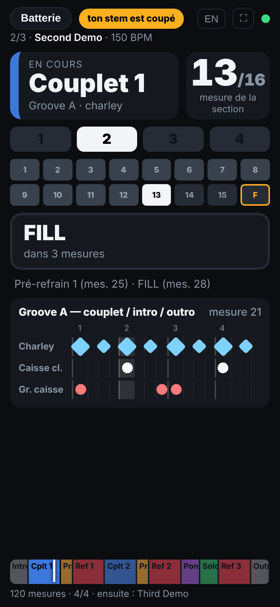
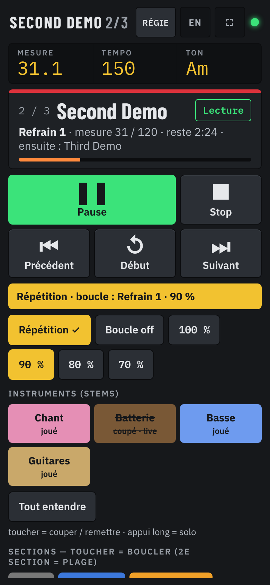
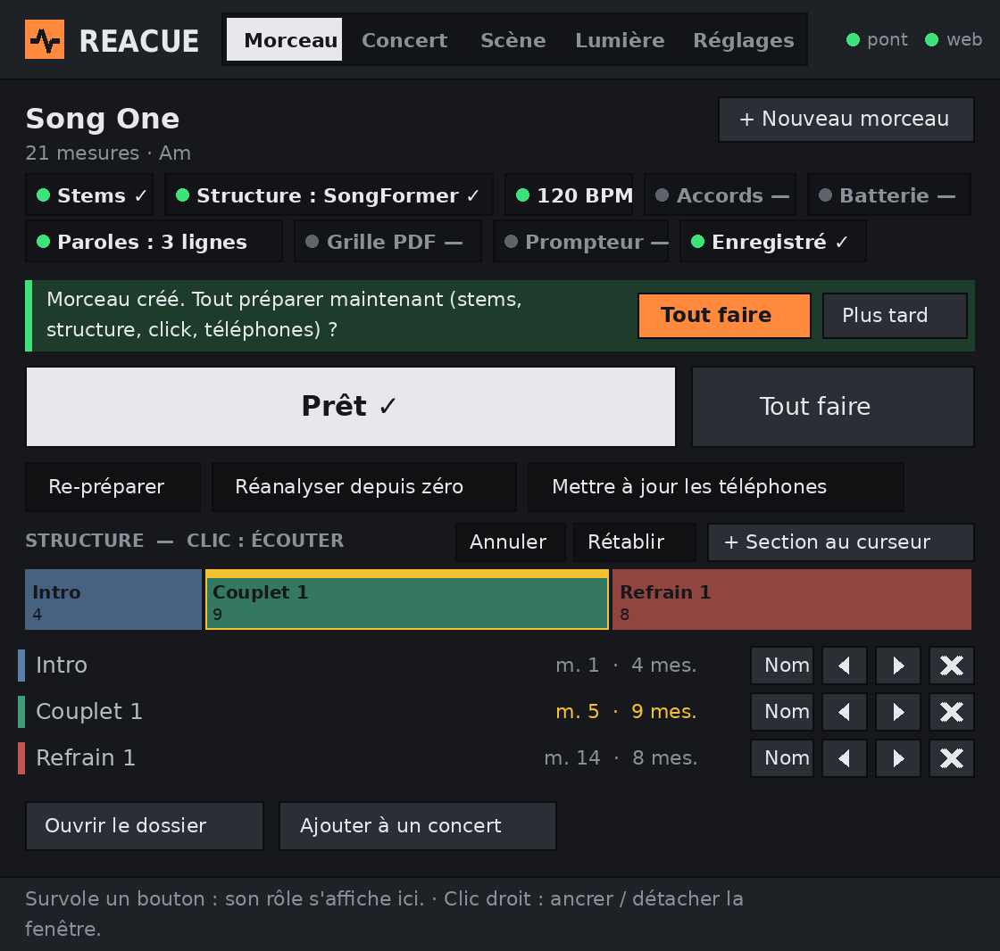
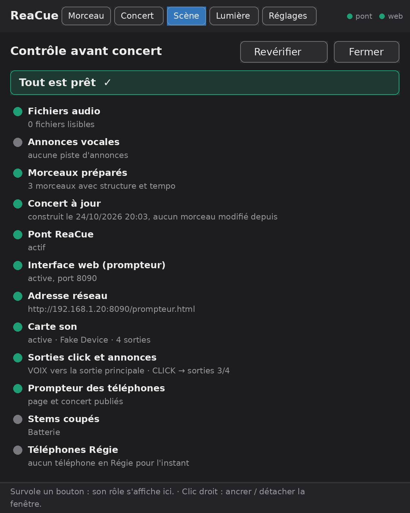
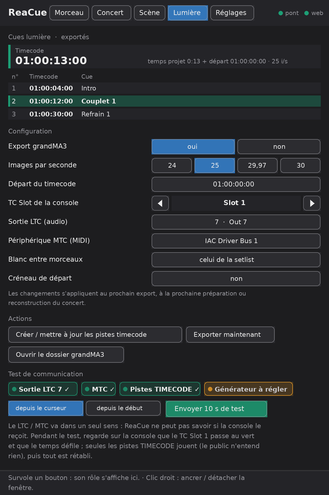
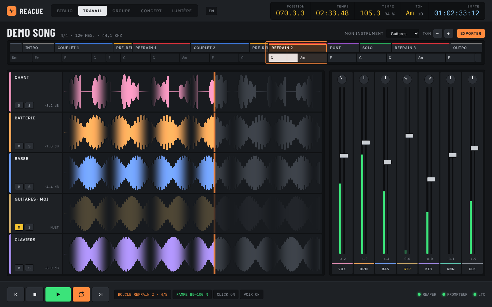
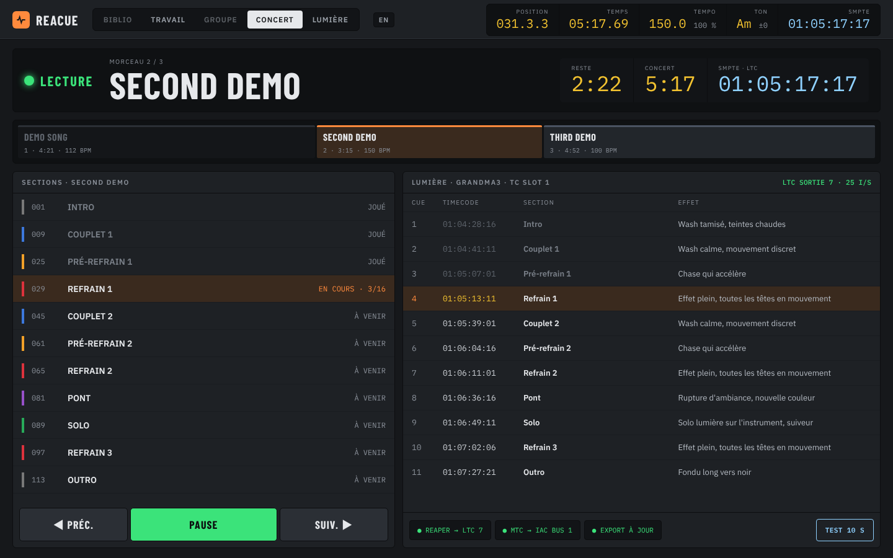
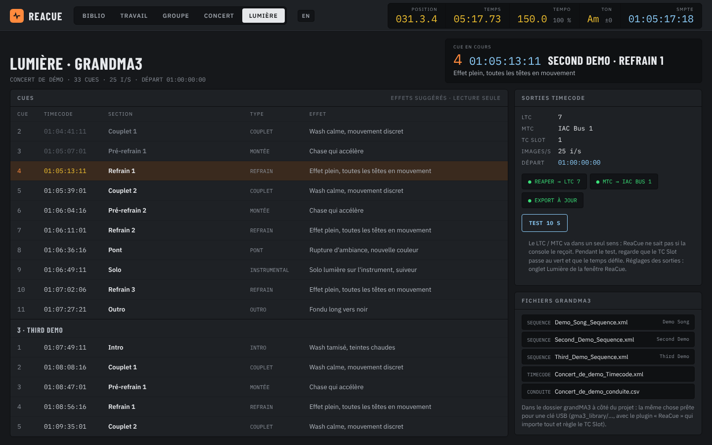
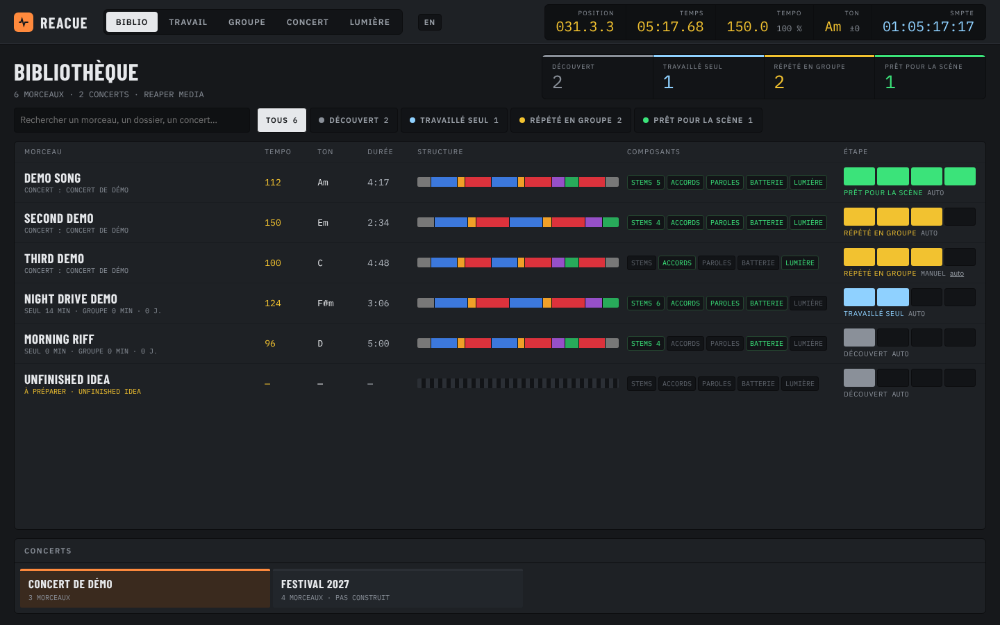
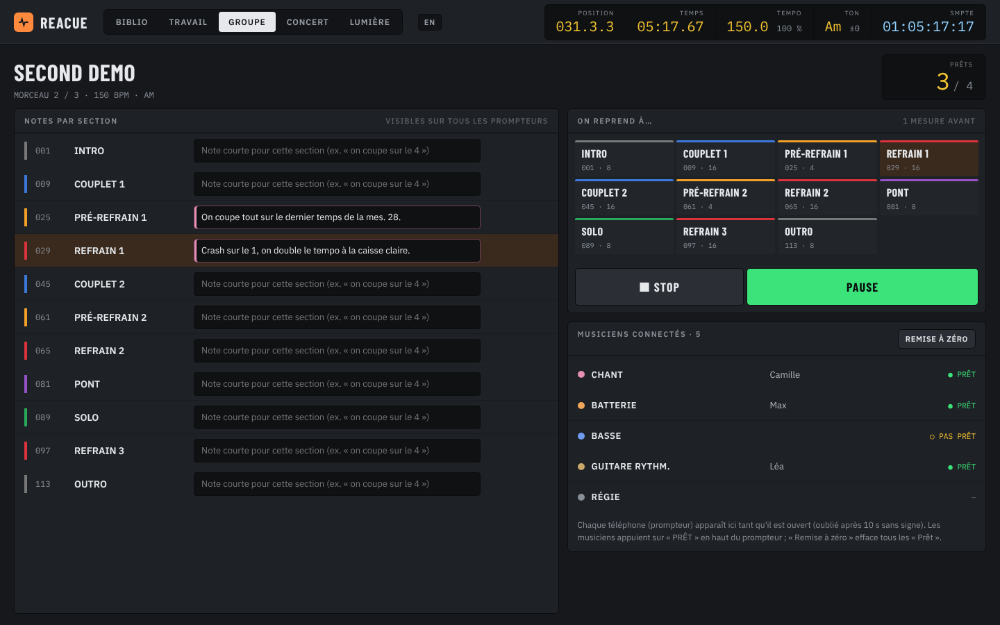

# ReaCue

**Des morceaux prêts pour le live dans REAPER, en un clic — et un prompteur sur le téléphone de chaque musicien.**

*[English version: README.md](README.md)*

ReaCue s'adresse aux groupes qui jouent en live avec REAPER. À partir des stems d'un morceau (ou d'un seul
MP3, qu'il sait séparer lui-même en stems, en local), il détecte le tempo, la grille des mesures et la structure, puis construit tout dans le projet REAPER :
carte de tempo, régions nommées et colorées, click avec count-in, annonces vocales (« Refrain »…) et décompte
« one two three four » avant chaque section. Il publie aussi un **prompteur web** que chaque musicien ouvre
sur son téléphone, servi par l'interface web intégrée de REAPER : structure, accords (basse / guitares),
paroles calées (chant) et une vue batteur dédiée avec les grooves et les fills transcrits.

Tout tourne en local : aucun service en ligne et pas d'internet une fois installé (les composants facultatifs —
séparation de stems, analyse de structure, accords, batterie, paroles mot par mot et automatiques — utilisent
des modèles d'IA qui tournent eux aussi sur ton ordinateur).
Un mode facultatif permet de piloter ReaCue en langage naturel avec Claude (serveur MCP).

> **Nouveau sur ReaCue ? Suis le tutoriel pas à pas : [docs/TUTORIEL_fr.md](docs/TUTORIEL_fr.md)**
> (anglais : [docs/TUTORIAL_en.md](docs/TUTORIAL_en.md)).

> **Licences et avertissements :** voir [Licences, responsabilités et avertissements](#licences-responsabilités-et-avertissements)
> et [THIRD_PARTY_NOTICES.md](THIRD_PARTY_NOTICES.md) — l'analyse de structure facultative est réservée à un
> **usage non commercial**.

> **État : 1.2.1.** Développé et utilisé sur macOS (Intel). La prise en charge de Windows et des Mac Apple Silicon
> **n'a pas encore été testée sur une vraie machine** — vos retours sont les bienvenus.

| La fenêtre ReaCue dans REAPER | Le prompteur sur un téléphone | La Régie (télécommande, PIN) |
|---|---|---|
|  |  |  |

| Batterie | Basse | Chant | Guitare |
|---|---|---|---|
|  |  |  |  |


*(Captures d'un morceau fictif « Demo Song » : structure, accords, paroles et batterie sont inventés.)*

## Sommaire

- [Fonctionnalités](#fonctionnalités)
- [Principe](#principe)
- [Prérequis](#prérequis)
- [Installation](#installation)
- [Activer l'interface web de REAPER (prompteur)](#activer-linterface-web-de-reaper-prompteur)
- [Séparation de stems (facultatif)](#séparation-de-stems-facultatif)
- [Analyse de structure (SongFormer, par défaut)](#analyse-de-structure-songformer-par-défaut)
- [Reconnaissance d'accords (modèle, facultatif)](#reconnaissance-daccords-modèle-facultatif)
- [Transcription de batterie (ADTOF, facultatif)](#transcription-de-batterie-adtof-facultatif)
- [La fenêtre ReaCue](#la-fenêtre-reacue)
- [Utilisation](#utilisation)
- [Mode concert](#mode-concert)
- [ReaCue Studio : travailler et exporter](#reacue-studio--travailler-et-exporter)
- [Paroles](#paroles)
- [Grille PDF](#grille-pdf)
- [Lumière : export grandMA3](#lumière--export-grandma3)
- [Guide d'équipe, organisation REAPER, stems et matériel](#guide-déquipe-organisation-reaper-stems-et-matériel)
- [Réglages](#réglages)
- [Facultatif : piloter ReaCue avec un assistant IA (MCP)](#facultatif--piloter-reacue-avec-un-assistant-ia-mcp--claude-antigravity-cursor-etc)
- [Limites connues](#limites-connues)
- [Dépannage / FAQ](#dépannage--faq)
- [Désinstallation](#désinstallation)
- [Pour les développeurs](#pour-les-développeurs)
- [Licences, responsabilités et avertissements](#licences-responsabilités-et-avertissements)
- [Crédits et licence](#crédits-et-licence)

## Fonctionnalités

Dans REAPER, à partir de l'audio déjà présent dans le projet — le tout depuis **une seule fenêtre, « ReaCue »**,
en cinq onglets (Morceau, Concert, Scène, Lumière, Réglages) :

- **Carte de tempo** calée sur le morceau : tempo fixe quand l'enregistrement est quantisé, ou un marqueur
  de tempo par mesure quand il a été joué sans click (le click suit alors le groupe). L'audio est déplacé
  pour que la mesure 1 tombe pile sur une barre de mesure.
- **Une région par section**, nommée et colorée (Intro, Couplet 1, Pré-refrain, Refrain, Pont, Solo,
  Break, Outro, Main Riff…), en français ou en anglais.
- **Piste CLICK** (source click native de REAPER) avec **count-in** de 2 mesures, envoyable sur une sortie
  physique dédiée pour les in-ears.
- **Piste VOIX** : annonce vocale (« Refrain ») sur l'avant-dernière mesure de chaque section et « one two
  three four » sur la dernière, routée comme le click. Utilise les voix du système (macOS `say`, Windows SAPI).
- **Piste CUES** et marqueurs « → Refrain », lisibles d'un coup d'œil.
- **Séparation de stems** (facultatif) : transforme un seul MP3/WAV en 6 stems (voix, batterie, basse,
  guitare, piano, autres) avec [Demucs](https://github.com/facebookresearch/demucs), sur ton ordinateur, sans
  abonnement ni envoi en ligne — puis ReaCue prépare le morceau à partir des stems.
- **Analyse de structure** par SongFormer (installée par défaut, usage non commercial) ; **accords** et
  **batterie** par modèles entraînés (facultatifs) ; **paroles calées mot par mot** et **paroles
  automatiques** (brouillon transcrit par Whisper quand tu n'as pas de texte, facultatif). Tous tournent en
  local, avec repli automatique sur la détection de ReaCue.
- **Grille PDF** à imprimer (accords et paroles mesure par mesure) dans le dossier du morceau, à chaque
  publication.
- **Lumière grandMA3** : un cue par section (Sequence, Timecode, fiche de conduite, plugin), rôle Lumière du
  prompteur et pistes qui envoient le timecode (LTC / MTC) à la console, réglables dans l'onglet **Lumière**.
- **Mode concert** : plusieurs morceaux préparés enchaînés dans un seul projet, arrêt automatique à la fin
  de chaque morceau, un onglet **Scène** pour piloter le concert, un **QR code** pour les
  musiciens et une télécommande **Régie** sur téléphone (code PIN) ; un bouton **Vérifier** (contrôle
  avant concert, avec corrections en un clic) et un mode **Répétition** : boucler une section ou une plage
  avec une mesure de décompte avant chaque reprise, vitesse 100 à 70 %.
- **Instruments** : couper / mettre en solo chaque stem du concert (Chant, Batterie, Basse…), *Tout
  entendre*, et un profil **« Joué en live »** enregistré avec le concert (le groupe joue batterie et basse
  pour de vrai → ces stems sont coupés sur tous les morceaux, avec des exceptions par morceau). Depuis la
  fenêtre, le téléphone Régie ou Claude.

- **ReaCue Studio** (page web, ordinateur ou tablette) : écran **Travail** avec position, tempo et vitesse,
  ton, SMPTE, structure et accords cliquables, formes d'onde des stems, console (mute, solo, volume, pan,
  vumètres) sur les vraies pistes de REAPER, boucle de section avec **rampe de vitesse**, « mon instrument »
  coupé, transposition, et **exports** WAV / MP3 de chaque stem, d'une section ou de mesures choisies,
  séparés ou mixés.

Sur les téléphones et tablettes des musiciens (prompteur web, même style « Studio pro » que ReaCue Studio,
très gros caractères pour la scène) :

- trois afficheurs **mesure · tempo · ton**, section en cours avec voyants de temps et mesure dans la section,
  bloc **ENSUITE / DANS n mes**, décompte sur la dernière mesure, mini-structure en couleur ;
- **Basse / guitares** : accord en cours (carte claire) et suivant avec décompte, grille de la section
  (mesure en cours en orange), tonalité ; accords et ton **transposés** quand les stems le sont (ReaCue Studio) ;
- **note de section** affichée sous la grille quand elle existe ;
- **Chant** : paroles défilantes calées sur le morceau, ligne suivante et décompte avant chaque entrée
  (mot en cours surligné avec les paroles mot par mot) ;
- **Batterie** : groove de la section, grille 16 pas (ou triolets) de la mesure en cours, charley ouvert,
  fills, crashs, arrêts et reprises ;
- entrées et silences de chaque instrument détectés sur les stems (« STOP à la prochaine mesure »,
  « Entrée dans 2 mesures ») ;
- français / anglais ; suit le curseur de lecture de REAPER (sur scène, seul REAPER doit tourner) ;
- en mode concert : morceau x/N et morceau suivant ; rôle **Régie** pour piloter le concert depuis un téléphone ;
- rôle **Lumière** : cues grandMA3, cue en cours, timecode, fichiers à télécharger.

## Principe

```
 Action REAPER « ReaCue - Préparer le morceau »          Claude (facultatif, MCP)
                 │                                         │
                 ▼                                         ▼
        Programme ReaCue (Python) : analyse audio, tempo, sections, accords, paroles, batterie
                 │  dépose des données (jamais de code) dans <ressources REAPER>/ReaCueMCP/
                 ▼
        ReaCue_Bridge.lua (tourne en fond dans REAPER) ──> API REAPER
                 │
                 └──> reaper_www_root/prompteur.html + reacue_song.json ──> téléphones (Wi-Fi)
```

## Prérequis

- **REAPER 7** ou plus récent (la 6.x marche probablement, non testée).
- **macOS 12+** (Intel ou Apple Silicon) ou **Windows 10/11** (bêta).
- Environ 1,5 Go d'espace disque (environnement Python et bibliothèques), plus l'espace des composants
  facultatifs installés (voir le tableau de l'[Installation](#installation)).
- **Internet seulement pendant l'installation** (téléchargement de Python et des bibliothèques). Rien n'est
  envoyé ensuite ; aucune parole n'est jamais téléchargée.
- Pour le prompteur : téléphones et ordinateur sur le même réseau Wi-Fi.

## Installation

1. Télécharge le projet (bouton vert **Code** → *Download ZIP*) et dézippe-le **là où il restera**, par
   exemple `Documents/ReaCue`. Ne déplace plus le dossier ensuite (ou relance l'installation si tu le fais).
2. Lance REAPER une fois (pour que son dossier de réglages existe), puis **quitte REAPER** : l'installateur
   peut alors enregistrer les actions tout seul.
3. Lance l'installateur :
   - **macOS** : double-clic sur **`Install ReaCue.command`**. Si macOS refuse de l'ouvrir (« développeur
     non identifié »), clic droit → *Ouvrir* → *Ouvrir*. Autre possibilité dans le Terminal :
     `bash "Install ReaCue.command"`.
   - **Windows** : double-clic sur **`Install ReaCue.bat`**. Si SmartScreen affiche un avertissement :
     *Informations complémentaires* → *Exécuter quand même*.
4. Réponds aux questions : langue (`fr` / `en`), déclaration de ReaCue dans vos assistants IA / serveur MCP
   (Claude Desktop, Google Antigravity, Cursor, export JSON — facultatif) et installation de la **séparation de stems** (facultatif,
   environ 1 Go à télécharger, 5 à 15 minutes ; voir [Séparation de stems](#séparation-de-stems-facultatif)).
   Dernière question : l'**analyse de structure SongFormer**, proposée par défaut (*Entrée* = oui) ; il faut
   ensuite taper **`J'accepte`** pour accepter les licences des modèles (usage non commercial). Les modèles
   déjà présents sur l'ordinateur sont réutilisés ([détails](#analyse-de-structure-songformer-par-défaut)).
5. Lance REAPER. Le pont démarre tout seul et les actions sont disponibles dans *Actions → Show action list*
   (au premier lancement, la fenêtre ReaCue ouvre un assistant qui vérifie l'installation) :
   - **ReaCue** — la fenêtre principale (onglets Morceau, Concert, Scène, Lumière, Réglages) : **ajoute celle-ci à
     une barre d'outils** (clic droit sur une barre → *Customize toolbar* → *Add*), elle suffit au quotidien ;
   - **ReaCue - Concert** — la même fenêtre, ouverte sur l'onglet Scène ;
   - **ReaCue - Préparer le morceau**, **ReaCue - Republier le prompteur**, **ReaCue - Séparer les stems**
     (aussi en boutons dans l'onglet Morceau), **ReaCue - Morceau suivant** / **Morceau précédent** (pour une
     pédale ou un raccourci).

L'installateur peut être relancé à tout moment (changer de langue, réparer une installation) : tes réglages
et tes morceaux préparés sont conservés.

Ce qu'il fait : installe [uv](https://docs.astral.sh/uv/) (gestionnaire Python d'Astral) si besoin, crée un
environnement Python 3.12 privé dans le dossier `.venv` (paquets précompilés uniquement, aucun compilateur
nécessaire), copie les scripts REAPER dans `<ressources REAPER>/Scripts/ReaCue/`, ajoute le pont à
`Scripts/__startup.lua`, enregistre les actions dans `reaper-kb.ini` (seulement si REAPER est fermé) et
écrit `<ressources REAPER>/ReaCueMCP/reacue_settings.json`. Rien d'autre n'est modifié sur le système.

**Composants facultatifs.** Chacun a son installateur (double-clic, `.command` sur Mac, `.bat` sous Windows),
son environnement Python séparé dans le dossier de ReaCue, et un repli automatique sur la méthode de ReaCue
s'il manque ou échoue :

| Composant | Installateur | À télécharger | Licence | Détails |
|---|---|---|---|---|
| Séparation de stems (Demucs) | `Install ReaCue Stems` (ou question de l'installateur) | ≈ 1 Go | MIT | [Séparation de stems](#séparation-de-stems-facultatif) |
| Analyse de structure (SongFormer) | `Install ReaCue Structure` (ou question de l'installateur) | ≈ 3 Go | non commercial (CC BY-NC 4.0), « J'accepte » | [Analyse de structure](#analyse-de-structure-songformer-par-défaut) |
| Accords (modèle entraîné) | `Install ReaCue Chords` | ≈ 800 Mo + 60 Mo | MIT | [Reconnaissance d'accords](#reconnaissance-daccords-modèle-facultatif) |
| Batterie (ADTOF) | `Install ReaCue Drums` | ≈ 300 Mo + 16 Mo | non commercial (CC BY-NC-SA 4.0), « J'accepte » | [Transcription de batterie](#transcription-de-batterie-adtof-facultatif) |
| Paroles mot par mot + automatiques (Whisper) | `Install ReaCue Words` | ≈ 1 Go + 1,3 Go par langue + 1,6 Go | Apache-2.0, MIT | [Paroles mot par mot](#paroles-mot-par-mot-facultatif), [Paroles automatiques](#paroles-automatiques-facultatif) |

PyTorch est téléchargé une fois : il vient du cache si un autre composant l'a déjà installé. Pas à pas :
[tutoriel, chapitre 20](docs/TUTORIEL_fr.md#20-composants-facultatifs).

Si REAPER était ouvert pendant l'installation, charge les actions une fois à la main : *Actions → Show action
list → New action → Load ReaScript…* → choisis `ReaCue.lua` (et, si tu les veux en actions séparées,
`ReaCue_Preparer.lua`, `ReaCue_Republier_prompteur.lua`, `ReaCue_Separer_stems.lua`) dans `<ressources REAPER>/Scripts/ReaCue/`. (*Options → Show REAPER resource path* ouvre ce dossier.)

## Activer l'interface web de REAPER (prompteur)

À faire une fois, à la main (REAPER n'offre pas de moyen sûr de le faire par script) :

1. REAPER → *Options → Preferences* (macOS : *REAPER → Settings*) → **Control/OSC/web** → **Add**.
2. Control surface mode : **Web browser interface**. Port : **8080** (ou un autre port libre). Le reste ne change pas.
3. OK, OK.

Sur chaque téléphone ou tablette, ouvre : **`http://<IP de l'ordinateur>:8080/prompteur.html`**, puis
choisis ton rôle.
ReaCue Studio (travail et exports, voir plus bas) : **`http://<IP de l'ordinateur>:8080/studio.html`**.

Trouver l'adresse IP de l'ordinateur :

- **macOS** : *Réglages Système → Wi-Fi → Détails…* à côté du réseau → *Adresse IP* (ex. `10.0.1.23`).
- **Windows** : *Paramètres → Réseau et Internet → Wi-Fi → propriétés du réseau → Adresse IPv4*, ou
  `ipconfig` dans une invite de commandes.
- L'installateur affiche aussi l'adresse probable à la fin.

Conseils :

- **Réserve l'adresse IP** de l'ordinateur dans la box ou le routeur (réservation DHCP, parfois appelée
  « bail statique ») : l'adresse ne change plus et les favoris des téléphones restent valables. En concert,
  un petit routeur de voyage dédié est idéal.
- Ajoute la page à l'écran d'accueil (iOS : *Partager → Sur l'écran d'accueil* ; Android : *⋮ → Ajouter à
  l'écran d'accueil*) pour un affichage plein écran comme une application. Le bouton ⛶ passe aussi en plein écran.
- Le bouton **FR/EN** change la langue du prompteur sur ce téléphone (mémorisé).
- Le voyant vert (en haut à droite) indique que la liaison avec REAPER est active ; rouge = liaison perdue.

## Séparation de stems (facultatif)

ReaCue donne ses meilleurs résultats avec des stems (un fichier par instrument). Si tu n'as que le MP3 d'un
morceau, ReaCue peut le séparer pour toi avec [Demucs](https://github.com/facebookresearch/demucs)
(recherche Meta AI, licence MIT), entièrement sur ton ordinateur : rien n'est envoyé en ligne, aucun abonnement.

**Installation** (une fois) : réponds *oui* à la question de l'installateur sur la séparation de stems, ou
plus tard double-clic sur **`Install ReaCue Stems.command`** (macOS) / **`Install ReaCue Stems.bat`**
(Windows). Cela crée un environnement Python séparé `.venv-demucs` dans le dossier de ReaCue (PyTorch +
Demucs, environ 1 Go), télécharge les deux modèles et mesure la vitesse de ton ordinateur. L'environnement
de ReaCue lui-même n'est pas touché.

**Utilisation** :

1. Glisse le MP3 (ou le WAV) dans un projet REAPER vide et clique dessus pour le sélectionner.
2. Lance **ReaCue - Séparer les stems**. Une fenêtre montre l'avancement (tu peux la fermer).
3. À la fin, six pistes apparaissent (Chant, Batterie, Basse, Guitare, Piano, Autres), calées exactement
   comme l'item d'origine, qui est retiré du projet (un seul *Annuler* le remet ; le fichier reste sur le disque).
4. Lance **ReaCue - Préparer le morceau** comme d'habitude.

Détails :

- Durée : **5 à 20 secondes** avec un GPU dédié (NVIDIA GeForce/RTX avec CUDA, Apple Silicon Metal/MPS) ; environ **5 à 8 minutes** en mode processeur (CPU).
- **Audit et réalignement matériel automatique** : à chaque lancement de `Install ReaCue.bat` (ou `installation.bat`) ou `Install ReaCue Stems.bat`, l'installateur réanalyse la machine (détection du GPU, de la VRAM, architecture Blackwell/série RTX 50 nécessitant CUDA 12.8, Apple Silicon ou CPU). S'il détecte un changement de matériel ou des dépendances non optimales (par exemple une version CPU installée sur une machine dotée d'un GPU dédié, ou une version CUDA obsolète), il désinstalle automatiquement les paquets inadaptés, réinstalle la roue PyTorch matérielle optimale et ajuste le modèle par défaut dans `reacue_settings.json` (`htdemucs_6s` sur GPU $\ge 8\text{ Go}$, `htdemucs` sur CPU). Si l'environnement est déjà optimal, aucun re-téléchargement n'est effectué.

- Les stems sont écrits à côté du fichier d'origine, dans `<nom du morceau>-stems/htdemucs_6s/`, et gardent
  le nom du fichier d'origine (tonalité et tempo dans le nom restent lus par ReaCue). Relancer l'action sur le
  même fichier les importe immédiatement, sans refaire la séparation.
- `stems_model` dans les réglages : `"htdemucs_6s"` (6 stems, par défaut), `"htdemucs_ft"` (4 stems HQ fine-tuned, recommandé avec GPU) ou `"htdemucs"` (4 stems : voix,
  batterie, basse, autres — guitare et claviers restent ensemble dans « autres »).
- **Guide complet :** Pour une analyse détaillée des différences entre les modèles Demucs (htdemucs_6s, htdemucs_ft, htdemucs), les temps de calcul selon le matériel (RTX 50 Blackwell, Apple Silicon, etc.) et les bonnes pratiques scéniques, consultez le **[Guide ReaCue : Bonnes Pratiques en Équipe, Organisation REAPER, Découpe de Stems & Guide Matériel](docs/BONNES_PRATIQUES_ET_MATERIEL.md)**.
- Qualité : voix, batterie et basse sont très bonnes ; guitare et surtout piano sont moins propres qu'avec
  les services commerciaux (un peu de repisse). Guitare lead et rythmique ne sont pas séparées : la détection
  des solos, qui s'appuie sur un stem de guitare lead, n'est donc pas disponible.
- Mac Intel : PyTorch n'est plus publié pour les Mac Intel après la version 2.2.2 ; l'installateur choisit
  automatiquement les bonnes versions.

## Analyse de structure (SongFormer, par défaut)

ReaCue trouve tout seul les sections d'un morceau (couplet, refrain, pont…). Pour des frontières et des
noms plus justes, il peut utiliser [SongFormer](https://github.com/ASLP-lab/SongFormer), un modèle d'IA
d'analyse de structure musicale, entièrement sur ton ordinateur (rien n'est envoyé en ligne). **ReaCue
garde sa grille** (tempo, mesures, count-in) : SongFormer dit seulement où sont les sections et ce qu'elles
sont ; chaque frontière est ensuite calée sur la mesure la plus proche de la grille de ReaCue.

**Installation** (une fois) : l'installateur la propose **par défaut** (étape 6/6, *Entrée* = oui) ;
ou plus tard double-clic sur **`Install ReaCue Structure.command`** (macOS) / **`Install ReaCue
Structure.bat`** (Windows). Avant tout téléchargement, l'installateur affiche les licences des modèles et
n'installe que si tu tapes exactement **`J'accepte`** (`I accept` en anglais) ; sinon rien n'est installé.
Pour une installation sans question : `REACUE_STRUCTURE_ACCEPT=yes`. L'accord est mémorisé dans
`structure/.licenses_accepted` (pas redemandé aux mises à jour). Cela crée un environnement Python séparé `.venv-structure` dans le dossier de
ReaCue, télécharge SongFormer et ses deux dépendances (MuQ, MusicFM) à des versions figées dans
`structure/`, télécharge les modèles une fois pour toutes (dans `structure/hf` et le dossier de
SongFormer), fait un court essai et affiche `STRUCTURE_OK` avec la vitesse de ton ordinateur. Environ
**3 Go** à télécharger, 10 à 40 minutes. L'environnement de ReaCue lui-même n'est pas touché.

- **Accélération matérielle et audit automatique** : comme pour Demucs, l'installateur audite `.venv-structure` et installe la version optimale de PyTorch pour votre matériel (CUDA 12.8 pour l'architecture Blackwell / série RTX 50, CUDA 12.4 pour les autres NVIDIA, Metal MPS pour Apple Silicon, ou processeur standard). Sur GPU dédié, l'analyse d'un morceau complet de 4 minutes ne prend qu'environ **1 minute** (contre 3 à 5 minutes sur processeur). Si l'environnement est déjà optimal, aucun re-téléchargement n'est déclenché.

**Modèles déjà téléchargés** : avant de télécharger, l'installateur cherche les modèles déjà présents sur
l'ordinateur — une autre copie de SongFormer (par exemple `~/Documents/ReaCue-labo/SongFormer/src/SongFormer/ckpts`,
fichiers vérifiés avec le `md5sum.txt` de SongFormer) et le cache Hugging Face par défaut
(`~/.cache/huggingface/hub` sur macOS / Linux, `%USERPROFILE%\.cache\huggingface\hub` sur Windows :
MuQ et wav2vec2-conformer). Ils sont **copiés** (ou liés, sans place en plus sur le même disque) vers
`structure/` ; les originaux ne sont jamais modifiés ni supprimés. Seul ce qui manque est téléchargé.
Autres dossiers à fouiller : `REACUE_REUSE_DIRS` (séparés par `:` ou `;`).

**Utilisation** : rien à faire. *Analyser et préparer*, *Tout faire* et *Réanalyser depuis zéro* (fenêtre,
actions, Claude) utilisent SongFormer automatiquement dès qu'il est installé ; l'onglet affiche **« Analyse de structure (SongFormer)… N s »** pendant
ce temps et le résultat indique « Sections détectées par SongFormer ». Le résultat est mémorisé par morceau
(`.reacue/<morceau>_structure.json` à côté de l'audio) : préparer à nouveau le morceau est immédiat, tant
que le fichier audio ne change pas.

Comment les sections sont construites :

| Étape | Règle |
|---|---|
| Entrée | le mix, ou la somme des stems (calés comme pour l'analyse) |
| Frontières | calées sur la mesure la plus proche ; une carrure de 4 mesures depuis la frontière précédente l'emporte si elle est à ≤ 1 mesure |
| Petits morceaux | segments de moins de 2 mesures fusionnés avec un voisin ; deux parties consécutives de même type fusionnées si l'une fait moins de 8 mesures et le tout ≤ 16 (8 + 8 = deux couplets) |
| Silence | ignoré au début et à la fin |
| Noms | Intro, Couplet N, Pré-refrain N, Refrain N, Pont, Instrumental, Outro (français ou anglais ; couplets, pré-refrains et refrains numérotés) ; une partie *instrumentale* devient **Solo** quand la guitare (stem lead s'il existe) est nettement plus forte que d'habitude et la voix faible ; même type = même lettre |
| Priorité | les régions modifiées à la main dans REAPER, et `set_sections` de Claude, passent toujours avant toute analyse |
| À vérifier | dans la fenêtre, une section est en **orange** si sa longueur n'est pas 4, 8 ou 16 mesures, ou si SongFormer avait placé sa frontière à ¾ de mesure ou plus de la mesure retenue (« déplacée par le calage ») ou entre deux mesures |
| Repli | SongFormer non installé, réglage « ReaCue seul » → détection de ReaCue ; erreur ou délai dépassé (30 min) → « Analyse SongFormer impossible : … → structure ReaCue utilisée » |

Exemple réel (une chanson française à 105,12 BPM, Mac 16 Go) : frontières de SongFormer calées exactement
aux mesures 9 / 17 / 25 / 33 / 41 / 49 / 57 / 73 → Intro, Couplet 1, Couplet 2, Instrumental, Couplet 3,
Pont, Refrain 1, Instrumental (Solo avec les stems), Outro. Première fois : environ 40 min de
téléchargement et chargement des modèles, puis environ 7 min d'analyse (fenêtre 420 s).

Réglage **Détection de structure** dans l'onglet **Réglages** : *auto (SongFormer)* (par défaut :
SongFormer s'il est installé) ou *ReaCue seul* ; la ligne en dessous indique si SongFormer est installé.
Clé `structure_engine` (`"auto"` / `"reacue"`).

Mémoire et durée :

- Le modèle regarde le morceau par fenêtres de **420 s** (son réglage d'entraînement) si l'ordinateur a
  **15 Go de RAM ou plus**, sinon **120 s** (un peu moins précis, environ 4 Go de mémoire). En 420 s il lui
  faut **6 Go ou plus** de mémoire libre. 8 Go de RAM au total est le minimum conseillé.
- Sur le processeur (aucune carte graphique nécessaire) : **plusieurs minutes par morceau** sur un Mac
  Intel (l'installateur affiche une estimation) ; plus rapide sur Apple Silicon ou avec une carte NVIDIA.
  Seule la première préparation d'un morceau coûte ce temps (ensuite le cache sert).

**Licences — usage non commercial uniquement.** Le code de SongFormer est sous CC BY 4.0, mais il
s'appuie sur le modèle **MuQ** dont les **poids sont sous licence CC BY-NC 4.0 (non commerciale)** :
l'analyse est donc réservée à un usage personnel / non commercial. Voir [Crédits et
licence](#crédits-et-licence). Le dépôt ne contient aucun poids de modèle : l'installateur les télécharge
chez leurs auteurs.

## Reconnaissance d'accords (modèle, facultatif)

Par défaut, ReaCue détecte les accords du prompteur et de la grille PDF avec ses propres règles (chroma +
basse). Pour des accords plus justes (majeur / mineur, 7e, maj7, m7, sus, dim, aug, renversements comme
`D/F#`), il peut utiliser un **modèle entraîné** : *Large-Vocabulary Chord Transcription via Chord Structure
Decomposition* (Junyan Jiang, Ke Chen, Wei Li, Gus Xia — ISMIR 2019), **code et poids sous licence MIT**.

**Installer :** double-clic sur **`Install ReaCue Chords.command`** (Mac) ou **`Install ReaCue Chords.bat`**
(Windows), ou `bash install/install_chords_mac.sh`. L'installateur crée un environnement séparé
`.venv-chords` (le `.venv` de ReaCue n'est pas touché), télécharge le modèle depuis GitHub à une version
figée dans `chords/model` (environ 60 Mo), installe PyTorch (déjà en cache si la séparation de stems est
installée ; sur Mac Intel : PyTorch 2.2.2, numpy < 2, aucun paquet à compiler), puis fait un essai sur un
audio synthétique et affiche `CHORDS_OK`.

| | |
|---|---|
| Entrée | les stems **sans la voix ni la batterie** (guitares, basse, claviers, other), sinon le fichier unique |
| Calage | le décodage suit les temps de la grille de ReaCue (changements sur les temps, surtout 1 et 3), puis au plus deux accords par mesure, comme avant |
| Nommage | dièses / bémols selon la tonalité (nom du fichier, sinon estimée) ; basse des renversements épelée comme note de l'accord (`E/G#`, `Ab/C`) |
| Lisibilité | 9e, 11e, 13e affichées comme la 7e correspondante (`G9` → `G7`) |
| Temps | environ 1 à 2 min par morceau de 4 min sur un Mac Intel (processeur), environ 1,2 Go de mémoire ; résultat mémorisé dans le dossier `.reacue` du morceau (un changement de grille ne relance que le décodage) |
| Repli | modèle non installé, réglage `chords_engine` = `"reacue"`, erreur ou délai dépassé (10 min) → détection de ReaCue (message « Modèle d'accords indisponible : … ») ; après un échec, pas de nouvel essai sur le même audio pendant 1 h |

**Comparer** les deux méthodes sur tes morceaux : `.venv/bin/python tools/compare_chords.py <dossier du
morceau ou fichier audio>…` (affiche les deux grilles mesure par mesure et leur taux d'accord).
## Transcription de batterie (ADTOF, facultatif)

La vue **Batterie** du prompteur (groove, fills, crashs) vient du stem batterie. Par défaut ReaCue le
transcrit avec ses propres règles ; si tu installes ce composant, il utilise **ADTOF**, un modèle entraîné
sur 359 heures de musique réelle (grosse caisse, caisse claire, toms, charley, cymbales), bien plus fiable
sur la caisse claire et les cymbales. ReaCue précise ensuite tom aigu / médium / basse, charley fermé /
**ouvert** (nouvelle ligne « Charley ouv. »), crash / ride, et cale chaque coup sur sa grille
(double-croches, ou triolets pour un morceau shuffle).

- Installation : double-clique **`Install ReaCue Drums.command`** (Mac) ou **`Install ReaCue Drums.bat`**
  (Windows). Environ 300 Mo à télécharger (PyTorch, déjà en cache si la séparation de stems est installée)
  + 16 Mo pour le modèle, 3 à 10 minutes. Environnement séparé `.venv-drums`.
- Ensuite c'est automatique (réglage `drums_engine` : `auto` ; `reacue` pour revenir aux règles) ; en cas
  d'échec, ReaCue reprend ses règles. Calcul : environ 20 à 60 s par morceau sur un Mac Intel, une seule
  fois (résultat mémorisé à côté du stem, dans `.reacue/`).
- Comparer avant / après sur un morceau : `.venv/bin/python tools/compare_drums.py <stem batterie>`.

**Licences — usage non commercial uniquement.** Les poids d'ADTOF sont sous **CC BY-NC-SA 4.0** ; le
portage PyTorch utilisé (ADTOF-pytorch) n'indique pas de licence. L'installateur demande de taper
« J'accepte ». Voir [THIRD_PARTY_NOTICES.md](THIRD_PARTY_NOTICES.md).

## La fenêtre ReaCue

Action **ReaCue** (mets-la dans une barre d'outils). Une fenêtre, cinq onglets ; elle s'ouvre toute seule
sur le bon (projet concert → **Scène**, projet d'un morceau → **Morceau**, sinon le dernier utilisé).
Clic droit : ancrer / détacher — ancrée en bas, elle devient une barre de transport compacte. Tant qu'elle
est ouverte, quel que soit l'onglet, elle assure aussi l'arrêt automatique du concert, la boucle de
répétition, la télécommande Régie et le profil « joué en live ».

**Apparence « Studio pro »** (la même que ReaCue Studio) : fond sombre, panneaux nets, afficheurs LCD en police
monospace (Menlo / Monaco sur Mac, Consolas sur Windows), titres en capitales condensées (Avenir Next
Condensed ou Helvetica Neue Condensed sur Mac, Arial Narrow ou Bahnschrift SemiCondensed sur Windows, sinon
Arial gras), voyants verts / jaunes. Onglet **Scène** : bandeau lecture avec voyant, titre, afficheurs RESTE /
CONCERT / SMPTE, gros boutons de transport (lecture en vert), sections et setlist en **blocs à bord supérieur
coloré** (joué / en cours / à venir). Les fonctions et leur place n'ont pas changé.

En bas, une **ligne d'aide** explique l'élément survolé. Une erreur affiche sa **cause**, **que faire** et
un bouton qui le fait (*Démarrer le pont*, *Corriger* pour un fichier hors ligne, *Installer*,
*Enregistrer*, *Ouvrir le journal*…). Au **premier lancement**, un assistant vérifie l'installation
(pont, interface web et port, adresse IP, programme, stems, structure, dossier des projets) avec un bouton
pour chaque point manquant ; on le retrouve dans *Réglages → Vérifier l'installation*.

| Morceau | Tout faire |
|---|---|
|  |  |
| **Structure (édition)** | **+ Nouveau morceau** |
|  |  |
| **Concert** | **Concert — préparation en lot** |
|  |  |
| **Scène** | **Joué en live** |
|  |  |
| **Vérifier (avant le concert)** | **QR code (téléphones)** |
|  |  |
| **Assistant (premier lancement)** | **Réglages** |
|  |  |
| **Réglages avancés** | **Lumière (grandMA3)** |
|  |  |

*(Morceaux de démonstration inventés, adresse 192.168.1.20, PIN 1234.)*

- **Morceau** — le projet ouvert.
  - Un **grand bouton** donne l'étape suivante : **Séparer les stems** (un seul MP3/WAV) → **Analyser et
    préparer** → **Prêt ✓** (clic : onglet Scène) ; après une modification de la structure : **Appliquer
    les modifications**. À côté, **Tout faire** enchaîne séparer les stems (si besoin), analyser et préparer,
    mettre à jour les téléphones et enregistrer le projet : une liste montre chaque étape (déjà fait, en
    cours avec sa durée, réussie, en échec), *Arrêter* s'arrête après l'étape en cours, *Reprendre* repart de
    l'étape en échec. *Tout faire* est proposé juste après **+ Nouveau morceau**.
  - Boutons secondaires : *Re-préparer* (garde ta structure), *Réanalyser depuis zéro* (après
    confirmation), *Mettre à jour les téléphones* (paroles, accords, batterie, structure).
  - **Pastilles d'état** : Stems · Structure (*SongFormer*, *ReaCue* ou *manuelle*) · Tempo · Accords ·
    Batterie · Paroles (N lignes) · Prompteur publié · Enregistré. Un clic fait l'action utile (séparer,
    installer SongFormer, mettre à jour les téléphones, ouvrir le dossier des paroles, QR code, enregistrer).
  - **Structure** : une **bande colorée** (une case par section, largeur proportionnelle aux mesures,
    couleurs de ReaCue, **orange = à vérifier**, survol = détail) puis la liste (première mesure, longueur).
    Clic sur une case ou un nom = la choisir et l'écouter. Pour la section choisie : *Renommer*, ◀ ▶
    (début ± 1 mesure), *Fusionner →* (avec la suivante), *Couper en deux*, *Supprimer* ; *+ Section au
    curseur* ; **Annuler / Rétablir** (historique) ; puis **Appliquer**.
  - *Ouvrir le dossier*, **Ajouter à un concert**. Après une réussite lancée depuis la fenêtre, le projet du
    morceau est enregistré automatiquement.
- **Concert** — les projets de morceaux du dossier des projets (✓ préparé, orange = à préparer), **+** en
  ajoute un à la setlist ; réordonner (▲ ▼), retirer (✕), *Renommer* ; **Construire** (ou *Reconstruire*) le
  concert, l'*Ouvrir* dans un nouvel onglet, *Joué en live…* ; les concerts existants (*Modifier*, *Ouvrir*).
  **Préparer tous les morceaux non préparés** (ou *Préparer la sélection* avec les cases cochées) : en
  arrière-plan, un morceau après l'autre (ouvert dans un onglet, *Tout faire*, enregistré, onglet refermé),
  avec la progression ; *Arrêter* s'arrête après le morceau en cours.
- **Scène** — pilotage du concert : morceau x/N, transport, sections, **instruments**, morceau suivant,
  *Vérifier* (avec *Corriger*, aussi pour le pont et l'interface web), *Répétition*, *Setlist*, *PIN*, *QR*.
  Avec un morceau seul ouvert (sans concert) : transport simple (Début, Lecture, Stop), sections,
  instruments et boucle de répétition.
- **Lumière** — console grandMA3 : cues du morceau ou du concert ouvert (n°, timecode SMPTE, nom ; cue en
  cours surligné) et timecode actuel ; réglages `gma3_*` sans éditer le fichier (export, images/s, départ,
  TC Slot, sortie LTC parmi les sorties de la carte son, périphérique MTC parmi les sorties MIDI, blanc et
  créneau du concert) ; **Créer / mettre à jour les pistes timecode**, **Exporter maintenant**, **Ouvrir le
  dossier grandMA3** ; **test de communication** : pastilles (sortie LTC présente, périphérique MIDI trouvé et
  activé, pistes `TIMECODE` avec générateur, générateur réglé) et **Envoyer 10 s de test** (seules les pistes
  `TIMECODE` jouent, en solo, puis solo / mute / position / lecture sont rétablis). Le LTC / MTC va dans un
  seul sens : c'est la console qui montre qu'elle reçoit (TC Slot au vert).
- **Réglages** — vue **simple** (langue, décompte, annonces, voix, sorties click + voix, détection de
  structure, licences) et **Réglages avancés** (PIN, annonce avant la section, langue, voix et débit du
  décompte, volumes, tempo, modèle de séparation, dossiers). *Vérifier l'installation* rouvre l'assistant.
  S'applique à la prochaine préparation.

## Utilisation

1. **Importe le morceau** : dans la fenêtre ReaCue, **+ Nouveau morceau** (onglet Morceau, ou sous la liste
   de l'onglet Concert) → un fichier (MP3, WAV…) ou un dossier de stems → titre. ReaCue copie les fichiers dans
   `<dossier des projets>/<Titre>/`, ouvre un nouvel onglet avec un fichier par piste et enregistre
   `<Titre>/<Titre>.RPP` (un morceau existant n'est jamais écrasé). À la main, ça marche aussi : un stem par
   piste, tous calés au même départ (glisser-déposer). Un seul MP3/WAV marche avec moins de détails — mieux
   vaut le séparer d'abord avec **Séparer les stems** (voir plus haut ; *Tout faire* le fait tout seul).
   - Le rôle de chaque stem est lu dans le **nom du fichier** : `drum`/`batterie`/`kick`/`perc`,
     `bass`/`basse`, `guitar`/`guitare`/`gtr` (`lead`/`solo` = guitare solo), `vocal`/`voice`/`vox`/`chant`/`voix` ;
     tout le reste compte comme claviers/autre.
   - Facultatif : la tonalité et le tempo dans le nom des fichiers (ex. `Demo Song-A minor-112bpm-drums.wav`)
     aident les accords et le choix entre tempo double et moitié.
2. Dans l'onglet **Morceau** de la fenêtre ReaCue, clique **Tout faire** (ou le grand bouton, étape par
   étape : *Séparer les stems* puis *Analyser et préparer* ; action **ReaCue - Préparer le morceau**).
   L'avancement s'affiche dans l'onglet (de 20 s à quelques minutes ; plus la première fois avec
   SongFormer) ; à la fin : tempo, structure (mesures et longueurs), ce qui a été publié (*Résumé*).
3. Vérifie la structure (bande colorée : les cases orange d'abord) et écoute. Pour la corriger : outils de
   la section choisie (renommer, déplacer d'une mesure, fusionner, couper, supprimer, ajouter, *Annuler*),
   puis **Appliquer** — ou **modifie les régions à la main dans REAPER**, puis *Appliquer* / *Re-préparer* :
   voir [Corriger la structure](#corriger-la-structure). *Re-préparer* sur le même projet **garde la
   structure validée** (ou reprend tes régions modifiées) et reconstruit tout (click, annonces, prompteur),
   en appliquant le fichier de réglages s'il a été modifié entre-temps.
4. Après avoir ajouté ou modifié un fichier de paroles, clique **Mettre à jour les téléphones** (action
   **ReaCue - Republier le prompteur**) (rien n'est modifié dans le projet REAPER).

Plusieurs morceaux à préparer ? Onglet **Concert** → **Préparer tous les morceaux non préparés**.

Chaque préparation **remplace** les régions, marqueurs, la carte de tempo et les pistes CLICK / CUES / VOIX
du projet (un seul *Annuler* revient en arrière). Prévois un projet par morceau.

### Corriger la structure

Deux méthodes, qu'on peut mélanger :

- **À la main dans REAPER, puis *Appliquer* (ou *Re-préparer*).** Double-clique sur une région dans la barre des régions (en haut
  de la fenêtre) pour changer son nom ou son début ; ajoutes-en une avec une sélection de temps et *Markers →
  Insert region from time selection* (Maj+R) ; supprimes-en une avec clic droit → *Remove region* ; ou fais
  simplement glisser ses bords, puis lance
  **ReaCue - Préparer le morceau**. Quand le morceau est déjà préparé (mêmes items audio), ReaCue lit les
  régions du projet et, si elles diffèrent de la structure enregistrée, **les adopte comme nouvelle
  structure** ; la fenêtre de fin indique alors « Structure reprise de tes régions REAPER ». Règles :
  - seul le **début** de chaque région compte : une section dure jusqu'au début de la région suivante ;
  - le début est placé sur la barre de mesure la plus proche (à moins d'un quart de mesure, sans rien dire ;
    au-delà, arrondi avec un avertissement) ;
  - les noms sont repris tels quels (français ou anglais) ; le type de section — couleur, annonce, rôle dans
    le prompteur — est déduit du nom (« Refrain 2 », « Chorus », « Solo »…) ;
  - une région avant la mesure 1, après la fin du morceau ou sur la même mesure qu'une autre est ignorée
    avec un avertissement ; si aucune région ne commence à la mesure 1, les premières mesures sont
    rattachées à la première région ;
  - régions, couleurs, marqueurs « → », CUES, VOIX, CLICK et prompteur sont ensuite reconstruits.
  Si aucune région n'a changé, rien ne change (structure conservée). Dans un autre projet (consolidé, autre
  morceau), les régions ne sont jamais lues et rien n'est modifié.
- **Avec Claude** (mode facultatif, plus bas) : « le refrain 1 commence mesure 37 », « renomme la section 6
  en Solo ».

*Mettre à jour les téléphones* ne reprend **pas** les régions modifiées (le prompteur doit rester d'accord avec
les annonces et le click déjà dans REAPER) : un avertissement demande de cliquer *Appliquer*.

## Mode concert

Enchaîne plusieurs morceaux **déjà préparés** (chacun dans son projet) dans un seul projet REAPER, et pilote
tout le concert depuis une fenêtre ou depuis un téléphone.

1. **Construire le concert** — dans l'onglet **Concert** de la fenêtre ReaCue : **+** sur chaque morceau,
   mets-les dans l'ordre, *Renommer*, **Construire** (le concert s'ouvre dans un nouvel onglet quand il est
   prêt). Ou avec Claude : *« concert “Samedi” : Demo Song, Second Demo, Third Demo »*
   (outil `build_concert`), ou en ligne de commande :
   `python -m reacue_mcp.cli concert --name "Samedi" --songs "Demo Song" "Second Demo"`
   (macOS/Linux, depuis le dossier de ReaCue avec `.venv/bin/python` ; Windows : `.venv\Scripts\python reacue_cli.py concert …`).
   Les morceaux sont cherchés par nom de projet dans le dossier des projets (réglage `projects_dir`, défaut
   `<Documents>/REAPER Media`) ou donnés par leur chemin `.RPP`. Rien n'est réanalysé : chaque morceau garde
   ses stems, sa carte de tempo (fixe ou un tempo par mesure), sa structure validée, ses annonces et son click.
2. **L'ouvrir** — onglet **Concert** (*Ouvrir*), ou action **ReaCue - Concert** (onglet Scène) : sans concert ouvert, elle liste les concerts
   (dossier : réglage `concert_dir`, défaut `<dossier des projets>/Concerts`) ; un clic l'ouvre dans un
   **nouvel onglet** (ton projet en cours reste ouvert).
3. **Jouer** — un seul projet : une piste par instrument commune à tous les morceaux (Chant, Batterie,
   Basse, Guitares…, une couleur par morceau), CLICK / VOIX / CUES en bas, régions « Morceau · Refrain 1 »,
   une ligne de règle « Morceaux » avec les marqueurs « 1 · Demo Song ». La lecture **s'arrête toute seule
   à la fin de chaque morceau** et le curseur attend sur le décompte du suivant : Espace quand le groupe est prêt.

Fichiers écrits côte à côte : `<nom>.RPP` (le concert), `<nom>.setlist.json` (l'ordre, réutilisable),
`<nom>.concert.lua` (temps des morceaux, lus par la fenêtre), `<nom>.prompteur.json` (prompteur de tout le
concert). Corrige un morceau **dans son propre projet**, puis *Reconstruire le concert* (bouton Setlist) :
les modifications faites directement dans le projet concert sont écrasées.

**L'onglet Scène** (fenêtre ancrable : clic droit) affiche « 2 / 6 · Morceau », tempo, tonalité,
section, « mesure x / N », une pastille Lecture / Pause / Arrêt, la progression et le temps restant du
morceau, le temps du concert et le morceau suivant ; de gros boutons **Précédent / Début / Lecture-Pause /
Stop / Suivant** (pendant la lecture, Stop, Précédent et Suivant demandent un **double appui** en 2 s, pour
éviter les accidents) ; les **sections** du morceau en pastilles de couleur (clic = y aller, la lecture
continue) ; les boutons **Setlist**, **PIN** et **QR**. Ancrée en bas, elle tient sur une ligne (état +
transport + QR). Actions en plus *ReaCue - Morceau suivant* / *Morceau précédent* pour une pédale ou un
raccourci. L'arrêt automatique et la télécommande ne marchent que si la fenêtre ReaCue est ouverte (n'importe quel
onglet, même ancrée).

**Instruments (couper / solo / joué en live)** — sous les sections, un bouton par piste d'instrument du
concert (Chant, Batterie, Basse, Guitares, Guitare solo, Claviers, Autres, Mix ; pas CLICK / VOIX / CUES) :
un clic la coupe / la remet (pendant la lecture hors répétition : **double appui**), un **appui long** =
solo (encore = retour), **Tout entendre** remet tout (encore = retour au profil). Ces choix à la main durent
jusqu'au morceau suivant. **Joué en live…** ouvre le profil du concert : coche ce que le groupe joue pour de
vrai (ex. Batterie et Basse) — ces stems sont coupés automatiquement sur chaque morceau — et règle des
**exceptions par morceau** (clic sur une case : stem / live / profil ; ex. on garde le stem de basse sur le
morceau où le bassiste passe aux claviers).


Le profil est enregistré dans `<nom>.setlist.json` (`live`, `live_exceptions`), gardé quand on reconstruit
le concert, et appliqué au début de chaque morceau. La mesure de décompte de la répétition n'écrase pas tes
choix. La vue *Vérifier* indique les stems coupés. Le prompteur affiche à chaque musicien « ton stem est
coupé / joué », et le téléphone Régie a les mêmes boutons (PIN). Avec Claude : `build_concert(…,
live=["drums", "bass"], live_exceptions={"Second Demo": {"bass": "stem"}})`, ou changer le profil d'un
concert existant sans le reconstruire : `set_live_profile("Samedi", live=[…], exceptions={…})` (aussi
`set_sections([{"concert_live": {…}}])`).

**QR code pour les musiciens** — le bouton QR affiche en grand l'adresse du prompteur
`http://<IP de cet ordinateur>:<port>/prompteur.html` : l'IP est calculée au moment du clic (macOS
`ipconfig`, Windows `ipconfig`, Linux `hostname -I`) et le port lu dans les réglages de l'interface web de
REAPER (`reaper.ini`). Les musiciens le scannent avec l'appareil photo du téléphone (même Wi-Fi).
Encodeur QR : [luaqrcode](https://github.com/speedata/luaqrcode) (licence BSD).

**Régie (télécommande sur téléphone)** — dans le prompteur, choisis le rôle **Régie** : Lecture/Pause, Stop,
Précédent / Suivant, Début du morceau, setlist et sections cliquables, instruments (toucher = couper, appui
long = solo, *Tout entendre*), avec un ✓ quand REAPER a exécuté la
commande. Le **code PIN à 4 chiffres** affiché dans l'onglet Scène est demandé une fois (généré au
premier lancement, modifiable avec le bouton PIN, mémorisé sur le téléphone). Les commandes passent par
l'interface web de REAPER (`/_/SET/EXTSTATE/ReaCue/remote/…`) et sont vérifiées par la fenêtre ReaCue (PIN,
protection contre le rejeu). ⚠️ Le PIN évite les fausses manipulations, **pas les attaques** : toute personne
sur le même réseau peut joindre directement l'interface web de REAPER (`/_/…`). En concert, utilise un Wi-Fi
réservé au groupe.

**Vérifier (contrôle avant concert)** — le bouton **Vérifier** de l'onglet Scène liste, avec une pastille
verte / orange / rouge : fichiers audio lisibles (pas d'« OFFLINE »), fichiers des annonces présents,
morceaux préparés (structure et tempo), concert à jour (aucun projet de morceau modifié depuis la
construction — empreinte enregistrée à la construction), pont ReaCue, interface web de REAPER, adresse
réseau, carte son active, sorties du click et des annonces (sorties matérielles existantes, piste non
coupée), prompteur publié, téléphones Régie vus. Un bouton **Corriger** apparaît quand c'est possible :
remettre les médias en ligne, reconstruire le concert, republier le prompteur. Disponible aussi sans concert
ouvert (partie système seulement).

**Mode répétition** — le bouton **Répétition** (fenêtre ou téléphone Régie) coupe l'arrêt automatique.
Touche une section pour la **faire boucler** ; touche une 2e section du même morceau pour boucler toute la
plage (ex. Couplet 2 → Refrain 2). Avant le début de la boucle et **avant chaque reprise, une mesure de
décompte** est jouée avec le click et les annonces seuls (les autres pistes sont coupées pendant cette
mesure), au tempo de cet endroit du morceau. **Vitesse** 100 / 90 / 80 / 70 % (hauteur préservée ; click,
annonces et prompteur suivent). *Boucle off* arrête la boucle ; *Quitter* (ou sortir de la répétition depuis
le téléphone) remet tout comme avant : vitesse 100 %, arrêt automatique, répétition et sélection de temps de
REAPER.

Pas à pas : [tutoriel, chapitre concert](docs/TUTORIEL_fr.md#16-mode-concert--plusieurs-morceaux-dans-un-projet).

## ReaCue Studio : travailler et exporter

Page web servie par REAPER, comme le prompteur, pour travailler un morceau sur l'ordinateur ou une tablette :
**`http://<IP de l'ordinateur>:8080/studio.html`** (sur l'ordinateur lui-même : `http://localhost:8080/studio.html`).
L'adresse figure aussi sous le QR code de la fenêtre ReaCue. Écrans **Travail**, **Concert** et **Lumière**
(Biblio et Groupe arrivent dans les prochaines versions ; `studio.html#concert` et `studio.html#lumiere`
ouvrent directement l'écran voulu) :



- **Afficheurs** : position mesure.temps.double-croche, temps, tempo (× vitesse de lecture, en %), ton
  (avec la transposition), SMPTE (`gma3_tc_start` + `gma3_fps`).
- **Structure et accords** : clic = aller à la section ou à l'accord ; **double-clic** = boucler la section.
  Les accords défilent sous la tête de lecture (16 mesures visibles).
- **Une ligne par stem** : forme d'onde (précalculée à la publication : `reacue_peaks.json`), partie jouée en
  couleur, **M** / **S**, volume. Clic dans la forme d'onde = aller à cet endroit.
- **Console** : panoramique (glisser vers le haut / le bas, double-clic = centre), vumètre (crête réelle de la
  piste), fader (double-clic = 0 dB), pour chaque stem, le **CLICK** et la **VOIX**.
- **Transport** : début, stop, lecture / pause (barre d'espace), boucle de la section en cours, section
  suivante ; voyants REAPER (vert : la fenêtre ReaCue répond aussi), prompteur, LTC.
- **Rampe de vitesse** : la section en cours tourne en boucle et accélère à chaque passage (ex. 85 → 100 % en
  8 passages, hauteur conservée) ; compteur « BOUCLE REFRAIN 1 · 4/8 ».
- **CLICK ON/OFF**, **VOIX ON/OFF** ; **Mon instrument** : ta piste est coupée automatiquement (choix
  mémorisé dans le navigateur).
- **TON − / +** : transposition des stems d'un demi-ton (double-clic sur l'afficheur TON = revenir à 0).

Mute, solo, volume, pan, position et transport passent par l'**API web native de REAPER** (aucun réglage) ;
la boucle, la rampe, la transposition et l'export sont exécutés par la **fenêtre ReaCue** (elle doit être
ouverte) et demandent le **PIN** de la Régie (onglet Scène), saisi une fois sur l'appareil.

**Exporter** (bouton en haut à droite) : coche un ou plusieurs instruments (et le click si besoin), choisis la
région (morceau entier, une section, des mesures « de → à », ou la sélection temporelle de REAPER), un
fichier par instrument ou tout mixé en un seul fichier, **MP3** (128 à 320 kbit/s, 320 par défaut) ou **WAV**
24 bits. Les fichiers sont écrits dans le dossier **`exports/`** à côté du projet, nommés
`<Titre> - <Instrument> - <Section>.mp3`, et proposés au téléchargement directement dans la page (les 5
derniers exports restent sur le serveur web de REAPER). Le mix est ramené à -1 dBFS s'il dépasse (pas
d'écrêtage) ; le volume et le pan des pistes s'appliquent au mix, pas aux stems exportés seuls. Le click
exporté est synthétisé sur la grille de ReaCue (le click de REAPER n'est pas un fichier). Aussi possible en
ligne de commande (`reacue_cli.py export --request '{"stems": ["Basse"], "format": "mp3"}'`) et avec Claude
(`set_sections` avec un élément `{"export": {…}}`).

Pas à pas : [tutoriel, ReaCue Studio](docs/TUTORIEL_fr.md#173-reacue-studio--lécran-travail).

### Écran Concert



Pour piloter le concert depuis l'ordinateur ou une tablette : bandeau **LECTURE / PAUSE / ARRÊT** (voyant),
« MORCEAU n / N », titre, afficheurs **RESTE** (fin du morceau), **CONCERT** (temps écoulé depuis le premier
morceau) et **SMPTE · LTC** ; **setlist en blocs** (joué grisé, en cours en orange, à venir ; clic = aller au
morceau) ; **sections du morceau** (mesure de départ, nom, JOUÉ / EN COURS 3/16 / À VENIR ; clic = y aller) ;
gros boutons **◀ PRÉC.**, **LECTURE / PAUSE** (vert, barre d'espace), **SUIV. ▶** ; à droite, la **lumière** du
morceau (cues grandMA3 : n°, timecode, section, effet ; cue en cours surligné), les voyants **REAPER → LTC**,
**MTC → console**, **EXPORT À JOUR** et le bouton **TEST 10 S**. Pendant la lecture, PRÉC., SUIV., un morceau
de la setlist et TEST demandent **deux appuis** (comme dans la fenêtre ReaCue).

Les commandes passent par la télécommande de la fenêtre ReaCue (même protocole et même **PIN** que la Régie :
`song`, `prev`, `next`, `toggle`, `seek`, `tctest`). Fenêtre fermée : lecture / pause et sauts se font par
l'API web de REAPER, le test timecode demande d'ouvrir la fenêtre. **Sans concert ouvert**, l'écran montre le
morceau seul avec ses sections (PRÉC. / SUIV. = section précédente / suivante) et un message l'explique.

### Écran Lumière



**Cue en cours** (n°, timecode, morceau · section, effet), **liste complète des cues** (par morceau en
concert ; clic = aller au cue), **sorties timecode** telles qu'exportées (sortie LTC, périphérique MTC, TC Slot,
images/s, départ), voyants, **TEST 10 S** (seules les pistes TIMECODE jouent 10 s, puis tout est rétabli — la
même fonction que l'onglet Lumière de la fenêtre ; la page affiche le compte à rebours) et **liens de
téléchargement** des fichiers grandMA3 (Sequences, Timecode, fiche de conduite). Les **effets** sont les
suggestions par type de section, en lecture seule pour l'instant (leur édition viendra plus tard). Réglages
(sorties, slot, images/s, départ) : onglet Lumière de la fenêtre ReaCue.

### Écran Biblio



Tous les morceaux connus : les projets du dossier des projets (et de ses sous-dossiers, comme l'onglet Concert
de la fenêtre) et ceux des concerts. Pour chacun : **titre**, tempo, ton, durée, **mini-structure colorée**,
**composants** (stems, accords, paroles, batterie, lumière) et **étape du parcours** : *Découvert → Travaillé
seul → Répété en groupe → Prêt pour la scène*. Les quatre compteurs du haut (et les pastilles) filtrent la
liste ; la recherche porte sur le titre, le dossier, le concert et le ton. **Clic sur un morceau** = il s'ouvre
dans REAPER (nouvel onglet de projet, comme dans l'onglet Concert ; rien si c'est déjà le projet en cours), son
prompteur est publié, puis l'écran passe sur TRAVAIL. Clic sur un concert construit = il s'ouvre.

L'étape est **calculée** à partir du temps de lecture compté par la fenêtre ReaCue : *travaillé seul* = 5 min
de lecture, *répété en groupe* = 3 min avec au moins 2 prompteurs de musiciens connectés, *prêt pour la scène*
= morceau préparé et répété en groupe sur 2 jours différents (2 min minimum par jour). Les quatre cases de la
colonne ÉTAPE la règlent **à la main** (MANUEL ; « auto » revient au calcul). Étape manuelle, notes et temps de
lecture sont gardés dans `ReaCueMCP/reacue_state.json` (pas seulement dans le navigateur) ; la bibliothèque est
publiée dans `reacue_library.json` à chaque publication du prompteur, construction de concert et ouverture de
la fenêtre ReaCue.

### Écran Groupe (répétition)



- **Notes par section** du morceau en cours (concert : celui sous la tête de lecture) : tape une note courte,
  Entrée (ou clic ailleurs) l'enregistre ; elle apparaît en 2 à 3 secondes dans le **cadre rose** de tous les
  prompteurs. Elle est gardée dans l'état de ReaCue et reprise à chaque préparation / construction de concert.
- **On reprend à…** : clic sur une section = la lecture repart **une mesure avant** (une boucle en cours
  s'arrête) ; STOP et LECTURE / PAUSE à côté.
- **Musiciens connectés** : chaque prompteur ouvert (rôle, prénom facultatif saisi sur le téléphone en
  choisissant son rôle) apparaît tant qu'il donne signe de vie (10 s). Sur le prompteur, les musiciens
  appuient sur **« Prêt ? »** (en haut, discret) : il devient vert « Prêt ✓ » quand ReaCue l'a reçu. Le compteur
  **PRÊTS 3 / 4** et **REMISE À ZÉRO** sont dans cet écran. Le nombre de prompteurs s'affiche aussi en bas de
  l'écran Travail (« PROMPTEUR · 5 »).

Nouvelles commandes de la télécommande (fenêtre ReaCue, PIN) : `open`, `libstage`, `note`, `resume`,
`readyreset`. Les prompteurs écrivent `ReaCue/hb0` … `hb7` (un emplacement par téléphone, tiré de son
identifiant ; un signe perdu est repris au suivant) ; la fenêtre publie `ReaCue/band`. Fenêtre fermée : pas de
musiciens, pas de notes ni d'étape manuelle (l'écran le dit).

## Lumière : export grandMA3

Chaque préparation (et chaque construction de concert) écrit aussi un **show lumière grandMA3** : un cue par
section (nommé comme la section, ex. « Refrain 1 ») au début de sa région, en **temps du projet REAPER**
(0 = début du projet, count-in compris).

- **Morceau** : `grandMA3/<Titre>_Sequence.xml`, `<Titre>_Timecode.xml`, `<Titre>_conduite.csv` à côté du `.RPP`.
- **Concert** : `<dossier des concerts>/grandMA3/<concert>/` : une Sequence par morceau, **un seul** Timecode
  (une piste par morceau) et la fiche de conduite.
- Noms de séquences nettoyés (ASCII et `_` : « Démo d’été » → `Demo_d_ete`) ; cues de même nom suffixés « (2) ».
- La fiche de conduite (CSV) donne timecode SMPTE, cue, libellé, type et un **effet suggéré** par type de
  section (aussi en commentaire XML au-dessus de chaque cue).
- Le rôle **Lumière** du prompteur affiche la liste des cues (cue en cours surligné), le timecode, les
  réglages et les liens de téléchargement des trois fichiers (servis par l'interface web de REAPER, sans internet).
- Sur la console : importer d'abord la ou les Sequences, puis le Timecode (essayer d'abord sur un slot vide).

**REAPER envoie le timecode à la console (MTC ou LTC), automatiquement.** La console suit la position du
projet, indispensable puisque le concert **s'arrête entre les morceaux** : l'arrêt de REAPER arrête le show
Timecode de la console, la relance le fait repartir. Donne `gma3_ltc_output` et/ou `gma3_mtc_output` : chaque
préparation et chaque construction de concert crée (ou remplace, jamais en double) les pistes :

- `TIMECODE LTC` : item *SMPTE LTC/MTC Timecode Generator* de REAPER sur tout le projet, envoyé vers la sortie
  audio `gma3_ltc_output` (`7` = sortie 7 seule, `"7/8"` = paire), jamais vers le master ;
- `TIMECODE MTC` : le même générateur envoyé vers la sortie MIDI `gma3_mtc_output` (nom du périphérique, ex.
  `"IAC Driver Bus 1"`), sans audio.

Temps envoyé = temps du projet + `gma3_tc_start`, à `gma3_fps` : les mêmes temps que le Timecode XML. Un
concert a **une** piste par sortie sur toute sa durée (les pistes des morceaux ne sont pas recopiées).
Réglages vides (par défaut) = aucune piste.

**Une seule fois, dans REAPER :** les réglages du générateur ne sont pas documentés dans le fichier projet,
ReaCue ne les invente donc pas. Après la première préparation, double-clic sur l'item du générateur →
*Propriétés de la source* : images/s = `gma3_fps`, départ = `gma3_tc_start`, *Send MIDI (MTC)* coché sur
`TIMECODE MTC` seulement, décoché sur `TIMECODE LTC` ; OK, puis relance la préparation. ReaCue le mémorise
(par fps + départ) et le réapplique à tous les morceaux et concerts ; d'ici là, chaque préparation le
rappelle. Active aussi la sortie MIDI dans *Préférences → Audio → MIDI Devices*. Tout cela se règle aussi
dans l'onglet **Lumière** de la fenêtre ReaCue (sorties, départ, TC Slot), qui crée les pistes sans refaire
la préparation, vérifie la sortie et le périphérique MIDI et envoie 10 s de test.

**Plugin grandMA3 « ReaCue ».** Le dossier d'export contient aussi `gma3_library/datapools/plugins/ReaCue.xml`
(+ `ReaCue.lua`) et une copie des XML dans `gma3_library/datapools/sequences/` et `…/timecodes/`. Copie le
**contenu** du dossier d'export dans `grandMA3/` à la racine d'une clé USB ; sur la console : pool Plugins →
nouveau plugin → *Import* → `ReaCue.xml`, puis lance-le. En un appui il importe les Sequences (une Sequence du
même nom déjà présente est gardée : ta programmation reste), le Timecode (demande avant de le remplacer),
règle son TC Slot (`gma3_tc_slot`, 1 par défaut), Auto Start et Auto Stop, et rappelle le réglage de l'entrée.
Réimporte le plugin après chaque export (il contient la liste des fichiers du morceau ou du concert).

| Installation | Réglage ReaCue | Console / onPC, une fois |
|---|---|---|
| Console, LTC | `gma3_ltc_output` : sortie de la carte son reliée à l'entrée **LTC XLR** | Menu → Output Configuration → Connector Configuration : SMPTE Mode = In, colonne SMPTE TC = slot |
| Console, MTC | `gma3_mtc_output` : interface MIDI reliée au **MIDI In** | MIDI TC Mode = In, colonne MIDI TC = slot |
| onPC sur le même Mac | `gma3_mtc_output` : `"IAC Driver Bus 1"` (Configuration audio et MIDI → Studio MIDI → Gestionnaire IAC : *Le périphérique est en ligne*) | entrée MIDI TC sur le slot |
| onPC sur un autre ordinateur | `gma3_mtc_output` : `"Réseau MIDI"` / `"Network Session 1"` (MIDI réseau de macOS) ; rtpMIDI sur le PC Windows | entrée MIDI TC sur le slot |

À tester sur la console (pas encore vérifié) : les commandes d'import du plugin et les dossiers `sequences/` /
`timecodes/`, les propriétés TC Slot / Auto Stop réglées par le plugin, l'entrée MIDI timecode de l'onPC. Si
le plugin n'arrive pas à importer un fichier, importe la Sequence puis le Timecode à la main et règle TC Slot
dans les réglages du Timecode. Réglages `gma3_song_gap` et `gma3_song_slot` (chaque morceau démarre à une
heure ronde, ex. toutes les 10 min) : voir [Réglages](#réglages).

## Paroles

ReaCue **ne télécharge jamais de paroles** : tu fournis ton propre fichier texte, à côté des stems (même dossier) :

- nom commençant par `paroles`, `parole` ou `lyrics`, extension `.txt` (UTF-8) ou `.rtf` ;
- une ligne = une phrase chantée ; une ligne vide sépare les blocs (couplet, refrain…) ;
- les lignes-étiquettes comme `[Refrain]` ou `Couplet 2 :` sont ignorées ; `(x2)` ou `bis` en fin de ligne la répète ;
- un refrain écrit une seule fois est retrouvé automatiquement quand il est rechanté (stem voix nécessaire).

Les lignes sont calées automatiquement sur le stem voix. Pour corriger une ligne, ajoute un **fichier
d'ancres** à côté des paroles : `paroles_calage.json` (ou `lyrics_timing.json`). Il ne contient aucun texte,
seulement des numéros de ligne et des positions sur la grille :

```json
{
  "_commentaire": "les clés commençant par _ sont ignorées",
  "1": "9:1.5",
  "2": "11:1.5-12:4",
  "5#2": "47:2.75",
  "8": null
}
```

- clé `"12"` = ligne 12 (à partir de 1, lignes non vides, étiquettes exclues), 1re fois qu'elle est chantée ;
  `"12#2"` = 2e fois qu'elle est chantée (refrain répété) ;
- valeur `"45"` = mesure 45, temps 1 ; `"45:2.75"` = mesure 45, temps 2,75 (temps à partir de 1, décimales
  permises) ; `"45:2.75-49:1.5"` = début et fin ; `{"debut": "45:2.75", "fin": "49:1.5"}` idem ;
  `null` = ligne jamais affichée.
- Si **chaque** ligne a son ancre (ou `null`), le calage automatique n'est pas utilisé du tout.

Clique ensuite *Mettre à jour les téléphones* (onglet Morceau).

### Paroles mot par mot (facultatif)

Par défaut, ReaCue sait où commence et finit chaque **ligne**, pas chaque mot : la grille PDF répartit les
mots régulièrement dans la ligne. Le composant facultatif **paroles mot par mot** place chaque mot à son vrai
moment par *alignement forcé* du texte connu sur le stem voix, avec un modèle de reconnaissance de la parole
(wav2vec2 XLSR-53 affiné en **français** ou en **anglais**, licence Apache-2.0), sur ton ordinateur.
Le calage par ligne reste l'ancrage (reprises, chœurs, lignes non chantées, ancres de `paroles_calage.json`) :
les mots sont cherchés **à l'intérieur** de chaque ligne ; une ligne mal reconnue garde le calage par ligne.

- **Installer** : double-clic sur `Install ReaCue Words.command` (Mac) ou `Install ReaCue Words.bat`
  (Windows), ou `bash install/install_words_mac.sh`. Environnement séparé `.venv-words` (mêmes versions de
  PyTorch que la séparation de stems : rien à retélécharger si elle est installée, sinon ≈ 1 Go), puis les
  deux modèles (≈ 1,3 Go chacun) ; à la fin : `WORDS_OK` et la vitesse de ton ordinateur. Une seule langue :
  `REACUE_WORDS_LANGS=fr bash install/install_words_mac.sh`.
- **Utilisation** : automatique à la prochaine publication du prompteur (*Mettre à jour les téléphones*,
  *Analyser et préparer*). La langue est déduite du texte des paroles (réglage `words_language` pour la
  forcer). Compte environ 1 à 3 minutes par morceau sur un Mac Intel (une seule fois : résultat mémorisé).
- **Résultat** : sur le prompteur (rôle Chant), le mot en cours est surligné et les mots déjà chantés sont
  estompés ; dans la grille PDF, chaque mot va dans la mesure où il est vraiment chanté.
- **Comparer** : `.venv/bin/python tools/compare_words.py` (dernier morceau préparé) affiche, ligne par
  ligne, les positions avant / après sans jamais afficher le texte ; `--clicks controle.wav` écrit la voix
  avec un clic à chaque début de mot, pour vérifier à l'oreille.
- **Désactiver** : réglage `words_engine` = `"off"`.

### Paroles automatiques (facultatif)

Pas de fichier de paroles ? Si le composant `.venv-words` contient aussi **Whisper** (OpenAI, code et modèle
sous licence MIT), ReaCue transcrit le stem voix sur ton ordinateur et écrit un **brouillon**
`paroles (auto).txt` dans le dossier du morceau, utilisé ensuite comme un fichier de paroles normal (calage
par ligne, puis mot par mot). C'est un brouillon : la reconnaissance du chant fait des erreurs.

- **Ton fichier d'abord** : `paroles.txt` (ou `lyrics.txt`…) est toujours prioritaire. Le brouillon n'est créé
  qu'une fois et n'est **jamais écrasé** : corrige-le sur place, ou renomme-le `paroles.txt` une fois corrigé,
  puis *Mettre à jour les téléphones*. Les lignes qui commencent par `#` (en tête du brouillon) sont ignorées.
- **Fenêtre ReaCue** : pastille orange *Paroles : auto (N lignes)* ; clic = ouvrir le brouillon. La grille
  PDF le signale en bas de page.
- **Installer** (ou compléter une installation existante, sans tout refaire) : relance
  `Install ReaCue Words.command` / `.bat` (ou `bash install/install_words_mac.sh`) : il ajoute Whisper et
  télécharge le modèle `large-v3-turbo` (≈ 1,6 Go) dans `words/whisper/`. Sans Whisper :
  `REACUE_WHISPER=0 bash install/install_words_mac.sh`.
- **Durée** : plusieurs minutes par morceau sur un Mac Intel (une seule fois). Seules les zones chantées du
  stem voix sont transcrites (pas de texte inventé sur les silences) ; une ligne = une phrase chantée, ligne
  vide entre deux blocs séparés par un long silence. Langue détectée (français / anglais surtout) ou forcée
  par `words_language`.
- **Essayer à la main** : `.venv/bin/python tools/transcribe_lyrics.py` (dernier morceau préparé) affiche
  seulement des statistiques (lignes, mots, langue, temps de calcul), jamais le texte ; `--write` écrit le
  brouillon s'il n'existe pas.
- **Désactiver** : réglage `lyrics_auto` = `"off"`.

## Grille PDF

À chaque publication du prompteur (*Analyser et préparer*, *Re-préparer*, *Tout faire*, *Mettre à jour les
téléphones*), ReaCue écrit une grille A4 à imprimer, **`Grille - <Titre>.pdf`** (`Chart - <Titre>.pdf` en
anglais), dans le **dossier du morceau** (celui des fichiers audio, ou le parent d'un dossier `…-stems`). Elle
est construite à partir des données du prompteur : ce que montre le PDF est ce que voient les téléphones.

- En-tête : titre, tempo, mesure, décompte, tonalité (« estimée » si elle vient des accords).
- Chaque section (nom, couleur, nombre de mesures) en lignes de 4 mesures, avec l'accord de chaque mesure
  (case coupée s'il y en a deux) et le texte chanté dans la mesure (case colorée ; mot par mot si le
  composant est installé ; sans paroles, les cases colorées montrent où la voix chante).
- Pied de page : « à vérifier », et mention des paroles automatiques (brouillon) le cas échéant.
- Onglet Morceau : pastille **Grille PDF** (clic = ouvrir, ou créer). Jamais bloquante : en cas d'erreur,
  « Grille PDF non créée : … ». Pas de grille pour un concert (celles des morceaux restent dans leurs dossiers).
- Aucune dépendance : PDF écrit par ReaCue lui-même (`reacue_mcp/sheet.py`, polices standard).

## Guide d'équipe, organisation REAPER, stems et matériel

Un document de référence complet est disponible dans le dossier docs/ pour vous accompagner dans la structuration de vos projets et la réussite de vos prestations en groupe :

👉 **[Consulter le Guide des Bonnes Pratiques et du Matériel (docs/BONNES_PRATIQUES_ET_MATERIEL.md)](docs/BONNES_PRATIQUES_ET_MATERIEL.md)**

Ce guide approfondi aborde :
- **L'organisation REAPER :** Règle absolue du projet unique par morceau, isolation des médias (« Copy all media into project directory »), prévention des items OFFLINE, routage des pistes de guidage et buffers audio recommandés (48 kHz, 128 à 256 samples).
- **Le travail en équipe :** Rôles musiciens sur le prompteur web (Chant avec Whisper, Basse/Guitares avec transposition automatique, Batterie avec ADTOF), utilisation de ReaCue Studio en répétition (boucles de travail et rampe d'accélération progressive), matrice scénique « Joué en live » pour éliminer le déphasage acoustique, et sécurisation par code PIN / double-appui anti-panique.
- **Les modèles de découpe de stems :** Comparatif technique entre htdemucs_6s (6 stems isolant guitare et piano), htdemucs_ft (4 stems haute fidélité fine-tuned) et htdemucs (4 stems standard optimisé CPU).
- **Le guide matériel :** Matrice d'adéquation matérielle (cartes NVIDIA avec support spécifique CUDA 12.8 pour l'architecture Blackwell RTX 50, Apple Silicon Metal/MPS, repli CPU), interfaces audio recommandées (routage multi-sorties façade vs in-ears), et configuration d'un réseau Wi-Fi scénique indépendant avec routeur de voyage 5 GHz et bail DHCP statique.

## Réglages

Le plus simple : l'onglet **Réglages** de la fenêtre ReaCue (écrit tout de suite, les autres clés du fichier
sont gardées). Fichier : `<ressources REAPER>/ReaCueMCP/reacue_settings.json` (créé par l'installateur ;
modifiable aussi avec n'importe quel éditeur de texte ; une clé absente prend sa valeur par défaut). Pris en compte à la prochaine
préparation (*Analyser et préparer*, *Re-préparer*, *Tout faire*), y compris pour un morceau déjà préparé (sa structure validée est gardée). Le réglage `language`
nomme les sections des morceaux nouvellement analysés ; les noms de sections que tu as validés restent tels quels.

| Clé | Défaut | Rôle |
|---|---|---|
| `language` | `"fr"` | `"fr"` ou `"en"` : noms des régions, annonces, prompteur, messages |
| `count_in_bars` | `2` | mesures de click avant la mesure 1 |
| `cue_lead_bars` | `2` | annonce N mesures avant la section (2 = avant-dernière mesure) |
| `voice_cues` | `true` | annonce vocale des sections |
| `voice_count_in` / `voice_count_each` | `true` | « one two three four » sur le count-in / avant chaque section |
| `count_lang` | `"en"` | langue du décompte (`"en"` ou `"fr"`) |
| `announce_voice` / `count_voice` | `null` | nom d'une voix du système (macOS : `Thomas`, `Samantha`… Windows : `Microsoft Hortense Desktop`, `Microsoft Zira Desktop`…) ; `null` = automatique |
| `count_rate` | `240` | débit du décompte (mots par minute) |
| `voice_volume` / `click_volume` | `0.8` / `0.5` | volume des pistes |
| `click_to_master` | `true` | `false` = click et voix seulement sur `click_hw_output` (in-ears) |
| `click_hw_output` | `null` | sortie physique (0 = sorties 1/2, 2 = 3/4…) |
| `tempo_mode` | `"auto"` | `auto`, `constant` (un seul tempo) ou `beatmap` (un tempo par mesure) |
| `stems_model` | `"htdemucs_6s"` | modèle de séparation de stems : `"htdemucs_6s"` (6 stems), `"htdemucs_ft"` (4 stems HQ) ou `"htdemucs"` (4 stems) |
| `structure_engine` | `"auto"` | sections : `"auto"` (SongFormer s'il est installé) ou `"reacue"` (détection de ReaCue seule) |
| `words_engine` | `"auto"` | paroles : `"auto"` (mot par mot si le composant est installé) ou `"off"` (lignes seulement) |
| `words_language` | `"auto"` | langue chantée pour le calage mot par mot : `"auto"` (déduite du texte), `"fr"` ou `"en"` |
| `lyrics_auto` | `"auto"` | sans fichier de paroles : `"auto"` (brouillon `paroles (auto).txt` par Whisper s'il est installé) ou `"off"` |
| `chords_engine` | `"auto"` | accords : `"auto"` (modèle d'accords s'il est installé) ou `"reacue"` (détection de ReaCue seule) |
| `drums_engine` | `"auto"` | batterie : `"auto"` (ADTOF s'il est installé) ou `"reacue"` (règles de ReaCue seules) |
| `projects_dir` | `null` | mode concert : dossier où chercher les projets des morceaux par leur nom ; `null` = `<Documents>/REAPER Media` |
| `concert_dir` | `null` | mode concert : dossier des concerts ; `null` = `<dossier des projets>/Concerts` |
| `gma3_export` | `true` | écrire les fichiers lumière grandMA3 à chaque préparation / construction de concert |
| `gma3_fps` | `25` | images par seconde du timecode (24, 25, 29.97, 30) |
| `gma3_tc_start` | `"00:00:00:00"` | timecode console du début du projet (ex. `"01:00:00:00"`) : ajouté au temps de chaque cue |
| `gma3_song_gap` | `null` | concert : blanc minimum entre deux morceaux (s), remplace celui de la setlist (4 s) ; `null` = inchangé |
| `gma3_song_slot` | `0` | concert : chaque morceau démarre au prochain multiple de ce temps (s, ex. `600` = 0, 10 min, 20 min… ; le blanc est rallongé de mesures entières) ; `0` = non |
| `gma3_ltc_output` | `null` | piste `TIMECODE LTC` : sortie audio du LTC (`7` = sortie 7, `"7/8"` = paire) ; `null` = pas de piste |
| `gma3_mtc_output` | `null` | piste `TIMECODE MTC` : nom du périphérique de sortie MIDI (`"IAC Driver Bus 1"`, `"Réseau MIDI"`… ; une partie du nom suffit, majuscules indifférentes) ; `null` = pas de piste |
| `gma3_tc_slot` | `1` | TC Slot grandMA3 (1 à 8) réglé par le plugin ReaCue |

Voix : sous Windows, on ajoute des voix (par exemple françaises) dans *Paramètres → Heure et langue →
Voix*. Seules les voix visibles par SAPI (voix « Desktop ») sont utilisées. Sans aucune voix, tout fonctionne
sauf les annonces (un avertissement s'affiche).

## Facultatif : piloter ReaCue avec un assistant IA (MCP : Claude, Antigravity, Cursor, etc.)

ReaCue intègre un serveur local compatible avec le standard ouvert **MCP (Model Context Protocol)**. Lors de l'installation, tu peux choisir de le déclarer automatiquement dans :
- **Claude Desktop** (`claude_desktop_config.json`)
- **Google Antigravity** (`~/.gemini/config/mcp_config.json`)
- **Cursor** (`~/.cursor/mcp.json` — compatible avec les modèles OpenAI / ChatGPT / Codex)
- **Export JSON générique** (`ReaCueMCP/reacue_mcp_config.json` pour ChatGPT via pont MCP, VS Code / Cline, etc.)

Une sauvegarde de ta configuration précédente est systématiquement conservée (ex. `.bak-reacue`). Redémarre ton assistant puis demande par exemple :

- « Prépare le morceau dans REAPER. »
- « Le refrain commence mesure 29, pas 25. » → `set_sections`
- « Renomme la section 6 en Solo guitare. » → `rename_section`
- « 1 mesure de count-in, click seulement sur les sorties 3/4. » → `update_options`
- « C'est à 94 BPM, pas 188. » → `prepare_song` avec `bpm_hint`
- « J'ai déplacé les régions dans REAPER, reprends-les. » → `prepare_song` (régions reprises, sans réanalyse)

| Outil | Rôle |
|---|---|
| `reaper_status` | REAPER et le pont répondent ? |
| `prepare_song` | Préparation complète (peut importer un fichier) |
| `analyze_audio` | Analyse seule, sans toucher au projet |
| `set_sections` / `rename_section` | Corriger la structure ; tout est reconstruit (noms en français ou en anglais). `set_sections` **l'emporte** sur les régions modifiées à la main ; `rename_section` les reprend d'abord (numéros = régions actuelles) |
| `set_grid` | Imposer une grille à tempo fixe quand la détection se trompe |
| `update_options` | Count-in, mode de tempo, click, annonces, voix… sans réanalyser |
| `get_project_state`, `goto_section`, `transport` | État du projet, navigation, lecture/arrêt |
| `build_concert` | Construire un concert avec des morceaux préparés (facultatif : profil « joué en live » `live`, `live_exceptions`) |
| `set_live_profile` | Changer le profil « joué en live » d'un concert existant, sans le reconstruire |

Les deux modes partagent la même mémoire du dernier morceau préparé : on peut préparer avec le bouton et
affiner avec Claude, ou l'inverse.

Les régions modifiées à la main dans REAPER sont reprises par `prepare_song` (morceau déjà préparé ;
`reanalyse=true`, `bpm_hint` ou `beats_per_bar` forcent une analyse complète), `update_options` et
`rename_section`. Sur un morceau déjà préparé dont les régions n'ont pas été modifiées, `prepare_song` refait
une analyse (le bouton *Re-préparer*, lui, garde la structure). `set_sections` et `set_grid` imposent la structure donnée et remplacent ces régions. Les
outils de Claude sont chargés au début d'une conversation : après une mise à jour de ReaCue, ouvre une
nouvelle conversation.

## Limites connues

- **La détection de structure n'est pas parfaite** : elle dépend des morceaux. Les limites de sections sont
  en général justes à une mesure près ; les noms (couplet ou refrain, pré-refrain collé au refrain…) sont à
  vérifier. Les longueurs qui ne font pas 4, 8 ou 16 mesures méritent un coup d'œil.
- **Un MP3 seul est moins précis que des stems** : pas d'entrées/silences par instrument, pas de transcription
  de batterie, noms de sections et accords moins fiables. Utilise d'abord *Séparer les stems*.
- **Séparation de stems** : les stems guitare et piano gardent un peu de repisse ; la séparation prend
  plusieurs minutes par morceau sur le processeur (une seule fois par morceau : le résultat est gardé).
- **Batterie** : grosse caisse, caisse claire et charley sont fiables ; toms et ride sont approximatifs. Les
  fills sont les mesures qui s'écartent du groove de la section.
- **Accords** : accords parfaits, septièmes, sus et power chords ; les voicings jazz complexes sont simplifiés.
- Régions modifiées à la main : seuls leurs débuts et leurs noms sont lus (pas leurs fins) ; une réanalyse
  complète d'un morceau déjà préparé n'est possible qu'avec Claude (`reanalyse`) ou en ligne de commande
  (`reacue_cli.py prepare --reanalyse`).
- Mesures en x/4 uniquement (4/4 et 3/4 détectés).
- **Windows : bêta, pas encore testé sur une vraie machine.** À vérifier en particulier : le lancement en
  arrière-plan depuis REAPER, les voix SAPI et les chemins avec accents. Merci de signaler les problèmes.
- Linux : pas d'installateur (le code tourne ; les annonces demandent `espeak-ng`).
- **Mode concert** : l'arrêt automatique, la télécommande et le profil des instruments demandent la fenêtre *ReaCue* ouverte ;
  Précédent / Suivant / Début arrêtent la lecture et placent le curseur (relance avec Lecture) ;
  *Reconstruire* écrase les modifications faites directement dans le projet concert. Le PIN de la Régie
  n'est pas une barrière de sécurité.
- **Boucle de répétition** : pilotée par la fenêtre ReaCue (pas par la boucle de REAPER), donc une reprise
  saute avec la latence habituelle d'un déplacement dans REAPER (quelques millisecondes) ; les pistes des
  instruments sont coupées pendant la mesure de décompte par la fenêtre (si REAPER est quitté pendant cette
  mesure, enlève le mute à la main). Les vitesses sous 100 % utilisent la vitesse de lecture de REAPER avec
  préservation de la hauteur (qualité selon le mode d'étirement du projet).
- **ReaCue Studio** : formes d'onde seulement pour un morceau préparé (pas encore pour un projet concert) ;
  transposition par le moteur de hauteur de REAPER (mode par défaut du projet) : correcte jusqu'à ±2
  demi-tons, artefacts audibles au-delà (voix, batterie) ; elle s'applique aux items des stems (annulable
  avec Ctrl/Cmd+Z). Export : fondus des items ignorés, vitesse d'item ≠ 1 rééchantillonnée simplement
  (suffisant pour travailler, pas pour un master), polices embarquées limitées à l'alphabet latin. Dans un
  concert, un mute fait depuis la page peut être remplacé par le profil « joué en live » au changement de
  morceau.
- **Vérifier** : « concert à jour » compare chaque projet de morceau à l'empreinte prise à la construction du
  concert — enregistrer un projet de morceau sans changement musical peut quand même le marquer comme
  modifié ; les médias hors ligne sont repérés par le fichier et sa fréquence d'échantillonnage (REAPER ne
  donne pas directement l'état OFFLINE).

## Dépannage / FAQ

**« Le pont ReaCue ne tourne pas dans REAPER. »** Le pont démarre avec REAPER via `Scripts/__startup.lua`.
Redémarre REAPER. Si ça ne suffit pas, lance l'action `ReaCue_Bridge.lua` à la main (*Actions → Load
ReaScript*) et vérifie que `__startup.lua` contient la ligne ReaCue (relancer l'installateur la rétablit).
Une fenêtre modale ouverte dans REAPER bloque aussi le pont.

**« Programme ReaCue introuvable. »** Le dossier a été déplacé ou supprimé : relance l'installateur depuis
son nouvel emplacement.

**Le prompteur affiche « REAPER ne répond pas ».** Vérifie que le téléphone est sur le même Wi-Fi que
l'ordinateur, que l'interface web est activée (voir plus haut) et que l'adresse et le port sont les bons. Un
pare-feu peut bloquer le port 8080 : autorise REAPER (Windows : *Autoriser une application via le pare-feu
Windows Defender*).

**L'adresse IP a changé et les téléphones ont perdu la page.** Réserve l'adresse IP de l'ordinateur dans la
box (réservation DHCP), voir plus haut.

**L'écran du téléphone se met en veille.** Touche ⛶ (plein écran) : la page demande alors au téléphone de
rester allumé (Screen Wake Lock, versions récentes de Chrome/Safari). Sinon, désactive le verrouillage
automatique pendant le concert (iOS : *Réglages → Luminosité et affichage → Verrouillage automatique* ;
Android : *Affichage → Mise en veille de l'écran*).

**Pas d'annonces vocales.** macOS : vérifie que les voix sont présentes dans *Réglages Système →
Accessibilité → Contenu énoncé*. Windows : installe une voix pour ta langue (*Paramètres → Heure et langue →
Voix*). L'avertissement de la fenêtre finale indique quelle voix manquait.

**Tempo faux (double ou moitié).** Indique le tempo dans le nom des stems (ex. `-94bpm`), ou passe par
Claude (`bpm_hint`).

**L'item audio affiche « OFFLINE » dans REAPER (macOS).** REAPER n'arrive pas à lire le fichier. Ça arrive
notamment avec les fichiers laissés dans *Téléchargements* : macOS peut refuser à REAPER l'accès à ce dossier.
Déplace ou copie le fichier dans le dossier du projet (par exemple `Documents/REAPER Media/<morceau>/`), puis
dans REAPER clic droit sur l'item → *Item properties…* → *Choose new file*, ou glisse simplement le fichier à
nouveau. Autre solution : autorise REAPER dans *Réglages Système → Confidentialité et sécurité → Fichiers et
dossiers* puis redémarre REAPER. *Séparer les stems* a aussi besoin de pouvoir lire le fichier.

**« La séparation de stems n'est pas installée. »** Double-clic sur `Install ReaCue Stems.command` / `.bat`
dans le dossier de ReaCue (internet nécessaire une fois).

**La séparation est lente / l'avancement reste à 0 %.** Le premier pour cent peut prendre une minute
(chargement du modèle). Compte 1,5 à 2 fois la durée du morceau sur un Mac Intel. Ferme les autres
applications gourmandes. Le journal est `<nom du morceau>-stems/demucs.log`, à côté du fichier d'origine.

**Scène : « Aucun concert ni morceau ouvert ».** L'onglet de projet en cours n'est ni un concert ni un
morceau. L'onglet **Concert** liste les concerts (*Ouvrir*), ou ouvre `<dossier des concerts>/<nom>.RPP` avec
*File → Open project*. Un morceau n'a pas de sections dans le concert : son projet a été enregistré avant
la préparation — prépare-le, enregistre-le (Cmd/Ctrl+S), puis *Reconstruire le concert*.

**Régie : « Ouvre la fenêtre ReaCue… ».** Le téléphone passe par cette fenêtre : lance l'action *ReaCue*
sur l'ordinateur (n'importe quel onglet, ancrée ou non). « Code PIN incorrect » : tape le code affiché par
le bouton PIN de l'onglet Scène. Le QR n'affiche pas d'adresse : l'ordinateur n'est pas connecté à un réseau.

**Où sont les journaux ?** `<ressources REAPER>/ReaCueMCP/cli.log` (préparation, concert) et
`<nom du morceau>-stems/demucs.log` (séparation de stems).

## Désinstallation

Double-clic sur **`Uninstall ReaCue.command`** (macOS) ou **`Uninstall ReaCue.bat`** (Windows), REAPER fermé.
Cela retire les scripts REAPER, la ligne de démarrage du pont, les actions et l'entrée Claude Desktop. Tes
réglages et le dernier morceau préparé restent dans `<ressources REAPER>/ReaCueMCP/` (ajoute `--purge` au
script de désinstallation pour les supprimer ; `--purge` supprime aussi l'environnement de séparation de
stems `.venv-demucs` et l'analyse de structure `.venv-structure` + `structure/`). Supprime ensuite le dossier de ReaCue
(les autres composants facultatifs, `.venv-chords` + `chords/`, `.venv-drums` + `drums/`, `.venv-words` +
`words/`, partent avec lui ; pour n'en retirer qu'un, supprime seulement ses dossiers : ReaCue reprend sa
propre méthode). Les modèles Demucs restent dans le cache de
PyTorch (`~/.cache/torch/hub/checkpoints`, quelques centaines de Mo) : supprime ce dossier si tu n'en as plus
besoin. Les stems séparés restent à côté de tes morceaux.

## Pour les développeurs

```bash
uv pip install -r requirements-dev.txt     # pytest, lupa, playwright
python -m pytest tests                     # tests légers : ni audio, ni REAPER
python tools/make_screenshots.py           # régénère docs/images/prompter_* (Playwright + Chromium)
REACUE_SHOTS=docs/images python -m pytest tests/test_doc_screenshots.py   # régénère docs/images/window_* (FR + EN)
```

Organisation :

| Chemin | Contenu |
|---|---|
| `reacue_mcp/` | Paquet Python : analyse, planification, client du pont, prompteur, accords, paroles, batterie, voix, i18n, réglages, CLI, serveur MCP |
| `reacue_mcp/web/prompteur.html` | La page du prompteur (un seul fichier) |
| `reaper/` | Scripts REAPER : le pont et les actions (`ReaCue_stems.lua` : séparation de stems ; `ReaCue.lua` : la fenêtre principale, avec `ReaCue_ui.lua` (dessin, boutons) et un module par onglet `ReaCue_tab_song.lua`, `ReaCue_tab_concert.lua`, `ReaCue_tab_stage.lua`, `ReaCue_tab_lighting.lua`, `ReaCue_tab_settings.lua` ; `ReaCue_Concert.lua` : la même fenêtre sur l'onglet Scène ; `ReaCue_concert_lib.lua` : concert, instruments, répétition, vérifications et Régie ; `ReaCue_qrcode.lua` : encodeur QR, luaqrcode, BSD) |
| `reacue_stems.py`, `requirements-stems.txt` | Lanceur de la séparation de stems (tourne dans `.venv-demucs`) et ses dépendances figées |
| `install/` | Installateurs (macOS, Windows) et `reacue_setup.py` commun |
| `tests/` | Tests pytest (faux pont REAPER, Lua exécuté via `lupa`, installateur, page du prompteur) |
| `tools/` | **Outils de développement uniquement** (non utilisés par ReaCue) : `concert_demo.py` (projets de démonstration fictifs pour les tests du mode concert), `struct_eval.py` (banc d'essai de la détection de structure sur tes propres morceaux, configuré par un fichier JSON privé), `asr_anchor.py` (fichier d'ancres de paroles par reconnaissance vocale, modèles lourds, Linux), `make_screenshots.py` |

Migration depuis une ancienne installation (dossier `~/Documents/reacue-mcp`) : voir
[docs/MIGRATION_fr.md](docs/MIGRATION_fr.md).

## Licences, responsabilités et avertissements

*Cette section n'est pas un avis juridique.*

- **ReaCue** est distribué sous [licence MIT](LICENSE) : il est fourni **« tel quel », sans aucune
  garantie** ; ses auteurs ne sont pas responsables des dommages liés à son utilisation.
- Les **composants tiers** (Demucs, SongFormer, MuQ, MusicFM, PyTorch, luaqrcode…) gardent leurs propres
  licences, listées dans [THIRD_PARTY_NOTICES.md](THIRD_PARTY_NOTICES.md). Seul luaqrcode est inclus dans ce
  dépôt (avec son en-tête de licence BSD) ; **aucun poids de modèle n'est redistribué ici** : les
  installateurs les téléchargent depuis leurs auteurs, et chaque utilisateur est responsable du respect de
  leurs licences.
- **Analyse de structure (SongFormer) — usage non commercial uniquement.** Elle télécharge les poids de
  MuQ, sous licence **CC BY-NC 4.0 (non commerciale)**, et le modèle MSD de MusicFM, dont la licence
  **n'est pas clairement indiquée** par ses auteurs. N'utilise pas ce composant facultatif pour un produit ou
  un service commercial sans l'accord des ayants droit. Le reste de ReaCue (y compris la séparation de stems
  avec Demucs, MIT) n'est pas concerné ; tu peux toujours utiliser ReaCue sans lui (réglage *Détection de
  structure : ReaCue seul*).
- **Paroles mot par mot (facultatif)** : modèles wav2vec2 XLSR-53 de Jonatas Grosman (Apache-2.0, à partir
  du modèle XLSR-53 de Meta, Apache-2.0), téléchargés depuis Hugging Face par l'installateur ; pas de
  restriction non commerciale.
- **Paroles automatiques (facultatif)** : openai-whisper et modèle Whisper `large-v3-turbo` d'OpenAI
  (code et poids **MIT**), téléchargés par l'installateur ; la transcription se fait sur ton ordinateur, à
  partir de tes propres fichiers, et le brouillon reste dans le dossier du morceau.
- **Reconnaissance d'accords (facultative)** : modèle de Jiang et al. (Music X Lab), code et poids sous
  licence **MIT**, téléchargés depuis GitHub par `Install ReaCue Chords` ; aucune restriction commerciale
  connue.
- **Transcription de batterie (ADTOF) — usage non commercial uniquement.** Composant facultatif dont les
  poids sont sous licence **CC BY-NC-SA 4.0 (non commerciale)** ; sans lui, ReaCue transcrit la batterie
  avec ses propres règles.
- **Ta musique :** tu es seul responsable des droits sur l'audio, les stems et les paroles que tu traites
  avec ReaCue. ReaCue ne fournit **ni audio ni paroles**, et ne télécharge jamais de paroles.
- **Marques :** REAPER est une marque de Cockos Incorporated ; Claude est une marque d'Anthropic ; les autres
  noms (par exemple Moises) appartiennent à leurs propriétaires. ReaCue est un projet indépendant, **ni
  affilié ni approuvé** par Cockos, Anthropic ou toute autre société citée.
- L'onglet **Réglages** de la fenêtre ReaCue a un bouton **Licences** qui ouvre ces informations.

## Crédits et licence

ReaCue par Hervé Naessens. Licence MIT, voir [LICENSE](LICENSE).

Séparation de stems par [Demucs](https://github.com/facebookresearch/demucs) (Alexandre Défossez, Meta AI,
licence MIT) sur [PyTorch](https://pytorch.org/).

Analyse de structure (facultative) par [SongFormer](https://github.com/ASLP-lab/SongFormer) (ASLP-lab,
code CC BY 4.0, modèle indiqué CC BY 4.0 sur sa page Hugging Face ; article : *SongFormer: Scaling Music Structure Analysis with Heterogeneous
Supervision*, [arXiv:2510.02797](https://arxiv.org/abs/2510.02797)), qui utilise
[MuQ](https://github.com/tencent-ailab/MuQ) (Tencent AI Lab ; code MIT, **poids MuQ-large-msd-iter
CC BY-NC 4.0, non commerciaux**) et [MusicFM](https://github.com/minzwon/musicfm) (Minz Won et al.,
ByteDance ; code MIT ; la licence de son modèle MSD n'est pas indiquée par ses auteurs). Téléchargés par
l'installateur à des versions figées, jamais inclus dans ce dépôt.

Paroles mot par mot (facultatif) : alignement forcé avec `torchaudio.functional.forced_align` et les modèles
[wav2vec2-large-xlsr-53-french](https://huggingface.co/jonatasgrosman/wav2vec2-large-xlsr-53-french) /
[-english](https://huggingface.co/jonatasgrosman/wav2vec2-large-xlsr-53-english) de Jonatas Grosman
(Apache-2.0), affinés à partir de XLSR-53 (Meta AI, Apache-2.0 ; [arXiv:2006.13979](https://arxiv.org/abs/2006.13979)).
Téléchargés par l'installateur, jamais inclus dans ce dépôt.

Paroles automatiques (facultatif) : [Whisper](https://github.com/openai/whisper) (OpenAI, code et poids MIT ;
[arXiv:2212.04356](https://arxiv.org/abs/2212.04356)), modèle `large-v3-turbo`, téléchargé par l'installateur,
jamais inclus dans ce dépôt.

QR codes par [luaqrcode](https://github.com/speedata/luaqrcode) (Patrick Gundlach et contributeurs,
licence BSD 3 clauses ; l'en-tête de licence est conservé dans `reaper/ReaCue_qrcode.lua`).

S'appuie sur [librosa](https://librosa.org/), [NumPy](https://numpy.org/), [SciPy](https://scipy.org/),
[soundfile](https://github.com/bastibe/python-soundfile), le SDK Python du
[Model Context Protocol](https://modelcontextprotocol.io/), [uv](https://docs.astral.sh/uv/) et, bien sûr,
[REAPER](https://www.reaper.fm/) de Cockos. ReaCue n'est affilié ni à Cockos ni à Anthropic. Liste complète :
[THIRD_PARTY_NOTICES.md](THIRD_PARTY_NOTICES.md) ; pour citer ReaCue : [CITATION.cff](CITATION.cff).
