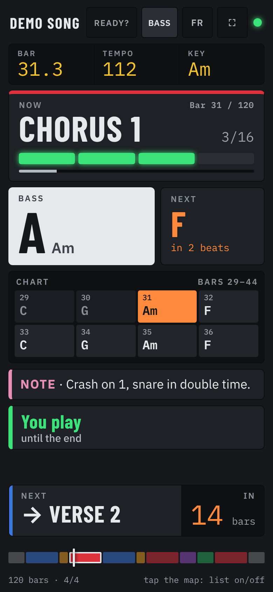
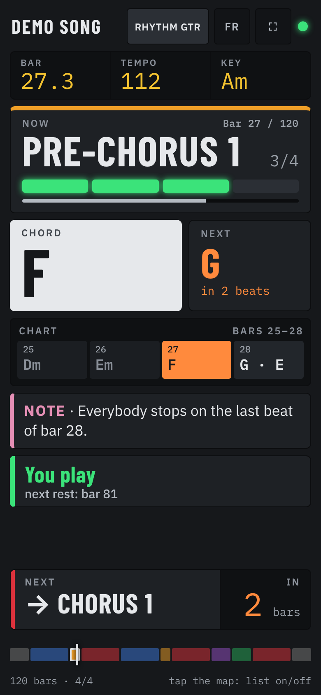
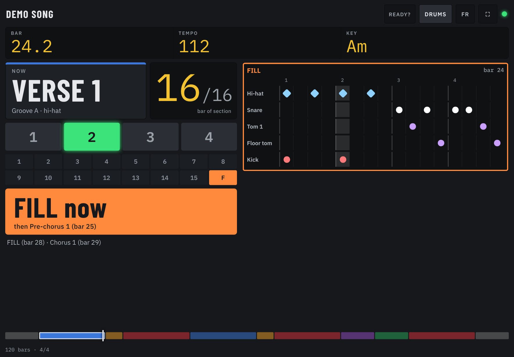
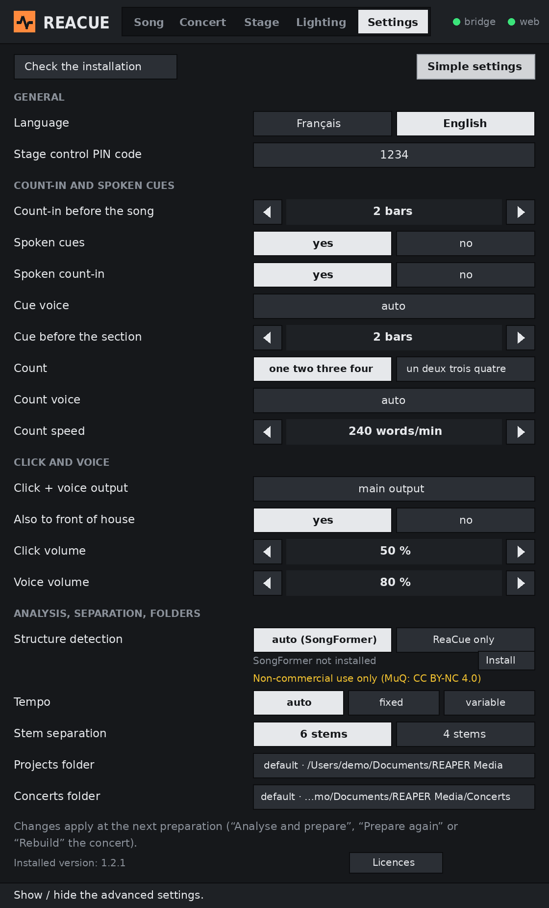
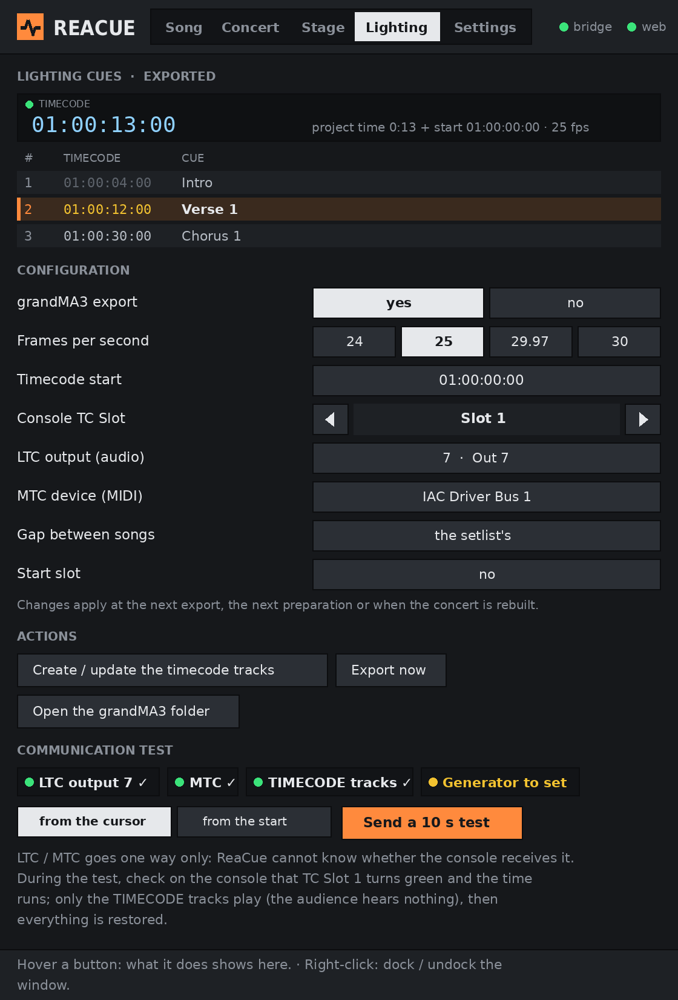

# ReaCue

**Live-ready songs in REAPER, in one click — and a prompter on every musician's phone.**

*[Version française : LISEZMOI.md](LISEZMOI.md)*

ReaCue is for bands that play live with REAPER. From the stems of a song (or a single MP3, which it can
split into stems itself, locally), it detects
the tempo, the bar grid and the structure, then builds everything in your REAPER project: tempo map,
named and coloured regions, a click with count-in, spoken cues (“Chorus”…) and a “one two three four”
count before each section. It also publishes a **web prompter** that each musician opens on their phone,
served by REAPER's built-in web interface: structure, chords (bass / guitars), timed lyrics (vocals) and a
dedicated drummer view with the transcribed grooves and fills.

Everything runs locally: no cloud service and no internet once installed (the optional components — stem
separation, structure analysis, chords, drums, word-by-word and automatic lyrics — use AI models that also run
on your computer). An optional mode lets you drive it in plain
language with Claude (MCP server).

> **New to ReaCue? Follow the step-by-step tutorial: [docs/TUTORIAL_en.md](docs/TUTORIAL_en.md)**
> (French: [docs/TUTORIEL_fr.md](docs/TUTORIEL_fr.md)).

> **Licences and disclaimers:** see [Licences, responsibilities and disclaimers](#licences-responsibilities-and-disclaimers)
> and [THIRD_PARTY_NOTICES.md](THIRD_PARTY_NOTICES.md) — the optional structure analysis is for
> **non-commercial use only**.

> **Status: 1.2.0.** Developed and used on macOS (Intel). Windows and Apple Silicon support has **not yet been
> tested on a real machine** — feedback welcome.

| The ReaCue window in REAPER | The prompter on a phone | Stage control (remote, PIN) |
|---|---|---|
|  |  |  |

| Drums | Bass | Vocals | Guitar |
|---|---|---|---|
|  |  |  |  |



*(Screenshots of a made-up “Demo Song”: structure, chords, lyrics and drums are all invented.)*

## Contents

- [Features](#features)
- [How it works](#how-it-works)
- [Requirements](#requirements)
- [Installation](#installation)
- [Enable REAPER's web interface (prompter)](#enable-reapers-web-interface-prompter)
- [Stem separation (optional)](#stem-separation-optional)
- [Structure analysis (SongFormer, default)](#structure-analysis-songformer-default)
- [Chord recognition (model, optional)](#chord-recognition-model-optional)
- [Drum transcription (ADTOF, optional)](#drum-transcription-adtof-optional)
- [The ReaCue window](#the-reacue-window)
- [Usage](#usage)
- [Concert mode](#concert-mode)
- [Lyrics](#lyrics)
- [PDF chart](#pdf-chart)
- [Lighting: grandMA3 export](#lighting-grandma3-export)
- [Settings](#settings)
- [Optional: drive ReaCue with Claude (MCP)](#optional-drive-reacue-with-claude-mcp)
- [Known limitations](#known-limitations)
- [Troubleshooting / FAQ](#troubleshooting--faq)
- [Uninstall](#uninstall)
- [For developers](#for-developers)
- [Licences, responsibilities and disclaimers](#licences-responsibilities-and-disclaimers)
- [Credits and licence](#credits-and-licence)

## Features

In REAPER, from the audio already in your project — everything from **one window, “ReaCue”**, with five tabs
(Song, Concert, Stage, Lighting, Settings):

- **Tempo map** locked to the song: fixed tempo when the recording is quantised, or one tempo marker per
  bar when it was played without a click (the click then follows the band). The audio is moved so that
  bar 1 falls exactly on a bar line.
- **One region per section**, named and coloured (Intro, Verse 1, Pre-chorus, Chorus, Bridge, Solo,
  Break, Outro, Main Riff…), in English or French.
- **CLICK track** (REAPER's native click source) with a 2-bar **count-in**, optionally routed to a
  dedicated hardware output for in-ears.
- **VOICE track**: a spoken cue (“Chorus”) on the second-to-last bar of each section and “one two three
  four” on the last bar, routed like the click. Uses the system voices (macOS `say`, Windows SAPI).
- **CUES track** and “→ Chorus” markers, readable at a glance.
- **Stem separation** (optional): turns a single MP3/WAV into 6 stems (vocals, drums, bass, guitar,
  piano, other) with [Demucs](https://github.com/facebookresearch/demucs), on your computer, no
  subscription and no upload — then ReaCue prepares the song from the stems.
- **Structure analysis** by SongFormer (installed by default, non-commercial use); **chords** and **drums**
  by trained models (optional); **word-by-word lyrics** and **automatic lyrics** (a draft transcribed by
  Whisper when you have no text, optional). All run locally, with an automatic fallback to ReaCue's own
  detection.
- **Printable PDF chart** (chords and lyrics bar by bar) in the song's folder, at each publication.
- **grandMA3 lighting**: one cue per section (Sequence, Timecode, cue sheet, plugin), Lighting role of the
  prompter and tracks that send timecode (LTC / MTC) to the desk, set up in the **Lighting** tab.
- **Concert mode**: several prepared songs chained in one project, automatic stop at the end of each song,
  a **Stage** tab to drive the show, a **QR code** for the musicians and a **Stage control**
  remote on a phone (PIN code); a **Check** button (pre-show check with one-click fixes) and a
  **Rehearsal** mode: loop a section or a range with a one-bar count-in before each repeat, 100–70 % speed.
- **Instruments**: mute / solo each stem of the concert (Vocals, Drums, Bass…), *Hear everything*, and a
  **“Played live”** profile saved with the concert (the band plays drums and bass for real → those stems are
  muted on every song, with per-song exceptions). From the window, the Stage control phone or Claude.

On the musicians' phones and tablets (web prompter):

- current section, bar and beat, bars left, next section, count-down on the last bar;
- **Bass / guitars**: current and next chord with a count-down, chord chart of the section, key;
- **Vocals**: scrolling lyrics in time with the song, next line and count-down before each entry (current
  word highlighted with word-by-word lyrics);
- **Drums**: groove of the section, 16-step (or triplet) grid of the current bar, open hi-hat, fills,
  crashes, stops and re-entries;
- per-instrument entries and rests detected from the stems (“STOP next bar”, “Come in in 2 bars”);
- French / English, follows REAPER's play cursor (REAPER is the only thing that needs to run on stage);
- in concert mode: song x/N and the next song; **Stage control** role to drive the concert from a phone;
- **Lighting** role: grandMA3 cues, current cue, timecode, files to download.

## How it works

```
 REAPER action “ReaCue - Prepare the song”          Claude (optional, MCP)
                 │                                         │
                 ▼                                         ▼
        ReaCue program (Python): audio analysis, tempo, sections, chords, lyrics, drums
                 │  drops data (never code) into <REAPER resources>/ReaCueMCP/
                 ▼
        ReaCue_Bridge.lua (runs in the background inside REAPER) ──> REAPER API
                 │
                 └──> reaper_www_root/prompteur.html + reacue_song.json ──> phones (Wi-Fi)
```

## Requirements

- **REAPER 7** or later (6.x probably works but is not tested).
- **macOS 12+** (Intel or Apple Silicon) or **Windows 10/11** (beta).
- About 1.5 GB of disk space (Python environment and libraries), plus the space of the optional components
  you install (see the table in [Installation](#installation)).
- **Internet only during installation** (to download Python and the libraries). Nothing is sent anywhere
  afterwards; lyrics are never downloaded.
- For the prompter: the phones and the computer on the same Wi-Fi network.

## Installation

1. Download the project (green **Code** button → *Download ZIP*) and unzip it **where you will keep it**,
   for example `Documents/ReaCue`. Do not move the folder afterwards (or run the installer again if you do).
2. Start REAPER once (so that its settings folder exists), then **quit REAPER**: the installer can then
   register the actions for you.
3. Run the installer:
   - **macOS**: double-click **`Install ReaCue.command`**. If macOS refuses to open it (“unidentified
     developer”), right-click it → *Open* → *Open*. Alternative in Terminal: `bash "Install ReaCue.command"`.
   - **Windows**: double-click **`Install ReaCue.bat`**. If SmartScreen shows a warning, click
     *More info* → *Run anyway*.
4. Answer the questions: language (`fr` / `en`), whether to register ReaCue in Claude Desktop
   (optional, answer *no* if you don't use Claude) and whether to install **stem separation** (optional,
   about 1 GB to download, 5 to 15 minutes; see [Stem separation](#stem-separation-optional)).
   Last question: **SongFormer structure analysis**, offered by default (*Enter* = yes); then type
   **`I accept`** to accept the models' licences (non-commercial use). Models already on the computer are
   reused ([details](#structure-analysis-songformer-default)).
5. Start REAPER. The bridge starts by itself and the actions are available in *Actions → Show action list*
   (on first launch, the ReaCue window opens an assistant that checks the installation):
   - **ReaCue** — the main window (Song, Concert, Stage, Lighting, Settings tabs): **add this one to a toolbar**
     (right-click a toolbar → *Customize toolbar* → *Add*), it is all you need day to day;
   - **ReaCue - Concert** — the same window, opened on the Stage tab;
   - **ReaCue - Prepare the song**, **ReaCue - Republish the prompter**, **ReaCue - Separate stems**
     (also buttons of the Song tab), **ReaCue - Next song** / **Previous song** (for a pedal or a shortcut).

The installer can be run again at any time (to change the language or repair an installation): your
settings and prepared songs are kept.

What it does: installs [uv](https://docs.astral.sh/uv/) (Astral's Python manager) if needed, creates a
private Python 3.12 environment in the `.venv` folder (pre-built packages only, no compiler needed), copies
the REAPER scripts into `<REAPER resources>/Scripts/ReaCue/`, adds the bridge to `Scripts/__startup.lua`,
registers the actions in `reaper-kb.ini` (only when REAPER is closed), and writes
`<REAPER resources>/ReaCueMCP/reacue_settings.json`. Nothing else in your system is modified.

**Optional components.** Each has its own installer (double-click, `.command` on a Mac, `.bat` on Windows),
its own Python environment inside the ReaCue folder, and an automatic fallback to ReaCue's own method when it
is missing or fails:

| Component | Installer | Download | Licence | Details |
|---|---|---|---|---|
| Stem separation (Demucs) | `Install ReaCue Stems` (or the installer's question) | ≈ 1 GB | MIT | [Stem separation](#stem-separation-optional) |
| Structure analysis (SongFormer) | `Install ReaCue Structure` (or the installer's question) | ≈ 3 GB | non-commercial (CC BY-NC 4.0), “I accept” | [Structure analysis](#structure-analysis-songformer-default) |
| Chords (trained model) | `Install ReaCue Chords` | ≈ 800 MB + 60 MB | MIT | [Chord recognition](#chord-recognition-model-optional) |
| Drums (ADTOF) | `Install ReaCue Drums` | ≈ 300 MB + 16 MB | non-commercial (CC BY-NC-SA 4.0), “I accept” | [Drum transcription](#drum-transcription-adtof-optional) |
| Word-by-word + automatic lyrics (Whisper) | `Install ReaCue Words` | ≈ 1 GB + 1.3 GB per language + 1.6 GB | Apache-2.0, MIT | [Word-by-word lyrics](#word-by-word-lyrics-optional), [Automatic lyrics](#automatic-lyrics-optional) |

PyTorch is downloaded once: it comes from the cache when another component already installed it. Step by
step: [tutorial, chapter 20](docs/TUTORIAL_en.md#20-optional-components).

If REAPER was open during installation, load the actions by hand once: *Actions → Show action list →
New action → Load ReaScript…* → pick `ReaCue.lua` (and, if you want them as separate actions,
`ReaCue_Preparer.lua`, `ReaCue_Republier_prompteur.lua`, `ReaCue_Separer_stems.lua`) in
`<REAPER resources>/Scripts/ReaCue/`. (*Options → Show REAPER resource path* opens that folder.)

## Enable REAPER's web interface (prompter)

This is done once, by hand (REAPER does not offer a safe way to do it from a script):

1. REAPER → *Options → Preferences* (macOS: *REAPER → Settings*) → **Control/OSC/web** → **Add**.
2. Control surface mode: **Web browser interface**. Port: **8080** (or any free port). Leave the rest as is.
3. OK, OK.

On each phone or tablet, open: **`http://<computer IP>:8080/prompteur.html`**, then pick your role.

Finding the computer's IP address:

- **macOS**: *System Settings → Wi-Fi → Details…* next to the network → *IP address* (e.g. `10.0.1.23`).
- **Windows**: *Settings → Network & Internet → Wi-Fi → (network) properties → IPv4 address*,
  or type `ipconfig` in a command prompt.
- The installer also prints the likely address at the end.

Tips:

- **Reserve the IP address** of the computer in your router (DHCP reservation, sometimes called
  “static lease”), so the address never changes and the phones' bookmarks keep working. On a gig, a small
  dedicated travel router works great.
- Add the page to the home screen (iOS: *Share → Add to Home Screen*; Android: *⋮ → Add to Home screen*)
  for a full-screen app-like view. The ⛶ button also switches to full screen.
- The **FR/EN** button switches the prompter language on that phone (remembered).
- The green dot means the link with REAPER is alive.

## Stem separation (optional)

ReaCue works best with stems (one file per instrument). If you only have the MP3 of a song, ReaCue can split
it for you with [Demucs](https://github.com/facebookresearch/demucs) (Meta AI research, MIT licence), entirely
on your computer: nothing is uploaded, no subscription.

**Install** (once): answer *yes* to the stem separation question of the installer, or later double-click
**`Install ReaCue Stems.command`** (macOS) / **`Install ReaCue Stems.bat`** (Windows). It creates a separate
Python environment `.venv-demucs` in the ReaCue folder (PyTorch + Demucs, about 1 GB), downloads the two
models and measures the speed of your computer. ReaCue's own environment is not touched.

**Use**:

1. Drag the MP3 (or WAV) into an empty REAPER project and click it to select it.
2. Run **ReaCue - Separate stems**. A window shows the progress (you can close it).
3. At the end, six tracks appear (Vocals, Drums, Bass, Guitar, Piano, Other), exactly aligned with the
   original item, which is removed from the project (one *Undo* brings it back; the file stays on disk).
4. Run **ReaCue - Prepare the song** as usual.

Details:

- Duration: about **5 to 8 minutes for a 4-minute song** on a recent Intel Mac (4 cores), faster on Apple
  Silicon. The computer's processor does the work (no graphics card needed).
- The stems are written next to the original file, in `<song name>-stems/htdemucs_6s/`, and keep the
  original file name (key and tempo in the name are still read by ReaCue). Running the action again on the
  same file imports them immediately, without separating again.
- `stems_model` in the settings: `"htdemucs_6s"` (6 stems, default) or `"htdemucs"` (4 stems: vocals,
  drums, bass, other — guitar and keys stay together in “other”).
- Quality: vocals, drums and bass are very good; guitar and especially piano are less clean than with
  commercial services (some bleed). Lead and rhythm guitars are not separated, so the solo detection
  that relies on a lead-guitar stem is not available.
- Mac Intel: PyTorch stopped supporting Intel Macs after version 2.2.2; the installer pins the right
  versions automatically.

## Structure analysis (SongFormer, default)

ReaCue finds the sections of a song (verse, chorus, bridge…) on its own. For better section boundaries and
names, it can use [SongFormer](https://github.com/ASLP-lab/SongFormer), a music structure AI model,
entirely on your computer (nothing is uploaded). **ReaCue keeps its own grid** (tempo, bars, count-in):
SongFormer only says where the sections are and what they are; each boundary is then snapped to the
nearest bar of ReaCue's grid.

**Install** (once): the installer offers it **by default** (step 6/6, *Enter* = yes); or later
double-click **`Install ReaCue Structure.command`** (macOS) / **`Install ReaCue Structure.bat`** (Windows).
Before anything is downloaded, the installer shows the licences of the models and installs only if you type
exactly **`I accept`** (`J'accepte` in French); otherwise nothing is installed. For an unattended
installation, set `REACUE_STRUCTURE_ACCEPT=yes`. The acceptance is remembered in
`structure/.licenses_accepted` (not asked again on updates).
It creates a separate Python environment `.venv-structure` in the ReaCue folder, downloads SongFormer and
its two dependencies (MuQ, MusicFM) at fixed versions into `structure/`, downloads the models once (into
`structure/hf` and SongFormer's own folder), runs a short test and shows `STRUCTURE_OK` with the speed of
your computer. About **3 GB** to download, 10 to 40 minutes. ReaCue's own environment is not touched.

**Models already downloaded**: before downloading, the installer looks for models already on the computer —
another copy of SongFormer (for example `~/Documents/ReaCue-labo/SongFormer/src/SongFormer/ckpts`, files
checked against SongFormer's `md5sum.txt`) and the default Hugging Face cache (`~/.cache/huggingface/hub`
on macOS / Linux, `%USERPROFILE%\.cache\huggingface\hub` on Windows: MuQ and wav2vec2-conformer). They are
**copied** (or linked, using no extra space on the same disk) into `structure/`; the originals are never
changed or deleted. Only what is missing is downloaded. Other folders to search: `REACUE_REUSE_DIRS`
(separated by `:` or `;`).

**Use**: nothing to do. *Analyse and prepare*, *Do everything* and *Re-analyse from scratch* (window,
actions, Claude) use SongFormer automatically as soon as it is installed; the tab shows **“Structure analysis (SongFormer)… N s”** meanwhile, and the result
says “Sections detected by SongFormer”. The result is remembered per song (`.reacue/<song>_structure.json`
next to the audio), so preparing the song again is immediate, until the audio file changes.

How the sections are built:

| Step | Rule |
|---|---|
| Input | the mix, or the sum of the stems (aligned like the analysis) |
| Boundaries | snapped to the nearest bar; a 4-bar phrase from the previous boundary wins if it is ≤ 1 bar away |
| Short pieces | segments shorter than 2 bars are merged with a neighbour; two consecutive parts of the same kind are merged when one is shorter than 8 bars and they total ≤ 16 (8 + 8 = two verses) |
| Silence | ignored at the start and at the end |
| Names | Intro, Verse N, Pre-chorus N, Chorus N, Bridge, Instrumental, Outro (French or English; verses, pre-choruses and choruses numbered); an *instrumental* part becomes **Solo** when the guitar (lead stem if present) is clearly louder than usual and the voice is low; same kind = same letter |
| Priority | regions you edited by hand in REAPER, and Claude's `set_sections`, still win over any analysis |
| To check | in the window, a section is **orange** when its length is not 4, 8 or 16 bars, or when SongFormer had put its boundary ¾ of a bar or more away from the chosen bar (“moved when aligning”) or between two bars |
| Fallback | SongFormer not installed, setting “ReaCue only” → ReaCue's own detection; error or timeout (30 min) → “SongFormer analysis failed: … → ReaCue structure used” |

Real example (a French song at 105.12 BPM, 16 GB Mac): SongFormer's boundaries land exactly on bars
9 / 17 / 25 / 33 / 41 / 49 / 57 / 73 → Intro, Verse 1, Verse 2, Instrumental, Verse 3, Bridge, Chorus 1,
Instrumental (Solo with stems), Outro. First time: about 40 min to download and load the models, then
about 7 min of analysis (420 s window).

Setting **Structure detection** in the **Settings** tab: *auto (SongFormer)* (default: SongFormer when
installed) or *ReaCue only*; the line below says whether SongFormer is installed. Key `structure_engine`
(`"auto"` / `"reacue"`).

Memory and time:

- The model looks at the song in windows of **420 s** (its trained setting) when the computer has
  **15 GB of RAM or more**, otherwise **120 s** (a little less accurate, about 4 GB of memory). With 420 s
  it needs **6 GB or more** of free memory. 8 GB of RAM in total is the recommended minimum.
- On the processor (no graphics card needed): **several minutes per song** on an Intel Mac (the installer
  prints an estimate); faster on Apple Silicon or with an NVIDIA graphics card. Only the first preparation
  of a song pays this price (then the cache is used).

**Licences — non-commercial use only.** SongFormer's code is CC BY 4.0, but it relies on the **MuQ**
model whose **weights are licensed CC BY-NC 4.0 (non-commercial)**; the analysis is therefore for
personal / non-commercial use. See [Credits and licence](#credits-and-licence). The repository contains no
model weights: they are downloaded by the installer from their authors.

## Chord recognition (model, optional)

By default ReaCue detects the prompter and PDF-chart chords with its own rules (chroma + bass). For more
accurate chords (major / minor, 7, maj7, m7, sus, dim, aug, inversions such as `D/F#`) it can use a
**trained model**: *Large-Vocabulary Chord Transcription via Chord Structure Decomposition* (Junyan Jiang,
Ke Chen, Wei Li, Gus Xia — ISMIR 2019), **code and weights under the MIT licence**.

**Install:** double-click **`Install ReaCue Chords.command`** (Mac) or **`Install ReaCue Chords.bat`**
(Windows). It creates a separate `.venv-chords` environment, downloads the model from GitHub at a pinned
revision into `chords/model` (about 60 MB), installs PyTorch (already cached if stem separation is installed;
Mac Intel: PyTorch 2.2.2, numpy < 2, nothing to compile), tests it on synthetic audio and prints `CHORDS_OK`.

The model listens to the stems **without vocals and drums** (or to the single file), its decoding follows
ReaCue's beat grid, and the result keeps the usual format (at most two chords per bar, beats 1 and 3);
sharps / flats follow the key, inversion basses are spelled as chord tones (`E/G#`, `Ab/C`), 9ths, 11ths
and 13ths show as the matching 7th chord. About 1 to 2 min per 4-minute song on an Intel Mac CPU, about
1.2 GB of memory, cached in the song's `.reacue` folder. Fallback to ReaCue's detection when it is not installed,
when `chords_engine` is `"reacue"`, or on error / timeout (10 min). Compare both methods on your songs:
`.venv/bin/python tools/compare_chords.py <song folder or audio file>…`.
## Drum transcription (ADTOF, optional)

The prompter's **Drums** view (groove, fills, crashes) comes from the drum stem. By default ReaCue
transcribes it with its own rules; if you install this component, it uses **ADTOF**, a model trained on
359 hours of real music (kick, snare, toms, hi-hat, cymbals), much more reliable on snare and cymbals.
ReaCue then tells high / mid / floor tom, closed / **open** hi-hat (new “Open hi-hat” row) and crash / ride
apart, and snaps every hit to its grid (sixteenths, or triplets for a shuffle).

- Install: double-click **`Install ReaCue Drums.command`** (Mac) or **`Install ReaCue Drums.bat`**
  (Windows). About 300 MB to download (PyTorch, already cached if stem separation is installed) + 16 MB for
  the model, 3 to 10 minutes. Separate `.venv-drums` environment.
- Then it is automatic (setting `drums_engine`: `auto`; `reacue` to go back to the rules); if it fails,
  ReaCue falls back to its rules. About 20 to 60 s per song on an Intel Mac, only once (result cached next
  to the stem, in `.reacue/`).
- Compare before / after on a song: `.venv/bin/python tools/compare_drums.py <drum stem>`.

**Licences — non-commercial use only.** ADTOF's weights are **CC BY-NC-SA 4.0**; the PyTorch port used
(ADTOF-pytorch) states no licence. The installer asks you to type “I accept”. See
[THIRD_PARTY_NOTICES.md](THIRD_PARTY_NOTICES.md).

## The ReaCue window

Action **ReaCue** (put it on a toolbar). One window, five tabs; it opens on the right tab by itself
(a concert project → **Stage**, a song project → **Song**, otherwise the last tab used). Right-click: dock /
undock — docked low, it becomes a compact transport bar. While it is open, on any tab, it also runs the
concert's automatic stop, the rehearsal loop, the Stage control remote and the “played live” profile.

At the bottom, a **help line** explains the element under the mouse. An error shows its **cause**, **what to
do** and a button that does it (*Start the bridge*, *Fix* for an offline file, *Install*, *Save*, *Open the
log*…). On **first launch**, an assistant checks the installation (bridge, web interface and port, IP
address, program, stems, structure, projects folder) with a button for each missing item; it is also in
*Settings → Check the installation*.

| Song | Do everything |
|---|---|
|  |  |
| **Structure (editing)** | **+ New song** |
|  |  |
| **Concert** | **Concert — batch preparation** |
|  |  |
| **Stage** | **Played live** |
|  |  |
| **Check (before the show)** | **QR code (phones)** |
|  |  |
| **Assistant (first launch)** | **Settings** |
|  |  |
| **Advanced settings** | **Lighting (grandMA3)** |
|  |  |

*(Made-up demo songs, address 192.168.1.20, PIN 1234.)*

- **Song** — the project that is open.
  - A **big button** gives the next step: **Split stems** (a single MP3/WAV) → **Analyse and prepare** →
    **Ready ✓** (click: Stage tab); after a structure edit: **Apply the changes**. Next to it, **Do
    everything** chains split stems (if needed), analyse and prepare, update the phones and save the project:
    a list shows each step (already done, running with its time, done, failed); *Stop* stops after the current
    step, *Resume* starts again at the failed step. *Do everything* is offered right after **+ New song**.
  - Secondary buttons: *Prepare again* (keeps your structure), *Re-analyse from scratch* (after a
    confirmation), *Update the phones* (lyrics, chords, drums, structure).
  - **Status pills**: Stems · Structure (*SongFormer*, *ReaCue* or *manual*) · Tempo · Chords · Drums ·
    Lyrics (N lines) · Prompter published · Saved. A click does the useful action (split, install
    SongFormer, update the phones, open the lyrics folder, QR code, save).
  - **Structure**: a **coloured band** (one box per section, width proportional to bars, ReaCue colours,
    **orange = to check**, hover = details) then the list (first bar, length). Click a box or a name to select
    it and listen. For the selected section: *Rename*, ◀ ▶ (start ± 1 bar), *Merge →* (with the next one),
    *Split in two*, *Delete*; *+ Section at cursor*; **Undo / Redo** (history); then **Apply**.
  - *Open folder*, **Add to a concert**. After a success started from the window, the song's project is saved
    automatically.
- **Concert** — the song projects of the projects folder (✓ prepared, orange = to prepare), **+** adds one to
  the setlist; reorder (▲ ▼), remove (✕), *Rename*; **Build** (or *Rebuild*) the concert, *Open* it in a new
  project tab, *Played live…*; the existing concerts (*Edit*, *Open*). **Prepare all songs not prepared** (or
  *Prepare the selection* with the ticked boxes): in the background, one song after the other (opened in a
  tab, *Do everything*, saved, tab closed), with the progress; *Stop* stops after the current song.
- **Stage** — drives the concert: song x/N, transport, sections, **instruments**, next song, *Check* (with
  *Fix*, also for the bridge and the web interface), *Rehearsal*, *Setlist*, *PIN*, *QR*. With a single song
  open (no concert) it gives a simple transport (Start, Play, Stop), the sections, the instruments and the
  rehearsal loop.
- **Lighting** — grandMA3 desk: cues of the open song or concert (number, SMPTE timecode, name; current cue
  highlighted) and the current timecode; `gma3_*` settings without editing the file (export, fps, start,
  TC Slot, LTC output from the audio interface's outputs, MTC device from the MIDI outputs, concert gap and
  slot); **Create / update the timecode tracks**, **Export now**, **Open the grandMA3 folder**;
  **communication test**: chips (LTC output present, MIDI device found and enabled, `TIMECODE` tracks with
  their generator, generator set) and **Send a 10 s test** (only the `TIMECODE` tracks play, soloed, then
  solo / mute / position / playback are restored). LTC / MTC goes one way: the desk shows it receives
  (TC Slot turns green).
- **Settings** — a **simple** view (language, count-in, cues, voices, click + voice outputs, structure
  detection, licences) and **Advanced settings** (PIN, cue lead, count language, voice and speed, volumes,
  tempo, separation model, folders). *Check the installation* opens the assistant again. Changes apply at the
  next preparation.

## Usage

1. **Import the song**: in the ReaCue window, **+ New song** (Song tab, or under the Concert tab's list) →
   one file (MP3, WAV…) or a folder of stems → title. ReaCue copies the files to
   `<projects folder>/<Title>/`, opens a new project tab with one file per track and saves
   `<Title>/<Title>.RPP` (an existing song is never overwritten). By hand also works: one stem per track, all
   starting at the same time (drag and drop). A single MP3/WAV works with less detail — better split it first
   with **Split stems** (see above; *Do everything* does it for you).
   - The role of each stem is read from its **file name**: `drum`/`batterie`/`kick`/`perc`, `bass`/`basse`,
     `guitar`/`guitare`/`gtr` (`lead`/`solo` = lead guitar), `vocal`/`voice`/`vox`/`chant`/`voix`;
     anything else counts as keys/other.
   - Optional: key and tempo in the file names (e.g. `Demo Song-A minor-112bpm-drums.wav`) help the chords
     and the tempo octave.
2. In the **Song** tab of the ReaCue window, click **Do everything** (or the big button, step by step:
   *Split stems* then *Analyse and prepare*; action **ReaCue - Prepare the song**). The progress shows in the
   tab (from 20 s to a few minutes; longer the first time with SongFormer); at the end: tempo, structure (bars
   and lengths), what was published (*Summary*).
3. Check the structure (coloured band: orange boxes first) and play the song. To correct it: tools of the
   selected section (rename, move by a bar, merge, split, delete, add, *Undo*), then **Apply** — or **edit
   the regions by hand in REAPER**, then *Apply* / *Prepare again*: see
   [Correcting the structure](#correcting-the-structure). *Prepare again* on the same project **keeps the
   validated structure** (or takes your edited regions) and rebuilds everything (click, cues, prompter),
   applying the settings file if you changed it in the meantime.
4. After adding or editing a lyrics file, click **Update the phones** (action **ReaCue - Republish the
   prompter**) (nothing in the REAPER project is changed).

Several songs to prepare? **Concert** tab → **Prepare all songs not prepared**.

Each preparation **replaces** the regions, markers, tempo map and the CLICK / CUES / VOICE tracks of the
project (one *Undo* goes back). Use one project per song.

### Correcting the structure

Two ways, which can be mixed:

- **By hand in REAPER, then *Apply* (or *Prepare again*).** Double-click a region in the region lane (top of the
  window) to change its name or its start; add one with a time selection and *Markers → Insert region from
  time selection* (Shift+R); delete one with right-click → *Remove region*; or simply drag its edges, then run **ReaCue - Prepare the song**.
  When the song was already prepared (same audio items), ReaCue reads the project's regions and, if they
  differ from the saved structure, **adopts them as the new structure**; the final window then says
  “Structure taken from your REAPER regions”. Rules:
  - only the **start** of each region counts: a section lasts until the next region starts;
  - the start is moved to the nearest bar line (within a quarter of a bar it is silent; further away it
    is rounded with a warning);
  - names are kept as typed (French or English); the section type — colour, spoken cue, prompter role — is
    deduced from the name (“Chorus 2”, “Refrain”, “Solo”…);
  - regions before bar 1, after the end of the song, or on the same bar as another one are ignored with a
    warning; if no region starts on bar 1, the first bars are joined to the first region;
  - regions, colours, “→” markers, CUES, VOICE, CLICK and the prompter are then rebuilt.
  If no region was changed, nothing changes (structure kept). In another project (consolidated, other
  song), the regions are never read and nothing is modified.
- **With Claude** (optional mode, below): “chorus 1 starts at bar 37”, “rename section 6 to Solo”.

*Update the phones* does **not** take edited regions (the prompter must stay in line with the cues and the
click already in REAPER): it shows a warning asking you to click *Apply*.

## Concert mode

Chain several songs that are **already prepared** (each in its own project) in one REAPER project, and
drive the whole show from one window or from a phone.

1. **Build the concert** — in the **Concert** tab of the ReaCue window: **+** on each song, order them,
   *Rename*, **Build** (the concert opens in a new tab when it is ready). Or with Claude: *“concert “Saturday”: Demo Song, Second Demo, Third Demo”*
   (tool `build_concert`), or from the command line:
   `python -m reacue_mcp.cli concert --name "Saturday" --songs "Demo Song" "Second Demo"`
   (macOS/Linux, from the ReaCue folder with `.venv/bin/python`; Windows: `.venv\Scripts\python reacue_cli.py concert …`).
   Songs are found by project name in the projects folder (setting `projects_dir`, default
   `<Documents>/REAPER Media`) or given as `.RPP` paths. Nothing is re-analysed: each song keeps its stems,
   tempo map (fixed or one tempo per bar), validated structure, spoken cues and click.
2. **Open it** — **Concert** tab (*Open*), or action **ReaCue - Concert** (Stage tab): with no concert open, it lists the concerts
   (folder: setting `concert_dir`, default `<projects folder>/Concerts`); one click opens it in a **new
   project tab** (your current project stays open).
3. **Play** — one project: one track per instrument shared by all songs (Vocals, Drums, Bass, Guitars…,
   one colour per song), CLICK / VOICE / CUES at the bottom, regions “Song · Chorus 1”, a “Songs” ruler
   lane with “1 · Demo Song” markers. Playback **stops by itself at the end of each song** and the cursor
   waits on the next song's count-in: press Space when the band is ready.

Files written next to each other: `<name>.RPP` (the concert), `<name>.setlist.json` (order, reusable),
`<name>.concert.lua` (song times, read by the window), `<name>.prompteur.json` (prompter for the whole
show). Edit a song in **its own project**, then *Rebuild the concert* (Setlist button): changes made
directly in the concert project are overwritten.

**The Stage tab** (window dockable: right-click) shows “2 / 6 · Song”, tempo, key, section,
“bar x / N”, a Playing / Paused / Stopped badge, song progress and time left, concert time and the next
song; big **Previous / Start / Play-Pause / Stop / Next** buttons (during playback Stop, Previous and Next
need a **double tap** within 2 s, to avoid accidents); the song's **sections** as coloured pills (click =
go there, playback continues); **Setlist**, **PIN** and **QR** buttons. Docked low, it shrinks to one line
(state + transport + QR). Extra actions *ReaCue - Next song* / *Previous song* for a pedal or a shortcut.
The automatic stop and the phone remote only work while the ReaCue window is open (any tab, even docked).

**Instruments (mute / solo / played live)** — under the sections, one button per instrument track of the
concert (Vocals, Drums, Bass, Guitars, Lead guitar, Keys, Other, Mix; not CLICK / VOICE / CUES): a click
mutes / unmutes it (during playback outside rehearsal: **double tap**), a **long press** = solo (again =
back), **Hear everything** unmutes all (again = back to the profile). These manual choices last until the
next song. **Played live…** opens the concert's profile: tick what the band plays for real (e.g. Drums and
Bass) — those stems are muted automatically on every song — and set **per-song exceptions** (click a cell:
stem / live / profile; e.g. the bass stem is kept on the song where the bassist plays keys). The profile is
saved in `<name>.setlist.json` (`live`, `live_exceptions`), kept when the concert is rebuilt, and applied
when each song starts. The rehearsal count-in bar does not overwrite your choices. The *Check* view shows
which stems are muted. The prompter tells each musician “your stem is muted / playing”, and the Stage
control phone has the same buttons (PIN). With Claude: `build_concert(…, live=["drums", "bass"],
live_exceptions={"Second Demo": {"bass": "stem"}})`, or change the profile of an existing concert without
rebuilding it: `set_live_profile("Saturday", live=[…], exceptions={…})` (also
`set_sections([{"concert_live": {…}}])`).

**QR code for the musicians** — the QR button shows, large, the prompter address
`http://<this computer's IP>:<port>/prompteur.html`: the IP is computed when you click (macOS `ipconfig`,
Windows `ipconfig`, Linux `hostname -I`) and the port is read from REAPER's web interface settings
(`reaper.ini`). Musicians scan it with the phone camera (same Wi-Fi). QR encoder:
[luaqrcode](https://github.com/speedata/luaqrcode) (BSD licence).

**Stage control (phone remote)** — in the prompter, choose the role **Stage control**: Play/Pause, Stop,
Previous / Next, Start of song, clickable setlist and sections, instruments (tap = mute, long press = solo,
*Hear everything*), with a ✓ when REAPER executed the command.
It asks once for the **4-digit PIN** shown in the Stage tab (generated on first launch, changeable
with the PIN button, remembered on the phone). Commands go through REAPER's web interface
(`/_/SET/EXTSTATE/ReaCue/remote/…`) and are checked by the ReaCue window (PIN, replay protection).
⚠️ The PIN prevents mistakes, **not attacks**: anyone on the same network can reach REAPER's web interface
(`/_/…`) directly. Use a Wi-Fi reserved for the band at gigs.

**Check (pre-show check)** — the **Check** button of the Stage tab lists, with a green / orange / red
dot: audio files readable (no “OFFLINE”), spoken cue files present, songs prepared (structure and tempo),
concert up to date (no song project changed since the concert was built — fingerprint stored at build
time), ReaCue bridge, REAPER web interface, network address, audio device running, click and cue outputs
(hardware outputs that exist, track not muted), prompter published, Stage control phones seen. A **Fix**
button appears when possible: set all media online, rebuild the concert, republish the prompter. Also
available with no concert open (system part only).

**Rehearsal mode** — the **Rehearsal** button (window or Stage control phone) turns the automatic stop off.
Tap a section to **loop** it; tap a second section of the same song to loop the whole range (e.g. Verse 2 →
Chorus 2). Before the loop starts and **before each repeat, one bar of count-in** is played with the click
and the spoken cues only (the other tracks are muted during that bar), at the tempo of that point of the
song. **Speed** 100 / 90 / 80 / 70 % (pitch preserved; click, cues and prompter follow). *Loop off* stops
looping; *Exit* (or leaving rehearsal from the phone) restores everything: speed 100 %, automatic stop,
REAPER's repeat and time selection as they were.

Step by step: [tutorial, concert chapter](docs/TUTORIAL_en.md#16-concert-mode-several-songs-in-one-project).

## Lighting: grandMA3 export

Every preparation (and every concert build) also writes a **grandMA3 lighting show**: one cue per section
(named after the section, e.g. “Chorus 1”) at the start of its region, in **REAPER project time** (0 = start
of the project, count-in included).

- **Song**: `grandMA3/<Title>_Sequence.xml`, `<Title>_Timecode.xml`, `<Title>_conduite.csv` next to the `.RPP`.
- **Concert**: `<concerts folder>/grandMA3/<concert>/`: one Sequence per song, **one** Timecode (one track
  per song) and the cue sheet.
- Sequence names are cleaned (ASCII and `_`: “Démo d’été” → `Demo_d_ete`); duplicate cue names get “(2)”.
- The cue sheet (CSV) lists SMPTE timecode, cue, label, type and a **suggested effect** per section type
  (also written as an XML comment above each cue).
- The prompter's **Lighting** role shows the cue list (current cue highlighted), the timecode, the settings
  and download links for the three files (served by REAPER's web interface, no internet needed).
- On the desk: import the Sequence(s) first, then the Timecode (test on an empty slot first).

**REAPER sends the timecode to the desk (MTC or LTC), automatically.** The desk follows the project
position, which matters because the concert **stops between songs**: stopping REAPER stops the desk's
timecode show, playing again restarts it. Give `gma3_ltc_output` and/or `gma3_mtc_output` and every
preparation and every concert build creates (or replaces, never duplicates) the tracks:

- `TIMECODE LTC`: REAPER's *SMPTE LTC/MTC Timecode Generator* item over the whole project, sent to the audio
  output `gma3_ltc_output` (`7` = output 7 alone, `"7/8"` = pair), never to the master;
- `TIMECODE MTC`: the same generator sent to the MIDI output `gma3_mtc_output` (device name, e.g.
  `"IAC Driver Bus 1"`), no audio.

Sent time = project time + `gma3_tc_start`, at `gma3_fps`: the same times as the Timecode XML. A concert
gets **one** track per output over the whole concert (the songs' tracks are not copied). Empty settings
(default) = no track.

**Once, in REAPER:** the generator's settings are not documented in the project file, so ReaCue does not
invent them. After the first preparation, double-click the generator item → *Source properties*: frame rate
= `gma3_fps`, start = `gma3_tc_start`, *Send MIDI (MTC)* ticked on `TIMECODE MTC` only, unticked on
`TIMECODE LTC`; OK, then prepare again. ReaCue remembers it (per frame rate + start) and reapplies it to every
song and concert; until then each preparation reminds you. Also enable the MIDI output in *Preferences →
Audio → MIDI Devices*.

**grandMA3 plugin “ReaCue”.** The export folder also holds `gma3_library/datapools/plugins/ReaCue.xml`
(+ `ReaCue.lua`) and copies of the XML files in `gma3_library/datapools/sequences/` and `…/timecodes/`.
Copy the **contents** of the export folder into `grandMA3/` at the root of a USB stick; on the desk: Plugins
pool → new plugin → *Import* → `ReaCue.xml`, then run it. In one tap it imports the Sequences (an existing
Sequence of the same name is kept: your programming stays), the Timecode (asks before replacing it), sets
its TC Slot (`gma3_tc_slot`, 1 by default), Auto Start and Auto Stop, and reminds you of the input setup.
Re-import the plugin after each export (it carries the song's or concert's file list).

| Setup | ReaCue setting | Desk / onPC, once |
|---|---|---|
| Console, LTC | `gma3_ltc_output`: sound card output wired to the desk's **LTC XLR** input | Menu → Output Configuration → Connector Configuration: SMPTE Mode = In, SMPTE TC column = slot |
| Console, MTC | `gma3_mtc_output`: MIDI interface wired to **MIDI In** | MIDI TC Mode = In, MIDI TC column = slot |
| onPC on the same Mac | `gma3_mtc_output`: `"IAC Driver Bus 1"` (Audio MIDI Setup → MIDI Studio → IAC Driver: *Device is online*) | MIDI TC input on the slot |
| onPC on another computer | `gma3_mtc_output`: `"Network Session 1"` (macOS Network MIDI); rtpMIDI on the Windows PC | MIDI TC input on the slot |

To test on the desk (not verified yet): the plugin's import commands and the `sequences/` / `timecodes/`
folders, the TC Slot / Auto Stop properties set by the plugin, onPC MIDI timecode input. If the plugin cannot
import a file, import the Sequence then the Timecode by hand and set TC Slot in the Timecode settings.
Settings `gma3_song_gap` and `gma3_song_slot` (start each song on a round time, e.g. every 10 min) are listed
in [Settings](#settings).

## Lyrics

ReaCue **never downloads lyrics**: you provide your own text file, next to the stems (same folder):

- name starting with `lyrics`, `paroles` or `parole`, extension `.txt` (UTF-8) or `.rtf`;
- one line = one sung phrase; an empty line separates blocks (verse, chorus…);
- label lines such as `[Chorus]` or `Verse 2:` are ignored; `(x2)` or `bis` at the end of a line repeats it;
- a chorus written once is found again automatically when it is sung again (needs a vocal stem).

The lines are aligned automatically on the vocal stem. To fix a line, add a **timing file** next to the
lyrics: `lyrics_timing.json` (or `paroles_calage.json`). It contains no text, only line numbers and
positions on the bar grid:

```json
{
  "_comment": "keys starting with _ are ignored",
  "1": "9:1.5",
  "2": "11:1.5-12:4",
  "5#2": "47:2.75",
  "8": null
}
```

- key `"12"` = line 12 (1-based, counting non-empty lines, labels excluded), first time it is sung;
  `"12#2"` = second time it is sung (repeated chorus);
- value `"45"` = bar 45, beat 1; `"45:2.75"` = bar 45, beat 2.75 (beats are 1-based, decimals allowed);
  `"45:2.75-49:1.5"` = start and end; `{"start": "45:2.75", "end": "49:1.5"}` is the same;
  `null` = line never shown.
- If **every** line has an anchor (or `null`), automatic alignment is skipped entirely.

Then click *Update the phones* (Song tab).

### Word-by-word lyrics (optional)

By default ReaCue knows where each **line** starts and ends, not each word. The optional **word-by-word
lyrics** component places every word at its real time by *forced alignment* of the known text on the vocal
stem, with a speech model (wav2vec2 XLSR-53 fine-tuned in **French** or **English**, Apache-2.0), on your
computer. Line timing stays the anchor (repeats, backing vocals, unsung lines, `lyrics_timing.json` anchors):
words are searched **inside** each line; a poorly recognised line keeps its line timing.

- **Install**: double-click `Install ReaCue Words.command` (Mac) or `Install ReaCue Words.bat` (Windows).
  Separate `.venv-words` environment (same PyTorch versions as stem separation), then the two models
  (≈ 1.3 GB each; one language only: `REACUE_WORDS_LANGS=en bash install/install_words_mac.sh`).
- **Use**: automatic at the next prompter update; the language is guessed from the lyrics text
  (`words_language` setting to force it). About 1–3 minutes per song on an Intel Mac, once (cached).
- **Result**: on the prompter (Vocals role) the current word is highlighted; in the PDF chart each word goes
  in the bar where it is sung. `tools/compare_words.py` shows before / after without ever printing the lyrics.

### Automatic lyrics (optional)

No lyrics file? If the `.venv-words` component also contains **Whisper** (OpenAI, code and model under the
MIT licence), ReaCue transcribes the vocal stem on your computer and writes a **draft** `paroles (auto).txt`
in the song folder, then used like a normal lyrics file (line timing, then word by word). It is a draft:
speech recognition makes mistakes on singing.

- **Your file first**: `lyrics.txt` (or `paroles.txt`…) always wins. The draft is created once and **never
  overwritten**: correct it in place, or rename it `lyrics.txt` once corrected, then *Update the phones*.
  Lines starting with `#` (at the top of the draft) are ignored.
- **ReaCue window**: orange pill *Lyrics: auto (N lines)*; click = open the draft. The PDF chart mentions it
  in its footer.
- **Install** (or complete an existing install without redoing everything): run `Install ReaCue Words`
  again (or `bash install/install_words_mac.sh`): it adds Whisper and downloads the `large-v3-turbo` model
  (≈ 1.6 GB) into `words/whisper/`. Without Whisper: `REACUE_WHISPER=0 bash install/install_words_mac.sh`.
- **Time**: several minutes per song on an Intel Mac (once). Only the sung parts of the vocal stem are
  transcribed (no invented text on silences); one line = one sung phrase, empty line between blocks
  separated by a long silence. Language detected (mostly French / English) or forced with `words_language`.
- **Try it by hand**: `.venv/bin/python tools/transcribe_lyrics.py` (last prepared song) prints statistics
  only (lines, words, language, computing time), never the text; `--write` writes the draft if missing.
- **Turn off**: setting `lyrics_auto` = `"off"`.

## PDF chart

Each time the prompter is published (*Analyse and prepare*, *Prepare again*, *Do everything*, *Update the
phones*), ReaCue writes a printable A4 chart, **`Chart - <Title>.pdf`** (`Grille - <Title>.pdf` in French), in
the **song's folder** (the folder of the audio files, or the parent of a `…-stems` folder). It is built from the
prompter data: what the PDF shows is what the phones show.

- Header: title, tempo, time signature, count-in, key (“estimated” when it comes from the chords).
- Each section (name, colour, number of bars) in rows of 4 bars, with the chord of each bar (box split when
  there are two) and the words sung in the bar (coloured box; word by word when the component is installed;
  without lyrics, the coloured boxes show where the voice sings).
- Footer: “please check”, and a mention of automatic lyrics (draft) when relevant.
- Song tab: **PDF chart** pill (click = open, or create). Never blocking: on error, “PDF chart not created: …”.
  No chart for a concert (the songs' charts stay in their folders).
- No dependency: the PDF is written by ReaCue itself (`reacue_mcp/sheet.py`, standard fonts).

## Settings

Easiest: the **Settings** tab of the ReaCue window (written at once, other keys of the file kept).
File: `<REAPER resources>/ReaCueMCP/reacue_settings.json` (created by the installer; can also be edited with
any text editor; missing keys take their default value). Taken into account at the next preparation (*Analyse and prepare*, *Prepare again*, *Do everything*), including for
an already prepared song (its validated structure is kept). The `language` setting names the sections of
newly analysed songs; section names you validated yourself are kept as they are.

| Key | Default | Meaning |
|---|---|---|
| `language` | `"fr"` | `"fr"` or `"en"`: region names, spoken cues, prompter, messages |
| `count_in_bars` | `2` | bars of click before bar 1 |
| `cue_lead_bars` | `2` | spoken cue N bars before the section (2 = second-to-last bar) |
| `voice_cues` | `true` | spoken section names |
| `voice_count_in` / `voice_count_each` | `true` | “one two three four” on the count-in / before every section |
| `count_lang` | `"en"` | language of the count (`"en"` or `"fr"`) |
| `announce_voice` / `count_voice` | `null` | system voice name (macOS: `Thomas`, `Samantha`… Windows: `Microsoft Hortense Desktop`, `Microsoft Zira Desktop`…); `null` = automatic |
| `count_rate` | `240` | count speed (words per minute) |
| `voice_volume` / `click_volume` | `0.8` / `0.5` | track volumes |
| `click_to_master` | `true` | `false` = click and voice only on `click_hw_output` (in-ears) |
| `click_hw_output` | `null` | hardware output index (0 = outputs 1/2, 2 = 3/4…) |
| `tempo_mode` | `"auto"` | `auto`, `constant` (one tempo) or `beatmap` (one tempo per bar) |
| `stems_model` | `"htdemucs_6s"` | stem separation model: `"htdemucs_6s"` (6 stems) or `"htdemucs"` (4 stems) |
| `structure_engine` | `"auto"` | sections: `"auto"` (SongFormer when installed) or `"reacue"` (ReaCue's own detection) |
| `words_engine` | `"auto"` | lyrics: `"auto"` (word by word when the component is installed) or `"off"` (lines only) |
| `words_language` | `"auto"` | sung language for word timing: `"auto"` (guessed from the text), `"fr"` or `"en"` |
| `lyrics_auto` | `"auto"` | without a lyrics file: `"auto"` (draft `paroles (auto).txt` by Whisper when installed) or `"off"` |
| `chords_engine` | `"auto"` | chords: `"auto"` (chord model when installed) or `"reacue"` (ReaCue's own detection) |
| `drums_engine` | `"auto"` | drums: `"auto"` (ADTOF when installed) or `"reacue"` (ReaCue's own rules) |
| `projects_dir` | `null` | concert mode: folder searched for song projects by name; `null` = `<Documents>/REAPER Media` |
| `concert_dir` | `null` | concert mode: folder of the concerts; `null` = `<projects folder>/Concerts` |
| `gma3_export` | `true` | write the grandMA3 lighting files at each preparation / concert build |
| `gma3_fps` | `25` | timecode frames per second (24, 25, 29.97, 30) |
| `gma3_tc_start` | `"00:00:00:00"` | desk timecode of the project start (e.g. `"01:00:00:00"`): added to every cue time |
| `gma3_song_gap` | `null` | concert: minimum gap between songs (s), replaces the setlist's (4 s); `null` = unchanged |
| `gma3_song_slot` | `0` | concert: each song starts on the next multiple of this time (s, e.g. `600` = 0, 10 min, 20 min…; the gap is lengthened by whole bars); `0` = off |
| `gma3_ltc_output` | `null` | `TIMECODE LTC` track: audio output of the LTC (`7` = output 7, `"7/8"` = pair); `null` = no track |
| `gma3_mtc_output` | `null` | `TIMECODE MTC` track: MIDI output device name (`"IAC Driver Bus 1"`, `"Network Session 1"`…; part of the name is enough, any case); `null` = no track |
| `gma3_tc_slot` | `1` | grandMA3 TC Slot (1–8) set by the ReaCue plugin |

Voices: on Windows, extra voices (e.g. French) are added in *Settings → Time & language → Speech*. Only
voices visible to SAPI (“Desktop” voices) are used. If no voice is available, everything works except the
spoken cues (a warning is shown).

## Optional: drive ReaCue with Claude (MCP)

If you use [Claude Desktop](https://claude.ai/download), answer *yes* during installation (or run the
installer again). The `reacue` server is added to Claude Desktop's configuration (a backup is kept as
`claude_desktop_config.json.bak-reacue`). Restart Claude Desktop, then ask for example:

- “Prepare the song in REAPER.”
- “The chorus starts at bar 29, not 25.” → `set_sections`
- “Rename section 6 to Guitar solo.” → `rename_section`
- “1 bar of count-in, click only on outputs 3/4.” → `update_options`
- “It's 94 BPM, not 188.” → `prepare_song` with `bpm_hint`
- “I moved the regions in REAPER, take them.” → `prepare_song` (regions adopted, no re-analysis)

| Tool | Role |
|---|---|
| `reaper_status` | Are REAPER and the bridge answering? |
| `prepare_song` | Full preparation (optionally imports a file) |
| `analyze_audio` | Analysis only, without touching the project |
| `set_sections` / `rename_section` | Fix the structure; everything is rebuilt (names can be in English or French). `set_sections` **wins** over regions edited by hand; `rename_section` first takes them (numbers = current regions) |
| `set_grid` | Impose a fixed-tempo grid when the detection is wrong |
| `update_options` | Count-in, tempo mode, click, cues, voices… without re-analysing |
| `get_project_state`, `goto_section`, `transport` | Project state, navigation, play/stop |
| `build_concert` | Build a concert from prepared songs (optionally with the “played live” profile `live`, `live_exceptions`) |
| `set_live_profile` | Change the “played live” profile of an existing concert, no rebuild |

Both modes share the same memory of the last prepared song: you can prepare with the button and fine-tune
with Claude, or the other way round.

Regions edited by hand in REAPER are taken by `prepare_song` (song already prepared; `reanalyse=true`,
`bpm_hint` or `beats_per_bar` force a full analysis instead), `update_options` and `rename_section`.
On an already prepared song whose regions were not edited, `prepare_song` still runs a new analysis (the
*Prepare again* button keeps the structure instead).
`set_sections` and `set_grid` impose the structure they are given and replace those regions. Claude's
tools are loaded when a conversation starts: after updating ReaCue, start a new conversation.

## Known limitations

- **Structure detection is not perfect**: it depends on the song. Section boundaries are usually right
  within a bar; names (verse vs chorus, pre-chorus glued to the chorus…) need checking. Lengths that are not
  4, 8 or 16 bars are worth a look.
- **A single MP3 is less precise than stems**: no per-instrument entries/rests, no drum transcription,
  less reliable section names and chords. Use *Separate stems* first.
- **Stem separation**: guitar and piano stems have some bleed; separation takes several minutes per song
  on the processor (once per song: the result is kept).
- **Drums**: kick, snare and hi-hat are reliable; toms and ride are approximate. Fills are detected as
  bars that differ from the section's groove.
- **Chords**: triads, sevenths, sus and power chords; complex jazz voicings are simplified.
- Hand-edited regions: only their starts and names are read (not their ends); a full re-analysis of an
  already prepared song is only available through Claude (`reanalyse`) or the command line
  (`reacue_cli.py prepare --reanalyse`).
- Time signatures in x/4 only (4/4 and 3/4 detected).
- **Windows: beta, not yet tested on a real machine.** In particular the background launch from REAPER,
  the SAPI voices and paths with accents should be checked. Please report issues.
- Linux: not packaged (the code runs; spoken cues need `espeak-ng`).
- **Concert mode**: the automatic stop, the phone remote and the instrument profile need the *ReaCue* window open;
  Previous / Next / Start stop playback and place the cursor (press Play again); *Rebuild* overwrites
  changes made directly in the concert project. The Stage control PIN is not a security barrier.
- **Rehearsal loop**: driven by the ReaCue window (not REAPER's own loop), so a repeat jumps back with
  REAPER's usual seek latency (a few milliseconds); the instrument tracks are muted during the count-in bar
  by the window (if REAPER quits during that bar, unmute them by hand). Speeds below 100 % use REAPER's
  playrate with pitch preservation (quality depends on the stretch mode of the project).
- **Check**: “concert up to date” compares each song project with the fingerprint taken when the concert
  was built — saving a song project without musical changes can still mark it as changed; offline media are
  detected from the file and its sample rate (REAPER does not expose the OFFLINE flag directly).

## Troubleshooting / FAQ

**“The ReaCue bridge is not running in REAPER.”** The bridge starts with REAPER through
`Scripts/__startup.lua`. Restart REAPER. If it still fails, run the action `ReaCue_Bridge.lua` by hand
(*Actions → Load ReaScript*), and check that `__startup.lua` contains the ReaCue line (run the installer
again to restore it). A modal window open in REAPER also blocks the bridge.

**“ReaCue program not found.”** The folder was moved or deleted: run the installer again from its new
location.

**The prompter says “REAPER is not responding”.** Check that the phone is on the same Wi-Fi as the
computer, that the web interface is enabled (see above) and that the address/port are right. A firewall
may block port 8080: allow REAPER (Windows: *Allow an app through Windows Defender Firewall*).

**The IP address changed and the phones lost the page.** Reserve the computer's IP address in the router
(DHCP reservation), see above.

**The phone's screen goes to sleep.** Tap ⛶ (full screen): the page then asks the phone to stay awake
(Screen Wake Lock, Chrome/Safari recent versions). Otherwise, disable auto-lock during the gig
(iOS: *Settings → Display & Brightness → Auto-Lock*; Android: *Display → Screen timeout*).

**No spoken cues.** macOS: check that the voices exist in *System Settings → Accessibility → Spoken
Content*. Windows: install a voice for your language (*Settings → Time & language → Speech*). The warning in
the final window tells which voice was missing.

**Wrong tempo (double or half).** Put the tempo in the stem file names (e.g. `-94bpm`), or use Claude
(`bpm_hint`).

**The audio item shows “OFFLINE” in REAPER (macOS).** REAPER cannot read the file. This happens in
particular with files left in *Downloads*: macOS may deny REAPER access to that folder. Move or copy the file
into your project folder (for example `Documents/REAPER Media/<song>/`), then in REAPER right-click the item
→ *Item properties…* → *Choose new file*, or simply drag the file again. Alternatively, allow REAPER in
*System Settings → Privacy & Security → Files and Folders* and restart REAPER. *Separate stems* needs the
file to be readable too.

**“Stem separation is not installed.”** Double-click `Install ReaCue Stems.command` / `.bat` in the ReaCue
folder (internet needed once).

**The separation is slow / the progress stays at 0 %.** The first percent can take a minute (model
loading). Count 1.5 to 2 times the song length on an Intel Mac. Close other heavy applications. The log is
`<song name>-stems/demucs.log`, next to the original file.

**Stage: “No concert or song open”.** The current project tab is neither a concert nor a song. The
**Concert** tab lists the concerts (*Open*), or open `<concerts folder>/<name>.RPP` with *File → Open project*.
A song shows no sections in the concert: its project was saved before *Analyse and prepare* — prepare it, save it
(Cmd/Ctrl+S), then *Rebuild the concert*.

**Stage control: “Open the ReaCue window…”.** The phone talks to REAPER through that window: run the
*ReaCue* action on the computer (any tab, docked or not). “Wrong PIN code”: type the code shown by the PIN
button of the Stage tab. The QR shows no address: the computer is not on a network.

**Where are the logs?** `<REAPER resources>/ReaCueMCP/cli.log` (preparation, concert) and
`<song name>-stems/demucs.log` (stem separation).

## Uninstall

Double-click **`Uninstall ReaCue.command`** (macOS) or **`Uninstall ReaCue.bat`** (Windows), with REAPER
closed. This removes the REAPER scripts, the bridge start-up line, the actions and the Claude Desktop entry.
Your settings and the last prepared song are kept in `<REAPER resources>/ReaCueMCP/` (add `--purge` to the
uninstall script to delete them; `--purge` also deletes the stem separation environment `.venv-demucs` and the structure
analysis `.venv-structure` + `structure/`). Then delete the ReaCue folder (the other optional components,
`.venv-chords` + `chords/`, `.venv-drums` + `drums/`, `.venv-words` + `words/`, go with it; to remove just one,
delete only its folders: ReaCue goes back to its own method). Demucs models are kept in PyTorch's cache (`~/.cache/torch/hub/checkpoints`, a few
hundred MB): delete that folder if you no longer need them. Separated stems stay next to your songs.

## For developers

```bash
uv pip install -r requirements-dev.txt     # pytest, lupa, playwright
python -m pytest tests                     # light tests: no audio, no REAPER
python tools/make_screenshots.py           # regenerates docs/images/prompter_* (Playwright + Chromium)
REACUE_SHOTS=docs/images python -m pytest tests/test_doc_screenshots.py   # regenerates docs/images/window_* (FR + EN)
```

Project layout:

| Path | Content |
|---|---|
| `reacue_mcp/` | Python package: analysis, planner, bridge client, prompter, chords, lyrics, drums, voice, i18n, settings, CLI, MCP server |
| `reacue_mcp/web/prompteur.html` | The prompter page (single file) |
| `reaper/` | REAPER scripts: bridge and the actions (`ReaCue_stems.lua`: stem separation; `ReaCue.lua`: the main window, with `ReaCue_ui.lua` (drawing, buttons) and one module per tab `ReaCue_tab_song.lua`, `ReaCue_tab_concert.lua`, `ReaCue_tab_stage.lua`, `ReaCue_tab_lighting.lua`, `ReaCue_tab_settings.lua`; `ReaCue_Concert.lua`: same window on the Stage tab; `ReaCue_concert_lib.lua`: concert, instruments, rehearsal, checks and Stage control; `ReaCue_qrcode.lua`: QR encoder, luaqrcode, BSD) |
| `reacue_stems.py`, `requirements-stems.txt` | Stem separation launcher (runs in `.venv-demucs`) and its pinned dependencies |
| `install/` | Installers (macOS, Windows) and the shared `reacue_setup.py` |
| `tests/` | pytest suite (fake REAPER bridge, Lua run through `lupa`, installer, prompter page) |
| `tools/` | **Development tools only** (not used by ReaCue): `concert_demo.py` (fictional demo projects for the concert tests), `struct_eval.py` (structure detection benchmark on your own songs, configured by a private JSON file), `asr_anchor.py` (lyrics timing file from speech recognition, heavy models, Linux), `make_screenshots.py` |

## Licences, responsibilities and disclaimers

*This section is not legal advice.*

- **ReaCue** is released under the [MIT licence](LICENSE): it is provided **“as is”, without warranty of
  any kind**; the authors are not liable for any damage arising from its use.
- **Third-party components** (Demucs, SongFormer, MuQ, MusicFM, PyTorch, luaqrcode…) keep their own
  licences, listed in [THIRD_PARTY_NOTICES.md](THIRD_PARTY_NOTICES.md). Only luaqrcode is included in this
  repository (with its BSD licence header); **no model weights are redistributed here**: the installers
  download them from their authors, and each user is responsible for complying with their licences.
- **Structure analysis (SongFormer) — non-commercial use only.** It downloads the MuQ weights, licensed
  **CC BY-NC 4.0 (non-commercial)**, and the MusicFM MSD checkpoint, whose licence is **not clearly stated**
  by its authors. Do not use this optional component for a commercial product or service without the
  rights holders' permission. The rest of ReaCue (including stem separation with Demucs, MIT) is not
  affected; you can always use ReaCue without it (setting *Structure detection: ReaCue only*).
- **Word-by-word lyrics (optional)**: J. Grosman's wav2vec2 XLSR-53 models (Apache-2.0, from Meta's
  XLSR-53, Apache-2.0), downloaded from Hugging Face by the installer; no non-commercial restriction.
- **Automatic lyrics (optional)**: OpenAI's openai-whisper and Whisper `large-v3-turbo` model (code and
  weights **MIT**), downloaded by the installer; transcription runs on your computer, from your own files,
  and the draft stays in the song folder.
- **Chord recognition (optional):** model by Jiang et al. (Music X Lab), code and weights under the **MIT**
  licence, downloaded from GitHub by `Install ReaCue Chords`; no known commercial restriction.
- **Drum transcription (ADTOF) — non-commercial use only.** Optional component whose weights are licensed
  **CC BY-NC-SA 4.0 (non-commercial)**; without it, ReaCue transcribes drums with its own rules.
- **Your music:** you alone are responsible for having the rights to the audio, stems and lyrics you
  process with ReaCue. ReaCue provides **no audio and no lyrics**, and never downloads lyrics.
- **Trademarks:** REAPER is a trademark of Cockos Incorporated; Claude is a trademark of Anthropic; other
  names (e.g. Moises) belong to their owners. ReaCue is an independent project, **not affiliated with or
  endorsed by** Cockos, Anthropic or any other company mentioned.
- The **Settings** tab of the ReaCue window has a **Licences** button that opens this information.

## Credits and licence

ReaCue by Hervé Naessens. MIT licence, see [LICENSE](LICENSE).

Stem separation by [Demucs](https://github.com/facebookresearch/demucs) (Alexandre Défossez, Meta AI, MIT
licence) on [PyTorch](https://pytorch.org/).

Structure analysis (optional) by [SongFormer](https://github.com/ASLP-lab/SongFormer) (ASLP-lab, code
CC BY 4.0, checkpoint shown as CC BY 4.0 on its Hugging Face page; paper: *SongFormer: Scaling Music Structure Analysis with Heterogeneous
Supervision*, [arXiv:2510.02797](https://arxiv.org/abs/2510.02797)), which uses
[MuQ](https://github.com/tencent-ailab/MuQ) (Tencent AI Lab; code MIT, **weights MuQ-large-msd-iter
CC BY-NC 4.0, non-commercial**) and [MusicFM](https://github.com/minzwon/musicfm) (Minz Won et al.,
ByteDance; code MIT; the licence of its MSD checkpoint is not stated by its authors). Downloaded by the
installer at fixed versions, never included in this repository.

Automatic lyrics (optional): [Whisper](https://github.com/openai/whisper) (OpenAI, code and weights MIT;
[arXiv:2212.04356](https://arxiv.org/abs/2212.04356)), `large-v3-turbo` model, downloaded by the installer,
never included in this repository.

QR codes by [luaqrcode](https://github.com/speedata/luaqrcode) (Patrick Gundlach and contributors,
3-clause BSD licence; the licence header is kept in `reaper/ReaCue_qrcode.lua`).

Built on [librosa](https://librosa.org/), [NumPy](https://numpy.org/), [SciPy](https://scipy.org/),
[soundfile](https://github.com/bastibe/python-soundfile), the
[Model Context Protocol](https://modelcontextprotocol.io/) Python SDK, [uv](https://docs.astral.sh/uv/)
and, of course, [REAPER](https://www.reaper.fm/) by Cockos. ReaCue is not affiliated with Cockos or
Anthropic. Full list: [THIRD_PARTY_NOTICES.md](THIRD_PARTY_NOTICES.md); how to cite: [CITATION.cff](CITATION.cff).
