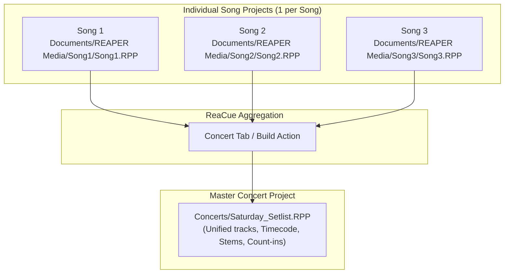
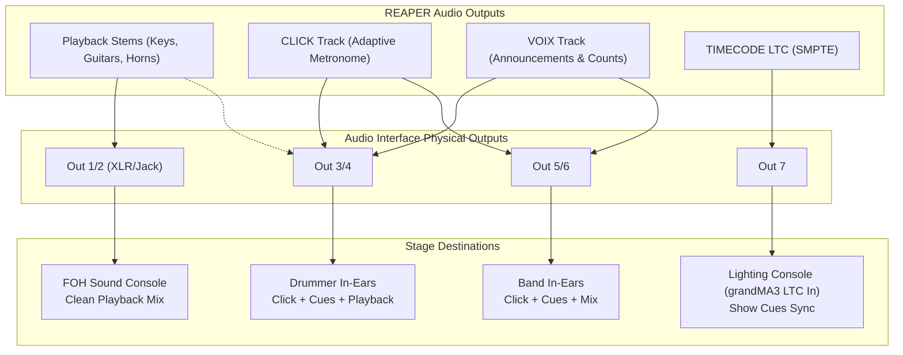

# ReaCue Guide: Team Best Practices, REAPER Project Organization, Stem Separation Models & Hardware Guide

This guide compiles official best practices, field experience, and hardware recommendations to get the best performance from **ReaCue** in a band setting. It covers methodical project organization in **REAPER**, smooth collaboration between musicians during rehearsals and on stage, stem separation model selection, and matching with your hardware (GPUs, audio interfaces, stage networking).

---

## Table of Contents

1. [REAPER Project Best Practices](#1-reaper-project-best-practices)
   - [Golden rule: one project per song](#11-golden-rule-one-project-per-song)
   - [Clean setup: "+ New Song" vs manual import](#12-clean-setup--new-song-vs-manual-import)
   - [Media management and preventing "OFFLINE" files](#13-media-management-and-preventing-offline-files)
   - [Track naming conventions and organization](#14-track-naming-conventions-and-organization)
   - [Sync and guide tracks](#15-sync-and-guide-tracks)
   - [Recommended audio settings (buffer, sample rate, latency)](#16-recommended-audio-settings-buffer-sample-rate-latency)
   - [Concert project lifecycle](#17-concert-project-lifecycle)
2. [Team Best Practices (Rehearsals & Live)](#2-team-best-practices-rehearsals--live)
   - [Musician roles on the web prompter](#21-musician-roles-on-the-web-prompter)
   - [Rehearsing effectively with ReaCue Studio](#22-rehearsing-effectively-with-reacue-studio)
   - [Stage mix management: "Played Live" mode](#23-stage-mix-management-played-live-mode)
   - [Safe transport control and Sound Engineer / Regie role](#24-safe-transport-control-and-sound-engineer--regie-role)
   - [Stage network and dedicated Wi-Fi router](#25-stage-network-and-dedicated-wi-fi-router)
   - [Pre-show checklist using "Check"](#26-pre-show-checklist-using-check)
3. [Stem Separation Models (Demucs)](#3-stem-separation-models-demucs)
   - [Local execution](#31-local-execution)
   - [Available model comparison](#32-available-model-comparison)
   - [Source file naming conventions](#33-source-file-naming-conventions)
   - [Storage management and stem caching](#34-storage-management-and-stem-caching)
4. [Hardware Guide & Optimal Model Matching](#4-hardware-guide--optimal-model-matching)
   - [Hardware / Model matching matrix](#41-hardware--model-matching-matrix)
   - [AI acceleration: NVIDIA (Blackwell RTX 50, Ada, Ampere), Apple Silicon & AMD](#42-ai-acceleration-nvidia-apple-silicon-amd-cpu)
   - [Audio interfaces and physical routing](#43-audio-interfaces-and-physical-routing)
   - [Network equipment, foot controllers, and stage mounts](#44-network-equipment-foot-controllers-and-stage-mounts)

---

## 1. REAPER Project Best Practices

### 1.1 Golden rule: one project per song

> [!IMPORTANT]
> **Always keep one distinct REAPER project (`.RPP`) per song.**  
> Never stack multiple songs sequentially in a single song project.

ReaCue dynamically computes the tempo map, section markers, bar counts, and guide tracks (`CLICK`, `VOIX`, `CUES`) during preparation. If multiple songs share the same project, each re-analysis will overwrite adjacent markers and tempo maps.

Full-set live playback is handled by an automated aggregate project: the **Concert Project** (see [section 1.7](#17-concert-project-lifecycle)).



### 1.2 Clean setup: "+ New Song" vs manual import

To create a new song, always prefer using the **« + New song »** button at the top of the **Song** tab in ReaCue:
1. **Automatic folder isolation:** ReaCue creates a dedicated subfolder in your projects directory (`Documents/REAPER Media/<Title>/`).
2. **Title cleanup:** Automatically derives a clean song name stripped of stem suffixes or export tags (e.g., `-drums`, `-120bpm`, `_final`).
3. **Overwrite prevention:** If a song with the same title already exists, it prompts for an alternate name instead of overwriting existing data.
4. **Clean item placement:** Audio files are positioned at bar 1, each on its respective track.

### 1.3 Media management and preventing "OFFLINE" files

A common pitfall during rehearsal or on tour occurs when an audio file moved from or left in a temporary directory (e.g. *Downloads*) becomes inaccessible to REAPER, displaying red **OFFLINE** media items.

> [!CAUTION]
> When saving manually in REAPER (*File → Save project as…*), always check:
> - **« Create subdirectory for project »**
> - **« Copy all media into project directory »**

This ensures that copying or archiving the song folder to a flash drive or cloud sync for another band member preserves all audio files inside the project folder.

### 1.4 Track naming conventions and organization

ReaCue automatically scans file and track names to identify instrument roles. Adopting consistent naming ensures instant detection without manual tweaking:

| Detected Role | Recognized keywords (case-insensitive) | Target track in ReaCue |
|---|---|---|
| **Vocals / Backing** | `vocal`, `vocals`, `voice`, `vox`, `chant`, `voix`, `lead-vocal` | Track **Chant / Vocals** (used for Whisper lyrics analysis) |
| **Drums** | `drum`, `drums`, `batterie`, `kick`, `snare`, `perc`, `percussions` | Track **Batterie / Drums** (used for ADTOF drum transcription) |
| **Bass** | `bass`, `basse`, `synth-bass`, `sub` | Track **Basse / Bass** (used for root chord detection) |
| **Guitar** | `guitar`, `guitare`, `gtr`, `electric-guitar`, `acoustic` | Track **Guitares / Guitars** |
| **Lead Guitar** | `guitar lead`, `lead guitar`, `solo guitar`, `gtr solo` | Enables automatic solo detection |
| **Keyboards / Piano** | `piano`, `keys`, `clavier`, `organ`, `synth`, `synthé` | Track **Claviers / Piano** |
| **Other** | Any other file or `other` tag | Track **Autres / Other** (FX, horns, strings) |

> [!TIP]
> **Key & Tempo tag bonus:** Naming your stems or mix with the musical key and tempo (e.g. `Highway To Jam-Am-124bpm.wav`) provides an upfront hint to ReaCue, preventing half/double tempo detection (62 vs 248 BPM) and improving chord transcription accuracy.

### 1.5 Sync and guide tracks

When preparing with **« Do All »** or **« Analyze and prepare »**, ReaCue builds standard control tracks:
- **`CLICK`:** REAPER click source configured with the set count-in (1 or 2 bars).
- **`VOIX`:** Automated voice cues announcing sections in advance (*« Verse 1 »*, *« Chorus »*, *« Bridge »*) and voice count-ins (*« One, two, three, four »*).
- **`CUES`:** Visual cues and sync flags for state changes.
- **`TIMECODE LTC` & `TIMECODE MTC`:** (Optional, configured in the *Lighting* tab) generates SMPTE signals to synchronize lighting consoles (such as grandMA3).

### 1.6 Recommended audio settings (buffer, sample rate, latency)

To guarantee stability during long rehearsals or live gigs:
- **Sample rate:** `48,000 Hz` (48 kHz) at `24-bit`. This is the universal standard for live sound and video.
- **ASIO / CoreAudio Buffer size:**
  - **On stage (Playback & prompter only):** Set buffer to **`256 samples`** or **`512 samples`**. For playback-only use, a 5 to 10 ms latency is imperceptible and provides maximum safety against audio dropouts (*buffer under-runs*).
  - **If a musician plays live virtual instruments or amp sims through REAPER:** Set buffer to **`128 samples`** (~3 ms latency), assuming a sufficiently capable CPU.

### 1.7 Concert project lifecycle

The Concert project (`Documents/REAPER Media/Concerts/<ConcertName>.RPP`) is an **auto-generated project**.

> [!WARNING]
> **Never edit song section markers or tempo maps directly inside the Concert project.**  
> Any changes made directly in the concert file will be overwritten on the next rebuild.

**Clean edit workflow:**
1. Open the individual song project (`Song.RPP`).
2. Make your edits (structure, mix, chords, lyrics).
3. Click **« Apply »** or **« Do All »** and save the song (`Ctrl+S` / `Cmd+S`).
4. Switch to the Concert project and click **« Rebuild concert »**. ReaCue updates all tracks and regions in seconds.

---

## 2. Team Best Practices (Rehearsals & Live)

ReaCue turns REAPER into a real-time collaborative platform via its two built-in web interfaces: the **Musicians' Prompter** (`/prompteur.html`) and **ReaCue Studio** (`/studio.html`).

```mermaid
flowchart LR
    Reaper["REAPER + ReaCue<br/>(FOH / Stage Laptop)"]
    Router["Dedicated 5 GHz Wi-Fi Router<br/>(Static DHCP Lease)"]
    
    Reaper -->|HTTP Server port 8080| Router
    Router -->|Vocals Role| Phone1["Smartphone / Tablet<br/>Lyrics & Count-in"]
    Router -->|Bass/Guitar Role| Phone2["Music Stand Tablet<br/>Chord Grid & Key"]
    Router -->|Drums Role| Phone3["Drummer Tablet<br/>Groove, Fills & Crashes"]
    Router -->|Sound Eng. Role (PIN)| Phone4["Regie Phone<br/>Transport & Setlist"]
    Router -->|Lighting Role| Console["grandMA3 Console<br/>Timecode & Cues"]
```

### 2.1 Musician roles on the web prompter

Each band member opens `http://<PC-IP>:8080/prompteur.html` (or scans the **QR code** in the *Stage* tab) and selects their instrument role:

- **Vocals:**
  - High-contrast display tailored for music stands.
  - Smooth scrolling lyrics, word-by-word highlight (with Whisper alignment).
  - Next line preview and bar countdown before vocal entries.
- **Bass / Guitars:**
  - Current and upcoming chord cards with bar countdowns.
  - Full chord grid for the active section with orange highlight on the current bar.
  - Instant transposition: if playback is transposed (e.g., -1 semitone), displayed chords adapt automatically.
- **Drums:**
  - Groove pulse and subdivisions.
  - Visual and text cues before fills, crashes, and breaks/stops.
- **Regie / Sound Engineer:**
  - Setlist overview, transport controls, song selection, and band status monitoring.

### 2.2 Rehearsing effectively with ReaCue Studio

During rehearsal, **ReaCue Studio** (`/studio.html`) lets the band practice tricky passages without touching the main computer:
- **Targeted loop:** Click any section (e.g. *Solo*, *Bridge*) to immediately loop it.
- **Tempo Ramp (Progressive speedup):**
  - Set a starting tempo (e.g. 70%) and a target tempo (100%).
  - ReaCue Studio automatically ramps up speed each loop repetition. Perfect for mastering difficult unisons.
- **"Mute my instrument" feature:**
  - One tap mutes your own track so you can practice playing on top of the backing band.
- **Home practice exports:**
  - One-click WAV/MP3 stem export, backing track without guitar/bass, or isolated practice loops.

### 2.3 Stage mix management: "Played Live" mode

Layering live instruments on top of pre-recorded playback stems creates severe acoustic issues: if the drummer plays acoustically while the recorded drum stem also plays through monitors or FOH, comb filtering and phase cancellation are inevitable.

ReaCue provides a stage matrix called **« Played Live »** in the *Stage* and *Concert* tabs:
1. **Global band profile:** Check instruments your band plays live (e.g. *Drums* and *Bass*). Their stems are muted by default across the entire set.
2. **Per-song exceptions:**
   - If the bassist switches to synthesizer on a specific track, click the Bass cell for that song to un-mute the playback stem for that song only.
   - Exceptions are saved in `setlist.json` and persist across concert rebuilds.
3. **Musician feedback:** On prompter screens, a status banner indicates: *« Your stem is muted »* (green) or *« Your stem is played »* (orange).

### 2.4 Safe transport control and Regie role

When controlling REAPER remotely:
- **PIN code security:** Transport control requires a 4-digit PIN (set in *Settings* or adjusted in the *Stage* tab). This prevents unauthorized guests on the Wi-Fi from interrupting the show.
- **Anti-panic double-tap protection:** While playback is active, tapping *Stop*, *Previous*, or *Next* does not stop immediately. The button flashes orange with *« Again? »*. The action only executes if tapped a second time within 2 seconds.

### 2.5 Stage network and dedicated Wi-Fi router

> [!CAUTION]
> **Never rely on venue Wi-Fi or public 4G/5G for your stage prompters.**  
> Crowded 2.4 GHz networks suffer extreme congestion once the venue fills up.

**Recommended setup:**
1. **Dedicated travel router:** Carry an independent compact Wi-Fi router (e.g. GL.iNet, TP-Link travel router).
2. **5 GHz band preferred:** Set up an isolated 5 GHz SSID on an uncrowded channel.
3. **Static DHCP lease (Fixed IP):** Reserve a static IP for the REAPER machine (e.g. `192.168.8.100`). Printed QR codes and musician bookmarks stay valid gig after gig without reconfiguration.
4. **Device setup:**
   - Add the prompter to the home screen (PWA full-screen mode).
   - Disable automatic screen sleep on all devices.

### 2.6 Pre-show checklist using "Check"

Before soundcheck or going on stage, click **« Check »** in ReaCue's *Stage* tab. ReaCue runs an automated 12-point audit:
- [x] **Audio files:** Validates no media items are *OFFLINE*.
- [x] **Voice cues:** Verifies presence of synthesized audio announcement files.
- [x] **Songs prepared:** Checks that every setlist song has tempo and sections.
- [x] **Concert up to date:** Ensures no song project was edited without rebuilding.
- [x] **ReaCue bridge:** Confirms Python and REAPER communication is active.
- [x] **Web interface:** Checks HTTP server is listening on port 8080.
- [x] **Network address:** Verifies valid IP for QR codes.
- [x] **Audio device:** Confirms hardware sound card is online in REAPER.
- [x] **In-Ear outputs:** Verifies click/cue hardware output routing exists.
- [x] **Prompter data:** Confirms valid JSON publication.
- [x] **Regie online:** Reports if a remote control phone has connected recently.
- [x] **Muted stems:** Reports active live mute profile.

If any line is orange or red, the **« Fix »** button resolves most issues with a single click.

---

## 3. Stem Separation Models (Demucs)

### 3.1 Local execution

ReaCue embeds **Demucs v4** (Meta AI Research), running **100% locally on your machine** inside an isolated Python environment (`.venv-demucs`).
- **Full privacy:** No audio is ever sent online.
- **No subscriptions:** Free, unlimited local separation.
- **Offline autonomy:** Zero internet access required once installed.

### 3.2 Available model comparison

| Model | Number of Stems | Extracted Channels | Strengths | Recommended Use Case |
|---|---|---|---|---|
| **`htdemucs_6s`** *(Default on GPU $\ge 8\text{ GB}$ & Apple Silicon)* | **6 stems** | `vocals`, `drums`, `bass`, `guitar`, `piano`, `other` | Separates **guitar** and **piano/keys** into separate tracks. | **Full bands** with both guitarists and keyboardists needing isolated monitoring and practice tracks. |
| **`htdemucs_ft`** *(Fine-tuned)* | **4 stems** | `vocals`, `drums`, `bass`, `other` | Highest acoustic fidelity on vocals, bass, and drums with fewer artifacts. | **Power trios** or formations without keyboards wanting maximum fidelity on vocals and rhythm section. Optimal on 2–8 GB GPUs. |
| **`htdemucs`** *(Standard)* | **4 stems** | `vocals`, `drums`, `bass`, `other` | Fast processing, low memory footprint. | **CPU-only processing** or laptops without dedicated graphics. |

### 3.3 Source file naming conventions

Extracted stems are organized in:
```text
SongTitle-Am-120bpm-stems/
  └── htdemucs_6s/
        ├── SongTitle-Am-120bpm-vocals.wav
        ├── SongTitle-Am-120bpm-drums.wav
        ├── SongTitle-Am-120bpm-bass.wav
        ├── SongTitle-Am-120bpm-guitar.wav
        ├── SongTitle-Am-120bpm-piano.wav
        └── SongTitle-Am-120bpm-other.wav
```

### 3.4 Storage management and stem caching

- **Instant re-import:** Running *Separate stems* or *Do All* on a previously processed track detects existing files and imports them immediately in <1 second without re-running Demucs.
- **Disk usage:** Budget approximately **200 to 300 MB** per 4-minute song for 24-bit WAV stems.
- **Undo safety:** The original media item is removed from the timeline for cleanliness, but the file on disk is never deleted. A simple *Undo* (`Ctrl+Z` / `Cmd+Z`) restores it.

---

## 4. Hardware Guide & Optimal Model Matching

ReaCue's automated hardware audit module (`reacue_gpu.py`) detects system capabilities and configures PyTorch and model presets automatically.

### 4.1 Hardware / Model matching matrix

| Detected Hardware | PyTorch Backend | Recommended Stems Model | SongFormer Structure Model | Average Time / 4-min Song |
|---|---|---|---|---|
| **NVIDIA RTX 50 Series** *(Blackwell, e.g. 5070, 5080, 5090)* | CUDA 12.8 (`cu128`, SM_120) | **`htdemucs_6s`** | 420s Window (Max accuracy) | **~ 8 to 15 seconds** |
| **NVIDIA RTX 40 / 30 / 20 Series** *($\ge 8\text{ GB}$ VRAM)* | CUDA 12.4 (`cu124`) | **`htdemucs_6s`** | 420s Window | **~ 15 to 30 seconds** |
| **NVIDIA RTX / GTX** *(2 to 8 GB VRAM, e.g. 3060 6 GB, 2060)* | CUDA 12.4 (`cu124`) | **`htdemucs_ft`** or `htdemucs_6s` | 120s Window | **~ 30 to 60 seconds** |
| **Apple Silicon** *(M1, M2, M3, M4 - Pro / Max / Ultra / base)* | Metal MPS (`mps`) | **`htdemucs_6s`** | 420s Window (if $\ge 16\text{ GB}$ RAM) | **~ 20 to 45 seconds** |
| **AMD Radeon dedicated** *(Linux ROCm / Windows)* | ROCm / DirectML | **`htdemucs_ft`** or `htdemucs_6s` | 120s / 420s Window | **~ 30 to 90 seconds** |
| **CPU Only** *(Intel / AMD without dedicated GPU)* | CPU (`cpu`) | **`htdemucs`** *(4 stems standard)* | 120s Window | **~ 5 to 8 minutes** |

### 4.2 AI acceleration: NVIDIA, Apple Silicon, AMD & CPU

- **NVIDIA Blackwell (RTX 50):** Requires Compute Capability 12.0 and CUDA 12.8+. ReaCue automatically downloads `2.8.0+cu128` PyTorch wheels.
- **NVIDIA RTX 20/30/40:** Runs on CUDA 12.4 (`cu124`) with rock-solid stability.
- **Apple Silicon:** Hardware-accelerated Metal via MPS. Shared unified memory allows running full 420s SongFormer windows and 6-stem models effortlessly on 16 GB+ systems.
- **CPU Fallback:** Automatically switches to standard `htdemucs` 4-stem model to keep processing under 6 minutes.

### 4.3 Audio interfaces and physical routing



- **Minimum Setup (4 outputs):**
  - Outputs 1 & 2: Front of House (FOH) Stereo master (playback only, click and voice cues muted).
  - Outputs 3 & 4: Musician In-Ears (Click + voice cues + playback).
- **Professional Setup (8 to 16 outputs):**
  - Outputs 1–6: Discrete stems to the FOH console (Keys, extra guitars, backing vocals, percussion/FX, sub-bass).
  - Outputs 7–8: Dedicated In-Ear click and guide cues bus.
  - Output 9: Physical LTC SMPTE timecode feed to the lighting console.

### 4.4 Network equipment, foot controllers, and stage mounts

1. **Dedicated stage router:** Compact USB-C travel router (e.g. GL.iNet Beryl AX) mounted inside your audio interface rack.
2. **MIDI / USB foot controller:** Assign footswitches to REAPER actions `ReaCue - Next song`, `ReaCue - Previous song`, and `Transport: Play/stop`.
3. **Mounting clamps:** Heavy-duty mic-stand clamps for musician tablets and phones, with dedicated USB power lines.

---

> For detailed setup instructions, see the [Step-by-step Tutorial](TUTORIAL_en.md) or the main [README.md](../README.md).
