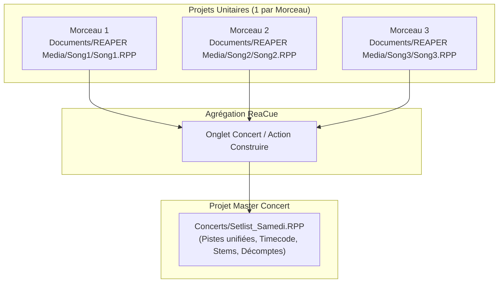
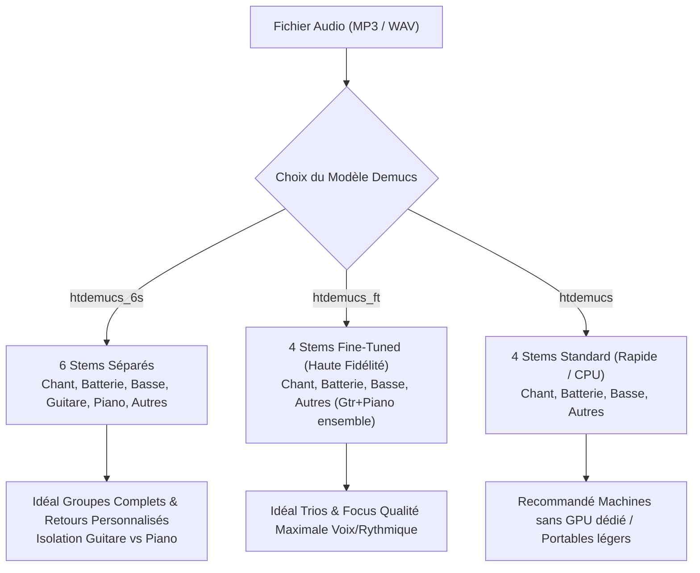
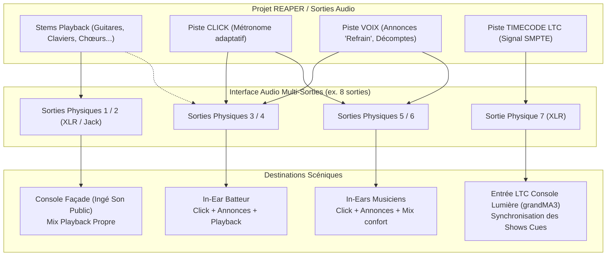

# Guide ReaCue : Bonnes Pratiques en Équipe, Organisation REAPER, Découpe de Stems & Guide Matériel

Ce guide rassemble les recommandations officielles et les retours d'expérience pour tirer le meilleur parti de **ReaCue** au sein d'un groupe musical. Il couvre l'organisation méthodique des projets dans **REAPER**, la collaboration efficace entre musiciens en répétition et sur scène, le choix des modèles de séparation de stems et l'adéquation avec votre configuration matérielle (cartes graphiques, interfaces audio, réseau scénique).

---

## Sommaire

1. [Bonnes pratiques du projet avec REAPER](#1-bonnes-pratiques-du-projet-avec-reaper)
   - [Règle d'or : un projet par morceau](#11-règle-dor--un-projet-par-morceau)
   - [Création propre : « + Nouveau morceau » vs import manuel](#12-création-propre---nouveau-morceau-vs-import-manuel)
   - [Gestion des médias et prévention des fichiers « OFFLINE »](#13-gestion-des-médias-et-prévention-des-fichiers--offline-)
   - [Nomenclature et organisation des pistes](#14-nomenclature-et-organisation-des-pistes)
   - [Pistes de synchronisation et de guidage](#15-pistes-de-synchronisation-et-de-guidage)
   - [Réglages audio recommandés (buffer, fréquence, latence)](#16-réglages-audio-recommandés-buffer-fréquence-latence)
   - [Cycle de vie du projet Concert](#17-cycle-de-vie-du-projet-concert)
2. [Bonnes pratiques de travail en équipe (Répétition & Live)](#2-bonnes-pratiques-de-travail-en-équipe-répétition--live)
   - [Les rôles sur le prompteur web](#21-les-rôles-sur-le-prompteur-web)
   - [Travailler efficacement avec ReaCue Studio](#22-travailler-efficacement-avec-reacue-studio)
   - [Gestion scénique du mix : le mode « Joué en live »](#23-gestion-scénique-du-mix--le-mode--joué-en-live-)
   - [Pilotage sécurisé et rôle Régie](#24-pilotage-sécurisé-et-rôle-régie)
   - [Réseau scénique et Wi-Fi dédié](#25-réseau-scénique-et-wi-fi-dédié)
   - [Checklist pré-concert avec la fonction « Vérifier »](#26-checklist-pré-concert-avec-la-fonction--vérifier-)
3. [Modèles de découpe de stems (Demucs)](#3-modèles-de-découpe-de-stems-demucs)
   - [Fonctionnement en local](#31-fonctionnement-en-local)
   - [Comparatif des modèles disponibles](#32-comparatif-des-modèles-disponibles)
   - [Conventions de nommage des fichiers sources](#33-conventions-de-nommage-des-fichiers-sources)
   - [Gestion du stockage et réutilisation des stems](#34-gestion-du-stockage-et-réutilisation-des-stems)
4. [Guide Matériel & Adéquation avec les Meilleurs Modèles](#4-guide-matériel--adéquation-avec-les-meilleurs-modèles)
   - [Matrice de correspondance Matériel / Modèles](#41-matrice-de-correspondance-matériel--modèles)
   - [Accélération IA : NVIDIA (Blackwell RTX 50, Ada, Ampere), Apple Silicon & AMD](#42-accélération-ia--nvidia-apple-silicon-amd-cpu)
   - [Interfaces audio et routage physique](#43-interfaces-audio-et-routage-physique)
   - [Équipements réseau, contrôleurs au pied et supports scène](#44-équipements-réseau-contrôleurs-au-pied-et-supports-scène)

---

## 1. Bonnes pratiques du projet avec REAPER

### 1.1 Règle d'or : un projet par morceau

> [!IMPORTANT]
> **Conservez toujours un projet REAPER (`.RPP`) distinct par morceau.**  
> Ne tentez jamais d'empiler plusieurs morceaux les uns après les autres dans un même projet unitaire.

ReaCue recalcule dynamiquement la grille de tempo, les marqueurs de sections, la numérotation des mesures et les pistes d'annonces (`CLICK`, `VOIX`, `CUES`) à chaque préparation. Si plusieurs morceaux partagent un même projet, chaque réanalyse écrasera les régions et les repères des morceaux voisins.

L'enchaînement en direct fait l'objet d'un projet dédié généré automatiquement : le **Projet Concert** (voir [section 1.7](#17-cycle-de-vie-du-projet-concert)).



### 1.2 Création propre : « + Nouveau morceau » vs import manuel

Pour créer un morceau, privilégiez toujours le bouton **« + Nouveau morceau »** situé en haut de l'onglet **Morceau** de ReaCue :
1. **Isolation automatique :** ReaCue crée un sous-dossier propre dans votre répertoire de projets (`Documents/REAPER Media/<Titre>/`).
2. **Nettoyage du titre :** Il déduit automatiquement un nom propre débarrassé des suffixes de stems ou d'export (ex. `-drums`, `-120bpm`, `_final`).
3. **Prévention des écrasements :** Si un morceau portant ce nom existe déjà, il vous invite à spécifier une variante au lieu d'écraser vos données existantes.
4. **Placement régulier :** Les fichiers audio sont positionnés à la mesure 1, chacun sur sa piste respective.

### 1.3 Gestion des médias et prévention des fichiers « OFFLINE »

L'un des pièges les plus fréquents en répétition ou en tournée survient lorsqu'un fichier audio déplacé ou stocké dans un répertoire temporaire (ex. dossier *Téléchargements*) devient indisponible pour REAPER, affichant l'item en rouge marqué **OFFLINE**.

> [!CAUTION]
> Lors de toute sauvegarde manuelle dans REAPER (*File → Save project as…*), veillez à cocher impérativement les cases :
> - **« Create subdirectory for project »** (Créer un sous-dossier pour le projet)
> - **« Copy all media into project directory »** (Copier tous les médias dans le dossier du projet)

Cette précaution garantit qu'en archivant, copiant ou synchronisant le dossier d'un morceau sur une clé USB ou un disque partagé pour un autre membre du groupe, l'intégralité des fichiers audio reste physiquement solidaire du projet.

### 1.4 Nomenclature et organisation des pistes

ReaCue inspecte automatiquement le nom des fichiers audio et des pistes pour identifier les rôles des instruments. L'adoption de conventions claires garantit une reconnaissance immédiate sans configuration manuelle :

| Rôle détecté | Mots-clés reconnus (insensibles à la casse) | Piste cible dans ReaCue |
|---|---|---|
| **Chant / Chœurs** | `vocal`, `vocals`, `voice`, `vox`, `chant`, `voix`, `lead-vocal` | Piste **Chant** (utilisée pour l'analyse des paroles Whisper) |
| **Batterie** | `drum`, `drums`, `batterie`, `kick`, `snare`, `perc`, `percussions` | Piste **Batterie** (utilisée pour la transcription ADTOF) |
| **Basse** | `bass`, `basse`, `synth-bass`, `sub` | Piste **Basse** (utilisée pour la détection fondamentale des accords) |
| **Guitare** | `guitar`, `guitare`, `gtr`, `electric-guitar`, `acoustic` | Piste **Guitares** |
| **Guitare Solo** | `guitar lead`, `lead guitar`, `solo guitar`, `gtr solo` | Permet la détection automatique des solos instrumentaux |
| **Claviers / Piano** | `piano`, `keys`, `clavier`, `organ`, `synth`, `synthé` | Piste **Claviers / Piano** |
| **Autres** | Tout autre fichier ou mention `other` | Piste **Autres** (FX, cuivres, cordes) |

> [!TIP]
> **Bonus Tonalité & Tempo dans le nom :** Nommer vos stems ou votre mix avec la tonalité et le tempo (ex. `Highway To Jam-Am-124bpm.wav`) fournit un indice direct à ReaCue. Cela évite les fausses détections de tempo en demi-vitesse (62 BPM) ou double-vitesse (248 BPM) et fiabilise le calcul des accords.

### 1.5 Pistes de synchronisation et de guidage

Lors de la préparation via le bouton **« Tout faire »** ou **« Analyser et préparer »**, ReaCue génère des pistes de contrôle standardisées :
- **`CLICK` :** Générateur de métronome REAPER configuré avec le décompte paramétré (1 ou 2 mesures).
- **`VOIX` :** Annonces vocales automatisées signalant les sections à l'avance (*« Couplet 1 »*, *« Refrain »*, *« Pont »*) et décomptes vocaux (*« One, two, three, four »* ou *« Un, deux, trois, quatre »*).
- **`CUES` :** Repères visuels et balises de synchronisation pour les changements d'états.
- **`TIMECODE LTC` & `TIMECODE MTC` :** (Facultatif, activé via l'onglet *Lumière*) génère les signaux SMPTE pour synchroniser une console lumière (ex. grandMA3).

### 1.6 Réglages audio recommandés (buffer, fréquence, latence)

Pour assurer une stabilité absolue en situation de répétition intensive ou de concert :
- **Fréquence d'échantillonnage :** `48 000 Hz` (48 kHz) en `24-bit`. C'est le standard universel pour l'audio scénique et la vidéo.
- **Taille de Buffer ASIO / CoreAudio :**
  - **Sur scène (Lecture seule de pistes & prompteur) :** Réglez le buffer sur **`256 samples`** ou **`512 samples`**. En lecture pure de playback, une latence de 5 à 10 ms n'a aucun impact perceptible et offre une marge de sécurité maximale contre les craquements audios (*buffer under-runs*).
  - **Si un musicien joue à travers des effets virtuels temps réel dans REAPER :** Ajustez le buffer à **`128 samples`** (environ 3 ms de latence), sous réserve d'un processeur suffisamment puissant.

### 1.7 Cycle de vie du projet Concert

Le projet Concert (`Documents/REAPER Media/Concerts/<NomConcert>.RPP`) est un **projet généré**.

> [!WARNING]
> **Ne modifiez jamais la structure d'un morceau directement dans le projet Concert.**  
> Toute modification de tempo, de région ou de marqueur effectuée dans le concert sera impitoyablement écrasée lors de la prochaine reconstruction.

**Workflow de modification propre :**
1. Ouvrez l'onglet ou le projet unitaire du morceau concerné (`Song.RPP`).
2. Ajustez la structure, le mixage, les accords ou les paroles.
3. Cliquez sur **« Appliquer »** ou **« Tout faire »** et enregistrez le morceau (`Ctrl+S` / `Cmd+S`).
4. Basculez sur le projet Concert et cliquez sur **« Reconstruire le concert »**. ReaCue réimporte les modifications à jour en quelques secondes.

---

## 2. Bonnes pratiques de travail en équipe (Répétition & Live)

ReaCue transforme REAPER en plateforme collaborative temps réel grâce à ses deux interfaces web intégrées : le **Prompteur** (`/prompteur.html`) et **ReaCue Studio** (`/studio.html`).

```mermaid
flowchart LR
    Reaper["REAPER + ReaCue<br/>(Machine Régie / Scène)"]
    Router["Routeur Wi-Fi 5 GHz dédié<br/>(Bail DHCP statique)"]
    
    Reaper -->|Serveur HTTP port 8080| Router
    Router -->|Rôle Chant| Phone1["Smartphone / Tablette<br/>Paroles & Décompte"]
    Router -->|Rôle Basse/Guitare| Phone2["Tablette Pupitre<br/>Grille d'accords & Ton"]
    Router -->|Rôle Batterie| Phone3["Tablette Batteur<br/>Groove, Fills & Crashs"]
    Router -->|Rôle Régie (Code PIN)| Phone4["Téléphone Régie / Ingé Son<br/>Transport & Setlist"]
    Router -->|Rôle Lumière| Console["Console grandMA3<br/>Timecode & Cues"]
```

### 2.1 Les rôles sur le prompteur web

Chaque musicien ouvre l'adresse `http://<IP-du-PC>:8080/prompteur.html` (ou scanne le **QR Code** affiché dans l'onglet *Scène*) et sélectionne son instrument :

- **Chant :**
  - Affichage optimisé à fort contraste pour pupitre.
  - Défilement régulier des paroles, surlignage mot-à-mot (quand Whisper est activé).
  - Affichage anticipé de la ligne suivante et décompte visuel de mesures avant chaque prise de voix pour ne jamais manquer un départ.
- **Basse / Guitares :**
  - Carte claire indiquant l'accord en cours et l'accord suivant.
  - Grille harmonique complète de la section active avec indication en orange de la mesure jouée.
  - Transposition instantanée : si le playback est transposé (ex. -1 demi-ton), les accords affichés s'adaptent immédiatement.
- **Batterie :**
  - Repères de pulsation et débit rythmique.
  - Alertes textuelles et visuelles à l'approche des fills de batterie, des accents de crashs et des silences/reprises (*breaks*).
- **Régie :**
  - Vue générale du concert, contrôle du transport, déclenchement des morceaux et monitoring de l'état du groupe.

### 2.2 Travailler efficacement avec ReaCue Studio

En répétition, l'interface **ReaCue Studio** (`/studio.html`) permet de décortiquer un morceau sans avoir à manipuler la souris sur l'ordinateur principal :
- **Boucle ciblée sur un passage :** Cliquez sur une section (ex. *Solo*, *Pont*) pour caler automatiquement la boucle de lecture dessus.
- **Rampe d'accélération progressive (Speed Ramp) :**
  - Définissez un tempo de départ réduit (ex. 70%) et un tempo cible (100%).
  - ReaCue Studio accélère graduellement le tempo à chaque itération de la boucle. C'est l'outil idéal pour que le groupe maîtrise collectivement un passage technique à l'unisson.
- **Fonction « Mon instrument coupé » :**
  - Un clic permet de muter temporairement son propre instrument pour s'entraîner à tenir la cadence par-dessus les autres pistes.
- **Exports pour le travail à la maison :**
  - En un clic depuis Studio, exportez un stem isolé, un mix playback sans instrument, ou une boucle spécifique en MP3/WAV pour que chacun puisse réviser chez soi.

### 2.3 Gestion scénique du mix : le mode « Joué en live »

Lors d'un concert, superposer les pistes de playback avec des instruments réels joués sur scène présente un risque majeur : si le batteur joue en acoustique pendant que le stem de batterie tourne dans les retours ou la façade, un déphasage acoustique désagréable (effet de filtre en peigne) se produit inévitablement.

ReaCue intègre une matrice scénique **« Joué en live »** accessible dans l'onglet *Scène* et l'onglet *Concert* :
1. **Profil général du groupe :** Cochez les instruments systématiquement joués en vrai par le groupe (ex. *Batterie* et *Basse*). Ces pistes seront mutées par défaut sur l'ensemble du concert.
2. **Matrice d'exceptions :**
   - Si sur un morceau spécifique le bassiste pose sa basse pour jouer du synthétiseur, cliquez sur la case correspondante du morceau pour réactiver le stem de basse en playback uniquement pour ce titre.
   - Les modifications sont mémorisées dans le fichier `setlist.json` et préservées lors des reconstructions.
3. **Information en temps réel :** Sur le prompteur des musiciens, un bandeau discret informe chaque membre : *« Ton stem est coupé »* (vert) ou *« Ton stem est joué »* (orange).

### 2.4 Pilotage sécurisé et rôle Régie

Lorsque REAPER est piloté depuis un smartphone ou une tablette en régie :
- **Sécurisation par code PIN :** Le pilotage du transport requiert la saisie d'un code PIN à 4 chiffres (défini dans l'onglet *Réglages* ou modifiable directement sur l'onglet *Scène*). Cela empêche tout spectateur connecté au réseau de stopper la musique par inadvertance.
- **Protection anti-panique (Double-Appui) :** Pendant que REAPER est en lecture, appuyer sur *Stop*, *Morceau précédent* ou *Morceau suivant* ne coupe pas immédiatement le son. Le bouton clignote en orange avec la mention *« Encore ? »*. L'action n'est confirmée que si l'utilisateur appuie une seconde fois dans les 2 secondes.

### 2.5 Réseau scénique et Wi-Fi dédié

> [!CAUTION]
> **Ne comptez jamais sur le réseau Wi-Fi public ou la 4G/5G d'une salle de concert pour relier vos prompteurs.**  
> En présence du public, les réseaux 2.4 GHz sont saturés et les connexions deviennent instables.

**Configuration préconisée :**
1. **Routeur de voyage dédié :** Utilisez un petit routeur Wi-Fi autonome (ex. GL.iNet, TP-Link portable) branché en régie.
2. **Fréquence 5 GHz privilégiée :** Configurez le réseau Wi-Fi sur la bande 5 GHz (canal fixe non encombré).
3. **Bail DHCP statique (IP fixe) :** Réservez dans les paramètres du routeur une adresse IP fixe pour l'ordinateur hébergeant REAPER (ex. `192.168.8.100`). De cette façon, les raccourcis des musiciens et les QR codes imprimés restent valables d'un concert à l'autre sans jamais devoir reconfigurer les téléphones.
4. **Comportement des terminaux :**
   - Activez le mode plein écran (PWA : *Ajouter à l'écran d'accueil* sur iOS/Android).
   - Désactivez la mise en veille automatique des écrans pendant la prestation.

### 2.6 Checklist pré-concert avec la fonction « Vérifier »

Avant d'entrer sur scène ou de débuter les balances, ouvrez l'onglet **Scène** de ReaCue et cliquez sur le bouton **« Vérifier »**.

ReaCue exécute un audit instantané en 12 points de contrôle :
- [x] **Fichiers audio :** Vérifie qu'aucun média n'est *OFFLINE*.
- [x] **Annonces vocales :** Présence physique des fichiers d'annonces générés.
- [x] **Morceaux préparés :** Contrôle que chaque titre de la setlist a bien une grille et des régions.
- [x] **Concert à jour :** S'assure qu'aucun morceau n'a été modifié sans reconstruire le concert.
- [x] **Pont ReaCue :** Confirmation de la communication active entre Python et REAPER.
- [x] **Interface Web :** Serveur HTTP REAPER accessible sur le port prévu (8080).
- [x] **Adresse réseau :** Présence d'une adresse IP locale valide pour la diffusion des QR codes.
- [x] **Carte son :** Interface audio physique connectée et reconnue par REAPER.
- [x] **Sorties physiques In-Ears :** Vérification que les sorties assignées au métronome et aux annonces sont disponibles.
- [x] **Prompteur & Données :** Fichiers JSON du concert et du prompteur correctement générés.
- [x] **Régie vue :** Confirmation qu'un terminal de régie est appairé si nécessaire.
- [x] **Stems coupés :** Contrôle du profil des mutes live.

Si un élément est orange ou rouge, le bouton **« Corriger »** permet souvent de résoudre l'anomalie en un clic (reconstruction automatique, republication du prompteur).

---

## 3. Modèles de découpe de stems (Demucs)

### 3.1 Fonctionnement en local

ReaCue intègre l'algorithme de séparation de sources **Demucs v4** (développé par Meta AI Research).  
Contrairement à la majorité des outils du marché, ReaCue exécute Demucs **entièrement en local sur votre propre machine**, dans un environnement virtuel dédié (`.venv-demucs`).
- **Confidentialité totale :** Aucun fichier audio n'est téléversé sur un serveur distant.
- **Zéro abonnement :** Utilisation illimitée et gratuite.
- **Autonomie hors-ligne :** Aucune connexion Internet requise une fois l'installation terminée.

### 3.2 Comparatif des modèles disponibles

ReaCue prend en charge trois modèles adaptés à des besoins et des configurations spécifiques :



| Modèle | Nombre de stems | Canaux extraits | Points forts | Cas d'usage recommandé |
|---|---|---|---|---|
| **`htdemucs_6s`** *(Modèle par défaut sur GPU $\ge 8\text{ Go}$ et Apple Silicon)* | **6 stems** | `vocals`, `drums`, `bass`, `guitar`, `piano`, `other` | Sépare distinctement la **guitare** et le **piano/claviers**. Permet d'isoler chaque instrument pour le travail et le mixage in-ear. | **Configuration reine pour groupe de rock/pop standard** comportant guitariste(s) et claviériste. |
| **`htdemucs_ft`** *(Fine-tuned)* | **4 stems** | `vocals`, `drums`, `bass`, `other` | Qualité acoustique et fidélité de timbre optimales sur la voix et la batterie. Moins d'artefacts. | **Formations sans clavier** ou musiciens recherchant la plus haute fidélité possible sur la voix et la section rythmique. Idéal sur GPU avec 2 à 8 Go de VRAM. |
| **`htdemucs`** *(Standard)* | **4 stems** | `vocals`, `drums`, `bass`, `other` | Traitement plus rapide, consommation de mémoire réduite. | **Traitement sur processeur (CPU)** ou ordinateurs portables sans carte graphique dédiée pour éviter les temps de calcul trop longs. |

> [!NOTE]
> **Qualité et repisse acoustique :** La voix, la batterie et la basse séparées par Demucs sont d'une clarté remarquable. Sur le modèle 6 stems, les pistes de guitare et de piano peuvent présenter une légère repisse mutuelle selon la densité du mix d'origine. C'est normal et largement suffisant pour l'usage prompteur, métronome et répétition de ReaCue.

### 3.3 Conventions de nommage des fichiers sources

Lorsque Demucs termine la découpe d'un fichier nommé `Titre-Am-120bpm.mp3`, ReaCue génère les fichiers stems dans le sous-dossier :
```text
Titre-Am-120bpm-stems/
  └── htdemucs_6s/
        ├── Titre-Am-120bpm-vocals.wav
        ├── Titre-Am-120bpm-drums.wav
        ├── Titre-Am-120bpm-bass.wav
        ├── Titre-Am-120bpm-guitar.wav
        ├── Titre-Am-120bpm-piano.wav
        └── Titre-Am-120bpm-other.wav
```
En conservant le préfixe du fichier source (`Titre-Am-120bpm-`), ReaCue hérite instantanément de la tonalité et du BPM sans recalculer l'analyse globale.

### 3.4 Gestion du stockage et réutilisation des stems

- **Instantanéité au réimport :** Si vous relancez l'action *Séparer les stems* ou *Tout faire* sur un morceau déjà découpé, ReaCue détecte la présence des fichiers dans le dossier `<morceau>-stems/<modèle>/` et les importe immédiatement dans le projet en moins d'une seconde, sans relancer le calcul.
- **Espace disque requis :** Comptez environ **200 à 300 Mo** d'espace disque par morceau pour l'ensemble des stems au format WAV 24-bit 44.1/48 kHz.
- **Sécurité d'annulation :** L'import des stems retire l'item audio original de l'arrangement pour faire place nette, mais le fichier audio d'origine sur votre disque n'est jamais supprimé. Un simple *Annuler* (`Ctrl+Z` / `Cmd+Z`) rétablit instantanément la piste d'origine.

---

## 4. Guide Matériel & Adéquation avec les Meilleurs Modèles

ReaCue intègre depuis la version 1.2 un module d'audit matériel intelligent (`reacue_gpu.py`). Lors de l'installation ou du lancement de `installation.bat`, ReaCue détecte la puissance de votre machine, configure la version exacte de PyTorch requise et sélectionne automatiquement le modèle optimal.

### 4.1 Matrice de correspondance Matériel / Modèles

| Matériel détecté | Backend PyTorch | Modèle stems recommandé | SongFormer (Structure) | Temps moyen / morceau (4 min) |
|---|---|---|---|---|
| **NVIDIA RTX série 50** *(Blackwell, ex. 5070, 5080, 5090)* | CUDA 12.8 (`cu128`, SM_120) | **`htdemucs_6s`** | Fenêtre 420s (Résolution max) | **~ 8 à 15 secondes** |
| **NVIDIA RTX série 40 / 30 / 20** *($\ge 8\text{ Go}$ VRAM)* | CUDA 12.4 (`cu124`) | **`htdemucs_6s`** | Fenêtre 420s | **~ 15 à 30 secondes** |
| **NVIDIA RTX / GTX** *(2 à 8 Go VRAM, ex. 3060 6 Go, 2060)* | CUDA 12.4 (`cu124`) | **`htdemucs_ft`** ou `htdemucs_6s` | Fenêtre 120s | **~ 30 à 60 secondes** |
| **Apple Silicon** *(M1, M2, M3, M4 - Pro / Max / Ultra / standard)* | Metal MPS (`mps`) | **`htdemucs_6s`** | Fenêtre 420s (si $\ge 16\text{ Go}$ mémoire unifiée) | **~ 20 à 45 secondes** |
| **AMD Radeon dédié** *(Windows / Linux ROCm)* | ROCm / DirectML | **`htdemucs_ft`** ou `htdemucs_6s` | Fenêtre 120s / 420s | **~ 30 à 90 secondes** |
| **Processeur seul (CPU)** *(Intel / AMD sans GPU dédié)* | CPU (`cpu`) | **`htdemucs`** *(4 stems standard)* | Fenêtre 120s | **~ 5 à 8 minutes** |

### 4.2 Accélération IA : NVIDIA, Apple Silicon, AMD & CPU

#### A. NVIDIA CUDA & Architecture Blackwell (RTX 50)
- **Architecture Blackwell (Séries RTX 50) :** Les GPU récents basés sur l'architecture Blackwell nécessitent impérativement le support Compute Capability 12.0 et CUDA 12.8. L'installateur ReaCue installe automatiquement la roue PyTorch `2.8.0+cu128` dédiée, éliminant tout risque de crash de compatibilité binaire.
- **Séries RTX 20, 30 et 40 :** Prises en charge nativement via CUDA 12.4 (`cu124`), offrant une fiabilité et une vitesse de calcul exceptionnelles.

#### B. Apple Silicon (Metal / MPS)
Sur les Mac équipés de puces Apple Silicon (M1 à M4), ReaCue exploite l'accélération matérielle Metal via le sous-système **MPS** (*Metal Performance Shaders*). La mémoire unifiée partagée entre le CPU et le GPU permet de manipuler de très grands modèles sans goulot d'étranglement de transfert PCIe. Le modèle `htdemucs_6s` et SongFormer en fenêtre complète (420s) tournent à pleine vitesse sur les machines dotées de 16 Go de RAM unifiée ou plus.

#### C. AMD Radeon & Repli Processeur (CPU)
- **AMD :** Pris en charge sous Linux via ROCm, ou en détection standard sous Windows.
- **Processeur (CPU seul) :** Si aucune carte dédiée n'est détectée, ReaCue bascule automatiquement sur le modèle `htdemucs` (4 stems). Cela évite à l'utilisateur de subir une attente de 15 à 20 minutes par morceau, ramenant le temps de calcul à environ 5 à 7 minutes. Une fois le calcul initial achevé, les stems sont stockés en cache et le morceau se charge ensuite instantanément.

### 4.3 Interfaces audio et routage physique

Pour une utilisation professionnelle en répétition et en concert, le choix de l'interface audio branchée à la machine REAPER conditionne la clarté d'écoute de l'équipe :



#### Configuration Minimum (4 sorties physiques)
- **Sorties 1 & 2 :** **Façade Stéréo (Master Public)**. Reçoit les stems de playback que le groupe ne joue pas en live. Le click et les voix d'annonces sont strictement coupés de ce bus.
- **Sorties 3 & 4 :** **In-Ears Musiciens (Click + Annonces + Playback)**. Câblé vers les émetteurs HF de retours d'oreille ou un ampli casque pour le batteur.

#### Configuration Pro Recommandée (8 à 16 sorties physiques)
- **Sorties 1 à 6 :** Stems individuels envoyés à la console de sonorisation façade (ex. Sortie 1-2 : Claviers stéréo, Sortie 3 : Guitares additionnelles, Sortie 4 : Chœurs/Voix témoins, Sortie 5 : Percussions/FX, Sortie 6 : Basse sub). L'ingénieur du son façade dispose ainsi d'un contrôle total sur l'équilibre du mix dans la salle.
- **Sorties 7 & 8 :** Bus dédié In-Ears pour le métronome et les annonces vocales ReaCue.
- **Sortie 9 (ou sortie ligne assignée) :** Envoi du signal **Timecode LTC (SMPTE)** directement vers le connecteur LTC XLR de la console lumière (grandMA3).

### 4.4 Équipements réseau, contrôleurs au pied et supports scène

1. **Routeur Wi-Fi scénique indépendant :**
   - Modèles recommandés : Routeurs de voyage compacts (ex. *GL.iNet Beryl AX / Slate AX*, *TP-Link TL-WR902AC*).
   - Privilégiez un boîtier alimenté en USB-C, facile à loger dans le rack de l'interface audio.
   - Désactivez le SSID 2.4 GHz si la portée le permet, et connectez tous les pupitres sur le 5 GHz.
2. **Contrôleur au pied (Pédalier MIDI / USB) :**
   - Pour ne jamais toucher au clavier ou à la souris pendant le concert, associez deux boutons d'un pédalier (ex. *Line 6 FBV*, *Behringer FCB1010*, *pédalier USB 2/3 touches*) aux actions REAPER :
     - `ReaCue - Morceau suivant`
     - `ReaCue - Morceau précédent`
     - `Transport: Play/stop`
3. **Supports et pinces de scènes :**
   - Utilisez des pinces métalliques renforcées pour fixer les smartphones et tablettes aux pieds de micros des chanteurs et guitaristes (ex. supports type *K&M* ou *Hercules*).
   - Prévoyez des chargeurs ou des câbles de charge discrets pour éviter toute panne de batterie en milieu de concert.

---

> Pour toute question complémentaire ou suggestion d'amélioration, consultez le [Tutoriel pas à pas](TUTORIEL_fr.md) ou le fichier principal [LISEZMOI.md](../LISEZMOI.md).
