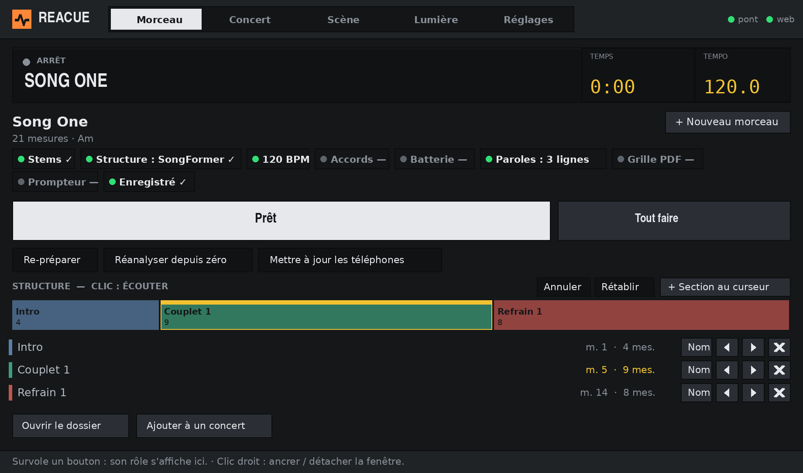
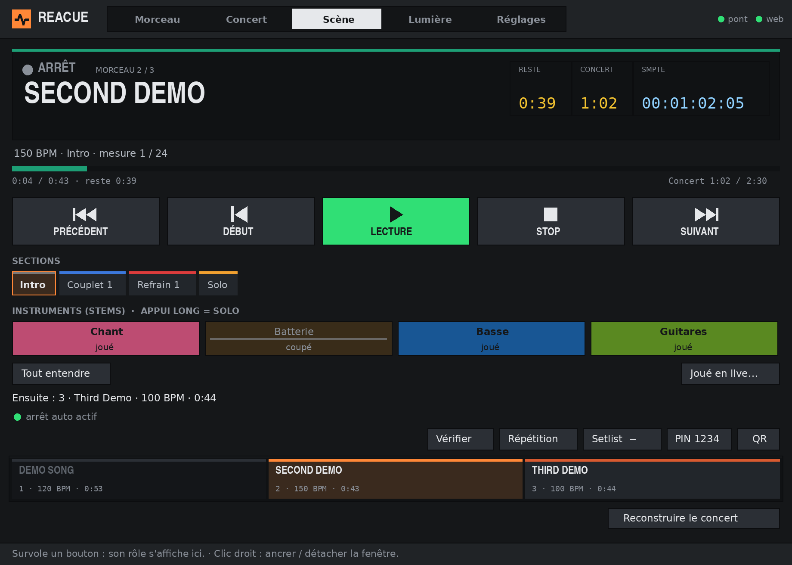
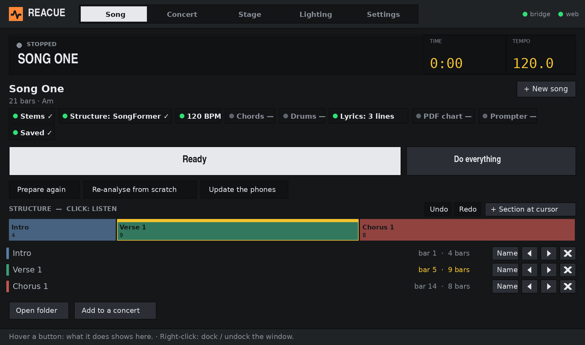

# ReaCue dans REAPER — style Studio / Native Studio styling

## Français

Cette mise à jour concerne **la fenêtre native ReaCue (Lua/gfx) dans REAPER**, et non uniquement les pages web.
Palette graphite/orange/vert commune à Studio, fenêtre de départ de 920 px, navigation claire, titres
condensés, panneaux et afficheurs de lecture. Les onglets Morceau, Concert, Scène, Lumière et Réglages
conservent leurs commandes. Le bandeau commun affiche le projet, l'état de lecture, le temps et le tempo
réels ; l'onglet Scène garde son propre bandeau. En fenêtre étroite, les afficheurs communs s'effacent
pour préserver le titre. La barre compacte ancrée reste disponible.

Pour voir la modification :

1. Fermer la fenêtre ReaCue dans REAPER.
2. Récupérer le dépôt avec `git pull origin main`.
3. Relancer **Install ReaCue.command** sur Mac ou **Install ReaCue.bat** sur Windows pour recopier les scripts Lua.
4. Relancer l'action **ReaCue** dans REAPER. Aucune page de navigateur n'est nécessaire pour cette interface.

Les polices Barlow Condensed et IBM Plex sont utilisées si elles sont installées ; sinon les polices
système prévues pour macOS/Windows prennent le relais. Aucune police système n'est installée automatiquement.
Le rendu natif adopte la même identité que Studio, avec les possibilités de dessin de REAPER gfx ;
il n'embarque pas la console web ni ses formes d'onde dans la fenêtre Lua.
Les captures sont des rendus du simulateur Lua avec morceaux fictifs et polices de substitution Linux.
Le rendu exact sur ton Mac/PC reste à vérifier.

## English

This update changes **ReaCue's native Lua/gfx window inside REAPER**. It shares Studio's graphite/orange/green
palette, opens at 920 px, and uses condensed titles, panels and playback readouts. Existing Song, Concert,
Stage, Lighting and Settings commands are retained. The shared banner shows the project, playback state,
time and tempo; Stage keeps its dedicated banner. Narrow windows omit the shared LCDs to preserve the title,
and the compact docked strip remains available.

Close the native ReaCue window, run `git pull origin main`, rerun the Mac or Windows installer to copy Lua
scripts into REAPER, then launch the ReaCue action again. A browser is not required for this window.
Barlow Condensed / IBM Plex are preferred when installed, with macOS/Windows system fallbacks otherwise.
No system fonts are installed automatically. This is native styling, not an embedded copy of the web mixer.
Screenshots are simulator renders with fictional songs and Linux substitute fonts. Real Mac/PC rendering
still needs verification.
