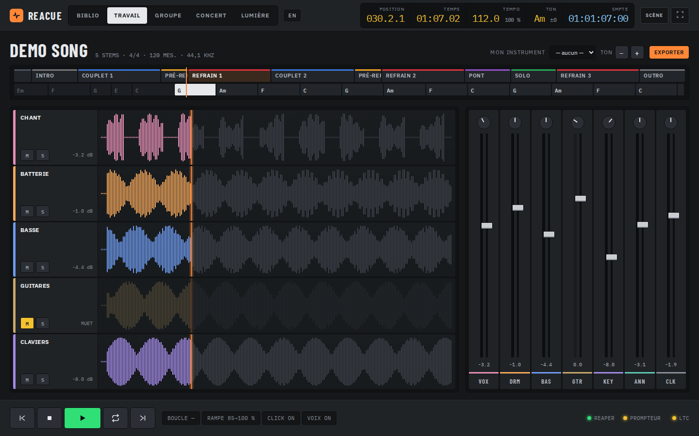
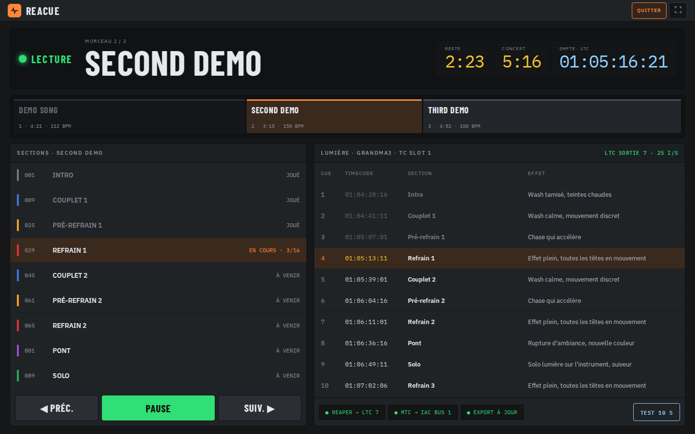
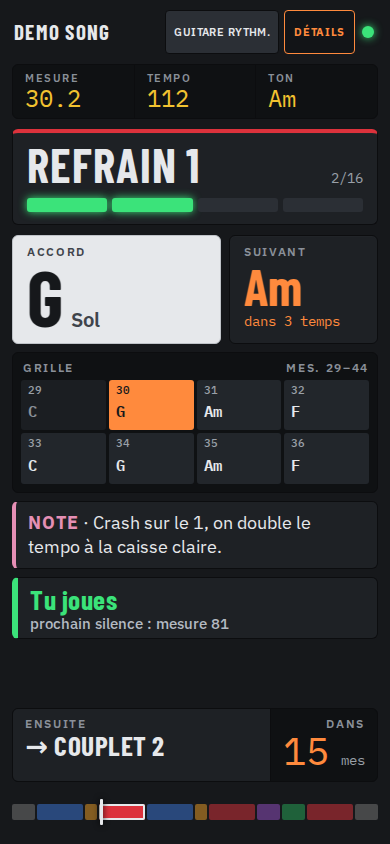

# ReaCue Studio — console, concert et prompteur

Cette proposition reprend les références fournies : surfaces graphite, titres condensés,
couleurs par instrument, valeurs numériques jaune/bleu et orange réservé aux repères actifs.
Les aperçus utilisent uniquement les morceaux fictifs du simulateur REAPER du dépôt.

## Console de travail

- Bandeau de navigation et afficheurs sur une ligne à 1440 px ; repli adapté aux petits écrans.
- Pistes colorées, tranche de console lisible et avertissement CLIP basé sur la crête de REAPER.
- Faders : flèches haut/bas par 1 dB, Maj par 0,1 dB ; Début remet à 0 dB, Fin à −60 dB.
- Panoramique : flèches gauche/droite par 5 %, Maj par 1 % ; Début recentre.
- Les valeurs de ces contrôles sont exposées aux lecteurs d'écran. Les boutons mute/solo
  restent pilotés par REAPER ; leurs cibles sont agrandies sur écran tactile.

## Concert et lumière

Le bouton **SCÈNE** réduit les commandes secondaires et agrandit les informations de lecture.
**QUITTER** rétablit la navigation ; le choix est mémorisé dans ce navigateur. Le plein écran
est indépendant et disponible si le navigateur le permet. Aucun de ces boutons ne lance la lecture.
Les sections sont accessibles avec Tab puis Entrée ou Espace, par le même chemin de commande
que le clic. Les protections existantes de changement de morceau restent en place.

La barre d'espace utilise maintenant le transport de l'écran actif : Travail, Concert ou Groupe.
Elle ne commande plus le transport caché de Travail depuis Bibliothèque ou Lumière. Elle est ignorée
pendant la saisie, dans une fenêtre modale, sur un curseur ou avec une touche modificatrice.

## Prompteur des musiciens

**SCÈNE / DÉTAILS** bascule entre le prompteur épuré et l'affichage complet. Le rôle, la liaison,
la section, les accords/paroles/batterie, les notes et le prochain changement restent disponibles.
Le mode scène masque la liste détaillée et des commandes secondaires ; il conserve la mini-structure.
Les deux modes utilisent les données réelles et le même calcul de synchronisation.

## Installation et vérification

Après récupération de cette branche, relancer `Install ReaCue.command` (ou l'installateur Windows)
pour recopier les pages et leurs ressources dans REAPER, puis recharger les pages du navigateur.
Aucune ressource distante n'est nécessaire. Ces changements concernent les interfaces web Studio
et Prompteur ; ils ne remplacent pas les fenêtres Lua natives de REAPER.

Validation : tests Chromium des interfaces existantes, tests des commandes clavier, de la
persistance du mode scène et du prompteur à 390 × 844 ; captures vérifiées à 1440 × 900 et 390 × 844.
Les essais avec REAPER réel et sur Safari/iPhone restent à effectuer.
