# ReaCue tutorial — step by step

*[Version française : TUTORIEL_fr.md](TUTORIEL_fr.md)*

This tutorial takes you from installation to rehearsing with the band. It assumes you can start REAPER and
play a song, nothing more. Each step tells you **where to click**, **what you should see** and **what to do
if it does not work**.

At the end, for each song, you will have in REAPER:

- a tempo map locked to the song, named and coloured regions (Intro, Verse 1, Chorus…);
- a **CLICK** track with a 2-bar count-in, a **VOICE** track that says “Chorus” before each section and
  counts “one two three four”;
- a **prompter** on every musician's phone: structure, chords, lyrics, drums.

Everything is done from **one window, “ReaCue”**, with four tabs: **Song** (prepare a song), **Concert**
(put a concert together and build it, prepare several songs at once), **Stage** (play: transport,
instruments, rehearsal, Stage control) and **Settings**.

**For each song it comes down to two clicks**: **+ New song**, then **Do everything**. A big button always
gives the next step, a line at the bottom of the window explains the button under the mouse, and an error
tells you what to do with a button that does it.

Time needed: 30 to 45 minutes the first time (installation included), then 5 to 10 minutes per song.

---

## Contents

1. [What you need](#1-what-you-need)
2. [Download ReaCue](#2-download-reacue)
3. [Get REAPER ready for the installation](#3-get-reaper-ready-for-the-installation)
4. [Run the installer](#4-run-the-installer)
5. [Check in REAPER](#5-check-in-reaper)
6. [Enable REAPER's web interface (once)](#6-enable-reapers-web-interface-once)
7. [Create a project for a song](#7-create-a-project-for-a-song)
8. [Import the audio: stems or a single MP3](#8-import-the-audio-stems-or-a-single-mp3)
9. [Split an MP3 into stems](#9-split-an-mp3-into-stems)
10. [Prepare the song](#10-prepare-the-song-with-do-everything)
11. [Check the structure](#11-check-the-structure)
12. [Add the lyrics](#12-add-the-lyrics)
13. [Open the prompter on the phones](#13-open-the-prompter-on-the-phones)
14. [Set up the click, the spoken cues and the in-ears](#14-set-up-the-click-the-spoken-cues-and-the-in-ears)
15. [Link Claude Desktop (optional)](#15-link-claude-desktop-optional)
16. [Concert mode: several songs in one project](#16-concert-mode-several-songs-in-one-project)
17. [At rehearsal](#17-at-rehearsal)
18. [Troubleshooting](#18-troubleshooting)
19. [Cheat sheet: a new song, a concert](#19-cheat-sheet-a-new-song-a-concert)

---

## 1. What you need

| Item | Details |
|---|---|
| Computer | Mac (macOS 12 or later, Intel or Apple Silicon) or Windows 10/11 PC (Windows: beta) |
| REAPER | Version 7 or later, already installed ([reaper.fm](https://www.reaper.fm/)) |
| Disk space | 1.5 GB for ReaCue, + 1.5 GB if you install stem separation |
| Internet | Only during installation |
| Audio | The stems of a song (one file per instrument), **or** a single MP3/WAV |
| Phones | On the **same Wi-Fi** as the computer, with a browser (Safari, Chrome…) |

> Stems give the best results. If you only have the MP3, ReaCue can split it into stems on your computer
> (step 9).

---

## 2. Download ReaCue

1. On the project's GitHub page, click the green **Code** button, then **Download ZIP**.
2. Open the downloaded ZIP file: a `reacue-main` folder appears.
3. **Move this folder to its final place**, for example in *Documents*, and rename it `ReaCue`.

**You should see** in the `ReaCue` folder: `Install ReaCue.command`, `Install ReaCue.bat`,
`Install ReaCue Stems.command`, `Install ReaCue Stems.bat`, `README.md`, `LISEZMOI.md` and the folders
`reacue_mcp`, `reaper`, `install`, `docs`.

> ⚠️ Do not move this folder after installation. If you have to, run the installer again from the new place.

---

## 3. Get REAPER ready for the installation

1. **Start REAPER once**, then **quit it** (macOS: *REAPER → Quit REAPER*; Windows: *File → Quit*).

Why: on its first start REAPER creates its settings folder, and the installer can only register the ReaCue
actions while REAPER is **closed**.

---

## 4. Run the installer

### On a Mac

1. In the `ReaCue` folder, **double-click `Install ReaCue.command`**.
2. If macOS says it cannot be opened because it is from an unidentified developer: click **OK**, then
   **right-click** (or Ctrl-click) `Install ReaCue.command` → **Open** → **Open**.
   On recent macOS versions you may have to go to *System Settings → Privacy & Security*, scroll down and
   click **Open Anyway**.
3. A Terminal window opens.

### On Windows

1. In the `ReaCue` folder, **double-click `Install ReaCue.bat`**.
2. If Windows shows “Windows protected your PC” (SmartScreen): click **More info**, then **Run anyway**.
3. A black console window opens.

### The questions (Mac and Windows)

| Question | What to answer |
|---|---|
| `Langue / Language [fr/en]` | `en` then Enter |
| `Register ReaCue in Claude Desktop …? [y/N]` | `n` if you don't use Claude Desktop (you can do it later) |
| `Install stem separation …? [y/N]` | `y` if you have songs as MP3 only (about 1 GB to download, 5 to 15 minutes); otherwise `n` |
| `Install structure analysis …? [Y/n]` | **Enter** (= yes, offered by default): better sections with SongFormer (AI, about 3 GB to download, 10 to 40 minutes, 8 GB of RAM recommended, **non-commercial use**); `n` to go without |
| `To install, type exactly “I accept”` (after the licence summary) | Read the summary: the MuQ model weights are for **non-commercial use only** (CC BY-NC 4.0). If that suits you, type `I accept` then Enter; otherwise just Enter (nothing is installed). Details: [THIRD_PARTY_NOTICES.md](../THIRD_PARTY_NOTICES.md) |

**You should see** 6 steps scroll by (`== 1/6 Checks` … `== 6/6 Structure analysis`):

- at the end of step 4: a line `Likely IP address(es) of this computer: …` → **write this address down**
  (e.g. `192.168.1.20`), you will need it for the phones; then `Installation complete. Restart REAPER…`
  (ReaCue is installed);
- in step 5, if you answered `y`: PyTorch and Demucs being downloaded, two `model … ready` lines, two
  `speed … about N min for a 4-minute song` lines, then `Stem separation installed`;
- in step 6 (unless you answered `n`): the licence summary and the “I accept” prompt, then SongFormer, MuQ
  and MusicFM being downloaded, then PyTorch; `model reused: …` for each model already on the computer (for
  example in `Documents/ReaCue-labo` or the Hugging Face cache: not downloaded again), then the missing
  models (up to 2 GB), a line `speed: about N min for a 4-minute song`, `STRUCTURE_OK` and `Structure analysis installed`.

Press Enter to close the window.

**If it does not work:**

| Message | Solution |
|---|---|
| `REAPER folder not found` | Start REAPER once, quit it, run the installer again |
| `could not install uv (internet?)` | Check the internet connection, run the installer again |
| `REAPER is running: the actions cannot be registered` | No problem: quit REAPER and run the installer again, or load the actions by hand (step 5) |
| `stem separation not installed` | The rest of ReaCue works. Try again later with `Install ReaCue Stems.command` / `.bat` |
| `structure analysis not installed` | ReaCue keeps its own detection. Try again later with `Install ReaCue Structure.command` / `.bat` (it resumes where it stopped) |

> You can run the installer as many times as you like: it repairs the installation and keeps your settings.

---

## 5. Check in REAPER

1. Start REAPER.
2. Menu **Actions → Show action list…**
3. In the **Filter** box at the top, type `ReaCue`.

**You should see** seven actions:

- `Custom: ReaCue` — **the main window**, the one you will use all the time
- `Custom: ReaCue - Prepare the song`
- `Custom: ReaCue - Republish the prompter`
- `Custom: ReaCue - Separate stems`
- `Custom: ReaCue - Concert` (the same window, opened on the Stage tab)
- `Custom: ReaCue - Next song` and `Custom: ReaCue - Previous song`

**Put the “ReaCue” action on the toolbar.** Right-click the main toolbar (top left) → **Customize
toolbar…** → **Add…** → filter `ReaCue` → pick **`ReaCue`** → **Select/close** → **Save**. One click on that
button opens the ReaCue window (a 2nd click closes it).

**On first launch**, the ReaCue window opens an **assistant** that checks everything: bridge, web interface
(port), IP address, ReaCue program, stem separation, structure analysis, projects folder. Each green dot is
ready; for an orange or red one, the button on the right sets it up (*Start*, *Preferences*, *Install*,
*Create*…). **Finish** closes the assistant; it is also in *Settings → Check the installation*.

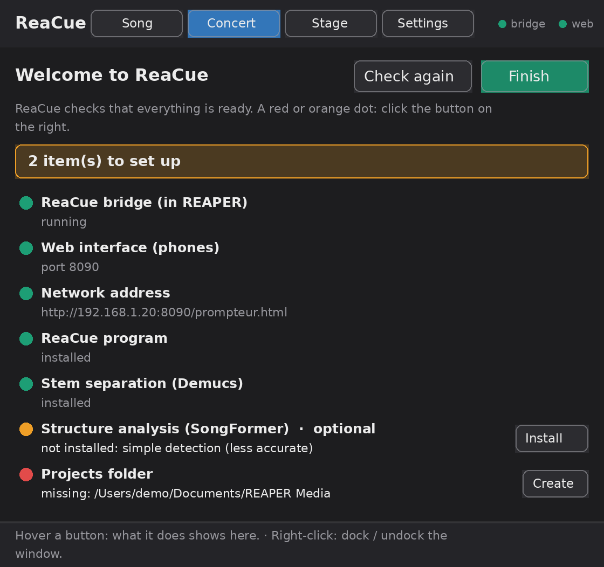

**The ReaCue window** opens on the right tab by itself: **Stage** if the project is a concert, **Song** if it
is a song, otherwise the last one used. Right-click in the window: dock it in REAPER or undock it (docked at
the bottom, it becomes a compact transport bar). Top right, two dots: **bridge** (ReaCue answers in REAPER)
and **web** (prompter available) — green when all is well. At the bottom, the **help line** explains what the
element under the mouse does.

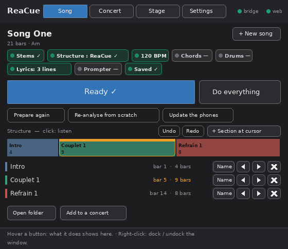

**If the actions are missing** (REAPER was open during installation):

1. In the action list, click **New action… → Load ReaScript…**
2. Go to the scripts folder: menu *Options → Show REAPER resource path in explorer/finder*, then
   `Scripts` → `ReaCue`.
3. Pick `ReaCue.lua` → **Open**. Do the same with `ReaCue_Preparer.lua`, `ReaCue_Republier_prompteur.lua`,
   `ReaCue_Separer_stems.lua`, `ReaCue_Concert.lua`, `ReaCue_Morceau_suivant.lua` and `ReaCue_Morceau_precedent.lua`.

---

## 6. Enable REAPER's web interface (once)

The phones' prompter goes through the small web server built into REAPER.

1. Mac: menu **REAPER → Settings…**; Windows: menu **Options → Preferences…**
2. In the list on the left, at the bottom: **Control/OSC/web**.
3. Click **Add**.
4. **Control surface mode**: choose **Web browser interface**.
5. **Port**: `8080` (keep this value if you can).
6. Leave everything else as is, click **OK**, then **OK** to close the preferences.

**To check:** on the computer, open a browser at `http://localhost:8080/`: a REAPER page should appear.

**If it does not work:** another program may be using port 8080 → start again with `8081` (and use that
port everywhere below). On Windows, if the firewall asks about REAPER, tick **Private networks** and click
**Allow**.

---

## 7. Create a project for a song

**One REAPER project per song.** ReaCue replaces the regions, the tempo map and the CLICK / CUES / VOICE
tracks every time it prepares a song: do not put several songs in the same project.

### The easy way: “+ New song”

1. Open the **ReaCue** window (action **ReaCue**). The **+ New song** button is at the top of the **Song**
   tab (and under the list of songs in the **Concert** tab).
2. Click it and choose:
   - **One file (MP3, WAV…)**: pick the song's file;
   - **Stems (a folder)**: pick **one of the stem files** — every audio file in the same folder is used (with
     the *js_ReaScriptAPI* extension installed, you pick the folder directly).
3. ReaCue suggests a **title** from the name (without “-Bass-”, the key, the BPM, “Official Video”…): fix it
   if needed, **OK**. If a song with that title already exists, ReaCue asks for another title: nothing is
   ever overwritten.
4. ReaCue **copies** the files to `Documents/REAPER Media/<Title>/` (progress in the tab; file names are
   kept), opens a **new project tab** (your open project is not touched), puts **one file per track** at the
   start, and **saves** the project `<Title>/<Title>.RPP`.

**You should see** the new project's **Song** tab with the banner **“Song created. Prepare everything now?”**:
click **Do everything** (step 10) — or **Later**. The big button shows the next step: **Split stems** (single
file, step 9) or **Analyse and prepare** (stems). The song also appears in the **Concert** tab's list
(orange until it is prepared; click its name to open it).

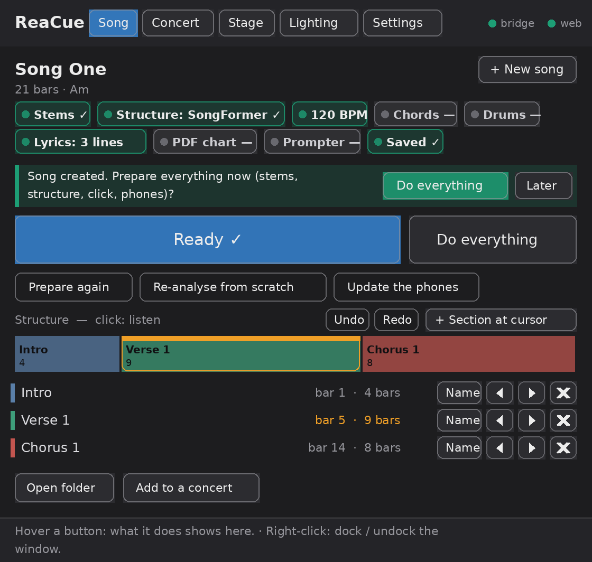

> Copying the files avoids the “OFFLINE” problem with files left in *Downloads* on a Mac. After a successful
> **Do everything**, **Split stems**, **Analyse and prepare** or **Apply** from the window, the song's project
> is **saved automatically** (“Saved ✓” pill): the concert always finds its sections and tempo.

### Other way (by hand)

1. Create a folder for the song, for example `Documents/REAPER Media/Demo Song/`.
2. **Copy the song's audio files into it** (stems or MP3).
   > ⚠️ On a Mac, avoid leaving the files in *Downloads*: macOS may prevent REAPER from reading them (the
   > item then shows “OFFLINE”).
3. In REAPER: **File → New project**.
4. **File → Save project as…**, pick the song's folder, name the project (`Demo Song`) and tick **Copy all
   media into project directory** if the option is offered. **Save**.
5. Import the audio (step 8).

---

## 8. Import the audio: stems or a single MP3

*Not needed if you used **+ New song** (step 7): just read the file-name table.*

### Case A: you have the stems

1. Select all the stem files in the Finder / File Explorer.
2. **Drag them together** into REAPER's track area, at the very beginning (left).
3. If REAPER asks how to place several files, choose **“One per track”**.

**You should see** one track per stem, all items starting at the same place.

File names matter: ReaCue recognises the role of each stem from words in the name:

| Role | Words recognised in the file name |
|---|---|
| Drums | `drum`, `batterie`, `kick`, `perc` |
| Bass | `bass`, `basse` |
| Guitar | `guitar`, `guitare`, `gtr` (`lead` or `solo` = lead guitar) |
| Vocals | `vocal`, `voice`, `vox`, `chant`, `voix` |
| Other | anything else (keys…) |

> Bonus: the key and tempo in the name (e.g. `Demo Song-A minor-112bpm-drums.wav`) improve the chords and
> avoid double/half tempo mistakes.

Go straight to **step 10**.

### Case B: you only have an MP3 (or a WAV)

1. Drag the file into REAPER's track area, at the very beginning.

You can prepare the song right away (step 10), but with less detail (no drum view, no per-instrument
entries/rests, less reliable chords and sections). **Better: split it into stems first (step 9).**

---

## 9. Split an MP3 into stems

*Needs stem separation installed (answer `y` in step 4, or `Install ReaCue Stems`).*

1. **Click the MP3 item** in REAPER to select it (it becomes lighter).
2. In the **ReaCue** window, **Song** tab, click the big **Split stems** button (or run the action **ReaCue -
   Separate stems**). *Do everything* (step 10) does it too, then carries on.
3. The tab shows **“Separating stems: N %”** with a progress bar.
   - Count **5 to 8 minutes for a 4-minute song** on an Intel Mac, less on a recent Mac.
   - You can switch tabs and keep working: the import happens by itself at the end.
   - Do not quit REAPER during the separation.
4. At the end, a **“Stems imported”** message appears.

**You should see** six new tracks below the original track: **Vocals, Drums, Bass, Guitar, Piano, Other**,
aligned exactly like the MP3. The MP3 item was removed from the project (the file itself is still on disk;
*Edit → Undo* brings it back).

The stem files are stored next to the MP3, in `<song name>-stems/htdemucs_6s/`. If you run the action again
on the same MP3, the import is immediate (no new separation).

> Listen to the tracks solo (**S** button): vocals, drums and bass are usually very clean; guitar and piano
> may keep a bit of the other instruments. That is normal and good enough for ReaCue. An almost empty track
> (for example Piano in a song without keys) is not a problem.

**If it does not work:**

| Message | Solution |
|---|---|
| “Select the song's audio item” | Click the MP3 item, then run the action again |
| “Audio file not found… OFFLINE” | The file cannot be read: see [Troubleshooting](#18-troubleshooting) |
| “Stem separation is not installed” | Double-click `Install ReaCue Stems.command` / `.bat` in the ReaCue folder |
| “The separation failed” | Read the end of the log shown; the full log is `…-stems/demucs.log` |
| The progress stays at 0 % for a while | Normal during the first minute (model loading) |

---

## 10. Prepare the song with Do everything

1. **ReaCue** window, **Song** tab: click **Do everything** (right of the big button). No need to select
   anything.
2. A list shows the steps and their time:

   | Step | What it does |
   |---|---|
   | Split stems | only for a single MP3/WAV (“already done” otherwise) |
   | Analyse and prepare | tempo, bars, **structure** (SongFormer when installed), regions, click, cues, prompter |
   | Update the phones | lyrics, chords, drums and structure for the prompter |
   | Save the project | so that the concert finds sections and tempo |

   **Stop** stops after the current step. If a step fails, the cause and **what to do** show with a button
   (e.g. *Start the bridge*); **Resume** starts again at the failed step.
3. At the end: **“Song ready ✓”** (*Summary*: tempo, bars, structure, what was published). **Close**. The big
   button now says **Ready ✓** and the **pills** are green: Stems ✓ · Structure: SongFormer ✓ · 120 BPM ·
   Chords ✓ · Drums ✓ · Lyrics · Prompter published ✓ · Saved ✓.

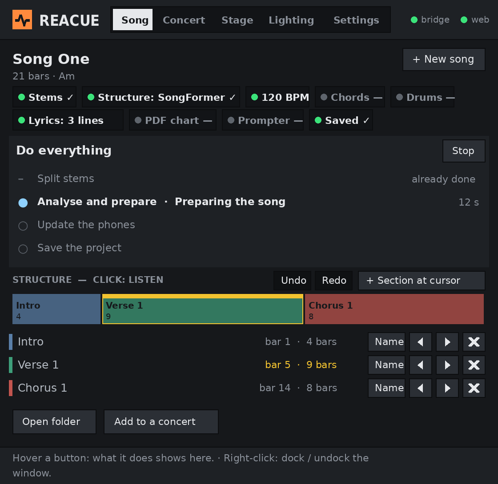

Step by step, the big button does the same (**Split stems** → **Analyse and prepare** → **Ready ✓**); below
it: *Prepare again* (rebuilds everything keeping your structure), *Re-analyse from scratch* (tempo and
structure computed again, your fixes are replaced), *Update the phones*. The action **ReaCue - Prepare the
song** does *Analyse and prepare*.

**You should see** in the project:

- coloured **regions** at the top (Intro, Verse 1, Chorus 1…);
- **“→ Chorus”** markers before each section;
- three new tracks: **CUES**, **VOICE**, **CLICK**;
- the audio moved by 2 bars to make room for the count-in.

> **With SongFormer** (structure analysis, installed by default): the first preparation of a song takes a
> few minutes more; the list shows **“Structure analysis (SongFormer)… N s”**. The next preparations of the
> same song are immediate (result remembered). If SongFormer fails, the message says “SongFormer analysis
> failed: … → ReaCue structure used” and the pill shows **Structure: ReaCue**. To compare: *Settings* →
> *Structure detection* → **ReaCue only**, then *Re-analyse from scratch*.

Press **Space**: you hear 2 bars of click with “one two three four”, then the song, the click and the cues.

**If it does not work:** the window shows the cause, what to do and a button. In short:

| Message | Solution |
|---|---|
| “The ReaCue bridge is not running in REAPER” | **Start the bridge** button; otherwise restart REAPER, or run the installer again (REAPER closed) |
| “ReaCue program not found” | The ReaCue folder was moved: run the installer again from its new place |
| “A preparation is already running” | Wait for the previous one to finish (1 minute max) |
| The tempo is double or half the real one | Put the tempo in the file names (e.g. `-94bpm`) and *Re-analyse from scratch* |

---

## 11. Check the structure

Read the structure in the **Song** tab: the **coloured band** (one box per section, width proportional to
its number of bars) and the list below (first bar, length). **Orange** boxes are **to check** — hover them,
the help line says why:

- **unusual length**: a section that is not 4, 8 or 16 bars long is often a mistake (two sections glued
  together, or one section cut in two);
- **boundary moved when aligning on bars** or **between two bars**: SongFormer hesitated on the start.

Also look at **the names** (verse and chorus swapped, pre-chorus glued to the chorus) and the ending (a long
“Outro” may contain a last chorus or a solo).

Listen: **click a box** of the band (or a name in the list) — the section is selected and playback starts at
its beginning.

**To fix it, three ways (you can mix them):**

**Way 1 — in the Song tab** (the easiest)

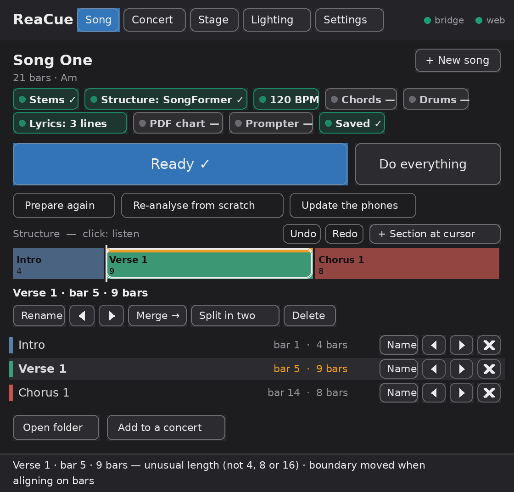

Select a section (click its box); its tools show under the band:

| Button | Effect |
|---|---|
| **Rename** (or **Name** in the list) | rename (“Pre-chorus”, “Solo”…) |
| **◀** / **▶** | move the start one **bar** earlier / later (the end of the previous section follows) |
| **Merge →** | join the section with the next one |
| **Split in two** | split the section in the middle (on a bar); you name the 2nd part |
| **Delete** (or **✕**) | delete (the previous section extends to the next one) |
| **+ Section at cursor** | add a section starting at the edit cursor's bar |
| **Undo** / **Redo** | go back / redo, as many times as you like |

The big button becomes **Apply the changes** (and a “Structure changed” banner offers **Apply**): click it.
Click, cues, colours and prompter follow; the pill shows **Structure: manual**.

**Way 2 — by hand in REAPER, then “Apply”**

1. Fix the regions in the region lane (top of the window):
   - **rename** or **change the start**: double-click the region → change *Name* or *Start* → **OK**;
   - **move the start**: you can also drag the region's left edge;
   - **add**: make a time selection (drag in the ruler) starting where the new section starts, then menu
     *Markers → Insert region from time selection* (default shortcut Shift+R), and name it;
   - **delete**: right-click the region → *Remove region*.
2. Click **Apply the changes** / **Prepare again** in the Song tab (or run **ReaCue - Prepare the song**).
3. The final window starts with **“Structure taken from your REAPER regions”**, with the new table. The
   regions are recoloured, and the “→” markers, the cues, the click and the prompter follow.

Good to know:

- only the **start** of each region counts: a section lasts until the next region starts (no need to fix
  the ends);
- a start placed between two bars is moved to the nearest bar line (a warning tells you if it was more than
  a quarter of a bar away);
- the name sets the colour and the cue: “Chorus 2” or “Refrain 2” makes a chorus, “Solo” a solo…;
- a region before bar 1, after the end of the song or on the same bar as another one is ignored (warning);
- if you changed nothing, *Prepare again* keeps the saved structure, as before;
- *Update the phones* does not take edited regions: a warning asks you to click *Apply*.

**Way 3 — with Claude Desktop** (optional, see [step 15](#15-link-claude-desktop-optional))

Just say “chorus 1 starts at bar 37” or “rename section 6 to Solo”: everything is rebuilt (regions, click,
cues, prompter). What you tell Claude replaces regions edited by hand.

---

## 12. Add the lyrics

ReaCue never downloads lyrics: **you provide the text**.

1. Open a text editor:
   - Mac: **TextEdit**, then menu **Format → Make Plain Text** (important: plain text);
   - Windows: **Notepad**.
2. Type (or paste) the lyrics: **one line = one sung phrase**, an empty line between blocks (verse,
   chorus…). Lines like `[Chorus]` or `Verse 2:` are ignored. `(x2)` at the end of a line repeats it.
3. Save the file as **`lyrics.txt`** (**UTF-8** encoding), **in the stems folder**. For an MP3 split by
   ReaCue, you can put it **next to the original MP3** (or in the `…-stems/htdemucs_6s/` folder).
4. **Song** tab: the pill shows **Lyrics: N lines** (click it, or **Open folder**, to see where). Click
   **Update the phones** (or the action **ReaCue - Republish the prompter**): nothing in the project is changed.

**You should see** in the result: `Prompter published: … N lyric lines`. On the phone, in the
**Vocals** view, the lines scroll with the song.

The lines are aligned automatically on the vocal stem. If a line is off, you can place it by hand with a
timing file `lyrics_timing.json` (see the *Lyrics* section of the README).

**No text at hand?** If *automatic lyrics* are installed (Whisper, with `Install ReaCue Words`), ReaCue
transcribes the vocal stem and writes a draft **`paroles (auto).txt`** in the song folder; the pill turns
orange: **Lyrics: auto (N lines)**. Click it to open the draft, correct it by ear (in place, or rename it
`lyrics.txt`), then **Update the phones**. Your own `lyrics.txt` always wins, and the draft is never
overwritten.

---

## 13. Open the prompter on the phones

1. Connect the phone to the **same Wi-Fi** as the computer.
2. Find the computer's IP address (if you did not write it down in step 4):
   - Mac: *System Settings → Wi-Fi → Details…* (next to the connected network) → **IP address**;
   - Windows: *Settings → Network & Internet → Wi-Fi → network properties* → **IPv4 address**.
3. On the phone, open the browser and type: **`http://<IP address>:8080/prompteur.html`**
   (example: `http://192.168.1.20:8080/prompteur.html`). Careful: `http`, not `https`.
4. Pick your role: **Drums**, **Bass**, **Rhythm gtr**, **Lead gtr**, **Vocals** or **Overview** (the choice
   is remembered on this phone; the **Role** button changes it).
5. Start playback in REAPER: the prompter follows the position (section, bar, beat).

**You should see** a green dot (link with REAPER alive), the current section and the next one.

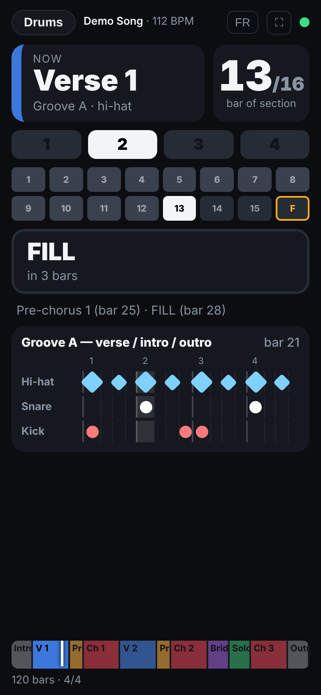 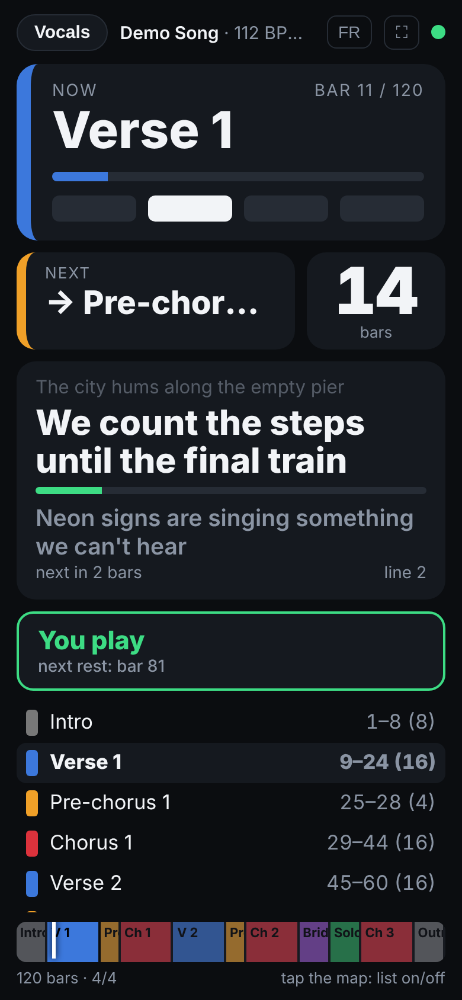

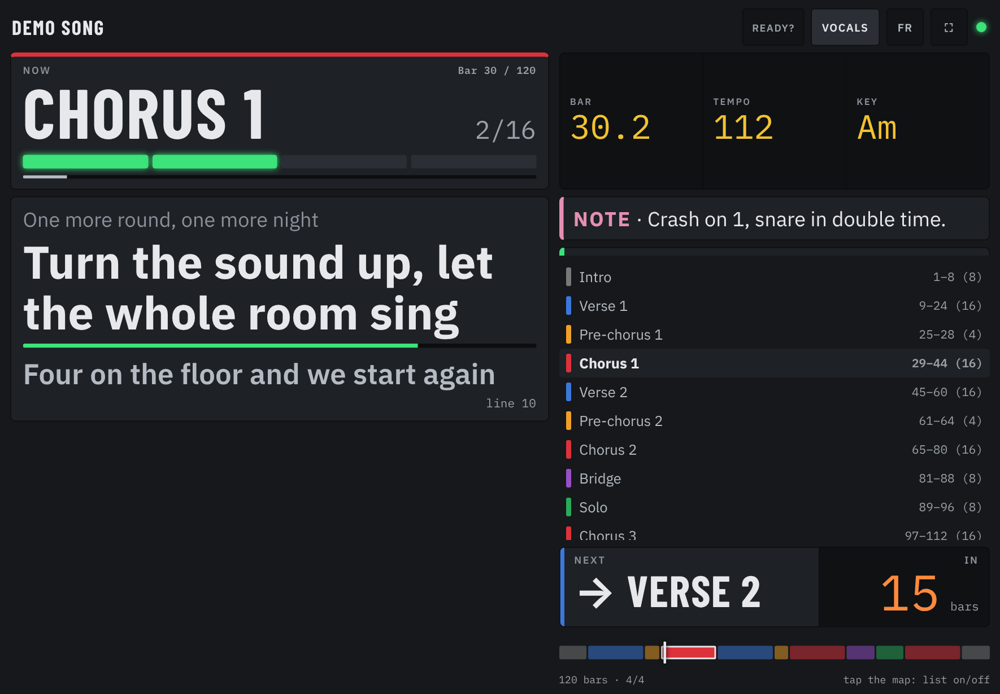

Tips:

- **Home screen**: iPhone: *Share → Add to Home Screen*; Android: menu **⋮ → Add to Home screen**. The page
  then opens full screen, like an app.
- **Screen sleep**: tap the **⛶** button (full screen), which asks the phone to stay awake. If the screen
  still turns off, disable auto-lock during rehearsal (iPhone: *Settings → Display & Brightness → Auto-Lock →
  Never*; Android: *Display → Screen timeout*).
- **Changing address**: the router may give the computer a different IP address from one day to the next,
  and the phones' bookmarks stop working. In your router's settings, look for **“DHCP reservation”** (or
  “static lease”, “fixed IP”) and reserve the current address for the computer. At gigs, a small travel
  router dedicated to the band avoids any surprise.
- The **FR/EN** button switches the prompter language on that phone.

---

## 14. Set up the click, the spoken cues and the in-ears

**ReaCue** window, **Settings** tab. Each change is saved at once (“saved” shows) and **applies at the
next preparation**: click **Prepare again** in the Song tab (the validated structure is kept), or **Rebuild
the concert**. The view is **simple** by default (language, count-in, cues, voices, outputs, structure
detection, licences); **Advanced settings** adds PIN, cue lead, count language / voice / speed, volumes,
tempo, separation model and folders.

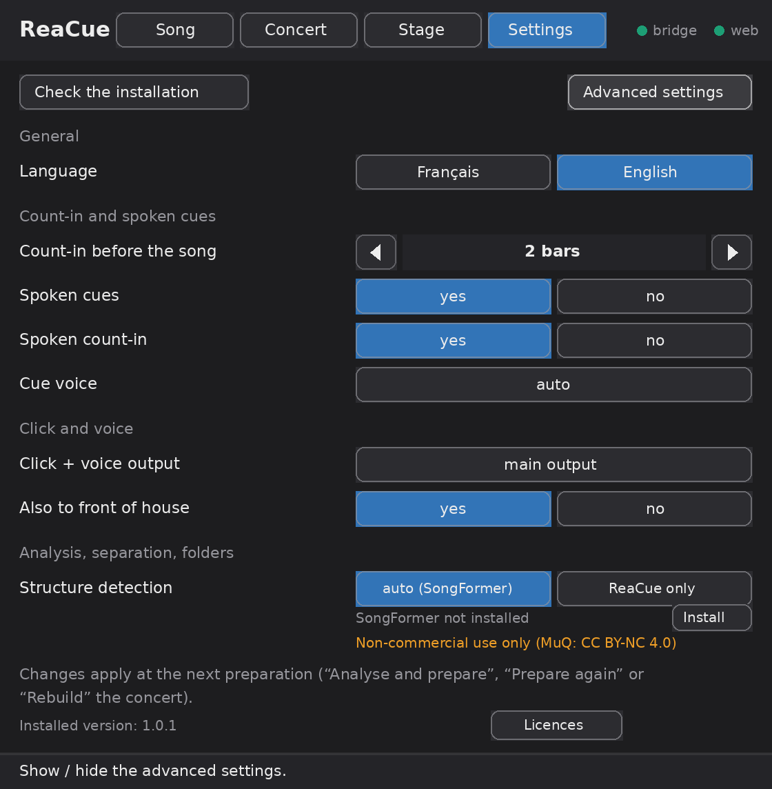

Common examples:

| I want… | In the Settings tab | Key in the file |
|---|---|---|
| A single bar of count-in | *Count-in before the song*: ◀ down to **1** | `"count_in_bars": 1` |
| The count in French | *Count*: **un deux trois quatre** | `"count_lang": "fr"` |
| No spoken cues, only the click | *Spoken cues*: **no** | `"voice_cues": false` |
| A louder click | *Click volume*: ▶ | `"click_volume": 0.8` |
| Click and voice only in the in-ears (outputs 3/4), not front of house | *Click + voice output*: **outputs 3/4**, *Also to front of house*: **no** | `"click_hw_output": 2` and `"click_to_master": false` |
| 4 stems instead of 6 | *Stem separation*: **4 stems** | `"stems_model": "htdemucs"` |
| Sections by ReaCue only (not SongFormer) | *Structure detection*: **ReaCue only** | `"structure_engine": "reacue"` |

The tab also shows the **installed version**. The settings live in the file **`reacue_settings.json`**
(REAPER's resource folder, menu *Options → Show REAPER resource path in explorer/finder* → folder
**`ReaCueMCP`**): you can also edit it with TextEdit or Notepad, keeping the JSON syntax. For
`click_hw_output`: `0` = outputs 1/2, `2` = outputs 3/4, `4` = outputs 5/6, and so on.

For the cue voices (`announce_voice`), see the *Settings* section of the README.

---

## 15. Link Claude Desktop (optional)

All of ReaCue works without Claude. Linking [Claude Desktop](https://claude.ai/download) also lets you drive
ReaCue in plain English: fix the structure, change a setting, move around the song.

**Requirements**

- Claude Desktop installed on **the same computer** as REAPER and signed in to your Claude account (a paid
  plan may be needed depending on the offer: check the current terms on claude.ai);
- ReaCue installed (step 4) and REAPER open, with the bridge running.

**Link ReaCue to Claude Desktop**

1. If you answered `y` to “Register ReaCue in Claude Desktop” in step 4, it is already done. Otherwise
   **run the installer again** (`Install ReaCue.command` / `.bat`) and answer `y` to that question. The
   installer adds the `reacue` server to Claude Desktop's configuration (a backup of the previous
   configuration is kept).
2. **Quit Claude Desktop completely** and start it again (Mac: menu *Claude → Quit*, not just closing the
   window; Windows: right-click the Claude icon near the clock → *Quit*, if it is there).
3. **Start a new conversation.**

**Check that the ReaCue tools are there**

Depending on your version of Claude Desktop, the tools of linked servers are behind a tools icon or a
“connectors” / “tools” menu near the message box. You should see **reacue** with its tools (`prepare_song`,
`set_sections`, `reaper_status`…). The simplest test: type “check that REAPER is responding”. Claude uses
`reaper_status` (it may ask for permission the first time) and should answer that REAPER and the bridge are
connected.

**Example requests**

| You say | What happens |
|---|---|
| “Prepare the song open in REAPER” | New song: full analysis. Already prepared song whose regions you edited: your regions are taken. Already prepared song with no edit: **new analysis** (the validated structure is replaced) — to only rebuild, use the *Prepare again* button instead |
| “Chorus 1 starts at bar 37” | Structure fixed, everything rebuilt |
| “Rename section 6 to Solo” | Region renamed, recoloured, cue changed |
| “Only republish the prompter” | Prompter updated, nothing changes in REAPER |
| “Go to chorus 2” | REAPER's cursor jumps to the start of the region |
| “Just one bar of count-in” | Setting changed, click and cues rebuilt |

**What updates by itself**: after each of these requests, the regions, markers, CUES / VOICE / CLICK tracks
in REAPER and the phones' prompter (which reloads its data every 2 seconds). Nothing to restart.

**If it does not work**

| Problem | Solution |
|---|---|
| reacue does not show in the tools | Run the installer again answering `y`, then quit Claude Desktop completely and start it again |
| Claude says REAPER is not responding | REAPER must be open; restart it to restart the bridge; a dialog left open in REAPER also blocks the bridge |
| ReaCue's new features are not visible | Tools are loaded when a conversation starts: after updating ReaCue, **start a new conversation** (and restart Claude Desktop) |
| “the project open in REAPER no longer contains the tracks of the last prepared song” | You switched projects (or consolidated): ask “prepare the song open in REAPER” to analyse it |

---

## 16. Concert mode: several songs in one project

For a gig (or a full run-through), ReaCue chains your **already prepared** songs in one REAPER project. Each
song keeps everything you validated: stems, tempo, structure, spoken cues, click.

**Before you start:** each song must have been prepared (step 10) **and its project saved** (**Cmd+S** /
**Ctrl+S**). A project saved before the preparation goes into the concert without sections.

### 16.1 Build the concert

**In the ReaCue window, Concert tab:**

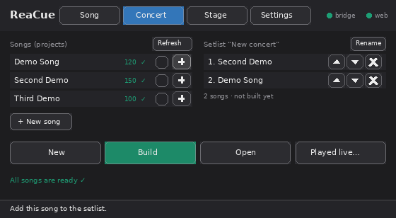

1. On the left, **Songs**: the projects found in `Documents/REAPER Media` (setting *Projects folder*), with
   their tempo; **✓** = prepared, *to prepare* in orange otherwise. **Refresh** reads the folder again.
2. Click **+** on each song, in the concert's order: they are added on the right, in the **Setlist**.
   **▲ ▼** change the order, **✕** removes a song.
3. **Rename**: give the concert a name (e.g. “Saturday 15”).
4. **Build**. A song that is not prepared is reported first (you can build anyway). Building takes a few
   seconds; the concert **opens by itself in a new REAPER project tab**.

**Several songs to prepare?** Below the buttons, **Prepare all songs not prepared** (or tick songs in the
list → **Prepare the selection**). ReaCue prepares them **one after the other in the background**: each
project is opened in a tab, *Do everything*, saved, then the tab is closed. The progress shows (✓ ready, ●
running with the step, ✗ failed with the reason); **Stop** stops after the current song.

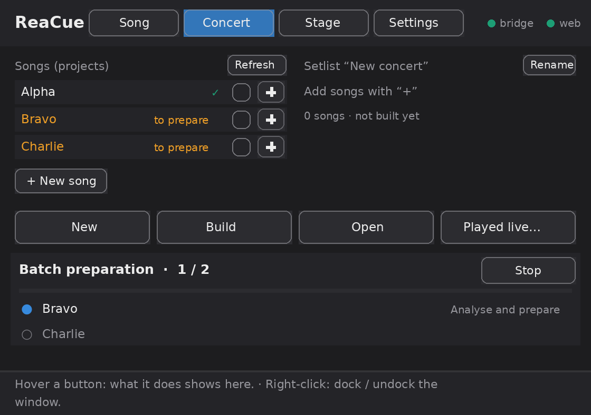

From the **Song** tab, the **Add to a concert** button adds the open song to a setlist (new or existing)
without leaving the song.

At the bottom of the Concert tab, **Existing concerts**: **Edit** loads its setlist into the editor, **Open**
opens it in a new tab. After a change, the button becomes **Rebuild**.

**With Claude Desktop** (step 15): type for example

> Build a concert “Saturday 15” with: Demo Song, Second Demo, Third Demo

Claude finds the projects by name in `Documents/REAPER Media` (setting `projects_dir`) and answers with the
concert table: start, tempo, bars and sections of each song. Warnings (song without regions…) show in its
answer.

**Without Claude** (command line, from the `ReaCue` folder):

- Mac: `.venv/bin/python -m reacue_mcp.cli concert --name "Saturday 15" --songs "Demo Song" "Second Demo"`
- Windows: `.venv\Scripts\python reacue_cli.py concert --name "Saturday 15" --songs "Demo Song" "Second Demo"`

**You should see** in `Documents/REAPER Media/Concerts/` (setting `concert_dir`): `Saturday 15.RPP`,
`Saturday 15.setlist.json`, `Saturday 15.concert.lua` and `Saturday 15.prompteur.json`. Don't edit them by hand.

Building takes a few seconds; the prompter's chords, lyrics and drums are then computed in the background
(a few minutes the first time, then kept).

### 16.2 Open the concert

1. **ReaCue** window, **Concert** tab → **Existing concerts** → **Open** next to **Saturday 15** (right after
   building, it is already open).
2. The concert opens in a **new project tab** (your current project stays open in its own tab), and the
   window switches to the **Stage** tab by itself.

**You should see** one track per instrument for the whole concert (Vocals, Drums, Bass, Guitars…), one colour
per song, the CLICK / VOICE / CUES tracks at the bottom, regions “Demo Song · Chorus 1”, and at the top a
**Songs** lane with “1 · Demo Song”, “2 · Second Demo”… The Stage tab shows **1 / 3 · Demo Song**.

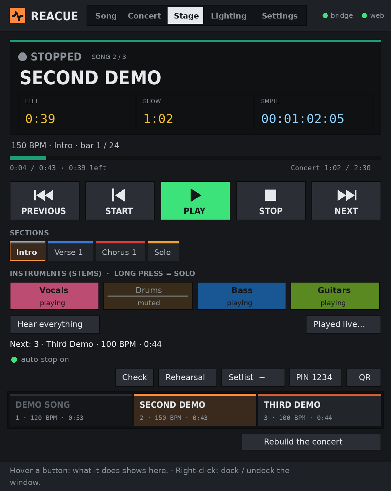

> Tip: **right-click in the window** to dock it at the bottom of REAPER (it becomes a compact transport bar)
> or to undock it.

### 16.3 Play

1. Press **Space** (or the big green **Play** button of the window): count-in, then the song.
2. At the end of the song, playback **stops by itself** and the cursor goes to the next song's count-in. The
   window shows **2 / 3 · Second Demo**.
3. When the band is ready: **Space**.

The Stage tab shows the current section, “bar x / N”, the time left in the song and the concert, and the
next song. Its buttons:

| Button | Effect |
|---|---|
| **Previous** | start of the current song; at the start, previous song |
| **Start** | back to the current song's count-in |
| **Play / Pause** | plays or pauses |
| **Stop** | stops |
| **Next** | goes to the next song's count-in |
| **Section** pills | go to the start of the section (playback continues) |
| **Setlist** | list of songs: one click = go to the song; **Rebuild the concert** |

During playback, **Stop**, **Previous**, **Next** and changing song need a **double tap**: the first tap shows
“again?” in orange, the second one (within 2 seconds) runs it.

For a pedal or a keyboard shortcut: the actions **ReaCue - Next song** and **ReaCue - Previous song**
(*Actions → Show action list* → select the action → **Add…** under *Shortcuts for selected action*).

> ⚠️ The automatic stop, the phone remote and the instrument profile only work while the **ReaCue** window
> is open (any tab, even docked). Don't close it during the gig.

### 16.4 QR code for the musicians

1. In the Stage tab, click **QR**.
2. The QR code shows large with the address underneath (e.g. `http://192.168.1.20:8080/prompteur.html`) and
   the Stage control PIN code.
3. Each musician, on the **same Wi-Fi**, opens the phone's camera, points it at the QR code and taps the link:
   the prompter opens; they choose their role.
4. Click **Close** (or the QR, or Escape) to go back.

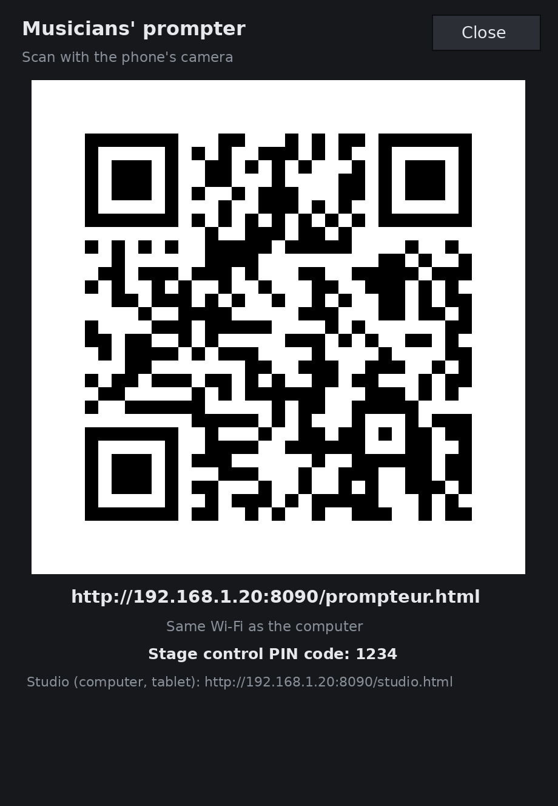

The address is computed at each click: if the computer's address changed, the QR is still right. If
“Computer IP address not found” shows: the computer is not connected to any network.

### 16.5 Drive the concert from a phone (Stage control)

1. On the phone of the person in charge: open the prompter (QR code), tap **Role** then **Stage control**.
2. Tap a button (e.g. **Play**): the phone asks for the **PIN code**. It is shown in the Stage tab (button
   **PIN 1234**, and under the QR code) and in the Settings tab. Type it, **OK**.
3. The button gets a green outline when REAPER has run the command.

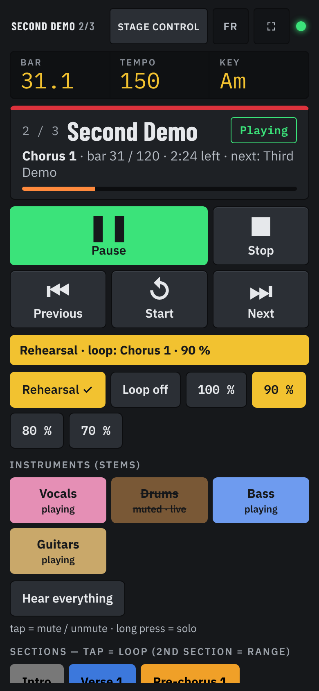 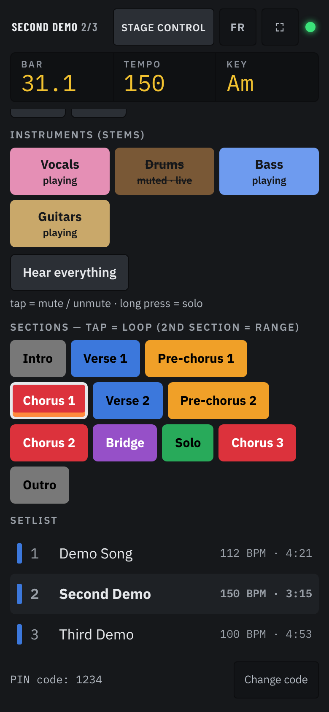

Stage control offers Play/Pause, Stop, Previous, Start, Next, the setlist, the sections and the
**instruments** (16.8), with the same double tap during playback. The PIN is remembered on the phone; **Change code** to type it again. To change
the PIN: **PIN** button of the Stage tab (4 digits).

> ⚠️ The PIN prevents mistakes, **not attacks**: anyone on the same network can drive REAPER through its web
> interface. At gigs, use a Wi-Fi reserved for the band.

### 16.6 Change a song of the concert

1. Open **the song's project** (not the concert), fix it (structure, settings…), **Apply** or **Prepare again** (saved by itself).
2. Back in the concert: Stage tab → **Rebuild the concert** → **OK** (or Concert tab → **Edit** →
   **Rebuild**).

Changes made directly in the concert project are **overwritten** by the rebuild.

### 16.7 Check before playing

Before the soundcheck or the show, click **Check** in the Stage tab.

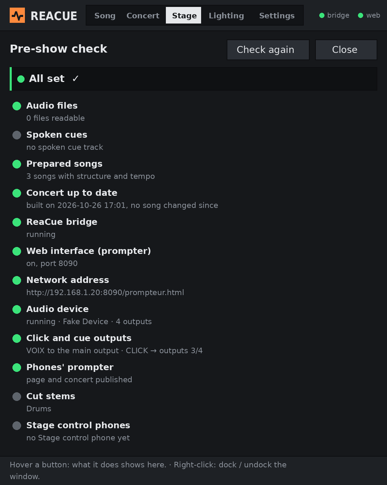

1. A list appears, with a summary at the top: **All set ✓** (green), **N thing(s) to watch** (orange) or
   **N problem(s)** (red).
2. Each line has a dot and a short detail:

| Line | What is checked | If it is not green |
|---|---|---|
| Audio files | every file of the concert is readable (not “OFFLINE”) | **Fix** sets all media online; otherwise see Troubleshooting (OFFLINE) |
| Spoken cues | the cue files are present | **Fix** rebuilds the concert |
| Prepared songs | each song has a structure and a tempo | prepare the song in its project, save, rebuild |
| Concert up to date | no song project changed since the build | **Fix** rebuilds the concert |
| ReaCue bridge | REAPER answers ReaCue | restart REAPER |
| Web interface | the prompter is served (port) | step 6 |
| Network address | the computer has an address (for the QR) | connect it to the band's Wi-Fi |
| Audio device | REAPER plays on an audio device | *Preferences → Audio → Device* |
| Click and cue outputs | the outputs chosen for CLICK / VOICE exist, tracks not muted | plug the right audio device or change `click_hw_output` (step 14) |
| Phones' prompter | the page and the concert are published | **Fix** republishes them |
| Stage control phones | a Stage control phone was seen recently | (information only) |
| Muted stems | the instruments muted (“played live” profile or by hand) | (information only) |

3. **Check again** runs the list again; **Close** (or Esc) goes back to the Stage tab.

> With no concert open, **Check** only covers the system part (bridge, web interface, address, audio
> device).

### 16.8 Instruments: muting a stem, “played live”

Below the sections, the Stage tab has an **Instruments (stems)** row: one button per instrument track of the
concert (Vocals, Drums, Bass, Guitars, Lead guitar, Keys, Other, Mix — never CLICK, VOICE or CUES). Under
each name: **playing** or **muted**.

| Gesture | Effect |
|---|---|
| **Click** | mute / unmute that stem (during playback outside rehearsal: **double tap**) |
| **Long press** | **solo**: only that one is heard (another long press = back) |
| **Hear everything** | unmutes all stems (again = back to the profile) |

These manual choices last until the next song.

**“Played live”: the concert's profile.** If the band really plays drums and bass, their stems must be muted
for the whole concert. Click **Played live…**:

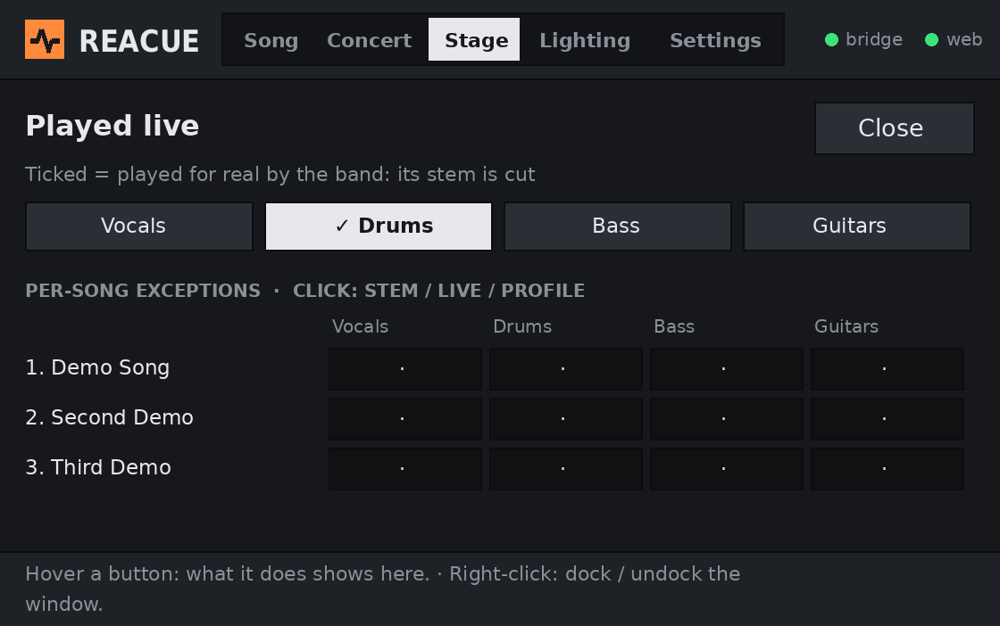

1. Tick what the band plays for real (e.g. **Drums**, **Bass**): those stems are muted at the start of every
   song.
2. **Per-song exceptions**: click a cell to turn it from **·** (profile) to **stem** (keep the stem on that
   song) then **live** (mute it on that song only). Example: the bass player switches to keys on one song →
   Bass cell of that song = **stem**.
3. **Close**.

The profile is saved with the concert (in `Saturday 15.setlist.json`) and **kept when you rebuild**. It is
also reachable from the Concert tab (**Played live…**). The rehearsal count-in bar does not overwrite your
choices.

On the phones, each musician sees at the top **“your stem is muted”** (orange) or **“your stem is playing”**
(green). In **Stage control**, the same buttons: tap = mute / unmute, long press = solo, **Hear everything**.

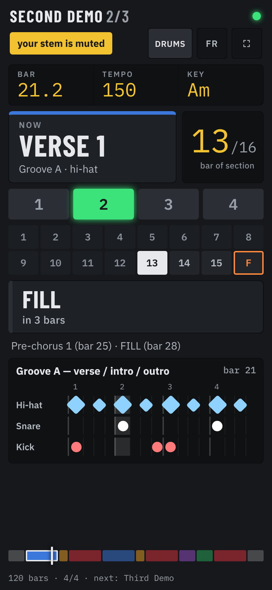 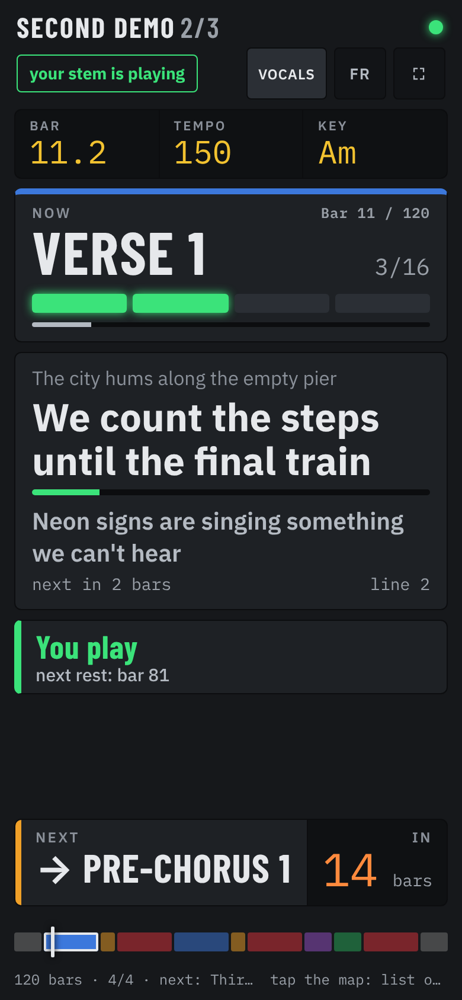

With Claude: “in the Saturday 15 concert, drums and bass are played live, except the bass on Second Demo”
(tool `set_live_profile`, no rebuild).

### 16.9 Lighting: grandMA3

At each preparation and each concert build, ReaCue writes one cue per section for a grandMA3 desk (folder
`grandMA3/` next to the project, or `Concerts/grandMA3/<concert>/`): one Sequence per song, one Timecode and
a cue sheet (CSV with a suggested effect per section).

1. On a phone or the lighting computer, open the prompter and choose the **Lighting** role: cue list,
   current cue highlighted, links to download the three files.
2. On the desk: import the Sequence, then the Timecode.
3. **REAPER sends the timecode** (MTC or LTC): the concert stops between songs, the desk follows.

**First setup (once).**

1. In `reacue_settings.json`, choose the output(s):
   - **console with LTC**: `"gma3_ltc_output": 7` (sound card output 7 → the desk's LTC XLR input);
   - **grandMA3 onPC on the same Mac**: `"gma3_mtc_output": "IAC Driver Bus 1"` (Audio MIDI Setup → Window →
     Show MIDI Studio → IAC Driver → tick *Device is online*);
   - **onPC on another computer**: `"gma3_mtc_output": "Network Session 1"` (Audio MIDI Setup → MIDI Network
     Setup: create a session, connect the PC; on Windows, rtpMIDI);
   - optionally `"gma3_tc_slot": 1`, `"gma3_tc_start": "01:00:00:00"`, `"gma3_fps": 25`.
2. REAPER: *Preferences → Audio → MIDI Devices*: enable that MIDI output (MTC only).
3. Prepare a song: tracks `TIMECODE LTC` / `TIMECODE MTC` appear. Double-click the generator item →
   *Source properties*: frame rate = `gma3_fps`, start = `gma3_tc_start`, *Send MIDI (MTC)* ticked on the
   MTC track only. OK, then **Prepare** again: ReaCue remembers this for every song and concert.
4. Desk: copy the contents of the export folder (`grandMA3/` next to the project, or
   `Concerts/grandMA3/<concert>/`) into `grandMA3/` at the root of a USB stick, import the plugin
   `ReaCue.xml` (Plugins pool → Import) and run it: Sequences, Timecode and TC Slot in one tap.
5. Desk input (once): *Menu → In & Out (Connector Configuration)*: SMPTE Mode = In and SMPTE TC = slot
   (LTC), or MIDI TC Mode = In and MIDI TC = slot (MTC).

Test: play in REAPER → the desk's timecode runs and the cues fire; stop → the timecode show stops; play
again → it restarts. Useful settings: `gma3_song_slot` (e.g. `600`: each song starts on a round 10-minute
mark). Rebuild the concert after a change.

---

## 17. At rehearsal

### 17.1 The concert's rehearsal mode (loop and slow-down)

In an open concert, with the **ReaCue** window (**Stage** tab):

1. Click **Rehearsal** (or, on the Stage control phone, tap **Rehearsal**). An orange **REHEARSAL** banner
   appears; the automatic stop between songs is off.
2. **Loop a section**: tap its pill (in the window or on the phone). Playback starts **one bar before** the
   section: during that bar you only hear the **click and the spoken cues** (“one two three four”), then the
   section plays, and at its end it **starts again with the same count-in bar**, endlessly.
3. **Loop several sections**: tap a 2nd section of the same song (e.g. *Verse 2* then *Chorus 2*): the loop
   goes from the start of one to the end of the other. Looped sections are underlined in orange. A 3rd tap
   starts a single-section loop again.
4. **Slow down**: buttons **100 %**, **90 %**, **80 %**, **70 %**. The pitch does not change; the click, the
   cues and the prompter follow.
5. **Loop off** stops looping (playback goes on). **Exit** (in the window) or **Rehearsal ✓** (on the phone)
   leaves the mode: speed 100 %, automatic stop back on, REAPER settings restored.

> During the count-in bar, the instrument tracks are muted and then restored automatically. If you stop
> playback during that bar, they are restored too.

### 17.2 Rehearsing a single song (no concert)

Open the song's project; in the ReaCue window, **Stage** tab (“Single song”):

- **Start**, **Play**, **Stop**; the musicians hear (or see on the prompter) the count-in, then the cues
  before each section;
- the **section** pills: one click = go there;
- the **instruments** (mute, solo, hear everything), as in 16.8;
- **Rehearsal**: loop a section or a range, with the count-in bar before each repeat and the slow-down,
  exactly as in 17.1;
- **Stage control** on a phone works too.

There is no automatic stop and no setlist (a single song). Only REAPER (and the ReaCue window for the loop)
needs to run during rehearsal: Claude is not needed.

---

## 18. Troubleshooting

| Symptom | Likely cause | Solution |
|---|---|---|
| The item shows **OFFLINE** (Mac) | REAPER is not allowed to read the file, often in *Downloads* | Copy the file into the project folder, then drag it into REAPER again (or right-click the item → *Item properties…* → *Choose new file*). Alternatively: *System Settings → Privacy & Security → Files and Folders → REAPER*, enable the folder, restart REAPER |
| “The ReaCue bridge is not running” | The bridge did not start | Restart REAPER; a dialog left open in REAPER can also block it |
| The prompter says “REAPER is not responding” | Wrong Wi-Fi, wrong address, web interface not enabled, firewall | Check step 6 and step 13; try `http://localhost:8080/` on the computer |
| The phones cannot find the page any more | The computer's IP address changed | New address (step 13), then a DHCP reservation |
| No spoken cues | Voice missing | Mac: *System Settings → Accessibility → Spoken Content*; Windows: *Settings → Time & language → Speech* |
| Stem separation very slow | Busy processor | Close other applications; count 1.5 to 2 times the song length |
| Wrong structure | Automatic detection is not perfect | Step 11: structure band (orange boxes), fix then *Apply*, or ask Claude; wrong tempo: tempo in the file names |
| “Structure: ReaCue” pill in orange | SongFormer is not installed | Click the pill → installer; or *Settings → Check the installation* |
| Stage tab: “No concert or song open” | The current project tab is empty | **Concert** tab → **Open** a concert, or open a song's project |
| A song of the concert has no sections | Its project was saved before the preparation | Open its project, *Do everything*, then *Rebuild the concert* |
| Phone (Stage control): “Open the ReaCue window…” | ReaCue window closed | Run the **ReaCue** action on the computer |
| Stage control: “Wrong PIN code” | Wrong code | Type the code shown by the **PIN** button of the Stage tab |
| Playback no longer stops between songs | ReaCue window closed, or rehearsal mode on | Open **ReaCue** again (even docked); otherwise **Exit** rehearsal |
| A stem stays muted | “Played live” profile or a manual choice | Stage tab: **Hear everything**, or **Played live…** to change the profile |
| **Check** shows red | See the line concerned | Table of step 16.7; **Fix** when the button is offered |
| After a rehearsal, some tracks stay muted | REAPER was closed during the count-in bar | Unmute the tracks (**M** button); the window normally restores them by itself |
| Logs | — | Preparation: `ReaCueMCP/cli.log` (REAPER resource folder); separation: `…-stems/demucs.log` next to the song |

---

## 19. Cheat sheet: a new song, a concert

1. **ReaCue** window → **+ New song** → one file **or** a folder of stems → title → **OK** (copied to
   `Documents/REAPER Media/<Title>/`, new tab, project saved).
2. **Do everything** (stems for a single MP3, structure, click, cues, phones, save).
3. Check the structure (orange boxes of the band, names); if needed **Rename** / **◀ ▶** / **Merge** /
   **Split** / **Delete** / **+ Section** (**Undo** if needed), then **Apply**.
4. Optional: `lyrics.txt` next to the files → **Update the phones**.
5. Several songs: **Concert** tab → **Prepare all songs not prepared**.
6. Phones: `http://<IP>:8080/prompteur.html`, pick your role.

**A concert:**

1. Each song prepared **and saved** in its own project.
2. **Concert** tab: **+** on each song, **Rename**, **Build** (or Claude: “Build a concert “Saturday” with: …”).
3. The concert opens in a new tab; the window switches to **Stage**.
4. Optional: **Played live…** → tick what the band plays for real.
5. **Check** → everything should be green (otherwise **Fix**).
6. **QR** → the musicians scan it; the person in charge picks **Stage control** and types the PIN.
7. **Space** for each song; playback stops by itself at the end of each one.
8. At rehearsal: **Rehearsal**, then a section to loop it (2nd section = range), speed if needed.
