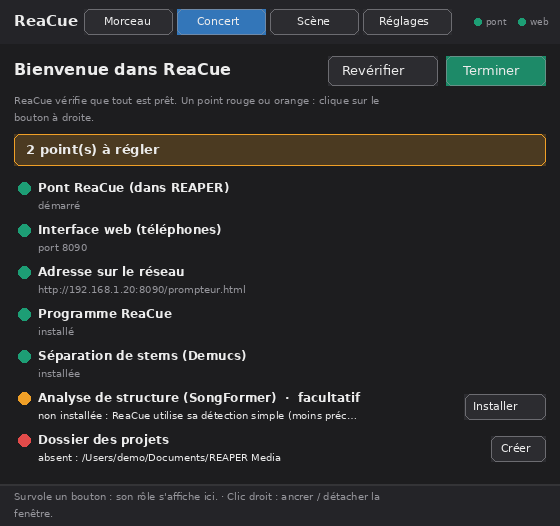
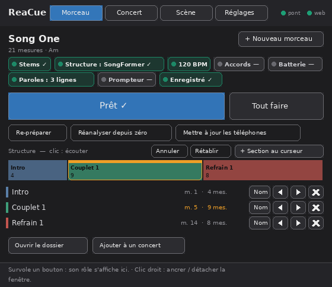
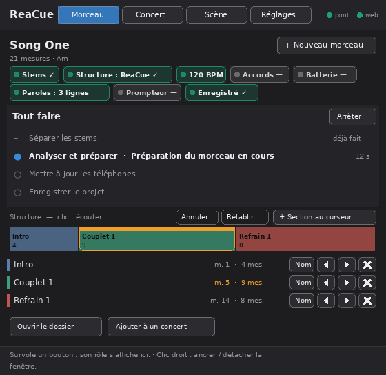
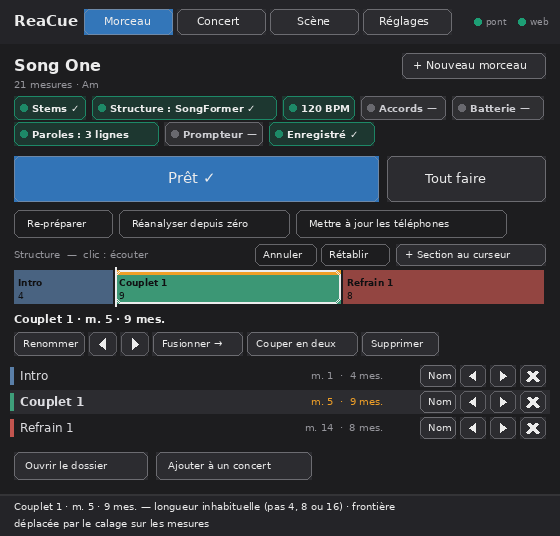
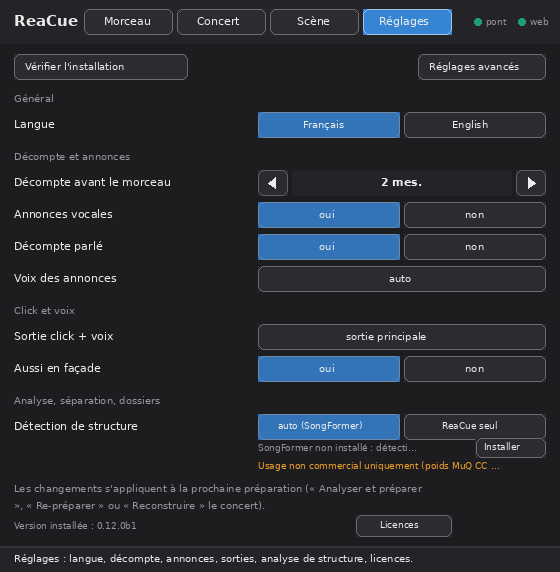
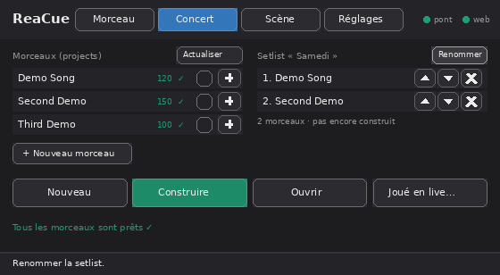
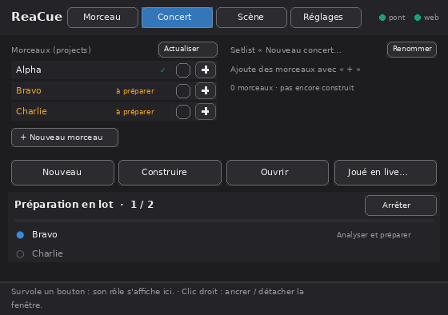
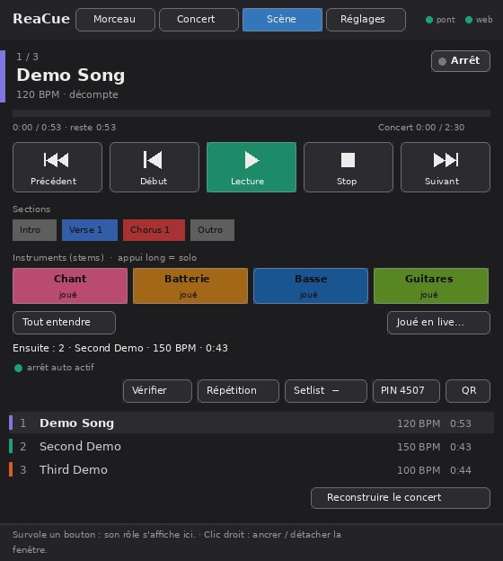
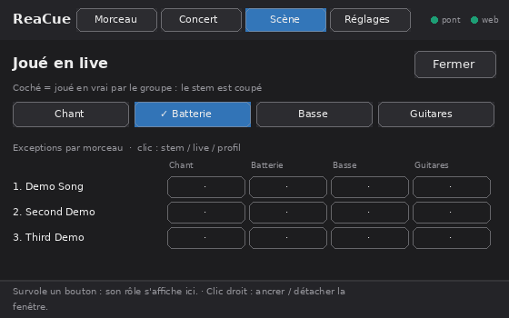

# Tutoriel ReaCue — pas à pas

*[English version: TUTORIAL_en.md](TUTORIAL_en.md)*

Ce tutoriel t'emmène de l'installation jusqu'à la répétition avec le groupe. Il suppose que tu sais lancer
REAPER et lire un morceau, rien de plus. Chaque étape dit **où cliquer**, **ce que tu dois voir** et **quoi
faire si ça ne marche pas**.

À la fin, pour chaque morceau, tu auras dans REAPER :

- une carte de tempo calée sur le morceau, des régions nommées et colorées (Intro, Couplet 1, Refrain…) ;
- une piste **CLICK** avec 2 mesures de décompte, une piste **VOIX** qui annonce « Refrain » avant chaque
  section et compte « one two three four » ;
- un **prompteur** sur le téléphone de chaque musicien : structure, accords, paroles, batterie.

Tout se fait depuis **une seule fenêtre, « ReaCue »**, en quatre onglets : **Morceau** (préparer un
morceau), **Concert** (composer et construire un concert, préparer plusieurs morceaux d'un coup), **Scène**
(jouer : transport, instruments, répétition, Régie) et **Réglages**.

**Le principe pour chaque morceau tient en deux clics** : **+ Nouveau morceau**, puis **Tout faire**. Un grand
bouton te donne toujours l'étape suivante, une ligne en bas de la fenêtre explique le bouton survolé, et une
erreur te dit quoi faire avec un bouton qui le fait.

Durée : 30 à 45 minutes la première fois (installation comprise), puis 5 à 10 minutes par morceau.

---

## Sommaire

1. [Ce qu'il te faut](#1-ce-quil-te-faut)
2. [Télécharger ReaCue](#2-télécharger-reacue)
3. [Préparer REAPER pour l'installation](#3-préparer-reaper-pour-linstallation)
4. [Lancer l'installateur](#4-lancer-linstallateur)
5. [Vérifier dans REAPER](#5-vérifier-dans-reaper)
6. [Activer l'interface web de REAPER (une seule fois)](#6-activer-linterface-web-de-reaper-une-seule-fois)
7. [Créer le projet d'un morceau](#7-créer-le-projet-dun-morceau)
8. [Importer l'audio : des stems ou un seul MP3](#8-importer-laudio--des-stems-ou-un-seul-mp3)
9. [Séparer un MP3 en stems](#9-séparer-un-mp3-en-stems)
10. [Préparer le morceau](#10-préparer-le-morceau)
11. [Vérifier la structure](#11-vérifier-la-structure)
12. [Ajouter les paroles](#12-ajouter-les-paroles)
13. [Ouvrir le prompteur sur les téléphones](#13-ouvrir-le-prompteur-sur-les-téléphones)
14. [Régler le click, les annonces et les in-ears](#14-régler-le-click-les-annonces-et-les-in-ears)
15. [Relier Claude Desktop (facultatif)](#15-relier-claude-desktop-facultatif)
16. [Mode concert : plusieurs morceaux dans un projet](#16-mode-concert--plusieurs-morceaux-dans-un-projet)
17. [En répétition](#17-en-répétition)
18. [Dépannage](#18-dépannage)
19. [Pense-bête : un nouveau morceau, un concert](#19-pense-bête--un-nouveau-morceau-un-concert)

---

## 1. Ce qu'il te faut

| Élément | Détail |
|---|---|
| Ordinateur | Mac (macOS 12 ou plus, Intel ou Apple Silicon) ou PC Windows 10/11 (Windows : version bêta) |
| REAPER | Version 7 ou plus récente, déjà installé ([reaper.fm](https://www.reaper.fm/)) |
| Espace disque | 1,5 Go pour ReaCue, + 1,5 Go si tu installes la séparation de stems |
| Internet | Seulement pendant l'installation |
| Audio | Les stems d'un morceau (un fichier par instrument), **ou** un seul MP3/WAV |
| Téléphones | Sur le **même Wi-Fi** que l'ordinateur, avec un navigateur (Safari, Chrome…) |

> Les stems donnent les meilleurs résultats. Si tu n'as que le MP3, ReaCue peut le séparer en stems sur
> ton ordinateur (étape 9).

---

## 2. Télécharger ReaCue

1. Sur la page GitHub du projet, clique sur le bouton vert **Code**, puis **Download ZIP**.
2. Ouvre le fichier ZIP téléchargé : un dossier `reacue-main` apparaît.
3. **Déplace ce dossier à son emplacement définitif**, par exemple dans *Documents*, et renomme-le `ReaCue`.

**Tu dois voir** dans le dossier `ReaCue` : `Install ReaCue.command`, `Install ReaCue.bat`,
`Install ReaCue Stems.command`, `Install ReaCue Stems.bat`, `README.md`, `LISEZMOI.md` et les dossiers
`reacue_mcp`, `reaper`, `install`, `docs`.

> ⚠️ Ne déplace plus ce dossier après l'installation. Si tu dois le déplacer, relance l'installateur depuis
> le nouvel emplacement.

---

## 3. Préparer REAPER pour l'installation

1. **Lance REAPER une fois**, puis **quitte-le** (macOS : *REAPER → Quit REAPER* ; Windows : *File → Quit*).

Pourquoi : au premier lancement, REAPER crée son dossier de réglages ; et l'installateur ne peut enregistrer
les actions ReaCue que si REAPER est **fermé**.

---

## 4. Lancer l'installateur

### Sur Mac

1. Dans le dossier `ReaCue`, **double-clique sur `Install ReaCue.command`**.
2. Si macOS affiche « impossible d'ouvrir … développeur non identifié » : clique sur **OK**, puis
   **clic droit** (ou Ctrl + clic) sur `Install ReaCue.command` → **Ouvrir** → **Ouvrir**.
   Sur les versions récentes de macOS, il peut falloir aller dans *Réglages Système → Confidentialité et
   sécurité*, tout en bas, et cliquer sur **Ouvrir quand même**.
3. Une fenêtre Terminal s'ouvre.

### Sur Windows

1. Dans le dossier `ReaCue`, **double-clique sur `Install ReaCue.bat`**.
2. Si Windows affiche « Windows a protégé votre ordinateur » (SmartScreen) : clique sur **Informations
   complémentaires**, puis **Exécuter quand même**.
3. Une fenêtre noire (console) s'ouvre.

### Les questions (Mac et Windows)

| Question | Quoi répondre |
|---|---|
| `Langue / Language [fr/en]` | `fr` puis Entrée |
| `Déclarer ReaCue dans Claude Desktop … ? [o/N]` | `n` si tu n'utilises pas Claude Desktop (tu pourras le faire plus tard) |
| `Installer la séparation de stems … ? [o/N]` | `o` si tu as des morceaux en MP3 seulement (environ 1 Go à télécharger, 5 à 15 minutes) ; sinon `n` |
| `Installer l'analyse de structure … ? [O/n]` | **Entrée** (= oui, proposé par défaut) : de meilleures sections avec SongFormer (IA, environ 3 Go à télécharger, 10 à 40 minutes, 8 Go de RAM conseillés, **usage non commercial**) ; `n` pour s'en passer |
| `Pour installer, tape exactement « J'accepte »` (après le résumé des licences) | Lis le résumé : les poids du modèle MuQ sont réservés à un **usage non commercial** (CC BY-NC 4.0). Si ça te convient, tape `J'accepte` puis Entrée ; sinon Entrée seule (rien n'est installé). Détails : [THIRD_PARTY_NOTICES.md](../THIRD_PARTY_NOTICES.md) |

**Tu dois voir** défiler 6 étapes (`== 1/6 Vérifications` … `== 6/6 Analyse de structure`) :

- à la fin de l'étape 4 : une ligne `Adresse(s) IP probable(s) de cet ordinateur : …` → **note cette
  adresse** (ex. `192.168.1.20`), elle servira pour les téléphones ; puis `Installation terminée. Redémarre
  REAPER…` (ReaCue est installé) ;
- à l'étape 5, si tu as répondu `o` : le téléchargement de PyTorch et Demucs, deux lignes `modèle … prêt`,
  deux lignes `vitesse … environ N min pour un morceau de 4 min`, puis `Séparation de stems installée` ;
- à l'étape 6 (sauf si tu as répondu `n`) : le résumé des licences et la demande « J'accepte », puis le
  téléchargement de SongFormer, MuQ et MusicFM, puis de PyTorch ; `modèle réutilisé : …` pour chaque modèle
  déjà présent sur l'ordinateur (par exemple dans `Documents/ReaCue-labo` ou le cache Hugging Face : il n'est
  pas retéléchargé), puis les modèles manquants (jusqu'à 2 Go), une ligne `vitesse : environ N min pour un morceau de 4 min`, `STRUCTURE_OK` et
  `Analyse de structure installée`.

Appuie sur Entrée pour fermer la fenêtre.

**Si ça ne marche pas :**

| Message | Solution |
|---|---|
| `dossier REAPER introuvable` | Lance REAPER une fois, quitte-le, relance l'installateur |
| `installation de uv impossible (internet ?)` | Vérifie la connexion internet, relance l'installateur |
| `REAPER est ouvert : les actions ne peuvent pas être enregistrées` | Pas grave : quitte REAPER et relance l'installateur, ou charge les actions à la main (étape 5) |
| `séparation de stems non installée` | Le reste de ReaCue marche. Réessaie plus tard avec `Install ReaCue Stems.command` / `.bat` |
| `analyse de structure non installée` | ReaCue garde sa propre détection. Réessaie plus tard avec `Install ReaCue Structure.command` / `.bat` (il reprend là où il s'est arrêté) |

> L'installateur peut être relancé autant de fois que tu veux : il répare l'installation et garde tes réglages.

---

## 5. Vérifier dans REAPER

1. Lance REAPER.
2. Menu **Actions → Show action list…**
3. Dans le champ **Filter** en haut, tape `ReaCue`.

**Tu dois voir** sept actions :

- `Custom: ReaCue` — **la fenêtre principale**, c'est celle dont tu te serviras tout le temps
- `Custom: ReaCue - Préparer le morceau`
- `Custom: ReaCue - Republier le prompteur`
- `Custom: ReaCue - Séparer les stems`
- `Custom: ReaCue - Concert` (la même fenêtre, ouverte sur l'onglet Scène)
- `Custom: ReaCue - Morceau suivant` et `Custom: ReaCue - Morceau précédent`

**Mets l'action « ReaCue » dans la barre d'outils.** Clic droit sur la barre d'outils principale (en haut à
gauche) → **Customize toolbar…** → **Add…** → filtre `ReaCue` → choisis **`ReaCue`** → **Select/close** →
**Save**. Un clic sur ce bouton ouvre la fenêtre ReaCue (un 2e clic la ferme).

**Au premier lancement**, la fenêtre ReaCue ouvre un **assistant** qui vérifie tout : pont, interface web
(port), adresse IP, programme ReaCue, séparation de stems, analyse de structure, dossier des projets. Chaque
point vert est prêt ; pour un point orange ou rouge, le bouton à droite le règle (*Démarrer*, *Préférences*,
*Installer*, *Créer*…). **Terminer** ferme l'assistant ; tu le retrouves dans *Réglages → Vérifier
l'installation*.

**La fenêtre ReaCue** s'ouvre toute seule sur le bon onglet : **Scène** si le projet est un concert,
**Morceau** si c'est un morceau, sinon le dernier utilisé. Clic droit dans la fenêtre : l'ancrer dans
REAPER ou la détacher (ancrée en bas, elle devient une barre de transport compacte). En haut à droite, deux
pastilles : **pont** (ReaCue répond dans REAPER) et **web** (prompteur disponible) — vertes quand tout va bien.
En bas, la **ligne d'aide** explique ce que fait l'élément sous la souris.

**Si les actions n'apparaissent pas** (REAPER était ouvert pendant l'installation) :

1. Dans la liste des actions, clique sur **New action… → Load ReaScript…**
2. Va dans le dossier des scripts : menu *Options → Show REAPER resource path in explorer/finder*, puis
   `Scripts` → `ReaCue`.
3. Choisis `ReaCue.lua` → **Ouvrir**. Recommence avec `ReaCue_Preparer.lua`, `ReaCue_Republier_prompteur.lua`,
   `ReaCue_Separer_stems.lua`, `ReaCue_Concert.lua`, `ReaCue_Morceau_suivant.lua` et `ReaCue_Morceau_precedent.lua`.

---

## 6. Activer l'interface web de REAPER (une seule fois)

Le prompteur des téléphones passe par le petit serveur web intégré à REAPER.

1. Mac : menu **REAPER → Settings…** ; Windows : menu **Options → Preferences…**
2. Dans la liste de gauche, tout en bas : **Control/OSC/web**.
3. Clique sur **Add**.
4. **Control surface mode** : choisis **Web browser interface**.
5. **Port** : `8080` (garde cette valeur si possible).
6. Laisse le reste tel quel, clique **OK**, puis **OK** pour fermer les préférences.

**Pour vérifier :** sur l'ordinateur, ouvre un navigateur à l'adresse `http://localhost:8080/` : une page
de REAPER doit s'afficher.

**Si ça ne marche pas :** un autre programme utilise peut-être le port 8080 → recommence avec `8081` (et
utilise ce port partout dans la suite). Sous Windows, si le pare-feu demande l'autorisation pour REAPER,
coche **Réseaux privés** et clique **Autoriser**.

---

## 7. Créer le projet d'un morceau

**Un projet REAPER par morceau.** ReaCue remplace les régions, le tempo et les pistes CLICK / CUES / VOIX à
chaque préparation : ne mets pas plusieurs morceaux dans le même projet.

### Le plus simple : « + Nouveau morceau »

1. Ouvre la fenêtre **ReaCue** (action **ReaCue**). Le bouton **+ Nouveau morceau** est en haut de l'onglet
   **Morceau** (et sous la liste des morceaux de l'onglet **Concert**).
2. Clique dessus et choisis :
   - **Un fichier (MP3, WAV…)** : choisis le fichier du morceau ;
   - **Des stems (un dossier)** : choisis **un des fichiers de stems** — tous les fichiers audio du même
     dossier sont pris (si l'extension *js_ReaScriptAPI* est installée, tu choisis directement le dossier).
3. ReaCue propose un **titre** déduit du nom (sans « -Bass- », la tonalité, le BPM, « Official Video »…) :
   corrige-le si besoin, **OK**. Si un morceau de ce titre existe déjà, ReaCue te demande un autre titre :
   rien n'est jamais écrasé.
4. ReaCue **copie** les fichiers dans `Documents/REAPER Media/<Titre>/` (la progression s'affiche dans
   l'onglet ; les noms des fichiers sont gardés), ouvre un **nouvel onglet de projet** (ton projet ouvert
   n'est pas touché), place **un fichier par piste** au début, et **enregistre** le projet
   `<Titre>/<Titre>.RPP`.

**Tu dois voir** l'onglet **Morceau** du nouveau projet avec le bandeau **« Morceau créé. Tout préparer
maintenant ? »** : clique **Tout faire** (étape 10) — ou **Plus tard**. Le grand bouton indique l'étape
suivante : **Séparer les stems** (un seul fichier, étape 9) ou **Analyser et préparer** (stems). Le morceau apparaît aussi
dans la liste de l'onglet **Concert** (en orange tant qu'il n'est pas préparé ; un clic sur son nom l'ouvre).

> Copier les fichiers évite le problème des fichiers « OFFLINE » laissés dans *Téléchargements* sur Mac.
> Après **Tout faire**, **Séparer les stems**, **Analyser et préparer** ou **Appliquer** réussis depuis la
> fenêtre, le projet du morceau est **enregistré automatiquement** (pastille « Enregistré ✓ ») : le concert retrouvera toujours ses
> sections et son tempo.

### Autre méthode (à la main)

1. Crée un dossier pour le morceau, par exemple `Documents/REAPER Media/Demo Song/`.
2. **Copie dedans les fichiers audio du morceau** (stems ou MP3).
   > ⚠️ Sur Mac, évite de laisser les fichiers dans *Téléchargements* : macOS peut empêcher REAPER de les
   > lire (l'item affiche alors « OFFLINE »).
3. Dans REAPER : **File → New project**.
4. **File → Save project as…**, choisis le dossier du morceau, nomme le projet (`Demo Song`), et coche
   **Copy all media into project directory** si l'option est proposée. **Save**.
5. Importe l'audio (étape 8).

---

## 8. Importer l'audio : des stems ou un seul MP3

*Inutile si tu as utilisé **+ Nouveau morceau** (étape 7) : lis seulement le tableau des noms de fichiers.*

### Cas A : tu as les stems

1. Sélectionne tous les fichiers de stems dans le Finder / l'Explorateur.
2. **Glisse-les ensemble** dans la zone des pistes de REAPER, tout au début (à gauche).
3. Si REAPER demande comment placer plusieurs fichiers, choisis **« One per track »** (un par piste).

**Tu dois voir** une piste par stem, tous les items commençant au même endroit.

Les noms de fichiers comptent : ReaCue reconnaît le rôle de chaque stem grâce à des mots dans le nom :

| Rôle | Mots reconnus dans le nom du fichier |
|---|---|
| Batterie | `drum`, `batterie`, `kick`, `perc` |
| Basse | `bass`, `basse` |
| Guitare | `guitar`, `guitare`, `gtr` (`lead` ou `solo` = guitare solo) |
| Chant | `vocal`, `voice`, `vox`, `chant`, `voix` |
| Autre | tout le reste (claviers…) |

> Bonus : la tonalité et le tempo dans le nom (ex. `Demo Song-A minor-112bpm-drums.wav`) améliorent les
> accords et évitent les erreurs de tempo double/moitié.

Passe directement à l'**étape 10**.

### Cas B : tu n'as qu'un MP3 (ou un WAV)

1. Glisse le fichier dans la zone des pistes de REAPER, tout au début.

Tu peux préparer directement le morceau (étape 10), mais avec moins de détails (pas de vue batterie, pas
d'entrées/sorties par instrument, accords et sections moins sûrs). **Mieux : sépare-le d'abord en stems
(étape 9).**

---

## 9. Séparer un MP3 en stems

*Nécessite la séparation de stems installée (réponse `o` à l'étape 4, ou `Install ReaCue Stems`).*

1. **Clique sur l'item du MP3** dans REAPER pour le sélectionner (il devient plus clair).
2. Dans la fenêtre **ReaCue**, onglet **Morceau**, clique le grand bouton **Séparer les stems** (ou lance
   l'action **ReaCue - Séparer les stems**). *Tout faire* (étape 10) le fait aussi, puis enchaîne la suite.
3. L'onglet affiche **« Séparation des stems : N % »** avec une barre de progression.
   - Compte **5 à 8 minutes pour un morceau de 4 minutes** sur un Mac Intel, moins sur un Mac récent.
   - Tu peux changer d'onglet et continuer à travailler : l'import se fera tout seul à la fin.
   - Ne ferme pas REAPER pendant la séparation.
4. À la fin, un message **« Stems importés »** s'affiche.

**Tu dois voir** six nouvelles pistes sous la piste d'origine : **Chant, Batterie, Basse, Guitare, Piano,
Autres**, calées exactement comme le MP3. L'item du MP3 a été retiré du projet (le fichier, lui, est toujours
sur le disque ; *Edit → Undo* le remet).

Les fichiers des stems sont rangés à côté du MP3, dans `<nom du morceau>-stems/htdemucs_6s/`. Si tu relances
l'action sur le même MP3, l'import est immédiat (pas de nouvelle séparation).

> Écoute les pistes en solo (bouton **S**) : voix, batterie et basse sont en général très propres ; guitare
> et piano peuvent garder un peu des autres instruments. C'est normal et suffisant pour ReaCue. Une piste
> presque vide (par exemple Piano dans un morceau sans clavier) n'est pas un problème.

**Si ça ne marche pas :**

| Message | Solution |
|---|---|
| « Sélectionne l'item audio du morceau » | Clique sur l'item du MP3, puis relance l'action |
| « Fichier audio introuvable… OFFLINE » | Le fichier n'est pas lisible : voir [Dépannage](#18-dépannage) |
| « La séparation de stems n'est pas installée » | Double-clic sur `Install ReaCue Stems.command` / `.bat` dans le dossier ReaCue |
| « La séparation a échoué » | Lis la fin du journal affichée ; le journal complet est `…-stems/demucs.log` |
| La progression reste longtemps à 0 % | Normal pendant la première minute (chargement du modèle) |

---

## 10. Préparer le morceau : « Tout faire »

1. Fenêtre **ReaCue**, onglet **Morceau** : clique **Tout faire** (à droite du grand bouton). Pas besoin de
   sélectionner quoi que ce soit.
2. Une liste montre les étapes et leur durée :

   | Étape | Ce qu'elle fait |
   |---|---|
   | Séparer les stems | seulement pour un MP3/WAV seul (« déjà fait » sinon) |
   | Analyser et préparer | tempo, mesures, **structure** (SongFormer s'il est installé), régions, click, annonces, prompteur |
   | Mettre à jour les téléphones | paroles, accords, batterie et structure pour le prompteur |
   | Enregistrer le projet | pour que le concert retrouve sections et tempo |

   **Arrêter** s'arrête après l'étape en cours. En cas d'échec, la cause et **que faire** s'affichent avec un
   bouton (par ex. *Démarrer le pont*) ; **Reprendre** repart de l'étape en échec.
3. À la fin : **« Morceau prêt ✓ »** (*Résumé* : tempo, mesures, structure, ce qui a été publié). **Fermer**.
   Le grand bouton indique maintenant **Prêt ✓** et les **pastilles** sont vertes : Stems ✓ · Structure :
   SongFormer ✓ · 120 BPM · Accords ✓ · Batterie ✓ · Paroles · Prompteur publié ✓ · Enregistré ✓.

Étape par étape, c'est pareil avec le grand bouton (**Séparer les stems** → **Analyser et préparer** → **Prêt
✓**) ; dessous : *Re-préparer* (refait tout en gardant ta structure), *Réanalyser depuis zéro* (tempo et
structure recalculés, tes corrections sont remplacées), *Mettre à jour les téléphones*. L'action **ReaCue -
Préparer le morceau** fait *Analyser et préparer*.

**Tu dois voir** dans le projet :

- des **régions** colorées en haut (Intro, Couplet 1, Refrain 1…) ;
- des marqueurs **« → Refrain »** avant chaque section ;
- trois nouvelles pistes : **CUES**, **VOIX**, **CLICK** ;
- l'audio décalé de 2 mesures pour laisser la place au décompte.

> **Avec SongFormer** (analyse de structure, installée par défaut) : la première préparation d'un morceau
> prend quelques minutes de plus ; la liste affiche **« Analyse de structure (SongFormer)… N s »**. Les
> préparations suivantes du même morceau sont immédiates (résultat mémorisé). Si SongFormer échoue, le
> message dit « Analyse SongFormer impossible : … → structure ReaCue utilisée » et la pastille indique
> **Structure : ReaCue**. Pour comparer : *Réglages* → *Détection de structure* → **ReaCue seul**, puis
> *Réanalyser depuis zéro*.

Appuie sur **Espace** : tu entends 2 mesures de click avec « one two three four », puis le morceau, le click
et les annonces.

**Si ça ne marche pas :** la fenêtre affiche la cause, que faire et un bouton. En résumé :

| Message | Solution |
|---|---|
| « Le pont ReaCue ne tourne pas dans REAPER » | Bouton **Démarrer le pont** ; sinon redémarre REAPER, ou relance l'installateur (REAPER fermé) |
| « Programme ReaCue introuvable » | Le dossier ReaCue a été déplacé : relance l'installateur depuis son nouvel emplacement |
| « Une préparation est déjà en cours » | Attends la fin de la précédente (1 minute max) |
| Le tempo est le double ou la moitié du vrai | Ajoute le tempo dans le nom des fichiers (ex. `-94bpm`) et *Réanalyser depuis zéro* |

---

## 11. Vérifier la structure

Lis la structure dans l'onglet **Morceau** : la **bande colorée** (une case par section, largeur
proportionnelle au nombre de mesures) et la liste dessous (première mesure, longueur). Les cases **orange**
sont **à vérifier** — survole-les, la ligne d'aide dit pourquoi :

- **longueur inhabituelle** : une section qui ne fait pas 4, 8 ou 16 mesures est souvent une erreur (deux
  sections collées, ou une section coupée en deux) ;
- **frontière déplacée par le calage** ou **entre deux mesures** : SongFormer hésitait sur le début.

Regarde aussi **les noms** (couplet et refrain inversés, pré-refrain collé au refrain) et la fin (une longue
« Outro » peut contenir un dernier refrain ou un solo).

Écoute : **clique sur une case** de la bande (ou sur un nom de la liste) — la section est choisie et la
lecture part de son début.

**Pour corriger, trois méthodes (tu peux les mélanger) :**

**Méthode 1 — dans l'onglet Morceau** (le plus simple)

Choisis une section (clic sur sa case) ; ses outils s'affichent sous la bande :

| Bouton | Effet |
|---|---|
| **Renommer** (ou **Nom** dans la liste) | renommer (« Pré-refrain », « Solo »…) |
| **◀** / **▶** | avancer / reculer le début d'**une mesure** (la fin de la section précédente suit) |
| **Fusionner →** | réunir la section avec la suivante |
| **Couper en deux** | couper la section au milieu (sur une mesure) ; tu nommes la 2e partie |
| **Supprimer** (ou **✕**) | supprimer (la section précédente s'allonge jusqu'à la suivante) |
| **+ Section au curseur** | ajouter une section qui commence à la mesure du curseur d'édition |
| **Annuler** / **Rétablir** | revenir en arrière / refaire, autant de fois que tu veux |

Le grand bouton devient **Appliquer les modifications** (et un bandeau « Structure modifiée » propose
**Appliquer**) : clique-le. Click, annonces, couleurs et prompteur suivent ; la pastille indique **Structure :
manuelle**.

**Méthode 2 — à la main dans REAPER, puis « Appliquer »**

1. Corrige les régions dans la barre des régions (en haut de la fenêtre) :
   - **renommer** ou **changer le début** : double-clique sur la région → change *Name* ou *Start* → **OK** ;
   - **déplacer le début** : tu peux aussi faire glisser le bord gauche de la région ;
   - **ajouter** : fais une sélection de temps (glisser dans la règle) qui commence au début de la nouvelle
     section, puis menu *Markers → Insert region from time selection* (raccourci par défaut Maj+R), et
     nomme-la ;
   - **supprimer** : clic droit sur la région → *Remove region*.
2. Clique **Appliquer les modifications** / **Re-préparer** dans l'onglet Morceau (ou lance **ReaCue - Préparer
   le morceau**).
3. La fenêtre de fin commence par **« Structure reprise de tes régions REAPER »**, avec le nouveau tableau.
   Les régions sont recolorées, et les marqueurs « → », les annonces, le click et le prompteur suivent.

Bon à savoir :

- seul le **début** de chaque région compte : une section dure jusqu'au début de la région suivante (pas
  besoin d'ajuster les fins) ;
- un début placé entre deux mesures est recalé sur la barre de mesure la plus proche (un avertissement le
  signale s'il était à plus d'un quart de mesure) ;
- le nom choisit la couleur et l'annonce : « Refrain 2 » ou « Chorus 2 » donne un refrain, « Solo » un solo… ;
- une région avant la mesure 1, après la fin du morceau ou sur la même mesure qu'une autre est ignorée
  (avertissement) ;
- si tu n'as rien changé, *Re-préparer* garde la structure enregistrée, comme avant ;
- *Mettre à jour les téléphones* ne reprend pas les régions modifiées : un avertissement te demande de
  cliquer *Appliquer*.

**Méthode 3 — avec Claude Desktop** (facultatif, voir [l'étape 15](#15-relier-claude-desktop-facultatif))

Dis simplement « le refrain 1 commence mesure 37 » ou « renomme la section 6 en Solo » : tout est
reconstruit (régions, click, annonces, prompteur). Ce que tu dis à Claude remplace les régions modifiées à
la main.

---

## 12. Ajouter les paroles

ReaCue ne télécharge jamais de paroles : **c'est toi qui fournis le texte**.

1. Ouvre un éditeur de texte :
   - Mac : **TextEdit**, puis menu **Format → Convertir au format texte** (important : texte brut) ;
   - Windows : **Bloc-notes**.
2. Écris (ou colle) les paroles : **une ligne = une phrase chantée**, une ligne vide entre les blocs
   (couplet, refrain…). Les lignes comme `[Refrain]` ou `Couplet 2 :` sont ignorées. `(x2)` en fin de ligne
   la répète.
3. Enregistre le fichier sous le nom **`paroles.txt`** (encodage **UTF-8**), **dans le dossier des stems**.
   Pour un MP3 séparé par ReaCue, tu peux le mettre **à côté du MP3 d'origine** (ou dans le dossier
   `…-stems/htdemucs_6s/`).
4. Onglet **Morceau** : la pastille affiche **Paroles : N lignes** (clic dessus, ou **Ouvrir le dossier**,
   pour retrouver l'emplacement). Clique **Mettre à jour les téléphones** (ou action **ReaCue - Republier
   le prompteur**) : rien n'est modifié dans le projet.

**Tu dois voir** dans le résultat : `Prompteur publié : … N lignes de paroles`. Sur le téléphone, en vue **Chant**, les lignes
défilent avec le morceau.

Les lignes sont calées automatiquement sur le stem de voix. Si une ligne tombe mal, tu peux la caler à la
main avec un fichier d'ancres `paroles_calage.json` (voir la section *Paroles* du LISEZMOI).

---

## 13. Ouvrir le prompteur sur les téléphones

1. Connecte le téléphone au **même Wi-Fi** que l'ordinateur.
2. Trouve l'adresse IP de l'ordinateur (si tu ne l'as pas notée à l'étape 4) :
   - Mac : *Réglages Système → Wi-Fi → Détails…* (à côté du réseau connecté) → **Adresse IP** ;
   - Windows : *Paramètres → Réseau et Internet → Wi-Fi → propriétés du réseau* → **Adresse IPv4**.
3. Sur le téléphone, ouvre le navigateur et tape : **`http://<adresse IP>:8080/prompteur.html`**
   (exemple : `http://192.168.1.20:8080/prompteur.html`). Attention : `http`, pas `https`.
4. Choisis ton rôle : **Batterie**, **Basse**, **Guitare rythm.**, **Guitare solo**, **Chant** ou **Général**
   (le choix est mémorisé sur ce téléphone ; le bouton **Rôle** permet d'en changer).
5. Lance la lecture dans REAPER : le prompteur suit la position (section, mesure, temps).

**Tu dois voir** un point vert (liaison avec REAPER active), la section en cours et la suivante.

Conseils :

- **Écran d'accueil** : iPhone : bouton *Partager → Sur l'écran d'accueil* ; Android : menu **⋮ → Ajouter à
  l'écran d'accueil**. La page s'ouvre alors en plein écran, comme une application.
- **Mise en veille** : touche le bouton **⛶** (plein écran), qui demande au téléphone de rester allumé. Si
  l'écran s'éteint quand même, désactive le verrouillage automatique pendant la répétition (iPhone :
  *Réglages → Luminosité et affichage → Verrouillage automatique → Jamais* ; Android : *Affichage → Mise en
  veille de l'écran*).
- **Adresse qui change** : la box peut donner une autre adresse IP à l'ordinateur d'un jour à l'autre, et les
  favoris des téléphones ne marchent plus. Dans l'interface de ta box ou de ton routeur, cherche
  **« Réservation DHCP »** (ou « bail statique », « IP fixe ») et réserve l'adresse actuelle pour
  l'ordinateur. En concert, un petit routeur de voyage dédié au groupe évite toute surprise.
- Le bouton **FR/EN** change la langue du prompteur sur ce téléphone.

---

## 14. Régler le click, les annonces et les in-ears

Fenêtre **ReaCue**, onglet **Réglages**. Chaque changement est enregistré tout de suite (« enregistré »
s'affiche) et **s'applique à la prochaine préparation** : clique **Re-préparer** dans l'onglet Morceau
(la structure validée est gardée), ou **Reconstruire le concert**. La vue est **simple** par défaut (langue,
décompte, annonces, voix, sorties, détection de structure, licences) ; **Réglages avancés** ajoute PIN,
annonce avant la section, langue / voix / débit du décompte, volumes, tempo, modèle de séparation et dossiers.

Exemples courants :

| Je veux… | Dans l'onglet Réglages | Clé du fichier |
|---|---|---|
| 1 seule mesure de décompte | *Décompte avant le morceau* : ◀ jusqu'à **1 mes.** | `"count_in_bars": 1` |
| Le décompte en français | *Décompte* : **un deux trois quatre** | `"count_lang": "fr"` |
| Pas d'annonces vocales, seulement le click | *Annonces vocales* : **non** | `"voice_cues": false` |
| Click plus fort | *Volume du click* : ▶ | `"click_volume": 0.8` |
| Click et voix seulement dans les in-ears (sorties 3/4), pas en façade | *Sortie click + voix* : **sorties 3/4**, *Aussi en façade* : **non** | `"click_hw_output": 2` et `"click_to_master": false` |
| Séparation en 4 stems au lieu de 6 | *Séparation de stems* : **4 stems** | `"stems_model": "htdemucs"` |
| Sections par ReaCue seul (sans SongFormer) | *Détection de structure* : **ReaCue seul** | `"structure_engine": "reacue"` |

L'onglet montre aussi la **version installée**. Les réglages sont dans le fichier **`reacue_settings.json`**
(dossier des ressources de REAPER, menu *Options → Show REAPER resource path in explorer/finder* → dossier
**`ReaCueMCP`**) : tu peux aussi l'éditer avec TextEdit ou le Bloc-notes, en respectant la syntaxe JSON.
Pour `click_hw_output` : `0` = sorties 1/2, `2` = sorties 3/4, `4` = sorties 5/6, etc.

Pour les voix des annonces (`announce_voice`), voir la section *Réglages* du LISEZMOI.

---

## 15. Relier Claude Desktop (facultatif)

Tout ReaCue marche sans Claude. Relier [Claude Desktop](https://claude.ai/download) permet en plus de
piloter ReaCue en français courant : corriger la structure, changer un réglage, naviguer dans le morceau.

**Prérequis**

- Claude Desktop installé sur **le même ordinateur** que REAPER, et connecté à ton compte Claude (un
  abonnement peut être nécessaire selon l'offre : vérifie les conditions actuelles sur claude.ai) ;
- ReaCue installé (étape 4) et REAPER ouvert, avec le pont qui tourne.

**Relier ReaCue à Claude Desktop**

1. Si tu as répondu `o` à la question « Déclarer ReaCue dans Claude Desktop » à l'étape 4, c'est déjà fait.
   Sinon, **relance l'installateur** (`Install ReaCue.command` / `.bat`) et réponds `o` à cette question.
   L'installateur ajoute le serveur `reacue` à la configuration de Claude Desktop (une copie de sauvegarde
   de l'ancienne configuration est gardée).
2. **Quitte complètement Claude Desktop** puis relance-le (Mac : menu *Claude → Quitter*, pas seulement
   fermer la fenêtre ; Windows : clic droit sur l'icône Claude près de l'horloge → *Quitter*, si elle y est).
3. **Ouvre une nouvelle conversation.**

**Vérifier que les outils ReaCue sont là**

Selon ta version de Claude Desktop, les outils des serveurs reliés se trouvent derrière une icône d'outils
ou un menu « connecteurs » / « outils » près de la zone de saisie. Tu dois y voir **reacue** avec ses outils
(`prepare_song`, `set_sections`, `reaper_status`…). Le plus simple pour tester : écris « vérifie que REAPER
répond ». Claude utilise `reaper_status` (il peut te demander l'autorisation la première fois) et doit
répondre que REAPER et le pont sont connectés.

**Exemples de phrases**

| Tu dis | Ce qui se passe |
|---|---|
| « Prépare le morceau ouvert dans REAPER » | Nouveau morceau : analyse complète. Morceau déjà préparé dont tu as modifié les régions : tes régions sont reprises. Morceau déjà préparé sans modification : **nouvelle analyse** (la structure validée est remplacée) — pour seulement reconstruire, utilise plutôt le bouton *Re-préparer* |
| « Le refrain 1 commence mesure 37 » | Structure corrigée, tout est reconstruit |
| « Renomme la section 6 en Solo » | Région renommée, recolorée, annonce changée |
| « Republie seulement le prompteur » | Prompteur mis à jour, rien ne change dans REAPER |
| « Va au refrain 2 » | Le curseur de REAPER se place au début de la région |
| « Une seule mesure de décompte » | Réglage changé, click et annonces reconstruits |

**Ce qui se met à jour tout seul** : après chaque demande de ce type, les régions, marqueurs, pistes CUES /
VOIX / CLICK dans REAPER et le prompteur des téléphones (qui relit ses données toutes les 2 secondes). Rien à
relancer.

**Si ça ne marche pas**

| Problème | Solution |
|---|---|
| reacue n'apparaît pas dans les outils | Relance l'installateur en répondant `o`, puis quitte complètement Claude Desktop et relance-le |
| Claude dit que REAPER ne répond pas | REAPER doit être ouvert ; redémarre-le pour relancer le pont ; une fenêtre restée ouverte dans REAPER bloque aussi le pont |
| Les nouveautés de ReaCue ne sont pas visibles | Les outils sont chargés au début d'une conversation : après une mise à jour de ReaCue, **ouvre une nouvelle conversation** (et relance Claude Desktop) |
| « le projet ouvert ne contient plus les pistes du dernier morceau » | Tu as changé de projet (ou consolidé) : demande « prépare le morceau ouvert » pour l'analyser |

---

## 16. Mode concert : plusieurs morceaux dans un projet

Pour un concert (ou une répétition générale), ReaCue enchaîne tes morceaux **déjà préparés** dans un seul
projet REAPER. Chaque morceau garde tout ce que tu as validé : stems, tempo, structure, annonces, click.

**Avant de commencer :** chaque morceau doit avoir été préparé (étape 10) **et son projet enregistré**
(**Cmd+S** / **Ctrl+S**). Un projet enregistré avant la préparation entre dans le concert sans sections.

### 16.1 Construire le concert

**Dans la fenêtre ReaCue, onglet Concert :**

1. À gauche, **Morceaux** : les projets trouvés dans `Documents/REAPER Media` (réglage *Dossier des
   projets*), avec leur tempo ; **✓** = préparé, *à préparer* en orange sinon. **Actualiser** relit le dossier.
2. Clique **+** sur chaque morceau, dans l'ordre du concert : ils s'ajoutent à droite, dans la **Setlist**.
   **▲ ▼** changent l'ordre, **✕** retire un morceau.
3. **Renommer** : donne un nom au concert (par ex. « Samedi 15 »).
4. **Construire**. Un morceau pas préparé est signalé avant (tu peux construire quand même). La construction
   prend quelques secondes ; le concert **s'ouvre tout seul dans un nouvel onglet** de REAPER.

**Plusieurs morceaux à préparer ?** Sous les boutons, **Préparer tous les morceaux non préparés** (ou coche
des morceaux dans la liste → **Préparer la sélection**). ReaCue les prépare **l'un après l'autre en
arrière-plan** : chaque projet est ouvert dans un onglet, *Tout faire*, enregistré, puis l'onglet est
refermé. La progression s'affiche (✓ prêt, ● en cours avec l'étape, ✗ échec avec la raison) ; **Arrêter**
s'arrête après le morceau en cours.

Depuis l'onglet **Morceau**, le bouton **Ajouter à un concert** ajoute le morceau ouvert à une setlist
(nouvelle ou existante) sans quitter le morceau.

En bas de l'onglet Concert, **Concerts existants** : **Modifier** recharge sa setlist dans l'éditeur,
**Ouvrir** l'ouvre dans un nouvel onglet. Après une modification, le bouton devient **Reconstruire**.

**Avec Claude Desktop** (étape 15) : écris par exemple

> Construis un concert « Samedi 15 » avec : Demo Song, Second Demo, Third Demo

Claude trouve les projets par leur nom dans `Documents/REAPER Media` (réglage `projects_dir`) et répond avec
le tableau du concert : début, tempo, mesures et sections de chaque morceau. Les avertissements (morceau sans
régions…) s'affichent dans sa réponse.

**Sans Claude** (ligne de commande, depuis le dossier `ReaCue`) :

- Mac : `.venv/bin/python -m reacue_mcp.cli concert --name "Samedi 15" --songs "Demo Song" "Second Demo"`
- Windows : `.venv\Scripts\python reacue_cli.py concert --name "Samedi 15" --songs "Demo Song" "Second Demo"`

**Tu dois voir** dans `Documents/REAPER Media/Concerts/` (réglage `concert_dir`) : `Samedi 15.RPP`,
`Samedi 15.setlist.json`, `Samedi 15.concert.lua` et `Samedi 15.prompteur.json`. Ne les modifie pas à la main.

La construction prend quelques secondes ; les accords, paroles et batterie du prompteur sont ensuite calculés
en arrière-plan (quelques minutes la première fois, puis c'est gardé).

### 16.2 Ouvrir le concert

1. Fenêtre **ReaCue**, onglet **Concert** → **Concerts existants** → **Ouvrir** à côté de **Samedi 15**
   (ou, juste après la construction, il est déjà ouvert).
2. Le concert s'ouvre dans un **nouvel onglet** (ton projet en cours reste ouvert dans le sien), et la
   fenêtre passe toute seule sur l'onglet **Scène**.

**Tu dois voir** une piste par instrument pour tout le concert (Chant, Batterie, Basse, Guitares…), une couleur
par morceau, les pistes CLICK / VOIX / CUES en bas, des régions « Demo Song · Refrain 1 », et en haut une
ligne **Morceaux** avec « 1 · Demo Song », « 2 · Second Demo »… L'onglet Scène affiche **1 / 3 · Demo Song**.

> Astuce : **clic droit dans la fenêtre** pour l'ancrer en bas de REAPER (elle devient une barre de transport
> compacte) ou la détacher.

### 16.3 Jouer

1. Appuie sur **Espace** (ou sur le gros bouton vert **Lecture** de la fenêtre) : décompte, puis le morceau.
2. À la fin du morceau, la lecture **s'arrête toute seule** et le curseur se place sur le décompte du suivant.
   La fenêtre affiche **2 / 3 · Second Demo**.
3. Quand le groupe est prêt : **Espace**.

L'onglet Scène montre la section en cours, « mesure x / N », le temps restant du morceau et du concert, et
le morceau suivant. Ses boutons :

| Bouton | Effet |
|---|---|
| **Précédent** | début du morceau en cours ; au début, morceau précédent |
| **Début** | revient au décompte du morceau en cours |
| **Lecture / Pause** | lance ou met en pause |
| **Stop** | arrête |
| **Suivant** | va au décompte du morceau suivant |
| Pastilles des **sections** | va au début de la section (la lecture continue) |
| **Setlist** | liste des morceaux : un clic = aller au morceau ; **Reconstruire le concert** |

Pendant la lecture, **Stop**, **Précédent**, **Suivant** et le changement de morceau demandent un **double
appui** : le premier appui affiche « encore ? » en orange, le second (dans les 2 secondes) exécute.

Pour une pédale ou un raccourci clavier : les actions **ReaCue - Morceau suivant** et **ReaCue - Morceau
précédent** (*Actions → Show action list* → sélectionne l'action → **Add…** dans *Shortcuts for selected action*).

> ⚠️ L'arrêt automatique, la télécommande et le profil des instruments ne marchent que si la fenêtre
> **ReaCue** est ouverte (n'importe quel onglet, même ancrée). Ne la ferme pas pendant le concert.

### 16.4 QR code pour les musiciens

1. Dans l'onglet Scène, clique sur **QR**.
2. Le QR code s'affiche en grand avec l'adresse en clair dessous (ex. `http://192.168.1.20:8080/prompteur.html`)
   et le code PIN de la Régie.
3. Chaque musicien, sur le **même Wi-Fi**, ouvre l'appareil photo de son téléphone, vise le QR code et touche
   le lien : le prompteur s'ouvre ; il choisit son rôle.
4. Clique sur **Fermer** (ou sur le QR, ou Échap) pour revenir.

L'adresse est recalculée à chaque clic : si l'ordinateur a changé d'adresse, le QR est quand même juste.
Si « Adresse IP de l'ordinateur introuvable » s'affiche : l'ordinateur n'est connecté à aucun réseau.

### 16.5 Piloter depuis un téléphone (Régie)

1. Sur le téléphone de la personne qui pilote : ouvre le prompteur (QR code), touche **Rôle** puis **Régie**.
2. Touche un bouton (par ex. **Lecture**) : le téléphone demande le **code PIN**. Il est affiché dans
   l'onglet Scène (bouton **PIN 1234**, et sous le QR code) et dans l'onglet Réglages. Tape-le, **OK**.
3. Le bouton s'entoure de vert quand REAPER a exécuté la commande.

La Régie offre Lecture/Pause, Stop, Précédent, Début, Suivant, la setlist, les sections et les
**instruments** (16.8), avec le même double appui pendant la lecture. Le PIN est mémorisé sur le téléphone ; **Changer de code** pour le retaper.
Pour changer le PIN : bouton **PIN** de l'onglet Scène (4 chiffres).

> ⚠️ Le PIN évite les fausses manipulations, **pas les attaques** : toute personne sur le même réseau peut
> piloter REAPER par son interface web. En concert, utilise un Wi-Fi réservé au groupe.

### 16.6 Modifier un morceau du concert

1. Ouvre **le projet du morceau** (pas le concert), corrige (structure, réglages…), **Appliquer** ou **Re-préparer** (enregistré tout seul).
2. Reviens dans le concert, onglet Scène → **Reconstruire le concert** → **OK** (ou onglet Concert →
   **Modifier** → **Reconstruire**).

Les modifications faites directement dans le projet concert sont **écrasées** par la reconstruction.

### 16.7 Vérifier avant de jouer

Avant la balance ou le concert, clique sur **Vérifier** dans l'onglet Scène.

1. Une liste s'affiche, avec un résumé en haut : **Tout est prêt ✓** (vert), **N point(s) à surveiller**
   (orange) ou **N problème(s)** (rouge).
2. Chaque ligne a une pastille et un détail court :

| Ligne | Ce qui est vérifié | Si ce n'est pas vert |
|---|---|---|
| Fichiers audio | chaque fichier du concert est lisible (pas « OFFLINE ») | **Corriger** remet les médias en ligne ; sinon voir Dépannage (OFFLINE) |
| Annonces vocales | les fichiers des annonces sont présents | **Corriger** reconstruit le concert |
| Morceaux préparés | chaque morceau a une structure et un tempo | prépare le morceau dans son projet, enregistre, reconstruis |
| Concert à jour | aucun projet de morceau n'a changé depuis la construction | **Corriger** reconstruit le concert |
| Pont ReaCue | REAPER répond à ReaCue | redémarre REAPER |
| Interface web | le prompteur est servi (port) | étape 6 |
| Adresse réseau | l'ordinateur a une adresse (pour le QR) | connecte-le au Wi-Fi du groupe |
| Carte son | REAPER joue sur une carte son | *Préférences → Audio → Device* |
| Sorties click et annonces | les sorties choisies pour CLICK / VOIX existent, pistes non coupées | branche la bonne carte son ou change `click_hw_output` (étape 14) |
| Prompteur des téléphones | la page et le concert sont publiés | **Corriger** les republie |
| Téléphones Régie | un téléphone en Régie a été vu récemment | (information seulement) |
| Stems coupés | les instruments coupés (profil « joué en live » ou à la main) | (information seulement) |

3. **Revérifier** relance la liste ; **Fermer** (ou Échap) revient à l'onglet Scène.

> Sans concert ouvert, **Vérifier** contrôle seulement la partie système (pont, interface web, adresse,
> carte son).

### 16.8 Instruments : couper un stem, « joué en live »

Sous les sections, l'onglet Scène a une rangée **Instruments (stems)** : un bouton par piste d'instrument du
concert (Chant, Batterie, Basse, Guitares, Guitare solo, Claviers, Autres, Mix — jamais CLICK, VOIX ni CUES).
Sous chaque nom : **joué** ou **coupé**.

| Geste | Effet |
|---|---|
| **Clic** | couper / remettre ce stem (pendant la lecture hors répétition : **double appui**) |
| **Appui long** | **solo** : on n'entend que lui (encore un appui long = retour) |
| **Tout entendre** | remet tous les stems (encore = retour au profil) |

Ces choix à la main durent jusqu'au morceau suivant.

**« Joué en live » : le profil du concert.** Si le groupe joue pour de vrai la batterie et la basse, leurs
stems doivent être coupés sur tout le concert. Clique **Joué en live…** :

1. Coche ce que le groupe joue en vrai (ex. **Batterie**, **Basse**) : ces stems seront coupés au début de
   chaque morceau.
2. **Exceptions par morceau** : clique sur une case pour la faire passer de **·** (profil) à **stem** (on
   garde le stem sur ce morceau) puis **live** (on le coupe sur ce morceau seulement). Exemple : le bassiste
   passe aux claviers sur un morceau → case Basse de ce morceau = **stem**.
3. **Fermer**.

Le profil est enregistré avec le concert (dans `Samedi 15.setlist.json`) et **gardé quand tu reconstruis**.
Il est aussi accessible dans l'onglet Concert (**Joué en live…**). La mesure de décompte de la répétition
n'écrase pas tes choix.

Sur les téléphones, chaque musicien voit en haut **« ton stem est coupé »** (orange) ou **« ton stem est
joué »** (vert). En **Régie**, les mêmes boutons : toucher = couper / remettre, appui long = solo, **Tout
entendre**.

Avec Claude : « dans le concert Samedi 15, la batterie et la basse sont jouées en live, sauf la basse sur
Second Demo » (outil `set_live_profile`, sans reconstruire).

---

## 17. En répétition

### 17.1 Le mode répétition du concert (boucle et ralenti)

Dans un concert ouvert, avec la fenêtre **ReaCue** (onglet **Scène**) :

1. Clique sur **Répétition** (ou, sur le téléphone en Régie, touche **Répétition**). Un bandeau orange
   **RÉPÉTITION** s'affiche ; l'arrêt automatique entre les morceaux est coupé.
2. **Boucler une section** : touche sa pastille (dans la fenêtre ou sur le téléphone). La lecture part
   **une mesure avant** la section : pendant cette mesure, on n'entend que le **click et les annonces**
   (« one two three four »), puis la section joue, et à la fin elle **recommence avec la même mesure de
   décompte**, sans fin.
3. **Boucler plusieurs sections** : touche une 2e section du même morceau (par ex. *Couplet 2* puis
   *Refrain 2*) : la boucle va du début de l'une à la fin de l'autre. Les sections bouclées sont soulignées en
   orange. Un 3e appui recommence une boucle simple.
4. **Ralentir** : boutons **100 %**, **90 %**, **80 %**, **70 %**. La hauteur ne change pas ; le click, les
   annonces et le prompteur suivent.
5. **Boucle off** arrête la boucle (la lecture continue). **Quitter** (dans la fenêtre) ou **Répétition ✓**
   (sur le téléphone) sort du mode : vitesse 100 %, arrêt automatique réactivé, réglages de REAPER remis
   comme avant.

> Pendant la mesure de décompte, les pistes des instruments sont coupées puis remises toutes seules. Si
> tu arrêtes la lecture pendant cette mesure, elles sont remises aussi.

### 17.2 Répéter un morceau seul (sans concert)

Ouvre le projet du morceau ; dans la fenêtre ReaCue, onglet **Scène** (« Morceau seul ») :

- **Début**, **Lecture**, **Stop** ; les musiciens entendent (ou voient sur le prompteur) le décompte, puis
  les annonces avant chaque section ;
- les **sections** en pastilles : un clic = y aller ;
- les **instruments** (couper, solo, tout entendre), comme en 16.8 ;
- **Répétition** : boucle sur une section ou une plage, avec la mesure de décompte avant chaque reprise et
  le ralenti, exactement comme en 17.1 ;
- la **Régie** sur téléphone marche aussi.

Il n'y a pas d'arrêt automatique ni de setlist (un seul morceau). Seul REAPER (et la fenêtre ReaCue pour la
boucle) doit tourner pendant la répétition : Claude n'est pas nécessaire.

---

## 18. Dépannage

| Symptôme | Cause probable | Solution |
|---|---|---|
| L'item affiche **OFFLINE** (Mac) | REAPER n'a pas le droit de lire le fichier, souvent dans *Téléchargements* | Copie le fichier dans le dossier du projet, puis glisse-le à nouveau dans REAPER (ou clic droit sur l'item → *Item properties…* → *Choose new file*). Autre solution : *Réglages Système → Confidentialité et sécurité → Fichiers et dossiers → REAPER*, active le dossier concerné, redémarre REAPER |
| « Le pont ReaCue ne tourne pas » | Le pont n'a pas démarré | Redémarre REAPER ; une fenêtre restée ouverte dans REAPER peut aussi le bloquer |
| Le prompteur affiche « REAPER ne répond pas » | Mauvais Wi-Fi, mauvaise adresse, interface web non activée, pare-feu | Vérifie l'étape 6 et l'étape 13 ; essaie `http://localhost:8080/` sur l'ordinateur |
| Les téléphones ne trouvent plus la page | L'adresse IP de l'ordinateur a changé | Nouvelle adresse (étape 13), puis réservation DHCP |
| Pas d'annonces vocales | Voix absente | Mac : *Réglages Système → Accessibilité → Contenu énoncé* ; Windows : *Paramètres → Heure et langue → Voix* |
| Séparation de stems très lente | Processeur occupé | Ferme les autres applications ; compte 1,5 à 2 fois la durée du morceau |
| Structure fausse | Détection automatique imparfaite | Étape 11 : bande de structure (cases orange), corrige puis *Appliquer*, ou demande à Claude ; tempo faux : tempo dans le nom des fichiers |
| Pastille « Structure : ReaCue » en orange | SongFormer n'est pas installé | Clic sur la pastille → installateur ; ou *Réglages → Vérifier l'installation* |
| Onglet Scène : « Aucun concert ni morceau ouvert » | L'onglet de projet en cours est vide | Onglet **Concert** → **Ouvrir** un concert, ou ouvre le projet d'un morceau |
| Un morceau du concert n'a pas de sections | Son projet a été enregistré avant la préparation | Ouvre son projet, *Tout faire*, puis *Reconstruire le concert* |
| Téléphone (Régie) : « Ouvre la fenêtre ReaCue… » | Fenêtre ReaCue fermée | Lance l'action **ReaCue** sur l'ordinateur |
| Régie : « Code PIN incorrect » | Mauvais code | Tape le code affiché par le bouton **PIN** de l'onglet Scène |
| La lecture ne s'arrête plus entre les morceaux | Fenêtre ReaCue fermée, ou mode répétition actif | Rouvre **ReaCue** (même ancrée en bas) ; sinon **Quitter** la répétition |
| Un stem reste coupé | Profil « joué en live » ou choix à la main | Onglet Scène : **Tout entendre**, ou **Joué en live…** pour changer le profil |
| **Vérifier** affiche du rouge | Voir la ligne concernée | Tableau de l'étape 16.7 ; **Corriger** quand le bouton est proposé |
| Après une répétition, des pistes restent muettes | REAPER fermé pendant la mesure de décompte | Enlève le mute des pistes (bouton **M**) ; la fenêtre les remet d'habitude toute seule |
| Journaux | — | Préparation et concert : `ReaCueMCP/cli.log` (dossier des ressources REAPER) ; séparation : `…-stems/demucs.log` à côté du morceau |

---

## 19. Pense-bête : un nouveau morceau, un concert

1. Fenêtre **ReaCue** → **+ Nouveau morceau** → un fichier **ou** un dossier de stems → titre → **OK**
   (copie dans `Documents/REAPER Media/<Titre>/`, nouvel onglet, projet enregistré).
2. **Tout faire** (stems si MP3 seul, structure, click, annonces, téléphones, enregistrement).
3. Vérifier la structure (cases orange de la bande, noms) ; au besoin **Renommer** / **◀ ▶** / **Fusionner** /
   **Couper** / **Supprimer** / **+ Section** (**Annuler** si besoin), puis **Appliquer**.
4. Facultatif : `paroles.txt` à côté des fichiers → **Mettre à jour les téléphones**.
5. Plusieurs morceaux : onglet **Concert** → **Préparer tous les morceaux non préparés**.
6. Téléphones : `http://<IP>:8080/prompteur.html`, choisir son rôle.

**Un concert :**

1. Chaque morceau préparé **et enregistré** dans son projet.
2. Onglet **Concert** : **+** sur chaque morceau, **Renommer**, **Construire** (ou Claude : « Construis un concert “Samedi” avec : … »).
3. Le concert s'ouvre dans un nouvel onglet ; la fenêtre passe sur **Scène**.
4. Facultatif : **Joué en live…** → cocher ce que le groupe joue en vrai.
5. **Vérifier** → tout doit être vert (sinon **Corriger**).
6. **QR** → les musiciens scannent ; la personne qui pilote choisit **Régie** et tape le PIN.
7. **Espace** à chaque morceau ; la lecture s'arrête toute seule à la fin de chacun.
8. En répétition : **Répétition**, puis une section pour la boucler (2e section = plage), vitesse au besoin.
